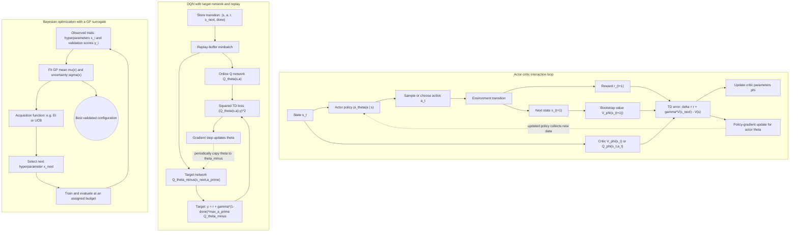

# Reinforcement Learning and Bayesian Tuning

D2L closes by connecting deep learning to decision making and automated model selection. Reinforcement learning studies agents that change their data through action and learn from delayed rewards. Gaussian processes model unknown functions with uncertainty. Hyperparameter optimization uses that uncertainty, or cheaper partial training runs, to decide which configuration to evaluate next.

The two areas share an exploration problem. An RL agent chooses actions inside an environment; a Bayesian optimizer chooses experiments in a search space. Both must trade current predictions against information that could improve later decisions.

## Discounted control in an MDP

A **Markov decision process** is a tuple $(\mathcal{S},\mathcal{A},P,R,\gamma)$ of states, actions, transition probabilities, rewards, and a discount factor. The Markov property states that the next-state distribution depends on the current state and action rather than the full history.

A policy $\pi(a \mid s)$ specifies action probabilities. Its state-value and action-value functions are

$$
V^\pi(s)=\mathbb{E}_\pi\left[\sum_{t=0}^{\infty}\gamma^t R_{t+1}\mid S_0=s\right]
$$

and

$$
Q^\pi(s,a)=\mathbb{E}_\pi\left[\sum_{t=0}^{\infty}\gamma^t R_{t+1}\mid S_0=s,A_0=a\right].
$$

For a fixed policy, the Bellman expectation equation is

$$
V^\pi(s)=
\sum_a \pi(a\mid s)
\sum_{s'}P(s'\mid s,a)
\left[R(s,a,s')+\gamma V^\pi(s')\right].
$$

Optimal control replaces the policy average with a maximizing action:

$$
V^*(s)=
\max_a
\sum_{s'}P(s'\mid s,a)
\left[R(s,a,s')+\gamma V^*(s')\right].
$$

The discount factor does more than express preference for early reward. If rewards satisfy $\vert R_t\vert \le R_{max}$ and $0\le\gamma\lt 1$, the infinite return is bounded by $R_{max}/(1-\gamma)$. The Bellman optimality operator is also a contraction in the maximum norm:

$$
\|\mathcal{T}V-\mathcal{T}U\|_\infty
\le\gamma\|V-U\|_\infty.
$$

Repeated value iteration therefore approaches a unique fixed point for a finite discounted MDP. Episodic undiscounted tasks can also be well defined when termination is guaranteed, but the contraction argument needs different assumptions.

### A delayed reward beats an immediate one

Suppose action $a_1$ gives reward $1$ and reaches a terminal state of value $0$, while $a_2$ gives reward $0$ and reaches a state of value $5$. With $\gamma=0.9$,

$$
Q(s,a_1)=1+0.9(0)=1
$$

and

$$
Q(s,a_2)=0+0.9(5)=4.5.
$$

Therefore

$$
V^*(s)=\max(1,4.5)=4.5,
$$

and $a_2$ is optimal despite its lower immediate reward.

The horizon encoded by discounting is gradual rather than sharp. A reward $k$ steps away is multiplied by $\gamma^k$. With $\gamma=0.9$, a reward ten steps away carries weight $0.9^{10}\approx0.349$; with $\gamma=0.99$, its weight is about $0.904$. Changing $\gamma$ can therefore change the problem being optimized, not merely the learning speed.

## Value learning, policy gradients, and unstable data

Deep RL uses neural networks to approximate values, policies, or environment models in large state spaces. Value-based methods learn action values and choose high-value actions, with an exploration mechanism added. Policy-gradient methods directly adjust policy parameters to increase expected return. Actor-critic methods learn both a policy and a value estimate.

Tabular Q-learning uses the temporal-difference target

$$
y_t=R_{t+1}+\gamma\max_{a'}Q(S_{t+1},a')
$$

and update

$$
Q(S_t,A_t)\leftarrow Q(S_t,A_t)
+\alpha\left[y_t-Q(S_t,A_t)\right].
$$

For a terminal transition, the continuation term is zero. Time-limit truncation is different: the environment stopped the rollout without necessarily entering a terminal state, so discarding the bootstrap value can bias learning. Modern environment APIs often report termination and truncation separately for that reason.

With a neural approximator, DQN minimizes a squared or robust TD error. A replay buffer breaks short-range temporal correlation and reuses experience; a delayed target network keeps the regression target from moving after every optimizer step. Neither device makes the samples independent or removes off-policy bias, but both reduce a damaging feedback loop between prediction and target.

An RL dataset is neither fixed nor independent: changing the policy changes the states and actions that will be observed. Exploration is needed because the currently best-looking action may only look best due to limited evidence. Function approximation, delayed credit, bootstrapping, replay, and off-policy distribution shift add further sources of instability.

For a differentiable stochastic policy, the policy-gradient theorem leads to an estimator of the form

$$
\nabla_\theta J(\theta)
=\mathbb{E}\left[
\nabla_\theta\log\pi_\theta(A_t\mid S_t)
\,\hat A_t
\right],
$$

where $\hat A_t$ estimates how much better the selected action was than the state's baseline. Subtracting a baseline that does not depend on the sampled action leaves the expected gradient unchanged while reducing variance. An actor-critic method trains the critic to supply that baseline or advantage estimate.

Exploration policies must be evaluated separately from deployed behavior. An $\varepsilon$-greedy value agent chooses a random action with probability $\varepsilon$, so returns collected during training include exploratory mistakes. Evaluation normally fixes the policy, disables training noise, and reports results over multiple environment seeds. Selecting a checkpoint from the same few evaluation episodes makes the reported estimate optimistic.

## A Gaussian process as a search surrogate

A **Gaussian process** is a distribution over functions such that every finite collection of function values has a multivariate Gaussian distribution. A mean function and kernel specify the prior:

$$
f(x) \sim \mathcal{GP}(m(x), k(x,x')).
$$

A common radial basis function kernel is

$$
k(x,x')=\sigma_f^2\exp\left(-\frac{\|x-x'\|^2}{2\ell^2}\right).
$$

For training inputs $X$, observations $y$, test inputs $X_*$, training kernel matrix $K$, cross-kernel $K_*$, and noise variance $\sigma_n^2$, the posterior mean is

$$
\mu_* = K_*^T(K+\sigma_n^2I)^{-1}y.
$$

GP regression also produces a predictive variance. Bayesian optimization uses the mean and uncertainty together: the mean supports exploitation of strong regions, while uncertainty assigns value to unexplored ones. The result depends on the kernel's smoothness assumptions, and a mismatched kernel can be overconfident or inefficient. Exact GP inference also scales cubically with the number of observations because of dense kernel-matrix factorization.

For a zero-mean GP, the posterior covariance at test inputs is

$$
\Sigma_*=K_{**}-K_*^T(K+\sigma_n^2I)^{-1}K_*.
$$

The first term is prior uncertainty; the second is the reduction supplied by observations. Predictive uncertainty is generally small near informative samples and grows away from them. Observation noise prevents the posterior from being forced through every measured value and also improves conditioning of the kernel matrix.

### Posterior mean from one observation

Take a zero-mean, noiseless GP with one observation $x=0$, $y=2$, and an RBF kernel with $\sigma_f^2=1$ and $\ell=1$. The training covariance is

$$
K=k(0,0)=1,
$$

while the cross-covariance at $x_*=1$ is

$$
k(0,1)=\exp\left(-\frac{(0-1)^2}{2}\right)=\exp(-0.5)\approx 0.607.
$$

Thus

$$
\mu_*=k(0,1)K^{-1}y\approx 0.607(2)=1.214.
$$

The influence of the observed value weakens with distance under the RBF kernel.

The variance in the same example is

$$
\begin{aligned}
\sigma_*^2
&=k(1,1)-k(0,1)K^{-1}k(0,1)\\
&=1-e^{-1}\\
&\approx0.632.
\end{aligned}
$$

At the observed location $x_*=0$, the noiseless posterior variance is zero. At $x_*=1$, the observation still reduces uncertainty, but it does not determine the function value.

## Turning uncertainty into the next experiment

An acquisition function is cheap to evaluate compared with training another model. For maximization, an upper confidence bound can be written

$$
a_{UCB}(x)=\mu(x)+\sqrt{\beta}\,\sigma(x).
$$

The mean term exploits predicted performance, while the standard-deviation term explores uncertain settings. The coefficient $\beta$ controls that balance. Expected improvement instead averages the positive amount by which a candidate would beat the current best under the predictive distribution.

Suppose candidate A has posterior mean $0.82$ and standard deviation $0.01$, while candidate B has mean $0.79$ and standard deviation $0.05$. With $\sqrt{\beta}=2$,

$$
a_{UCB}(A)=0.82+2(0.01)=0.84,
$$

$$
a_{UCB}(B)=0.79+2(0.05)=0.89.
$$

The optimizer evaluates B despite its lower predicted score because its uncertainty gives more upside. With $\sqrt{\beta}=0.5$, the scores become $0.825$ and $0.815$, and A is selected instead. The choice reflects a search policy, not a claim that B's model is already better.

Continuous variables can often be modeled after a log transform when orders of magnitude matter, as with learning rates. Integer depth and categorical optimizer choices need kernels or encodings suited to their structure. Treating category labels as ordinary numbers invents distances—for example, it would claim that one optimizer is “between” two others. Conditional spaces need equal care because momentum is irrelevant when the chosen optimizer has no momentum parameter.

## Three feedback loops



Actor-critic methods reuse a temporal-difference error to train a value estimate and guide policy improvement. DQN separates the online network from a delayed target and samples past transitions from replay. Bayesian optimization closes a slower loop over whole training trials rather than individual environment steps.

| Topic | Core object | Deep learning connection | Main caution |
|---|---|---|---|
| RL | Policy and value functions | Neural approximators for decisions | Exploration and instability |
| MDP | Transition and reward model | Formal environment interface | Markov assumption may be approximate |
| Gaussian process | Kernel distribution over functions | Surrogate uncertainty model | Cubic scaling with data count |
| Bayesian optimization | Acquisition over hyperparameters | Efficient model selection | Surrogate can be misleading |
| Successive halving | Budgeted trial ranking | Saves training compute | Early results may mis-rank late bloomers |

## Allocating a hyperparameter budget

Hyperparameters are configuration choices not learned directly by gradient descent: learning rate, dropout, batch size, depth, and weight decay are common examples. **Bayesian optimization** fits a surrogate to completed trials and maximizes an acquisition function such as expected improvement or upper confidence bound to select another trial.

**Multi-fidelity optimization** spends small budgets on many candidates and larger budgets on survivors. Successive halving repeatedly ranks configurations, discards a fraction, and expands the budgets of the rest. It saves compute when early learning curves predict final performance, but it favors fast starters when curves cross late.

Search results should include the search space, total trial count, per-trial budgets, selection metric, and random variation rather than only the winning configuration. Hundreds of adaptive validation trials consume more validation information than five trials, so a single lucky winner is weak evidence.

The test set must remain outside the optimization loop. Every hyperparameter choice made after looking at test performance leaks test information into training. Use training data for fitting, validation data for trial selection, then evaluate the selected procedure once on held-out test data. When stochastic training noise is large, rerun promising configurations with several seeds rather than letting the surrogate chase one lucky observation.

Successive halving begins with $n$ configurations at a small resource budget, retains roughly $n/\eta$ of them, and multiplies their budget by $\eta$. With $n=9$, $\eta=3$, and an initial budget of one epoch, one schedule evaluates nine models for one epoch, three survivors for three epochs, and one survivor for nine epochs. Its nominal work is $9+9+9=27$ epoch-units, compared with $81$ for training all nine for nine epochs. The comparison ignores overhead and assumes that early rankings contain useful signal.

Warm-starting survivors changes what “budget” means. If the three-epoch stage continues from the one-epoch checkpoint, the additional cost is two epochs per survivor rather than three; if every rung retrains from scratch, more compute is spent but comparisons may be easier to standardize. The experiment record should say which convention was used.

## Value iteration and a GP posterior in PyTorch

```python
import torch

def value_iteration(P, R, gamma=0.9, steps=20):
    # P[a, s, s_next], R[a, s, s_next]
    states = P.shape[1]
    V = torch.zeros(states)
    for _ in range(steps):
        q = (P * (R + gamma * V.reshape(1, 1, states))).sum(dim=2)
        V = q.max(dim=0).values
    return V

P = torch.tensor(
    [
        [[0.0, 1.0], [0.0, 1.0]],
        [[1.0, 0.0], [0.0, 1.0]],
    ]
)
R = torch.tensor(
    [
        [[0.0, 1.0], [0.0, 0.0]],
        [[0.5, 0.0], [0.0, 0.0]],
    ]
)
print("values:", value_iteration(P, R))

def rbf(x1, x2, lengthscale=1.0):
    sqdist = (x1[:, None] - x2[None, :]) ** 2
    return torch.exp(-0.5 * sqdist / lengthscale**2)

x_train = torch.tensor([0.0])
y_train = torch.tensor([2.0])
x_test = torch.tensor([1.0])
K = rbf(x_train, x_train) + 1e-6 * torch.eye(1)
K_s = rbf(x_train, x_test)
posterior_mean = K_s.T @ torch.linalg.solve(K, y_train)
print("GP posterior mean:", posterior_mean.item())
```

The first function assumes known finite transition and reward tensors; it is dynamic programming, not a learned deep-RL agent. The second calculation adds a small diagonal jitter before solving the kernel system, which improves numerical stability.

The value-iteration loop uses a fixed iteration count. A solver should also monitor the Bellman residual, such as `max(abs(V_next - V))`, and stop when it falls below a tolerance justified by $\gamma$. The GP calculation should use a linear solve or Cholesky factorization, as shown, rather than form a matrix inverse explicitly. When many test points share the same training set, reuse the factorization.

## Separate the three sources of randomness

RL results vary because of environment transitions, action sampling, and parameter optimization. One seed can influence all three, but reporting one seeded run still says little about the distribution of outcomes. Evaluation should aggregate complete episodes over several seeds and report both a central value and variation. For continuing tasks, a fixed evaluation horizon and a clearly defined return statistic are needed.

Training and evaluation environments should not share mutable state. Evaluation episodes must not enter the replay buffer unless the algorithm explicitly calls for that data, and normalization statistics should follow a stated policy. Otherwise an apparently read-only measurement changes the next training update.

On-policy methods estimate improvement for the policy that generated the current trajectories, so old data quickly becomes stale after updates. Off-policy methods can learn about one target policy from behavior generated by another, but large distribution mismatch raises variance or bias. Replay is therefore natural for DQN and less direct for an ordinary policy-gradient update. Importance ratios can correct some mismatch, yet unbounded ratios are themselves unstable.

## Hyperparameter optimization has two objective levels

The inner training objective updates weights on training batches. The outer optimization objective compares configurations by a validation metric. Those objectives may differ: training can minimize cross-entropy while selection maximizes calibrated accuracy or a cost-sensitive score. The outer objective must be computed consistently across trials, with the same preprocessing, evaluation mode, and resource accounting.

Some variables that look like hyperparameters are really parts of the data protocol. Changing augmentation, split construction, early-stopping patience, or class weighting changes what evidence a trial sees. They can be searched, but their ranges and selection effects belong in the experiment record alongside learning rate and depth.

A noisy objective should be represented as noisy. Replicate observations at the same configuration help estimate training variance; a GP with an unrealistically tiny noise term may chase random score differences. When training cost varies by configuration, an acquisition based only on expected score improvement can spend the whole budget on expensive candidates. Improvement per unit cost or an explicit resource constraint better matches the actual decision.

The selected configuration is only one output. The trial history can reveal insensitive dimensions, interactions, failed regions, and whether the winner sits on a search boundary. A boundary winner often calls for extending that range and repeating the search rather than declaring the boundary value intrinsically optimal.

<div className="see-also">

See also: [Reinforcement learning](/cs/reinforcement-learning/intro) · [Optimization algorithms](/cs/deep-learning/optimization-algorithms) · [Probability and random variables](/math/probability-and-random-variables/intro) · [Machine learning](/cs/machine-learning/intro) · [NLP pretraining and applications](/cs/deep-learning/nlp-pretraining-and-applications)

</div>
