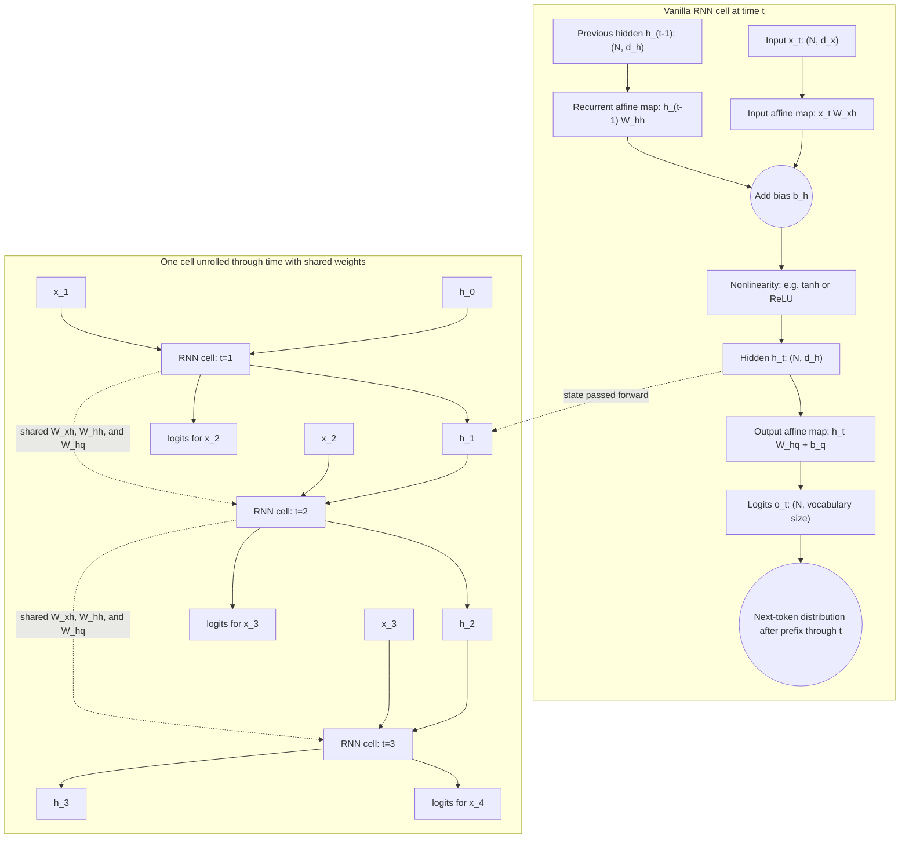

# Sequence Modeling and RNNs

Sequence modeling handles data whose order matters: text, time series, speech, click streams, and trajectories. D2L begins with autoregressive prediction and language modeling because they expose the central dependency: a prediction at time $t$ uses observations from earlier times. Recurrent neural networks represent that dependency by carrying a hidden state forward.

RNNs are no longer the default for large language models, but they introduce several durable ideas: shared parameters across time, truncated backpropagation, gradient clipping, teacher forcing, and the gap between parallel sequence training and one-step-at-a-time generation. These ideas recur in encoder-decoder models, transformers, and reinforcement learning.

## What the hidden state summarizes

A sequence is an ordered list $(x_1,\ldots,x_T)$. An autoregressive model predicts the next value from its prefix:

$$
P(x_t \mid x_{t-1},\ldots,x_1).
$$

For language, the chain rule gives an exact factorization of the sequence probability:

$$
P(x_1,\ldots,x_T)
= \prod_{t=1}^T P(x_t \mid x_1,\ldots,x_{t-1}).
$$

Representing the entire prefix explicitly is expensive. A basic RNN instead updates a learned summary,

$$
H_t = \phi(X_t W_{xh} + H_{t-1}W_{hh} + b_h),
$$

then reads out logits

$$
O_t = H_t W_{hq} + b_q.
$$

The same matrices are reused at every position.



The first subgraph expands one recurrent cell. The second shows parameter reuse across positions; the cells are time-indexed applications of one module, not separate layers with independent weights.

## Token units set the length and output space

Character vocabularies are small and avoid unknown words, but they produce long sequences. Word vocabularies shorten sequences and struggle with rare or unseen forms. Subword vocabularies trade between the two and dominate many modern NLP systems. D2L's character examples keep the mechanics easy to inspect because inputs can be one-hot and the output vocabulary stays small.

Time-series models use the same structure with real-valued inputs: lagged measurements, calendar features, or external covariates can replace token ids. One-step forecasts use observed history, while multi-step autoregressive rollout feeds predictions back as inputs and inherits the same compounding-error problem as text generation.

| Concept | Meaning in a sequence model | Modeling decision |
|---|---|---|
| Tokenization | Convert raw text to symbols | Character, word, or subword units |
| Vocabulary | Map symbols to integer ids | Include unknown and padding tokens as needed |
| Context | Information used for prediction | Fixed window or hidden state |
| Perplexity | Exponential average loss | Compare only under matched preprocessing |
| Hidden state | Learned summary of the past | Reset, detach, or carry between batches |
| Gradient clipping | Limit exploding gradients | Choose a clipping threshold |

## Training on chunks without mixing histories

**Backpropagation through time** differentiates through the unrolled recurrent graph. **Truncated BPTT** limits the number of time steps retained for gradient flow. Without truncation, carrying a state across an indefinitely long stream also carries its entire graph, so memory grows and gradients extend much farther than intended.

D2L contrasts random sampling with sequential partitioning. Independent or shuffled subsequences need fresh hidden states. Adjacent chunks from one stream may carry state to preserve continuity, but that state is detached at each truncation boundary. Carrying state while shuffling chunks silently connects unrelated histories and corrupts the sequence signal.

Repeated multiplication by the recurrent matrix can make gradients vanish or explode. GRUs and LSTMs add gates to preserve useful paths over longer spans. Gradient clipping addresses the exploding case by rescaling a gradient vector $g$ whose norm exceeds $\theta$:

$$
g \leftarrow \min\left(1,\frac{\theta}{\|g\|}\right)g.
$$

The hidden-state tensor returned by PyTorch recurrent modules is not batch-first even when the input is. Its shape is `(num_layers * directions, batch, hidden_size)`.

### Where vanishing gradients come from

The recurrence also explains its own optimization problem. Write a scalar loss at the final position as $L_T$. For two adjacent states, the chain rule gives

$$
\frac{\partial L_T}{\partial h_t}
=
\frac{\partial L_T}{\partial h_T}
\prod_{k=t+1}^{T}
\frac{\partial h_k}{\partial h_{k-1}}.
$$

For a tanh RNN,

$$
\frac{\partial h_k}{\partial h_{k-1}}
=
\operatorname{diag}\!\left(1-\tanh^2(z_k)\right)W_{hh}^{\mathsf T}.
$$

Each factor contains both the recurrent matrix and a derivative no larger than one in magnitude. If their typical singular values are below one, the product contracts exponentially with the distance $T-t$. Early states then receive almost no learning signal. Values above one can make the product grow exponentially instead. Saturated tanh units worsen contraction because their derivatives approach zero.

Clipping controls a large gradient after it has been computed; it does not restore a gradient that has already vanished. Gated cells attack the latter problem by creating additive state paths whose derivatives can remain near one. Truncation solves a separate resource problem: it deliberately cuts dependencies at chosen boundaries so that memory and update cost remain bounded.

There is also a useful distinction between **state length** and **gradient length**. A state may be carried through many consecutive chunks, letting predictions depend on the remote past, while detachment restricts credit assignment to the current chunk. The model can use old information, but a loss cannot teach the state transition that produced it before the boundary.

### Loss accounting across time

For next-token prediction, every input position usually contributes a cross-entropy term. Given target tokens $y_1,\ldots,y_m$ and predicted distributions $p_1,\ldots,p_m$,

$$
L=-\frac{1}{m}\sum_{t=1}^{m}\log p_t(y_t).
$$

Padding positions must be excluded from both the numerator and the count $m$. Otherwise a batch containing more padding can report a different average even if its real-token predictions are unchanged. Framework loss functions often support an ignored target index for this reason.

When batches have different numbers of valid tokens, averaging their already-averaged losses gives each batch equal weight rather than each token equal weight. Corpus loss should instead accumulate the summed negative log-likelihood and divide once by the total number of valid targets. Perplexity is then the exponential of that corpus-level average.

## Reading perplexity correctly

For average negative log-likelihood $\bar{\ell}$,

$$
\mathrm{perplexity} = \exp(\bar{\ell}).
$$

A value of $1$ means perfect next-token prediction. A value near the vocabulary size resembles uniform guessing over that vocabulary. Different token units, vocabularies, casing rules, and filters change the prediction problem, so their perplexities are not directly comparable.

Suppose a model assigns probabilities $0.5$, $0.25$, and $0.125$ to the correct next tokens. Their joint likelihood is

$$
P = 0.5 \cdot 0.25 \cdot 0.125 = 0.015625 = \frac{1}{64}.
$$

The average negative log-likelihood is

$$
\bar{\ell} = \frac{-\log P}{3}=\frac{\log 64}{3}=\log 4,
$$

and the perplexity is

$$
\exp(\bar{\ell})=4.
$$

The model has the same average uncertainty as a uniform choice among four options at each step.

## One recurrent update by hand

Let

$$
x_t =
\begin{bmatrix}
1 & 2
\end{bmatrix},
\quad
h_{t-1} =
\begin{bmatrix}
0 & 1
\end{bmatrix},
$$

$$
W_{xh} =
\begin{bmatrix}
1 & 0 \\
0 & 1
\end{bmatrix},
\quad
W_{hh} =
\begin{bmatrix}
1 & -1 \\
2 & 0
\end{bmatrix},
\quad
b_h =
\begin{bmatrix}
-1 & 1
\end{bmatrix}.
$$

The input path gives

$$
x_tW_{xh}=\begin{bmatrix}1&2\end{bmatrix},
$$

and the recurrent path gives

$$
h_{t-1}W_{hh}
=
\begin{bmatrix}0&1\end{bmatrix}
\begin{bmatrix}1&-1\\2&0\end{bmatrix}
=
\begin{bmatrix}2&0\end{bmatrix}.
$$

After adding the bias,

$$
z_t=
\begin{bmatrix}1&2\end{bmatrix}
+\begin{bmatrix}2&0\end{bmatrix}
+\begin{bmatrix}-1&1\end{bmatrix}
=\begin{bmatrix}2&3\end{bmatrix}.
$$

ReLU leaves both positive coordinates unchanged, so $h_t=[2,3]$.

## Two steps expose parameter sharing

Continue the calculation with the same matrices, set $x_{t+1}=[0,1]$, and keep ReLU. The input contribution becomes

$$
x_{t+1}W_{xh}=
\begin{bmatrix}0&1\end{bmatrix}.
$$

The recurrent contribution now uses the state just computed:

$$
h_tW_{hh}
=
\begin{bmatrix}2&3\end{bmatrix}
\begin{bmatrix}1&-1\\2&0\end{bmatrix}
=
\begin{bmatrix}8&-2\end{bmatrix}.
$$

Adding the unchanged bias gives

$$
z_{t+1}
=
\begin{bmatrix}0&1\end{bmatrix}
+\begin{bmatrix}8&-2\end{bmatrix}
+\begin{bmatrix}-1&1\end{bmatrix}
=
\begin{bmatrix}7&0\end{bmatrix},
$$

so $h_{t+1}=[7,0]$. No new time-specific matrix appeared. The same $W_{xh}$ interprets the new input, and the same $W_{hh}$ transforms a different incoming state. Sharing keeps the parameter count independent of sequence length and allows one learned transition rule to process sequences longer than those seen during training.

The example also shows why a hidden coordinate should not be read as a fixed human concept. Its value depends on the current input, the accumulated state, the nonlinearity, and the learned coordinate system. Interpretability claims based on one activation need stronger evidence than a single large number.

## Generation runs on the model's own history

Teacher-forced training supplies the correct previous token at each step. Generation instead feeds the model's prediction back as the next input, allowing early mistakes to alter every later conditional distribution.

Greedy decoding always selects the most probable token and can become repetitive. Random sampling preserves diversity but becomes incoherent if the distribution is too flat. Temperature changes the sharpness of the sampling distribution without changing the trained RNN. Generated samples therefore depend on both the language model and the decoding rule.

Evaluation code must reproduce this autoregressive loop. Feeding known future tokens during generation measures teacher-forced prediction, not free-running sequence generation.

Consider a two-step rollout with vocabulary `A`, `B`, `C`. After a true prefix, suppose the model assigns $(0.6,0.3,0.1)$ and greedy decoding chooses `A`. Conditioned on `A`, its next distribution is $(0.2,0.7,0.1)$, so it emits `B`. The generated continuation is `AB`, with model probability

$$
0.6\times 0.7=0.42.
$$

If the correct first continuation had instead been `B`, teacher-forced evaluation would use the distribution conditioned on `B`; assume that distribution assigns probability $0.8$ to `C`. The teacher-forced path can therefore score the second target highly even though free-running greedy decoding never reaches that prefix. Token-level accuracy and generated quality answer different questions.

Temperature $\tau$ rescales logits before softmax:

$$
p_i(\tau)=\frac{\exp(o_i/\tau)}{\sum_j\exp(o_j/\tau)}.
$$

As $\tau$ approaches zero, the largest logit dominates and sampling approaches greedy decoding. A larger temperature flattens the distribution. It cannot repair incorrect rankings learned by the model; it only changes how readily lower-ranked tokens are selected.

## Sequence shape depends on the task

Next-token language modeling is a many-to-many problem: each input position supplies a prediction for the following token. Other RNN uses place the readout differently. A many-to-one classifier may consume an entire review and classify only its final state. A sequence tagger predicts one label per input token. An encoder-decoder first reads a source sequence and then produces a target sequence whose length can differ.

Using only the final state for classification creates a narrow path from early inputs to the loss. Pooling all recurrent outputs, adding attention, or using a bidirectional RNN can shorten that path. Bidirectionality is suitable when the entire input is available, such as tagging a completed sentence. It is invalid for a causal forecast that must not read future observations.

Variable-length batches normally pad shorter sequences to a common length. The model must know which positions are real. A loss mask excludes padded targets; packing utilities can also skip recurrent computation on padding. If a final hidden state is taken from the rectangular padded tensor without lengths, it may summarize several padding steps rather than the last real token.

Sequence boundaries matter as much as padding. A hidden state carried from the final sentence of one document into an unrelated document lets the second prediction depend on artificial history. Reset at genuine independence boundaries. Carry state across adjacent pieces only when the stream semantics justify it.

### Turning one stream into training pairs

Take the character stream `ABCDE` and a time window of three. The first input is `ABC` and its aligned targets are `BCD`: position `A` predicts `B`, `B` predicts `C`, and `C` predicts `D`. Sliding once gives input `BCD` with targets `CDE`.

These windows overlap heavily. Randomly placing both in one minibatch is valid if each starts with a fresh state. It is not valid to pass the ending state of `ABC` into the independently sampled `BCD` merely because their text happens to overlap; that state already contains a particular computation of the prefix and changes the effective example.

With sequential partitioning, one batch row might receive `ABC`, then the following chunk `DEF`. The ending state from `ABC` can initialize `DEF`, preserving forward context. Detaching that state at the boundary says that the `DEF` loss may use the summary but may not backpropagate into the earlier chunk. For batch size greater than one, every row must continue its own stream rather than inheriting a neighbor's state.

Shifting targets by one produces one fewer usable token unless a later token is available. For a tensor `tokens` of shape `(batch, time + 1)`, inputs are `tokens[:, :-1]` and targets are `tokens[:, 1:]`; both then have shape `(batch, time)`. Flattening for cross-entropy must preserve the same row-major order for logits and targets.

## What the recurrence can and cannot remember

A hidden vector has fixed width regardless of prefix length. It can encode useful sufficient information for a task, but it cannot losslessly retain an arbitrarily long, high-entropy history in finite precision. Training also favors information that helps the objective, not every detail a human might later ask about.

Vanilla RNNs combine the previous state and current input through one affine map and nonlinearity. The update overwrites all coordinates together. LSTM and GRU gates give the model learned paths for retaining, exposing, or replacing state, which improves long-range optimization but does not guarantee permanent memory.

RNN inference has constant state size and can process one new element without revisiting the full prefix. Its recurrence is inherently sequential across time, however, so training cannot parallelize positions as freely as a transformer. Transformers trade that recurrence for attention over stored context; efficient state-space and recurrent variants explore other points in the same memory, computation, and parallelism tradeoff.

For time series, stationarity assumptions deserve attention. Carrying a state forever can preserve obsolete regimes after a sensor replacement or policy change. Reset rules, covariates that mark regime boundaries, and evaluation on later time periods often matter more than adding hidden units.

## A character-level training step in PyTorch

```python
import torch
from torch import nn

torch.manual_seed(3)

vocab_size = 20
batch_size = 4
time_steps = 6
hidden_size = 16

tokens = torch.randint(0, vocab_size, (batch_size, time_steps))
inputs = tokens[:, :-1]
targets = tokens[:, 1:]

model = nn.RNN(input_size=vocab_size, hidden_size=hidden_size, batch_first=True)
classifier = nn.Linear(hidden_size, vocab_size)
loss_fn = nn.CrossEntropyLoss()

one_hot = torch.nn.functional.one_hot(inputs, num_classes=vocab_size).float()
states, h_last = model(one_hot)
logits = classifier(states)

loss = loss_fn(logits.reshape(-1, vocab_size), targets.reshape(-1))
loss.backward()

torch.nn.utils.clip_grad_norm_(
    list(model.parameters()) + list(classifier.parameters()),
    max_norm=1.0,
)
print("loss:", loss.item())
print("last hidden shape:", h_last.shape)
```

`nn.RNN` expects feature vectors, not integer class indices, so this example one-hot encodes each token. An embedding layer is the usual alternative when the vocabulary is large.

<div className="see-also">

See also: [Gated RNNs and sequence-to-sequence](/cs/deep-learning/gated-rnns-seq2seq) · [Attention and transformers](/cs/deep-learning/attention-transformers) · [Natural language processing](/cs/nlp/intro) · [Probability and random variables](/math/probability-and-random-variables/intro) · [Reinforcement learning](/cs/reinforcement-learning/intro)

</div>
