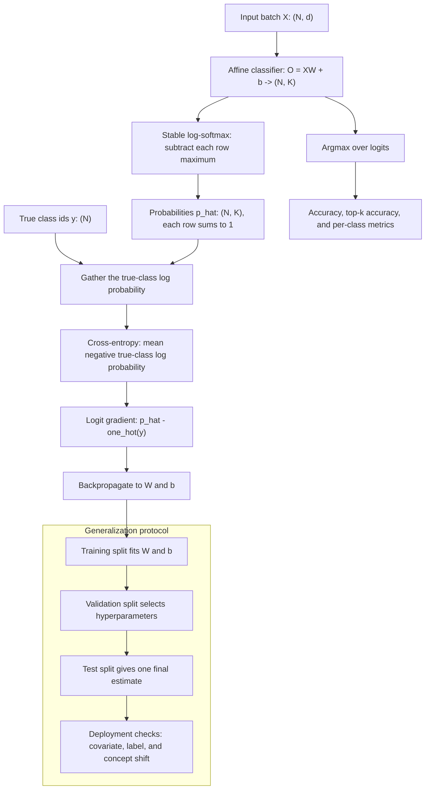

# Softmax Classification and Generalization

Classification changes the target from a real number to a discrete class. D2L introduces softmax regression as the linear neural network for this setting: one affine transformation produces class scores, and softmax interprets their relative values as probabilities. It is the baseline for mutually exclusive labels in images, text, and tabular data.

Training accuracy is only an optimization diagnostic. The actual goal is performance on future data from the intended environment, where cross-entropy, accuracy, class imbalance, calibration, and distribution shift can give different accounts of the same classifier.

## From logits to normalized probabilities

For $K$ classes, the model produces unconstrained **logits** $o \in \mathbb{R}^K$. Softmax maps them to probabilities:

$$
\hat{y}_k =
\frac{\exp(o_k)}{\sum_{j=1}^K \exp(o_j)}.
$$

The outputs are nonnegative and sum to $1$. Because softmax preserves order,

$$
\arg\max_k \hat{y}_k = \arg\max_k o_k.
$$

Softmax is also invariant to a common shift of all logits:

$$
\mathrm{softmax}(o)_k =
\mathrm{softmax}(o-c\mathbf{1})_k.
$$

Choosing $c=\max_j o_j$ avoids overflow during exponentiation. PyTorch's `nn.CrossEntropyLoss` performs a stable log-softmax internally and therefore expects raw logits, not precomputed probabilities.

Softmax regression remains a linear classifier. For $x \in \mathbb{R}^d$, $W \in \mathbb{R}^{d \times K}$, and $b \in \mathbb{R}^K$,

$$
o=W^Tx+b.
$$

Class boundaries occur where two logits are equal,

$$
w_a^Tx+b_a=w_b^Tx+b_b,
$$

so they are linear in the input space.

Only logit differences affect the probabilities. Adding the same vector $a$ to every class weight and the same scalar $c$ to every class bias changes all logits by $a^Tx+c$, which softmax cancels. The parameters are therefore not identifiable without an extra convention or regularization. One may choose a reference class with zero weights, although neural-network libraries usually keep all $K$ columns because the symmetric form is convenient.

For two classes, softmax reduces to the logistic sigmoid. Let the logits be $o_0$ and $o_1$. Then

$$
P(y=1\mid x)
=\frac{e^{o_1}}{e^{o_0}+e^{o_1}}
=\frac{1}{1+e^{-(o_1-o_0)}}.
$$

The model depends on one affine difference, $(w_1-w_0)^Tx+(b_1-b_0)$. Binary logistic regression and two-class softmax regression describe the same family of conditional probabilities, though their parameterizations differ.

## Why cross-entropy gives a useful gradient

For one-hot target $y \in \{0,1\}^K$, cross-entropy is

$$
\ell(y,\hat{y})=-\sum_{k=1}^K y_k\log\hat{y}_k.
$$

If the true class is $c$, only $-\log\hat{y}_c$ remains. Differentiating the combined softmax and cross-entropy gives

$$
\frac{\partial\ell}{\partial o_k}=\hat{y}_k-y_k.
$$

Gradient descent raises the true-class logit and lowers competing logits. Unlike accuracy, the loss continues to distinguish a barely correct prediction from a confident correct one.

Cross-entropy also has an information-theoretic reading: it is the expected code length obtained by encoding labels from the data distribution with the model distribution. KL divergence measures the extra expected length incurred by using the wrong distribution. Classification loss is therefore a probability-modeling objective as well as a route to an argmax decision.

The same loss follows from maximum likelihood. If examples are conditionally independent given their features, the likelihood of parameters $W,b$ is

$$
\mathcal{L}(W,b)
=\prod_{i=1}^{n}P(y_i\mid x_i;W,b).
$$

Products of many probabilities underflow and are awkward to optimize, so take the negative logarithm:

$$
-\log\mathcal{L}(W,b)
=-\sum_{i=1}^{n}\log P(y_i\mid x_i;W,b).
$$

Dividing by $n$ gives the mean cross-entropy. It has the same optimizer as the summed loss, but the scale no longer grows with batch size. If observations receive importance weights, the objective changes to a weighted log-likelihood; the denominator used for reporting must then be stated.

### Cross-entropy for three logits

Let $o=[2,1,0]$ and take class $0$ as the target. The exponentials are approximately

$$
e^2=7.389,\qquad e^1=2.718,\qquad e^0=1,
$$

with sum $Z=11.107$. The probabilities are

$$
\hat{y}
\approx [0.665,0.245,0.090].
$$

The loss is

$$
\ell=-\log(0.665)\approx0.408,
$$

and the logit gradient is

$$
\nabla_o\ell
=\hat{y}-y
=[0.665,0.245,0.090]-[1,0,0]
=[-0.335,0.245,0.090].
$$

For a feature vector $x=[3,-1]^T$, the gradient of a class weight column is $x(\hat y_k-y_k)$. The three columns are therefore

$$
\begin{aligned}
\frac{\partial\ell}{\partial w_0}
&=[3,-1]^T(-0.335)=[-1.005,0.335]^T,\\
\frac{\partial\ell}{\partial w_1}
&=[3,-1]^T(0.245)=[0.735,-0.245]^T,\\
\frac{\partial\ell}{\partial w_2}
&=[3,-1]^T(0.090)=[0.270,-0.090]^T.
\end{aligned}
$$

Their sum is zero, matching shift invariance: a common movement of every class column cannot improve the loss. With learning rate $0.1$, gradient descent adds approximately $[0.1005,-0.0335]^T$ to $w_0$ and subtracts the corresponding positive-class updates from the competitors.

## Drawing a decision region by hand

Take a two-dimensional, three-class model with

$$
W=
\begin{bmatrix}
1&0&-1\\
0&1&-1
\end{bmatrix},
\qquad b=\begin{bmatrix}0&0&1\end{bmatrix}.
$$

For $x=[2,1]^T$, the logits are

$$
o=W^Tx+b=[2,1,-2]^T+[0,0,1]^T=[2,1,-1]^T,
$$

so class $0$ wins. Its boundary with class $1$ satisfies $x_1=x_2$. Its boundary with class $2$ satisfies

$$
x_1=-x_1-x_2+1,
$$

or $2x_1+x_2=1$. All pairwise boundaries are lines, but the region assigned to a class is the intersection of the half-planes where its score beats every competitor. A class can even have an empty decision region if its affine score never reaches the upper envelope.

Applying softmax to $[2,1,-1]$ gives

$$
\hat y
=\frac{1}{e^2+e+e^{-1}}[e^2,e,e^{-1}]
\approx[0.705,0.259,0.035].
$$

The final probability is about $0.035$, not zero. Softmax assigns positive probability to every finite logit; exact zeros arise only through numerical underflow or masking.

## Mutually exclusive labels are an assumption

Softmax couples the outputs through one denominator and forces their probabilities to sum to one. That fits a single-label question such as “which digit is shown?” It does not fit an image that can independently contain a dog, a bicycle, and a tree. A multi-label model usually gives each label its own sigmoid output and binary cross-entropy term.

The distinction changes the meaning of competition. Raising one softmax class probability necessarily lowers the total probability available to the others. Raising one sigmoid label leaves the other label probabilities unconstrained. Encoding a multi-label target as one of many observed combinations creates a sparse class space and cannot naturally predict a combination absent from training.

Ordinal labels pose another modeling choice. Softmax treats levels such as `low`, `medium`, and `high` as unrelated categories; predicting `low` instead of `high` costs the same as predicting `medium` under ordinary cross-entropy. If distance between levels matters, an ordinal model or a task-specific cost can represent it.

Class weights alter the training objective, not the underlying data distribution. Multiplying minority-class losses can improve a desired decision metric, but raw softmax outputs from that weighted objective need not estimate natural class frequencies. Sampling strategy, loss weights, decision thresholds, and probability calibration should be recorded separately.

## The classifier workflow has two output paths



Loss consumes probability assigned to the true class, while accuracy and top-k metrics consume score order. The lower subgraph keeps optimization, model selection, final estimation, and deployment checks as distinct stages.

## Accuracy can reward the wrong classifier

Accuracy is the fraction of examples whose predicted class matches the label. Top-k accuracy gives credit when the label appears among the $k$ largest scores. Both are easy to read, but neither captures probability calibration or unequal class importance.

Consider $90$ examples of class `A` and $10$ of class `B`. A classifier that always predicts `A` has accuracy

$$
\frac{90}{100}=0.90,
$$

but recalls are $1$ for `A` and $0$ for `B`, giving balanced accuracy

$$
\frac{1+0}{2}=0.50.
$$

A second classifier correctly predicts $80$ examples of `A` and $8$ of `B`. Its raw accuracy is

$$
\frac{80+8}{100}=0.88,
$$

while its balanced accuracy is

$$
\frac{80/90+8/10}{2}
\approx0.8445.
$$

The always-`A` model wins on raw accuracy and fails completely on the minority class.

| Evaluation idea | Measures | Strength | Weakness |
|---|---|---|---|
| Cross-entropy | Probability assigned to true class | Sensitive to confidence | Harder to interpret than accuracy |
| Accuracy | Correct class decisions | Simple and task-facing | Ignores confidence and class imbalance |
| Validation error | Model-selection performance | Supports hyperparameter choice | Can be overused too |
| Test error | Final held-out estimate | Estimates the chosen model | Invalid after repeated selection |
| Calibration | Probability reliability | Important for risk decisions | Not guaranteed by high accuracy |
| Shift analysis | Train-deploy mismatch | Explains failures beyond overfitting | Requires deployment data knowledge |

Per-class recall, macro averages, balanced accuracy, or explicit task costs belong in evaluation whenever classes have different frequencies or consequences.

### Confusion counts before summary scores

For a selected class, let true positives be correctly predicted members of that class, false positives be other examples predicted as it, and false negatives be members predicted elsewhere. Then

$$
\mathrm{precision}=\frac{TP}{TP+FP},
\qquad
\mathrm{recall}=\frac{TP}{TP+FN}.
$$

Suppose a rare-event detector sees $20$ positive and $980$ negative cases. It finds $15$ positives and incorrectly flags $45$ negatives. Accuracy is $(15+935)/1000=0.95$, precision is $15/(15+45)=0.25$, and recall is $15/20=0.75$. The accuracy sounds strong because the negative class dominates; the precision reveals that three of every four alerts are false.

Macro averaging computes a metric separately for each class and then averages, giving rare classes equal weight. Micro averaging pools all confusion counts first, giving frequent classes more influence. Neither convention is universally preferable. The reporting choice should match whether errors are paid per class, per example, or through a separate cost matrix.

Thresholds are decisions layered on scores. Binary softmax or sigmoid output often uses $0.5$ because equal error costs and a correctly estimated posterior make it natural, not because the model requires it. If a false negative costs four times a false positive, a lower positive threshold may minimize expected cost. The chosen threshold belongs to validation, followed by one unbiased evaluation on the test set.

Top-k accuracy is appropriate when a later stage or human sees $k$ candidates. It is misleading if the deployed system must act on exactly one class. Reporting top-5 alone can conceal poor ranking at the first position, especially when the number of classes is small.

## Generalization is an evaluation protocol

**Training error** is measured on fitted examples. **Generalization error** is expected error on new samples from the target distribution. A validation set supports model and hyperparameter selection; a test set is held back for the final estimate. Repeatedly selecting models by test performance turns that test set into additional validation data and biases the reported result.

Deployment may also violate the shared-distribution assumption. **Covariate shift** changes $P(x)$, **label shift** changes $P(y)$, and **concept shift** changes $P(y\mid x)$. A clothing model trained on catalog photographs may encounter different lighting, poses, backgrounds, and cameras in user uploads even when the label set stays fixed.

High softmax confidence does not guarantee calibrated probabilities. Dividing logits by a temperature above $1$ softens them; a temperature below $1$ sharpens them without changing class order. Post-training temperature scaling can calibrate a held-out set, while label smoothing changes training targets to discourage overconfidence. They address related probability-quality problems through different mechanisms.

Generalization estimates also have sampling uncertainty. If a fixed classifier is correct on $m$ of $n$ independent test examples, the observed accuracy $\hat p=m/n$ is an estimate of an unknown success probability. Its rough standard error is

$$
\sqrt{\frac{\hat p(1-\hat p)}{n}}.
$$

An accuracy of $0.90$ on $100$ examples has standard error $0.03$; on $10{,}000$ examples it is $0.003$. Correlated samples, repeated users, or nearby video frames violate the independent-trial approximation and usually reduce the effective sample size. Splitting those correlated groups across train and test can also leak nearly duplicated information.

Regularization controls the fitted model; it cannot correct a test set drawn from the wrong population. Likewise, a large representative test set cannot rescue training if labels encode a different task. Optimization error, overfitting, and distribution mismatch need separate diagnoses because they call for different changes.

## Calibration asks a conditional question

A classifier is calibrated when predictions near probability $q$ are correct about a fraction $q$ of the time. The claim concerns groups of predictions, not one event. Among one hundred cases each assigned probability $0.8$, roughly eighty positives are expected under calibration; a single case either occurs or does not.

A reliability diagram bins predicted confidence and compares mean confidence with empirical accuracy in each bin. The picture depends on bin boundaries and sample size. Expected calibration error compresses the gaps into one number, but different binning schemes can produce different values and hide class-specific failures.

Calibration and discrimination can move independently. A temperature transform rescales every logit by one positive scalar, preserving argmax order and therefore top-1 accuracy. It can still improve cross-entropy and reliability by reducing overconfidence. Conversely, a classifier may be calibrated but weak: always predicting the base rate can be well calibrated while failing to separate individual positives from negatives.

For logits $o$ and temperature $T\gt 0$, calibration uses

$$
p_k(T)=\frac{\exp(o_k/T)}{\sum_j\exp(o_j/T)}.
$$

Suppose binary logits differ by $2$. The positive probability at $T=1$ is

$$
\frac{1}{1+e^{-2}}\approx0.881.
$$

At $T=2$, the difference becomes $1$, giving

$$
\frac{1}{1+e^{-1}}\approx0.731.
$$

The predicted class is unchanged because the difference stays positive, but confidence falls by about $0.15$. Temperature is fitted on held-out calibration data by minimizing a proper probabilistic loss; fitting it on the test set would spend the test set on model adjustment.

Label smoothing modifies a one-hot training target. With $K$ classes and smoothing amount $\varepsilon$, one convention assigns $1-\varepsilon$ to the true class and distributes $\varepsilon$ over the others. The exact convention should be checked because some implementations spread mass over all $K$ classes instead. Smoothing can regularize confidence, but the resulting model may still need calibration under deployment shift.

## Regularization changes the linear baseline

Softmax regression can overfit when features are numerous, correlated, or sparse relative to the sample size. Adding an $L_2$ penalty gives an objective such as

$$
J(W,b)=\frac{1}{n}\sum_{i=1}^{n}\ell_i+\frac{\lambda}{2}\lVert W\rVert_F^2.
$$

The penalty contributes gradient $\lambda W$, pulling weight differences toward zero. Biases are often excluded because shrinking a class intercept toward zero encodes a particular prior class balance. Regularization strength must be selected using validation data.

Feature scale affects what an equal coefficient penalty means. If one input is measured in meters and another in millimeters, comparable physical effects require coefficients differing by a factor of one thousand. Standardizing continuous features before an isotropic penalty makes coefficient shrinkage more comparable, while one-hot indicators and sparse counts may need their own treatment.

No regularizer turns a linear decision boundary into a curved one. If training and validation error are both high because the classes require nonlinear features, increasing or decreasing $\lambda$ addresses the wrong limitation. Feature design or a nonlinear model changes representational capacity; regularization changes which member of the current family is preferred.

## Fitting the linear baseline in PyTorch

```python
import torch
from torch import nn
from torch.utils.data import DataLoader, TensorDataset

torch.manual_seed(1)

n = 600
X0 = torch.randn(n // 3, 2) + torch.tensor([-2.0, 0.0])
X1 = torch.randn(n // 3, 2) + torch.tensor([2.0, 0.0])
X2 = torch.randn(n // 3, 2) + torch.tensor([0.0, 2.5])
X = torch.cat([X0, X1, X2], dim=0)
y = torch.cat(
    [
        torch.zeros(n // 3, dtype=torch.long),
        torch.ones(n // 3, dtype=torch.long),
        2 * torch.ones(n // 3, dtype=torch.long),
    ]
)

loader = DataLoader(TensorDataset(X, y), batch_size=64, shuffle=True)
model = nn.Linear(2, 3)
loss_fn = nn.CrossEntropyLoss()
optimizer = torch.optim.SGD(model.parameters(), lr=0.1)

for epoch in range(20):
    for xb, yb in loader:
        logits = model(xb)
        loss = loss_fn(logits, yb)
        optimizer.zero_grad()
        loss.backward()
        optimizer.step()

with torch.no_grad():
    pred = model(X).argmax(dim=1)
    accuracy = (pred == y).float().mean().item()
print(f"training accuracy: {accuracy:.3f}")
```

The loss receives logits directly. The reported accuracy is on the training set and only confirms that the optimization ran; a generalization estimate requires separate validation and test data drawn to represent the target environment.

<div className="see-also">

See also: [Linear regression and training loops](/cs/deep-learning/linear-regression-training) · [Multilayer perceptrons and regularization](/cs/deep-learning/multilayer-perceptrons-regularization) · [Classical machine learning](/cs/machine-learning/intro) · [Probability and random variables](/math/probability-and-random-variables/intro) · [Natural language processing](/cs/nlp/intro)

</div>
