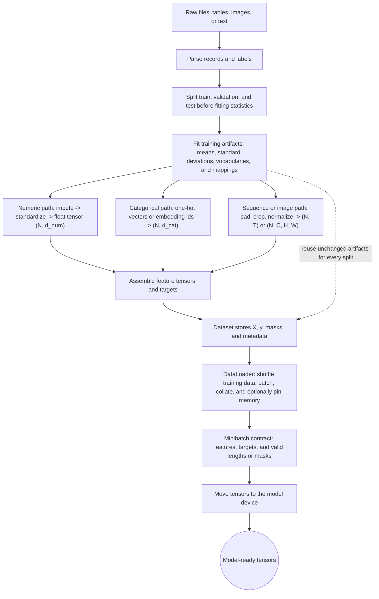

# Tensors and Data Preprocessing

Deep learning begins with two concrete skills: representing data as tensors and converting raw records into the numeric form a model expects. Every later architecture ultimately consumes batches of arrays, applies broadcasted arithmetic and matrix multiplication, and passes intermediate values through differentiable operators.

Preprocessing can dominate a result before optimization starts. Missing values, mixed numeric and categorical columns, inconsistent scales, and train-test leakage all change the learning problem. A sound pipeline keeps shapes explicit and fits every data-dependent transformation on the training split alone.

## Tensor shape is an interface contract

A **tensor** is a multidimensional array with a shape, data type, and usually a device. In PyTorch, a scalar has shape `()`, a vector `(d,)`, a matrix `(m, n)`, and a color-image minibatch commonly `(batch, channels, height, width)`.

For tabular data, let $X \in \mathbb{R}^{n \times d}$ contain $n$ feature rows and $d$ columns, with target vector $y \in \mathbb{R}^n$. Images require more axes, so a batch may be $X \in \mathbb{R}^{n \times c \times h \times w}$. A token batch often has shape `(batch, time)`.

| Value | Typical PyTorch shape | Role |
|---|---:|---|
| Scalar loss | `()` | Scalar objective for `backward()` |
| Feature vector | `(d,)` | One tabular example |
| Minibatch matrix | `(batch, d)` | Vectorized tabular training |
| Image batch | `(batch, channels, height, width)` | Standard PyTorch CNN layout |
| Token batch | `(batch, time)` | Discrete sequence input |
| One-hot features | `(batch, categories)` | Numeric category indicators |

Shape reasoning should remain valid when one example becomes a batch. A linear model with $w \in \mathbb{R}^d$ and scalar $b$ predicts every row through

$$
\hat{y}=Xw+b,
$$

where the matrix-vector product produces shape $(n)$ and broadcasting applies $b$ to each output. `X @ w` also launches one optimized kernel, whereas a Python loop around `torch.dot(X[i], w)` launches many small operations.

Document axis meanings at dataset boundaries and inspect one minibatch before training. Image files and plotting libraries often use channels-last arrays, while PyTorch convolution layers expect channels first. Integer ids are appropriate for embedding lookup; continuous arithmetic usually requires floating-point tensors.

### Shape, stride, and storage

A shape says how many indices exist along each axis. A **stride** says how far to move in storage when one index increases. A contiguous $2\times3$ row-major tensor commonly has strides $(3,1)$: moving down one row skips three elements, while moving across one column skips one.

Operations such as transpose can return a view with new shape and strides but the same underlying storage. If

$$
X=
\begin{bmatrix}
1&2&3\\
4&5&6
\end{bmatrix},
$$

then `X.T` has shape `(3, 2)` and can be represented by swapping the strides. No data copy is required. Some kernels require contiguous layout, so `contiguous()` may allocate and reorder the elements. `reshape` can return a view when strides permit it and otherwise makes a copy; code should not rely on which case occurred unless storage aliasing matters.

Slicing usually creates another view. Mutating `X[:, 0]` can therefore change `X` itself, while advanced indexing with a list or Boolean mask commonly returns a copy. This distinction matters in preprocessing code that reuses a supposedly untouched raw tensor.

Data type is part of the contract as well. `float32` is the usual neural-network default; `float64` costs twice the storage and is slower on much accelerator hardware, but can be needed for numerically sensitive scientific calculations. Integer division, overflow, and conversion are not differentiable in the way floating-point model operations are. Class indices passed to cross-entropy or embeddings normally use `int64`, whereas binary or continuous targets usually use floating point.

## Broadcasting aligns trailing dimensions

Broadcasting permits elementwise operations between compatible shapes. Starting from the trailing axis, dimensions must be equal or one of them must have size $1$. The singleton dimension is conceptually repeated, often without materializing a copied tensor.

For

$$
X=
\begin{bmatrix}
1&2&3\\
4&5&6
\end{bmatrix},
\qquad
r=\begin{bmatrix}10&20&30\end{bmatrix},
$$

the shapes are $(2,3)$ and $(1,3)$. The last dimensions agree, and the singleton row of $r$ can align with both rows of $X$:

$$
Y=X+r
=
\begin{bmatrix}
1+10&2+20&3+30\\
4+10&5+20&6+30
\end{bmatrix}
=
\begin{bmatrix}
11&22&33\\
14&25&36
\end{bmatrix}.
$$

The result has the common broadcast shape $(2,3)$. Broadcasting may use an expanded view for the input, though the computed result still occupies its full shape.

Singleton axes must be placed deliberately. Suppose an image batch has shape `(8, 3, 32, 32)` and channel means have shape `(3,)`. Subtracting them directly fails because broadcasting compares the final dimensions: it tries to align `3` with the final width `32`. Reshaping the means to `(1, 3, 1, 1)` aligns channel $3$ with channel $3$ while the singleton dimensions expand over batch, height, and width.

A more dangerous case succeeds with the wrong meaning. If a square matrix has shape `(3, 3)`, adding a vector of shape `(3,)` adds it to every row. Someone intending one offset per row needed shape `(3, 1)`. Matching sizes can conceal an axis error, so names such as `batch`, `channel`, and `feature` remain useful even though tensor libraries store only numeric dimensions.

Reduction operations also change contracts. `X.mean(dim=1)` removes axis $1$ and may turn `(batch, time, features)` into `(batch, features)`. With `keepdim=True`, the result is `(batch, 1, features)`, which often broadcasts back across time without a later `unsqueeze`.

Indexing and slicing preserve the same shape discipline. `X[:, 1:3]` selects every row and columns `1` and `2`. In-place assignment such as `X[:, 0] = 0` modifies storage; it needs care when autograd has retained earlier values for a backward pass.

## Split before fitting transformations

Data preprocessing usually parses records, separates targets, imputes missing values, encodes categories, scales numeric columns, shuffles training examples, and forms minibatches. Every decision learned from data belongs to the training split: means, standard deviations, category sets, vocabularies, imputers, feature selection, and label mappings.



Fitting a mean or vocabulary before the split leaks evaluation information into training. Encoding each split independently creates a different problem: column order and category identity can change between training and inference.

For numeric column $j$, standardization uses training statistics

$$
z_{ij}=\frac{x_{ij}-\mu_j}{\sigma_j+\epsilon},
$$

where $\epsilon$ protects constant or nearly constant columns. Scaling cannot correct a misspecified model, but it improves optimization when features use very different units.

One-hot encoding maps a categorical variable with $k$ values to a vector in $\{0,1\}^k$. This represents identity without imposing an artificial ordering. Large or open-ended category sets often use integer ids and learned embeddings instead.

Missingness needs a modeling decision, not only a fill value. Mean imputation says that a missing numeric value receives the center of the observed training column. Adding a binary missingness indicator lets the model distinguish an actual value equal to the mean from an imputed one. That distinction can help when the fact of measurement is informative, though it can also capture an unstable data-collection habit.

An unseen category at evaluation time cannot create a new model column. Common policies reserve an `unknown` category, use all-zero one-hot encoding with explicit semantics, or reject the record. The choice belongs in the saved preprocessing contract. Treating a new category as an arbitrary existing index silently changes its meaning.

Targets demand leakage checks too. A feature recorded after the outcome, an aggregate computed using future rows, or an identifier that encodes the label can make held-out accuracy look excellent. A random row split is insufficient when the intended prediction concerns future time periods or unseen people; split by time or group to match that use.

## Working a small table by hand

Treat the following three rows as a training set, with `price` as the target.

| row | rooms | age | city | price |
|---:|---:|---:|---|---:|
| 1 | 2 | 10 | Seoul | 220 |
| 2 | 4 | missing | Busan | 310 |
| 3 | 3 | 20 | Seoul | 280 |

The target is

$$
y=[220,310,280]^T.
$$

The observed ages have mean $(10+20)/2=15$, so mean imputation produces $[10,15,20]^T$. The `rooms` mean is $3$, with population standard deviation

$$
\sigma_{\text{rooms}}
=\sqrt{\frac{(2-3)^2+(4-3)^2+(3-3)^2}{3}}
=\sqrt{\frac{2}{3}}
\approx0.816.
$$

Its standardized values are approximately $[-1.225,1.225,0]$. The imputed `age` column has mean $15$ and population standard deviation

$$
\sigma_{\text{age}}
=\sqrt{\frac{(10-15)^2+(15-15)^2+(20-15)^2}{3}}
=\sqrt{\frac{50}{3}}
\approx4.083,
$$

giving standardized ages $[-1.225,0,1.225]$.

With one-hot columns ordered as `[Busan, Seoul]`, the category rows are `[0,1]`, `[1,0]`, and `[0,1]`. One valid model matrix is therefore

$$
X\approx
\begin{bmatrix}
-1.225&-1.225&0&1\\
1.225&0&1&0\\
0&1.225&0&1
\end{bmatrix}.
$$

The first two columns are standardized numeric features; the final two are category indicators.

### Transforming a held-out row with training artifacts

Now consider a test row with `rooms = 5`, missing `age`, and city `Incheon`. Reuse the training means $\mu_{\text{rooms}}=3$ and $\mu_{\text{age}}=15$, together with standard deviations $0.816$ and $4.083$. Imputing age with the stored mean gives

$$
z_{\text{rooms}}=\frac{5-3}{0.816}\approx2.451,
\qquad
z_{\text{age}}=\frac{15-15}{4.083}=0.
$$

If the encoder was fitted with an explicit `unknown` column ordered after `[Busan, Seoul]`, the category vector is `[0,0,1]`. The full feature row is

$$
x_{\text{test}}
\approx[2.451,0,0,0,1].
$$

Refitting on this one row would instead assign rooms a mean of $5$ and an undefined or zero standard deviation, yielding a quite different representation. Calling `get_dummies` on it alone would create an `Incheon` column that the trained weight matrix has never seen. Reuse is a mathematical requirement, not merely a software convenience.

If a missingness indicator is part of the fitted schema, append `age_missing = 1`. Training rows would have indicator values $[0,1,0]^T$. The model can then learn a separate coefficient for the observation process while the numeric age column stays finite.

## Building the same training pipeline

```python
import pandas as pd
import torch
from torch.utils.data import DataLoader, TensorDataset

raw = pd.DataFrame(
    {
        "rooms": [2.0, 4.0, 3.0],
        "age": [10.0, None, 20.0],
        "city": ["Seoul", "Busan", "Seoul"],
        "price": [220.0, 310.0, 280.0],
    }
)

y = torch.tensor(raw.pop("price").values, dtype=torch.float32).reshape(-1, 1)
numeric = raw[["rooms", "age"]].copy()
numeric = numeric.fillna(numeric.mean())
numeric = (numeric - numeric.mean()) / numeric.std(ddof=0)

categorical = pd.get_dummies(raw["city"], dtype=float)
features = pd.concat([numeric, categorical], axis=1)
X = torch.tensor(features.values, dtype=torch.float32)

dataset = TensorDataset(X, y)
loader = DataLoader(dataset, batch_size=2, shuffle=True)

for xb, yb in loader:
    print("features:", xb)
    print("targets:", yb)
```

Here `raw` is the training split, so its imputation, scaling, and category discovery produce training artifacts. A validation or test table must be transformed with those stored values and the same category column order, without calling `mean` or `get_dummies` independently on the new data.

## The preprocessing artifact belongs with the model

Save normalization statistics, category vocabularies, label mappings, padding conventions, and axis layouts with the learned weights. Changing any of them changes the numeric function evaluated at inference time. Retaining the artifacts also makes encoded examples reversible enough to interpret predictions and reproduce evaluations.

Assertions at the boundary are cheap insurance: check feature and target shapes, dtypes, finite numeric values, category handling, masks, and device placement before a long run. A tensor shape error usually indicates a mistaken batch or axis model rather than an incidental syntax problem.

## Batching changes representation, not meaning

A dataset maps an example index to one sample. A data loader chooses indices, groups samples, and applies a collation rule. Default collation can stack equal-shaped tensors along a new leading batch axis; variable-length sequences need padding, packing, or a custom structure.

Padding requires a validity mask. For sequences of lengths $3$ and $1$ padded to length $3$, one Boolean mask is `[true, true, true]` for the first row and `[true, false, false]` for the second. Loss reduction must count four valid positions, not six rectangular slots. Attention and pooling operations need the same semantic exclusion, though an API may use the opposite convention where true means “masked out.”

Shuffling changes sample order but should not change the transformation learned from training data. Random augmentation does change an example and belongs only in designated pipelines. Reproducibility requires tracking the random generators used by the loader, worker processes, and augmentation library; one global seed may not control all of them.

A final minibatch may be smaller than the requested size. Model code that reshapes using a fixed batch constant can fail only at the end of an epoch. Derive the current size from the tensor, or drop the last batch only when an algorithm genuinely requires fixed-size groups.

## Failure modes that survive a quick glance

- A target with shape `(batch, 1)` may broadcast against predictions of shape `(batch,)` and produce a `(batch, batch)` loss matrix. Both tensors contain the expected number of values, yet the loss compares every prediction with every target. Make their contracts identical before subtraction.
- Normalizing each minibatch in the input pipeline makes a record's representation depend on its batch companions. Batch normalization is a model layer with defined training and evaluation behavior; ad hoc per-batch feature scaling is a different transformation.
- Replacing every non-finite value with zero hides overflow and parsing errors along with genuine missing data. Detect `NaN` and infinity before imputation and decide which source values count as missing.
- Shuffling validation or test rows usually leaves aggregate metrics unchanged, but random augmentation does not. Evaluation transforms should be deterministic unless the metric explicitly averages multiple stochastic views.
- Moving a tensor to an accelerator returns a tensor on that device; it does not necessarily mutate the original variable. Model parameters, inputs, targets, and any masks used together must reside on compatible devices.

<div className="see-also">

See also: [Linear algebra foundations](/math/linear-algebra/intro) · [Probability and random variables](/math/probability-and-random-variables/intro) · [Classical machine learning data preparation](/cs/machine-learning/intro) · [Linear regression training](/cs/deep-learning/linear-regression-training) · [Computer vision applications](/cs/deep-learning/computer-vision-applications)

</div>
