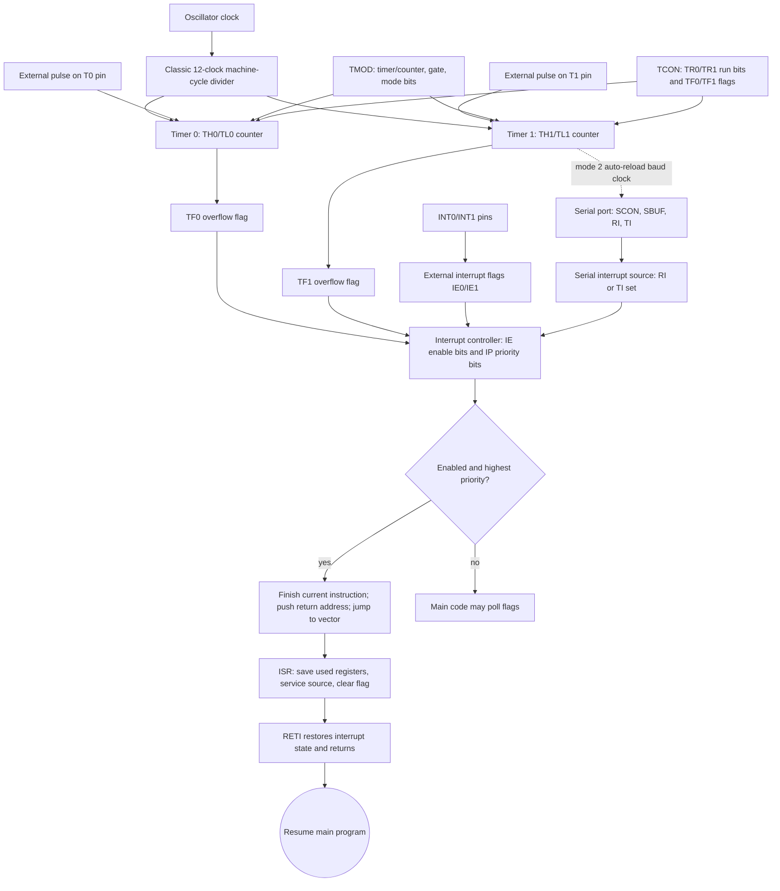

# 8051 Timers, Serial Port, and Interrupts

Timers, serial communication, and interrupts turn the 8051 from a small CPU with ports into a useful controller. The peripherals interact but have distinct jobs: timers produce delays and baud clocks, the serial port signals transmit and receive completion, and interrupts let the system respond without polling every flag continuously.

The central habit is to configure the correct SFR bits, clear or test the correct flags, and understand which hardware event sets each flag. Once that is in place, an 8051 program can blink LEDs, count external pulses, generate a baud clock, receive characters, and service external events predictably.

## Timer and control registers

The classic 8051 has **Timer 0** and **Timer 1**. Each can operate as a timer driven by the machine cycle clock or as a counter driven by external input pins. Later derivatives often add more timers or programmable counter arrays.

`TMOD` is the **timer mode register**. It selects timer/counter operation, gate control, and mode for Timer 0 and Timer 1.

`TCON` is the **timer control register**. It contains run bits such as `TR0` and `TR1`, overflow flags such as `TF0` and `TF1`, and external interrupt control flags.

Timer modes include:

- **Mode 0**: 13-bit timer mode.
- **Mode 1**: 16-bit timer mode.
- **Mode 2**: 8-bit auto-reload mode.
- **Mode 3**: split Timer 0 mode in the original 8051.

Each timer's four-bit field in `TMOD` is `GATE C/T M1 M0`. `C/T = 0` selects the internal machine-cycle source; `C/T = 1` counts transitions on the external `T0` or `T1` pin. With `GATE = 0`, `TRx` alone controls running. With `GATE = 1`, the corresponding external interrupt pin must also be high, which allows hardware pulse-width measurement or gated event counting. `TMOD` is not bit-addressable, so code should mask the other timer's nibble rather than overwrite it accidentally.

Mode 0 is retained mainly for compatibility with the original part. Mode 1 combines `THx` and `TLx` as a 16-bit up-counter. Mode 2 uses `TLx` as the running 8-bit counter and `THx` as the reload value copied into `TLx` after overflow. Mode 3 splits Timer 0 into two separate 8-bit counters and changes how the normal Timer 1 control resources can be used; it should be configured only after checking the exact derivative's manual.

The **serial port** uses `SBUF` as the transmit/receive data buffer and `SCON` as the serial control register. The flags `TI` and `RI` indicate transmit complete and receive complete.

A **baud rate** is the number of signaling events per second. In common 8051 serial mode 1, Timer 1 in mode 2 often generates the baud rate.

An **interrupt** is a hardware or internal event that temporarily redirects execution to an interrupt service routine. The 8051 has interrupt vectors for external interrupts, timer overflows, and serial events.

`IE` is the **interrupt enable register**, and `IP` is the **interrupt priority register**.

## Turning counts into time

The first key result is that timer overflow occurs after the timer counts from its loaded value up to its maximum and rolls over. In 16-bit mode, overflow happens after:

$$
65536 - \text{initial value}
$$

timer increments. Therefore a desired delay can be produced by loading:

$$
\text{initial value} = 65536 - \text{required counts}
$$

The second key result is that the timer increment rate depends on oscillator frequency and classic 8051 machine-cycle timing. In the original 12-clock core, one timer increment in timer mode occurs every 12 oscillator periods. With an 11.0592 MHz crystal:

$$
\frac{11.0592\ \text{MHz}}{12} = 921.6\ \text{kHz}
$$

The third key result is that mode 2 auto-reload is useful for periodic events and baud generation. The timer overflows from `FFH` to `00H`, reloads automatically from `THx`, and continues without software reloading `TLx` every time.

The fourth key result is that serial flags are software-cleared. After the serial hardware sets `TI` or `RI`, the program must clear the flag after handling the transmit or receive event.

The fifth key result is that interrupt service routines must be short and must preserve any registers they modify unless the program has a strict bank convention. The ISR should handle the event, clear or acknowledge the flag as required, and return with `RETI`.

The sixth key result is that interrupt priority matters only when simultaneous or nested interrupt conditions occur. Without careful design, a high-frequency timer interrupt can starve lower-priority work.

The seventh key result is that polling and interrupt service are both valid, but they answer different scheduling problems. Polling a timer flag inside the main loop is easy and deterministic when the loop is short. Enabling a timer interrupt is better when the main loop may block or when events must be serviced with bounded latency. The cost of interrupts is context saving, shared-data discipline, and the need to keep service routines short.

The eighth key result is that reload timing affects accuracy. In 16-bit mode, if software reloads `THx` and `TLx` only after detecting overflow, the time spent inside the service code adds error unless compensated. Auto-reload mode avoids part of this for 8-bit periodic events, while careful 16-bit code reloads promptly and accounts for instruction overhead when precise timing is required.

The ninth key result is that serial transmit and receive share the same interrupt source in the original 8051. The serial ISR must test both `RI` and `TI`. A transmit completion can occur while a receive byte is waiting, and a receive event can occur while the program is feeding the next transmit byte. A correct ISR handles both flags before returning or has a deliberate policy for prioritizing one side.

The familiar divide-by-12 rule belongs to the original 8051 core. Many modern derivatives execute a machine cycle in 6, 4, or 1 oscillator clocks, and some provide a timer prescaler or independent peripheral clock. A reload copied from an old textbook can therefore be wrong by a large factor on a newer chip. The device data sheet, clock-tree configuration, and fuse settings determine the real timer tick.

For a timer tick frequency $f_t$, an $n$-bit up-counter loaded with $R$ overflows after

$$
N=2^n-R
$$

ticks, giving ideal interval

$$
T=\frac{2^n-R}{f_t}.
$$

If the requested interval is not an integer number of ticks, rounding introduces quantization error. Repeating the same rounded reload makes that error accumulate. A software accumulator can alternate between neighboring counts so the long-term average is correct, similar to fractional division.

Polling adds latency between overflow and detection. Interrupts add the time to finish the current instruction, vector, save registers, and execute the reload. If a mode 1 ISR reloads from a fixed value after all that work, the period includes the service delay. Reloading immediately, adding compensation counts, or scheduling the next deadline relative to the current counter reduces drift. Mode 2 reloads in hardware and gives a stable overflow period, though interrupt response still has latency and jitter.

## How the peripherals meet at the interrupt controller



The diagram traces clock and external sources into the timers, then routes overflow and serial flags to interrupt selection. Timer 1's dotted edge marks its common second job as the UART baud generator. An ISR preserves only the state it uses, handles every applicable source, acknowledges flags according to the device rules, and exits with `RETI`.

| Feature | Main SFRs | Main flags/bits | Typical use |
|---|---|---|---|
| Timer 0 | `TMOD`, `TCON`, `TH0`, `TL0` | `TR0`, `TF0` | Delays, event counting, periodic interrupts |
| Timer 1 | `TMOD`, `TCON`, `TH1`, `TL1` | `TR1`, `TF1` | Delays, baud-rate generation |
| Serial port | `SCON`, `SBUF`, `PCON` | `RI`, `TI`, `SM0`, `SM1` | UART-style communication |
| Interrupts | `IE`, `IP`, vectors | `EA`, `EX0`, `ET0`, `ES` | Asynchronous event handling |
| External interrupts | `TCON`, pins `INT0`, `INT1` | `IE0`, `IE1`, `IT0`, `IT1` | Buttons, sensors, external requests |

## Serial mode 1 and baud generation

Serial mode 1 is an asynchronous 8-bit UART mode. A frame normally contains one start bit, eight data bits sent least-significant first, and one stop bit. `REN` enables reception. Writing `SBUF` starts transmission; reading `SBUF` retrieves a received byte. Although transmit and receive share the SFR name, the hardware has separate internal buffers.

For the classic core with Timer 1 in mode 2, serial modes 1 and 3 commonly use

$$
\mathrm{baud}
=\frac{2^{SMOD}}{32}
\frac{f_{osc}}{12(256-TH1)}.
$$

`SMOD` is a bit in `PCON`; setting it doubles the baud rate. The result must be close enough to the peer's rate for sampling to remain within the frame. Crystals such as 11.0592 MHz are convenient because standard baud rates divide cleanly under the classic clock scheme.

`TI` is set when transmission completes and `RI` when a byte has been received. Neither is automatically distinguished at the shared serial vector, so an ISR tests both. On the original 8051 these flags are cleared by software. A receive handler should read `SBUF` before clearing `RI` and move the byte into a buffer quickly. Processing an entire command inside the ISR risks losing later bytes.

Polling is adequate for a blocking `putchar` routine or a small monitor. An interrupt-driven driver uses ring buffers: foreground code enqueues outgoing bytes and dequeues incoming ones, while the ISR moves one byte at each hardware event. Shared head and tail indices must be updated atomically for the chosen width and toolchain. Declaring shared objects `volatile` prevents the compiler from assuming they never change outside foreground code; it does not make a multi-byte access atomic.

## Interrupt entry, priority, and acknowledgment

The original interrupt vectors are at fixed low addresses:

| Source | Vector | Enable bit | Priority bit |
|---|---:|---|---|
| External interrupt 0 | `0003H` | `EX0` | `PX0` |
| Timer 0 overflow | `000BH` | `ET0` | `PT0` |
| External interrupt 1 | `0013H` | `EX1` | `PX1` |
| Timer 1 overflow | `001BH` | `ET1` | `PT1` |
| Serial port | `0023H` | `ES` | `PS` |

`EA` globally enables maskable interrupts, while the individual `IE` bits select sources. The classic controller has two priority levels. A high-priority ISR may interrupt a low-priority ISR; an equal- or lower-priority source waits. Sources at the same priority have a fixed polling order for simultaneous requests, which determines which vector wins first but does not create a new nesting level.

Flag clearing depends on the source. Timer overflow flags are cleared by hardware when the processor accepts their interrupts on the classic 8051, although polling code must clear them explicitly and derivatives may differ. `RI` and `TI` require software clearing. Edge-triggered external interrupt flags are cleared on interrupt service, whereas a level-triggered request remains active while its pin stays low. Code should follow the specific controller's manual rather than apply one clearing rule to every flag.

The hardware pushes the return address, not every register used by C or assembly code. The compiler's interrupt calling convention usually emits the needed save and restore sequence. Handwritten assembly must preserve accumulator, status, data pointer, and any working registers it changes. Selecting a dedicated register bank can reduce latency, but nested interrupts and foreground assumptions must agree with that choice.

## Worked example 1: Timer 0 initial value for a 1 ms delay

Problem: On a classic 12-clock 8051 using a 12 MHz oscillator, find the Timer 0 mode 1 initial value for an approximate 1 ms delay.

Method:

1. Timer increments once per machine cycle in timer mode.

2. Machine-cycle frequency is:

$$
\frac{12\ \text{MHz}}{12} = 1\ \text{MHz}
$$

3. One timer count is therefore:

$$
1 / 1\ \text{MHz} = 1\ \text{us}
$$

4. A 1 ms delay needs:

$$
1000\ \text{us} / 1\ \text{us} = 1000
$$

counts.

5. In 16-bit mode, overflow occurs at 65536 counts, so load:

$$
65536 - 1000 = 64536
$$

6. Convert 64536 to hexadecimal:

$$
64536 = FC18\text{H}
$$

Answer: load `TH0 = FCH` and `TL0 = 18H`, start Timer 0, and wait for `TF0`.

Check: `10000H - FC18H = 03E8H = 1000`, confirming the count.

## Worked example 2: Timer 1 reload for 9600 baud

Problem: In a common 8051 serial mode 1 setup with an 11.0592 MHz crystal, Timer 1 mode 2, and `SMOD = 0`, find the usual reload value for 9600 baud.

Method:

1. Classic 8051 timer increment frequency:

$$
11.0592\ \text{MHz} / 12 = 921600\ \text{Hz}
$$

2. In serial mode 1 with `SMOD = 0`, baud rate is commonly:

$$
\text{baud} = \frac{\text{Timer1 overflow rate}}{32}
$$

3. Required Timer 1 overflow rate:

$$
9600 \cdot 32 = 307200\ \text{Hz}
$$

4. Timer counts per overflow:

$$
921600 / 307200 = 3
$$

5. In 8-bit auto-reload mode, counts per overflow are:

$$
256 - TH1
$$

6. Therefore:

$$
256 - TH1 = 3
$$

7. Solve:

$$
TH1 = 253 = FD\text{H}
$$

Answer: load `TH1 = FDH` for 9600 baud under these standard assumptions.

Check: `256 - FDH = 03H`; `921600 / 3 / 32 = 9600`.

## Polling UART setup in C

```c
/* 8051 C: initialize serial mode 1 at 9600 baud with 11.0592 MHz crystal.
   Syntax follows common 8051 C compilers with SFR names available. */

void uart_init(void) {
    TMOD &= 0x0F;      /* keep Timer 0 settings */
    TMOD |= 0x20;      /* Timer 1 mode 2, 8-bit auto-reload */
    TH1 = 0xFD;        /* 9600 baud for 11.0592 MHz, SMOD = 0 */
    TL1 = 0xFD;
    SCON = 0x50;       /* serial mode 1, receiver enabled */
    TR1 = 1;           /* start Timer 1 */
}

void uart_putc(unsigned char ch) {
    SBUF = ch;
    while (TI == 0) {
        ;              /* wait for transmit complete */
    }
    TI = 0;            /* software clears transmit flag */
}
```

The mask on `TMOD` matters because its upper nibble belongs to Timer 1 and lower nibble to Timer 0. `SCON = 0x50` selects mode 1 and reception. The routine assumes `SMOD = 0`; code that inherits a previously set `PCON.SMOD` would run at twice the expected baud. A production initializer should establish that bit explicitly if startup code does not.

## A periodic interrupt timing check

Suppose the 12 MHz system from the first example uses a Timer 0 mode 1 interrupt every 1 ms, and the ISR takes 35 timer ticks from overflow until the reload completes. Loading `FC18H` at that point produces an actual interval of about $1035\ \mu s$ from reload to the next reload. After 1000 interrupts, the software clock is roughly 35 ms slow.

A first compensation is to request only $1000-35=965$ post-reload ticks:

$$
R=65536-965=64571=FC3B\mathrm{H}.
$$

Then approximately 35 ticks of latency plus 965 timer ticks make the reload-to-reload interval 1000 ticks. The actual instruction path must be measured, because conditional branches, interrupt nesting, and compiler-generated prologue length can change it. Hardware auto-reload or compare peripherals on later derivatives are preferable when exact periodic timing matters.

## Failure modes to check on the bench

- Loading only `TL0` in 16-bit mode and forgetting `TH0`.
- Forgetting to clear `TF0`, `TF1`, `RI`, or `TI` after servicing the event.
- Reusing Timer 1 for a delay while it is already generating the serial baud rate.
- Calculating timer counts from oscillator frequency without dividing by 12 for a classic 8051 core.
- Writing long interrupt service routines that block other time-sensitive events.
- Ending an ISR with `RET` instead of `RETI`.
- Enabling individual interrupts but forgetting the global enable bit `EA`.
- Assuming all 8051-compatible cores use twelve oscillator clocks per timer increment.
- Sharing ISR data without considering atomicity, compiler optimization, or buffer overflow.
- Measuring a square-wave period without accounting for two timer events per full high–low cycle.

<div className="see-also">

See also: [8051 architecture, memory, and ports](/cs/embedded/architecture-memory-ports) · [8051 instruction set and programming](/cs/embedded/instruction-set-programming) · [Serial buses and embedded protocols](/cs/embedded/serial-buses-embedded-protocols) · [Microcontroller derivatives, AVR, and PIC](/cs/embedded/microcontroller-derivatives-avr-pic)

</div>
