# Scheduling and Real Time

Scheduling decides which task executes when. General-purpose schedulers often optimize throughput, fairness, or responsiveness. In an embedded system, timing can be part of correctness: a controller that computes the right output too late can still be wrong.

Lee and Seshia treat scheduling as a design and analysis problem over tasks, deadlines, periods, precedence constraints, mutual exclusion, and processor assignment. Rate-monotonic scheduling and earliest-deadline-first scheduling are the central uniprocessor cases; priority inversion and multiprocessor anomalies show where the tidy results stop applying directly.

## The task model behind a schedule

A **task** is a unit of schedulable computation. One execution may have a release time $r_i$, start time, finish time $f_i$, execution time $e_i$, deadline $d_i$, and possibly a period $p_i$. Its response time is

$$
f_i-r_i.
$$

Execution time counts only time on the processor, not time spent blocked or preempted. A **feasible schedule** meets every required deadline. A hard deadline is a correctness constraint; a soft deadline is a performance target for which lateness is undesirable but tolerable.

A preemptive scheduler may suspend one task to run another. A non-preemptive scheduler lets the selected task run until it blocks or finishes. Periodic work, such as a control loop, has a regular release pattern. Sporadic work has a known minimum inter-arrival time. Aperiodic work, such as arbitrary user commands, may arrive in bursts and is commonly isolated behind a budget or server so that it cannot consume unbounded processor time.

## What RM and EDF can guarantee

**Rate-monotonic** (RM) scheduling assigns fixed priorities to periodic tasks: the shorter the period, the higher the priority. For independent periodic tasks on one preemptive processor, RM is optimal among fixed-priority schedulers under the classic assumptions. If any fixed-priority assignment can schedule the task set, the rate-monotonic assignment can.

RM has the sufficient utilization test

$$
U=\sum_{i=1}^{n}\frac{e_i}{p_i}
\le n(2^{1/n}-1).
$$

As $n$ grows, the bound approaches $\ln 2\approx 0.693$. The condition is sufficient, not necessary: a task set above the bound may still be schedulable.

**Earliest deadline first** (EDF) gives the processor to the ready job with the earliest absolute deadline. It is optimal for feasibility for independent, preemptible jobs on one processor. For periodic tasks whose relative deadlines equal their periods, ideal EDF schedules every task set with total utilization at most $1$.

The diagram shows an RM schedule for a period-4 task with execution time 1 and a period-6 task with execution time 3. The higher-priority task preempts the lower-priority job at time 8.

```mermaid
gantt
  title RM schedule example
  dateFormat X
  axisFormat %s
  section Task T1 period 4
  T1 job 1 :0, 1
  T1 job 2 :4, 5
  T1 job 3 :8, 9
  section Task T2 period 6
  T2 part 1 :1, 4
  T2 part 2 :6, 8
  T2 part 3 :9, 10
```



| Scheduler | Priority type | Classic strength | Limitation |
|---|---|---|---|
| Fully static | Design-time order and time | Very predictable | Requires known execution times |
| Static order | Design-time order, run-time timing | Simple generated code | Long blocks delay later tasks |
| RM | Fixed priority | Optimal among fixed-priority periodic schedules | Simple utilization bound is below 100% |
| EDF | Dynamic priority | Optimal for many uniprocessor task models | More run-time scheduling work |
| Priority inheritance | Lock-aware fixed priority | Bounds some priority inversion | Does not remove locking complexity |

These claims depend on the model: known execution times, independent tasks, negligible scheduling overhead, and one processor. Release jitter, locks, interrupts, cache effects, communication delays, and data-dependent execution all require extra analysis.

## Checking the RM utilization bound

Take three periodic tasks with $(e_1,p_1)=(1,4)$, $(e_2,p_2)=(1,5)$, and $(e_3,p_3)=(2,20)$. Their utilization is

$$
U=\frac{1}{4}+\frac{1}{5}+\frac{2}{20}
 =0.25+0.20+0.10=0.55.
$$

For $n=3$, the RM bound is

$$
3(2^{1/3}-1)\approx 3(1.2599-1)=0.7797.
$$

Because

$$
0.55 \le 0.7797,
$$

the sufficient test passes. Under the classic assumptions, RM meets all deadlines for this task set.

## Ordering two ready jobs with EDF

Suppose two independent jobs are ready at time $0$. $J_1$ has execution time $2$ and deadline $5$; $J_2$ has execution time $1$ and deadline $3$. Since

$$
d_2=3<d_1=5,
$$

EDF runs $J_2$ from time $0$ to $1$, then $J_1$ from time $1$ to $3$. Their finish times satisfy

$$
f_2=1\le d_2=3,
\qquad
f_1=3\le d_1=5.
$$

Both jobs meet their deadlines.

For a fixed ready set, the same calculation can be turned into a small trace helper:

```python
def edf_schedule(jobs):
    """Non-preemptive EDF for a fixed ready set: (name, execution, deadline)."""
    time = 0
    result = []
    for name, execution, deadline in sorted(jobs, key=lambda item: item[2]):
        start = time
        finish = start + execution
        result.append((name, start, finish, deadline, finish <= deadline))
        time = finish
    return result

jobs = [("J1", 2, 5), ("J2", 1, 3)]
for row in edf_schedule(jobs):
    print(row)
```

The helper is deliberately non-preemptive and assumes every job is already released; it is not a simulator for general EDF arrivals.

## Precedence, locks, and multiple processors

Precedence constraints alter the scheduling problem. For finite task sets with precedences, a latest-deadline-first construction can build an optimal schedule backward. EDF can also use adjusted deadlines that account for successor deadlines.

Mutual exclusion introduces blocking. **Priority inversion** occurs when a high-priority task waits while a lower-priority task indirectly prevents progress. Priority inheritance temporarily raises the lock holder to the highest priority of any task blocked on that lock. Priority-ceiling protocols restrict lock acquisition to prevent certain deadlocks and bound blocking.

Blocking time belongs in response-time calculations. A task with a short execution time can still miss its deadline while waiting for a lock, bus transaction, DMA completion, driver, interrupt, or higher-priority task. A useful schedule trace records releases, starts, preemptions, blocking intervals, completions, and misses.

Multiprocessor scheduling is harder still. Under some policies, even reducing one task's execution time can increase the total makespan because it changes the order of contention for processors or shared resources. Uniprocessor RM and EDF theorems cannot simply be carried over.

## Turning physical timing into evidence

Release times and deadlines should come from the physical problem. A control-loop period follows from plant dynamics and stability margins; a braking deadline may follow from stopping distance; a sensor-fusion task must finish before its estimate is consumed. An arbitrary software deadline can be feasible while failing the physical requirement.

Logical and timing proofs also answer different questions. A mode-machine model may prove that a fault handler is eventually requested, while scheduling analysis must show that it runs soon enough. Mutual exclusion may protect shared state while still blocking a critical task for too long.

A scheduling design should record the timer that releases each periodic task, each priority or deadline, the maximum interrupt-disabled interval, and the overload policy. When demand exceeds processor capacity, the design must say which work is dropped, degraded, deferred, or escalated to a fault mode.

Hardware validation needs traces of releases, starts, preemptions, completions, and deadline misses. Average execution time is not evidence for a hard real-time claim; worst-case execution, blocking, scheduler overhead, cache effects, and interrupt latency need defensible bounds. A failed RM utilization bound does not prove infeasibility, and soft and hard deadlines should not be treated as interchangeable.

<div className="see-also">

See also: [CPU scheduling](/cs/operating-systems/cpu-scheduling) · [process synchronization](/cs/operating-systems/process-synchronization) · [multitasking and threads](/cs/embedded/multitasking-and-threads) · [quantitative analysis](/cs/embedded/quantitative-analysis) · [input and output interfacing](/cs/embedded/input-output-interfacing)

</div>
