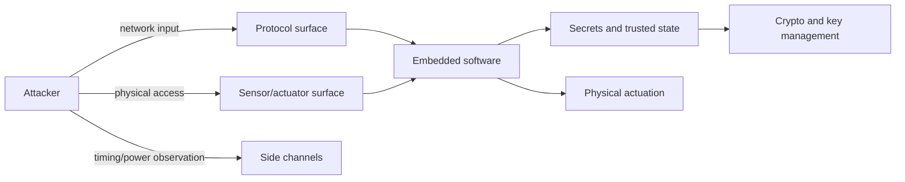

# Security and Privacy

Security and privacy change the failure model for a networked embedded system. The source of failure may be an attacker who chooses inputs, observes timing, tampers with sensors, injects messages, or reverse engineers the device rather than a random bug or overloaded CPU.

Lee and Seshia organize the subject around threat models, cryptographic primitives, protocols, software security, information flow, sensor and actuator attacks, and side channels. The first step is always to name the assumed attacker capabilities and the properties that must survive them.

## Start with the attacker and the protected property

A **threat model** states an attacker's capabilities and goals. It may grant network or physical access, observation of messages, injection of traffic, timing or power measurements, or modification of sensors.

The common protection goals are:

- **Confidentiality:** unauthorized parties cannot learn protected information.
- **Integrity:** data and behavior cannot be modified improperly.
- **Authenticity:** an entity or message origin is what it claims to be.
- **Availability:** the system continues to provide adequate service.

Security is relative to that model and those goals. A device that withstands a remote network attacker may still fail against someone with physical access and laboratory equipment.



| Goal | Typical mechanism | Embedded complication |
|---|---|---|
| Confidentiality | Encryption, access control | Key storage and side channels |
| Integrity | MACs, signatures, memory safety | Untrusted sensor and network inputs |
| Authenticity | Certificates, signatures, challenge-response | Device provisioning at scale |
| Availability | Rate limiting, redundancy, fail-safe modes | Physical safety during denial of service |
| Privacy | Information-flow control, minimization | Sensor data reveals context |

The diagram separates three attack surfaces that are often collapsed into a single “network security” problem. An embedded design must account for all paths granted by its threat model.

## Cryptography at device boundaries

**Symmetric-key cryptography** uses a shared secret key. **Public-key cryptography** uses a public and private key pair; for encryption, anyone can encrypt to the public key, while only the private-key holder can decrypt. Public-key operations help with key establishment but are relatively expensive, so many embedded protocols establish a symmetric session key and use it for bulk traffic.

A **block cipher** maps fixed-size plaintext blocks to ciphertext blocks under a key. AES is the standard modern example; DES and 3DES remain mainly as legacy designs. A **secure hash function** maps arbitrary data to a fixed-size digest and should resist preimage, second-preimage, and collision attacks. A **digital signature** uses public-key techniques to provide integrity and origin authentication.

Kerckhoffs's principle requires the system to remain secure when everything except the key is public. Actual security still depends on implementation details: random-number generation, key storage, constant-time operations, memory handling, and hardware acceleration.

### What pad reuse reveals

A one-time pad is perfectly secret only when its key is uniformly random, at least as long as the message, kept secret, and never reused. If two ciphertexts share a pad,

$$
C_1=M_1\oplus K,
\qquad
C_2=M_2\oplus K,
$$

then

$$
C_1\oplus C_2=M_1\oplus M_2.
$$

For $M_1=10110000$, $M_2=00110110$, and $K=11110000$,

$$
C_1=01000000,
\qquad
C_2=11000110,
$$

and an eavesdropper obtains

$$
C_1\oplus C_2=10000110=M_1\oplus M_2.
$$

Knowledge of either plaintext then reveals the pad and the other plaintext. The same reuse hazard appears with nonces and initialization vectors in modes that require uniqueness.

This short check rejects unequal inputs instead of silently truncating them through `zip`:

```python
def xor_bits(a, b):
    if len(a) != len(b):
        raise ValueError("bit strings must have equal length")
    return "".join("1" if x != y else "0" for x, y in zip(a, b))

m1 = "10110000"
m2 = "00110110"
k = "11110000"
c1 = xor_bits(m1, k)
c2 = xor_bits(m2, k)
print("c1 xor c2:", xor_bits(c1, c2))
print("m1 xor m2:", xor_bits(m1, m2))
```

Production firmware should use reviewed cryptographic libraries or hardware modules rather than implementing primitives directly.

## Encryption does not supply protocol state

An encrypted message can still be replayed, reordered, delayed, or attributed to the wrong device if the protocol omits freshness, sequence numbers, authentication, or key-management rules. Commissioning adds another layer: each device needs the correct identity, keys, trust anchors, and revocation path before joining the system.

Acknowledging a valid message also says nothing about physical completion. A controller may authenticate an actuator command while the mechanism remains jammed. Protocol state, application state, and physical feedback must be kept distinct.

## Memory safety begins at the input boundary

Software memory safety is a security property. A buffer overflow can corrupt secrets, control data, or return addresses, and sensor streams or network packets are attacker-controlled inputs under many threat models.

For a 16-byte packet buffer and a 20-byte input,

$$
L-B=20-16=4
$$

bytes fall outside the destination. Indices $0$ through $15$ fill the buffer; indices $16$ through $19$ overwrite adjacent memory. A boundary check must happen before the copy:

```python
def safe_copy(packet, capacity=16):
    if len(packet) > capacity:
        raise ValueError("packet too large")
    return bytearray(packet)
```

Real parsers also need to validate declared lengths, integer arithmetic, nested fields, and partial messages. The check belongs at every trust boundary, even when the bytes arrived through a sensor peripheral rather than a network socket.

## Information flow and physical side channels

**Information flow** asks how data moves from secret or untrusted sources to public or trusted sinks. **Non-interference** properties require, for example, that high-security data not affect low-security observations, or that low-integrity input not affect high-integrity state. Taint analysis tracks labels along these paths. Static analysis can report false positives; dynamic analysis adds run-time overhead and observes only executed paths.

A **side channel** carries information through timing, power, electromagnetic emissions, memory-access patterns, sound, or fault behavior. Timing differences in modular exponentiation, cache behavior during AES, and power traces during cryptographic operations can expose key material.

The same modeling boundaries used elsewhere in cyber-physical design need security variants. A control-oriented sensor model may omit spoofing, electromagnetic interference, or physical replacement. A scheduling model may ignore timing leakage. A functional memory model may ignore how long keys remain in RAM.

Sensor values should not be trusted merely because they come from hardware. Plausibility checks, redundant measurements, authenticated peripherals where available, and physical limits can constrain spoofed or faulty readings. Physical interlocks can prevent unsafe actuation even after software compromise.

## Updates, availability, and privacy over a device lifetime

Denial of service has physical consequences in a medical device, vehicle controller, or power controller. Rate limits, watchdogs, redundancy, fail-safe states, degraded operation, and recovery procedures must remain compatible with the plant's safety requirements.

Firmware updates are a privileged attack surface that may remain exposed for years. A secure update path authenticates the source, checks integrity before installation, prevents rollback to vulnerable versions, and recovers safely if power fails. Those requirements span cryptography, flash behavior, bootloaders, and safety logic.

Privacy extends beyond encrypted payloads. A smart meter, wearable, vehicle, or medical device can reveal sensitive facts through communication timing, sampling frequency, identifiers, packet sizes, or contacted services. Data minimization, aggregation, local processing, and explicit retention limits reduce what exists to be leaked.

Security review must follow architecture changes. Wireless diagnostics, a bootloader, a cloud dashboard, or a new sensor introduces interfaces and assumptions. Defense in depth combines independent controls: authenticated messages, memory-safe parsing, watchdog recovery, protected key storage, and physical interlocks. The review should also look for reused nonces, secret-dependent timing or power, unprotected metadata, and assumptions that silently exclude physical access.

<div className="see-also">

See also: [memory architectures](/cs/embedded/memory-architectures) · [input and output interfacing](/cs/embedded/input-output-interfacing) · [sensors and actuators](/cs/embedded/sensors-and-actuators) · [invariants and temporal logic](/cs/embedded/invariants-and-temporal-logic) · [reachability and model checking](/cs/embedded/reachability-and-model-checking)

</div>
