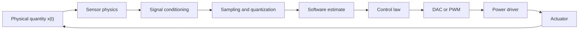

# Sensors and Actuators

Sensors and actuators form the boundary between a physical process and its computational model. A sensor converts a physical quantity into data; an actuator converts electrical signals or data into physical action. Neither is a perfect wire. Range, bias, quantization, noise, sampling, delay, and saturation all shape what software can observe or control.

Hardware notes on GPIO, ADCs, serial buses, and microcontroller ports explain how bits move. The cyber-physical question is different: what relationship is assumed between a physical variable and the number seen or commanded by software, and where does that relationship break down?

## From a physical quantity to a software estimate

An analog sensor produces a continuous electrical signal such as voltage. A digital sensor includes conversion to a number. A common affine model relates physical input $x$ to reported value $f(x)$:

$$
f(x)=ax+b,
$$

where $a$ is sensitivity and $b$ is bias. A linear model is the special case $b=0$.

The sensor's **range** is the interval over which its model is valid. A simple saturation model is

$$
f(x)=
\begin{cases}
L, & x<L,\\
x, & L\le x\le H,\\
H, & x>H.
\end{cases}
$$

Noise is often modeled additively,

$$
x_{\mathrm{measured}}(t)=x(t)+n(t),
$$

although real noise can depend on frequency, signal level, temperature, and the measurement circuit. Signal conditioning filters or scales the signal before conversion.

The complete path is a loop, not a one-way input chain:



| Effect | Sensor symptom | Actuator symptom | Modeling response |
|---|---|---|---|
| Bias | Constant offset in readings | Constant offset in action | Calibrate or subtract $b$ |
| Saturation | Readings clamp at endpoints | More command produces no more effect | Include range limits |
| Quantization | Stair-step output | Discrete command levels | Bound quantization error |
| Noise | Random variation | Jitter in effect | Filter or estimate |
| Sampling | Fast variation is missed | Updates occur at discrete times | Choose sample and update rates |
| Delay | Measurement arrives late | Physical response starts late | Include latency in control analysis |

## Quantization, resolution, and accuracy

Quantization maps a continuum to a finite set of codes. An $n$-bit converter has $2^n$ codes. For an ideal quantizer over $[L,H]$, a common step model is

$$
p=\frac{H-L}{2^n}.
$$

The error bound depends on whether the quantizer truncates, rounds, or saturates. Resolution should not be confused with accuracy: a 12-bit ADC can emit many codes while analog noise, bias, or poor calibration makes those codes inaccurate. Fine PWM resolution likewise says little about motion when friction, backlash, dead zones, and supply variation dominate.

An ADC code is best read as an interval, not an infinitely precise voltage. With an ideal round-to-nearest quantizer of step $p$, quantization contributes at most $p/2$ of error away from saturation. Reference-voltage error, offset, gain error, nonlinearity, and input noise add separate terms. Some are systematic and calibratable; others vary between samples.

Effective resolution can be lower than the nominal bit count. If the least significant few bits fluctuate while the input is steady, averaging may reduce uncorrelated noise, but it cannot remove a stable bias. Oversampling also cannot recover frequencies removed by the analog front end or values clipped at the rails.

### A three-bit voltage measurement

Suppose a 3-bit ADC covers $0$ to $1$ V with a truncating quantizer. There are

$$
2^3=8
$$

codes, and the step is

$$
p=\frac{1-0}{8}=0.125\text{ V}.
$$

For $x=0.70$ V,

$$
\frac{0.70}{0.125}=5.6,
\qquad
\lfloor 5.6\rfloor=5.
$$

Code 5 represents the lower edge at

$$
5p=0.625\text{ V},
$$

so the sample's truncation error is

$$
e=0.70-0.625=0.075\text{ V},
$$

within the general bound $0\le e\lt 0.125\text{ V}$.

The corresponding model includes endpoint saturation explicitly:

```python
def quantize_voltage(x, bits=3, low=0.0, high=1.0):
    levels = 2 ** bits
    step = (high - low) / levels
    if x <= low:
        return 0
    if x >= high:
        return levels - 1
    return int((x - low) // step)

print("code for 0.70 V:", quantize_voltage(0.70))
```

The formula $p=(H-L)/2^n$ partitions the input range into bins. Some converter documentation instead quotes one least significant bit as full-scale span divided by $2^n-1$, because it associates both endpoint codes with exact endpoint voltages. Both conventions occur. A calculation should state whether codes denote bin edges, bin centers, or endpoint levels.

## Sampling and the alias that survives

Uniform sampling at interval $T$ produces

$$
s(n)=f(x(nT)),
$$

with sampling rate $R=1/T$. If a band-limited signal contains no sinusoidal component at or above $R/2$, ideal samples can determine it uniquely. Components above that Nyquist limit can appear as lower frequencies, so an analog anti-aliasing filter must remove them before sampling. Software cannot reconstruct information that has already aliased.

For a $9$ kHz sinusoid sampled at $8$ kHz,

$$
9000-8000=1000\text{ Hz}.
$$

The result lies below the $4$ kHz Nyquist frequency, so the sampled sequence appears as a $1$ kHz tone. The two sample sequences can be compared directly:

```python
import math

def samples(freq_hz, sample_rate=8000, count=8):
    return [round(math.cos(2 * math.pi * freq_hz * n / sample_rate), 6)
            for n in range(count)]

print("1 kHz samples:", samples(1000))
print("9 kHz samples:", samples(9000))
```

Sampling rate alone does not set usable bandwidth. A sample-and-hold circuit has an aperture, the sensor has its own dynamics, and an anti-alias filter needs a transition band. If the signal of interest ends at $3$ kHz, sampling at exactly $6$ kHz leaves no room for a realizable filter to attenuate everything above $3$ kHz. Designers normally leave margin between the signal band and Nyquist frequency.

Periodic interference near an integer multiple of the sampling rate can appear almost constant. For example, a $50.1$ Hz disturbance sampled at $50$ Hz advances only $0.1$ cycle per second relative to the samples and aliases to $0.1$ Hz. Slow-looking drift may therefore originate from a much faster physical signal.

## Calibration and placement define the measured quantity

Calibration connects the nominal model to a particular device. Manufacturing variation, temperature, aging, mounting, and nearby electronics can shift gain and bias away from data-sheet values. For an affine model, two known physical inputs and their readings determine the slope and intercept used for later compensation.

Placement is part of the model. A temperature sensor measures its own location, not an abstract room average. An off-center accelerometer on a rotating body sees different effects from one at the center of mass. A shaft encoder can disagree with wheel motion because of slip or backlash. Many cyber-physical errors begin with treating the measured quantity as the desired quantity.

Sensor physics matters as well. Accelerometers measure proper acceleration and therefore include gravity effects. Encoders report rotation in discrete increments. Microphones cover limited pressure and frequency ranges. Mechanical switches bounce and may produce several electrical transitions from one press.

Timing completes the measurement statement. A sample describes an earlier physical condition after acquisition, conversion, communication, and software latency. Closed-loop analysis must include that age when it is not negligible.

## Solving a two-point calibration

Suppose a temperature probe is placed in two trusted reference conditions. At $0\,^{\circ}\mathrm{C}$ it reports $0.18$ V; at $100\,^{\circ}\mathrm{C}$ it reports $1.68$ V. Model voltage as

$$
v=aT+b.
$$

The first point immediately gives $b=0.18$ V. Subtracting the two calibration equations gives

$$
1.68-0.18=a(100-0),
$$

so

$$
a=\frac{1.50}{100}=0.015\text{ V}/^{\circ}\mathrm{C}.
$$

To recover temperature from a new voltage, invert the relation:

$$
\hat T=\frac{v-b}{a}.
$$

A reading of $0.93$ V therefore gives

$$
\hat T=\frac{0.93-0.18}{0.015}
=\frac{0.75}{0.015}
=50\,^{\circ}\mathrm{C}.
$$

If the ADC voltage uncertainty is $\pm 7.5$ mV, the corresponding temperature contribution is

$$
\Delta T=\frac{0.0075}{0.015}=0.5\,^{\circ}\mathrm{C}.
$$

That figure excludes uncertainty in both reference temperatures and any nonlinearity between them. Two points determine an affine correction exactly; they do not prove that the true response is affine. A residual check at one or more intermediate references can reveal curvature or hysteresis.

Calibration coefficients also need units, versioning, and association with the individual device. Swapping a sensor while retaining its predecessor's coefficients can be worse than using nominal values. Fixed-point firmware must retain enough range and fractional precision when applying the inverse relation.

## Static calibration does not describe response time

The affine calibration relates settled input and output. A real sensor may lag a changing quantity. A common first-order model for a sensor reading $y$ driven by physical input $x$ is

$$
\tau\frac{dy}{dt}+y=x,
$$

where $\tau$ is a time constant. After an input step from $0$ to $X$, the response is

$$
y(t)=X\left(1-e^{-t/\tau}\right).
$$

At $t=\tau$, the reading reaches

$$
X(1-e^{-1})\approx0.632X.
$$

At $3\tau$ it reaches about $0.950X$, and at $5\tau$ about $0.993X$. A probe with $	au=4$ s placed into a stable $100\,^{\circ}\mathrm{C}$ environment therefore reports only about $63.2\,^{\circ}\mathrm{C}$ after four seconds if it began at zero in this simplified model. Calibration can be exact at equilibrium while transient measurements remain badly delayed.

Actuators have dynamics too. Motor current is limited by winding inductance, mechanical speed by inertia, and temperature by stored heat. A control loop that samples faster does not remove these physical states. It can instead amplify measurement noise or command changes that the actuator cannot follow.

Bandwidth links the static device to sampling. The useful sample rate should exceed the signal bandwidth with room for filtering, while the sensor itself must respond fast enough to contain that band. A nominal “one kilohertz” digital output rate is not evidence that the underlying sensing element measures one-kilohertz motion accurately.

Hysteresis requires more than one-valued calibration: the output at a given input depends on whether the input approached from above or below. Backlash, magnetic materials, humidity sensors, and mechanical linkages can exhibit such path dependence. Repeating calibration points in both directions reveals it; fitting one affine line can hide it in averaged residuals.

## Commands meet drivers and plant dynamics

An actuator changes a physical quantity. Digital commands commonly reach it through a DAC, PWM circuit, transistor stage, or H-bridge. GPIO pins generally cannot power motors, valves, or other loads directly; voltage, current, flyback, thermal, and package limits determine the driver design.

One-bit actuation can still control a continuous plant. A bang-bang controller or PWM stage switches between states rapidly enough that electrical and mechanical dynamics average the result. The command-to-effect model still needs saturation, dead zones, delay, and load dependence. A requested duty cycle does not guarantee proportional motion at every operating point.

### PWM is a switching command

For a PWM period $T_p$ and on-time $T_{on}$, duty cycle is

$$
D=\frac{T_{on}}{T_p}.
$$

An ideal switch driving a load from voltage $V_s$ has average terminal voltage $DV_s$. With a $12$ V supply and $D=0.35$, that average is $4.2$ V. The instantaneous waveform still alternates between approximately $0$ and $12$ V. Motor inductance and inertia smooth current and speed; an LED responds fast enough to pulse, while the eye supplies much of the averaging.

The relation between duty cycle and the controlled quantity is rarely $y=D y_{max}$. A brushed motor must overcome static friction and may not turn below some duty cycle. Back electromotive force changes current with speed, while mechanical load changes the equilibrium. Feedback from an encoder permits the controller to correct these disturbances instead of assuming a fixed open-loop map.

PWM frequency is a compromise. Too low can produce torque ripple, flicker, or audible noise. Higher frequency increases switching losses and tightens timer resolution for a fixed clock. The load, driver, electromagnetic-compatibility constraints, and timer hardware set the useful range.

| Actuator | Typical command path | Nonideal behavior to model |
|---|---|---|
| DC motor | PWM through a transistor or H-bridge | stall current, back EMF, friction, reversal delay |
| Solenoid or relay | switched current with flyback path | pull-in versus hold current, heating, release delay |
| Hobby servo | pulse-width command to internal controller | limited travel, deadband, current spikes |
| Heater | relay or power transistor | slow thermal lag, residual heat, over-temperature risk |
| Piezo element | voltage waveform and suitable driver | resonance, capacitive load, limited displacement |

Inductive loads store energy $E=LI^2/2$. Interrupting their current without a flyback path can produce a voltage large enough to damage the switch or disturb nearby logic. A driver stage is part of the actuator interface, not an incidental wiring detail.

## Detecting when the physical model has drifted

Temperature, vibration, aging, dust, humidity, electromagnetic interference, and wear change devices over time. A robust design compensates for those changes, detects them as faults, or selects components and placement that keep them negligible over the required lifetime.

Useful diagnostics include range and rate checks, plausibility checks against independent sensors, calibration status, stuck-at detection, timeouts, and actuator feedback. These checks distinguish a numeric reading from a reading that can still be trusted. They also catch common interface failures: ADC saturation mistaken for a real plateau, switch bounce counted as repeated input, and a high-current load connected without an adequate driver.

Redundancy helps only when failures are sufficiently independent. Two identical sensors sharing one connector, supply, and software driver can fail together. Diversity may mean a different sensing principle, a separate power path, or a physical limit switch that can remove actuator power without trusting the main controller.

Fault handling should specify a safe state and the transition into it. Setting a motor command to zero may coast rather than brake; closing a valve may trap pressure; disabling a heater does not remove stored thermal energy. Watchdogs and plausibility checks are useful only if their response matches the plant's physics.

For closed-loop debugging, record timestamps beside raw sensor codes, calibrated values, controller outputs, and feedback. Logging only the final estimate erases evidence needed to separate sensor saturation, communication delay, controller error, and actuator failure.

<div className="see-also">

See also: [input and output interfacing](/cs/embedded/input-output-interfacing) · [serial buses and embedded protocols](/cs/embedded/serial-buses-embedded-protocols) · [8051 external-world interfacing](/cs/embedded/external-world-interfacing) · [signals and systems](/physics/signals-systems/intro) · [continuous dynamics](/cs/embedded/continuous-dynamics)

</div>
