# Serial Buses and Embedded Protocols

Serial links connect a microcontroller to devices at several scales: a UART may cross one board, I2C may share a short bus among memory and clock chips, and Modbus RTU may run over RS-485 between industrial controllers.

Each choice carries several contracts at once. Electrical levels, direction rules, clocking, addressing, frame boundaries, acknowledgements, and error checks all have to agree. Matching the byte format while ignoring the electrical layer is enough to make a link fail.

## From pins to complete messages

**Serial communication** moves data one bit at a time over one or a few signal lines. A simplex link sends in one direction, a half-duplex link takes turns, and a full-duplex link transmits and receives simultaneously.

An **asynchronous** link has no shared clock. A UART frame usually contains a start bit, data bits, optional parity, and one or more stop bits. A **synchronous** link supplies a clock or a defined clocking relationship so the receiver knows when to sample.

Framing above the byte level is separate. UART bytes do not identify message boundaries, so protocols add sync markers, fixed lengths, length fields, quiet intervals, checksums, CRCs, or addresses. After one byte is lost, a receiver needs one of those rules to find the next valid frame.

The main contracts can be compared in one diagram:

```mermaid
flowchart TB
  MCU["Microcontroller serial peripheral or bit-banged GPIO"] --> Choice{"Protocol and electrical layer"}

  subgraph UART["UART / RS-232 / RS-485 framing"]
    direction LR
    Idle["Idle line"] --> Start["Start bit"]
    Start --> Data["5-9 data bits, least significant bit first"]
    Data --> Parity["Optional parity"]
    Parity --> Stop["One or more stop bits"]
    Stop --> Gap["Inter-frame gap or protocol delimiter"]
  end

  subgraph I2C["I2C transaction"]
    direction LR
    Pullups["Open-drain SDA/SCL with pull-ups"] --> StartI["START: SDA falls while SCL high"]
    StartI --> Addr["7-bit address + R/W bit"]
    Addr --> Ack1["ACK bit driven low by receiver"]
    Ack1 --> Reg["Register address or command byte"]
    Reg --> Rep["Repeated START for read"]
    Rep --> DataI["Data byte, sampled while SCL high"]
    DataI --> NackStop["NACK then STOP"]
  end

  subgraph SPI["SPI full-duplex transfer"]
    direction LR
    CS["Assert one chip-select line"] --> Clock["SCLK edges define sample/shift timing"]
    Clock --> MOSI["MOSI shifts master-to-slave bitstream"]
    Clock --> MISO["MISO shifts slave-to-master bitstream"]
    MOSI --> DoneSPI["Deassert chip select after frame"]
    MISO --> DoneSPI
  end

  subgraph Modbus["Modbus RTU over RS-485"]
    direction LR
    Silent["Silent interval"] --> Slave["Slave address"]
    Slave --> Function["Function code"]
    Function --> Payload["Data bytes"]
    Payload --> CRC["CRC-16"]
    CRC --> Turnaround["Driver direction turnaround"]
  end

  Choice -- "async byte stream" --> UART
  Choice -- "two-wire shared bus" --> I2C
  Choice -- "synchronous chip-select bus" --> SPI
  Choice -- "industrial multidrop frames" --> Modbus
  UART --> Driver["Level shifter or differential transceiver as needed"]
  I2C --> Pull["Pull-up sizing and bus capacitance limit rise time"]
  SPI --> Fanout["One chip select per slave or decoder"]
  Modbus --> Term["RS-485 termination, bias, and bus arbitration"]
```



| Bus or standard | Signaling | Topology | Software concern | Hardware concern |
|---|---|---|---|---|
| TTL UART | Single-ended logic | Point-to-point | Baud and frame settings | Logic-level compatibility |
| RS-232C | Single-ended, bipolar voltage | Point-to-point | UART framing | Level shifter and cable length |
| RS-485 | Differential | Multidrop | Direction and higher-level protocol | Termination and biasing |
| I2C | Open-drain two-wire | Multidrop | Address, ACK, and bus state | Pull-ups and capacitance |
| SPI | Clocked, separate data directions | Chip-select fanout | Clock polarity, phase, and frame size | Signal integrity and chip selects |
| Modbus RTU | Commonly carried over RS-485 | Client-server network | CRC and timing gaps | Transceiver turnaround |
| IEEE-488 | Parallel instrument bus | Multiple instruments | Talker/listener control | Cable and bus loading |

## UART bytes and the RS electrical layers

A UART generates an asynchronous logic-level byte stream. Its receiver detects a start bit and then samples using its own baud-rate clock. Excessive transmitter-receiver clock error shifts the sample point across the frame and eventually produces data or framing errors.

**RS-232C** defines point-to-point, single-ended electrical signaling at voltages and polarity that differ from ordinary MCU logic. An 8051 UART therefore needs an RS-232 level shifter; connecting the pins directly is electrically wrong even when both ends use identical UART framing.

**RS-422** and **RS-485** use differential signaling. RS-485 is common on multidrop, half-duplex networks, but it defines the electrical layer rather than message ownership. The higher-level protocol must stop two nodes from driving the pair simultaneously, and the hardware needs correct termination, biasing, and driver-enable timing.

RS-423A is a related single-ended electrical standard. It appears less often in current microcontroller designs but belongs to the same distinction between a UART's byte framing and the external line driver.

## How an I2C transfer holds the bus together

I2C uses `SDA` for data and `SCL` for the clock. Devices pull these lines low or release them; pull-up resistors provide the high state. A push-pull high output violates that contract and can contend with another device pulling low.

A normal transfer consists of a start condition, address plus direction bit, acknowledge, data bytes with acknowledge bits, and a stop condition. A repeated start changes phase or direction without releasing the bus. Arbitration also relies on the wired behavior of `SDA`.

Pull-up resistance and bus capacitance set the rising-edge speed. Weak pull-ups on a capacitive bus rise too slowly; excessively strong pull-ups demand too much sink current. Bus speed, trace or cable length, device count, and voltage therefore belong in the same calculation.

An ACK has narrow meaning: the receiver pulled `SDA` low for one bit time. It does not prove that a sensor conversion is complete or that an EEPROM has finished its internal write cycle.

### Decoding the address byte `D0H`

In 7-bit addressing, bits 7 through 1 carry the device address and bit 0 selects write (`0`) or read (`1`). The transmitted byte is

```text
D0H = 1101 0000
```

Removing the direction bit leaves

```text
1101000 = 68H
```

and the low bit is `0`. The transfer therefore writes to 7-bit address `68H`, the DS1307 RTC address. A read uses `D1H`; only the direction bit changes. Data sheets that list `D0H` and `D1H` as separate “addresses” are showing the address-plus-direction byte, not two 7-bit addresses.

## SPI selects devices rather than addressing them

SPI uses a clock, separate master-to-peripheral and peripheral-to-master data lines, and a chip-select signal. Transfer is full-duplex at the shift-register level: every transmitted bit clocks one received bit. Devices must agree on clock polarity, clock phase, word length, bit order, and the chip-select boundaries that define a command.

There is no standard SPI message format or acknowledgement. One chip-select per peripheral is common, sometimes with a decoder. A successful electrical transfer only shows that bits were clocked; device status must be defined by the peripheral protocol.

## Modbus RTU framing and CRC

Modbus defines application fields such as unit address, function code, and data. Modbus RTU adds serial framing through silent intervals and a CRC. RS-485 is a common carrier, but the two standards solve different layers.

Consider the request bytes `01 03 00 10 00 02` followed by two CRC bytes:

```text
01H       unit address 1
03H       read holding registers
00 10     starting address 0010H
00 02     quantity 2
```

The request asks unit 1 for two holding registers starting at `0010H`. It is incomplete until the receiver verifies the CRC over the address, function, and data fields. Modbus RTU transmits the CRC low byte first.

```c
/* Modbus RTU CRC-16, polynomial 0xA001.
   Returns the CRC value whose low byte is transmitted first. */

unsigned int modbus_crc16(const unsigned char *buf, unsigned int len) {
    unsigned int crc = 0xFFFF;
    unsigned int i;
    unsigned char bit;

    for (i = 0; i < len; i++) {
        crc ^= buf[i];
        for (bit = 0; bit < 8; bit++) {
            if (crc & 0x0001) {
                crc = (crc >> 1) ^ 0xA001;
            } else {
                crc >>= 1;
            }
        }
    }
    return crc;
}
```

A valid Modbus response confirms that a server parsed the request and chose a response. It does not confirm that an actuator reached its commanded position; that requires application state or physical feedback.

## Choosing and debugging the link

Distance, noise, node count, speed, duplex requirements, and device support narrow the choice. Short board-level I2C buses trade simplicity for capacitance limits. SPI is fast and direct but consumes chip selects. RS-232 suits short point-to-point links. RS-485 covers longer multidrop wiring but adds transceivers, termination, bias, and turnaround control. IEEE-488, also called GPIB, remains relevant mainly for instrument-control systems.

Debug from the lowest contract upward. First verify voltage levels, common reference or differential wiring, pull-ups, termination, and driver direction. Then check clock or baud settings, polarity and phase, start and stop conditions, addresses, frame boundaries, and CRC byte order. A missing I2C ACK can indicate a wrong address, absent device, bus fault, or timing failure; treating it as a generic software error discards the most useful clue.

<div className="see-also">

See also: [8051 timers, serial port, and interrupts](/cs/embedded/timers-serial-interrupts) · [Serial EEPROM and DS1307 RTC interfacing](/cs/embedded/serial-eeprom-rtc-ds1307) · [8051 external-world interfacing](/cs/embedded/external-world-interfacing) · [Microcontroller derivatives, AVR, and PIC](/cs/embedded/microcontroller-derivatives-avr-pic)

</div>
