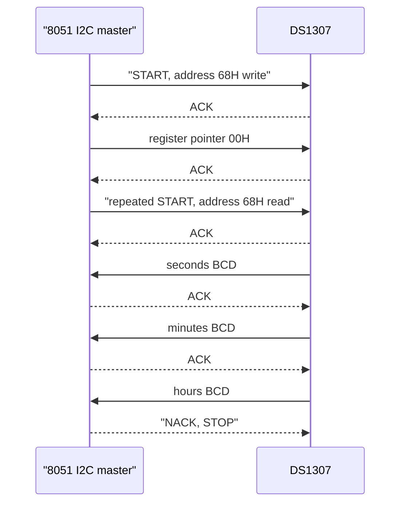

# Serial EEPROM and DS1307 RTC Interfacing

Serial EEPROMs and the DS1307 are small peripherals, but they expose several habits that matter across embedded work: read the exact address format, respect internal write time, distinguish RAM from nonvolatile state, decode BCD deliberately, and prevent a multi-register read from mixing two instants.

EEPROM provides storage after power loss. The RTC keeps calendar time while the main system is off. Both hide important device state behind a serial transaction, so a bus acknowledgement alone does not tell the whole story.

## The devices and their serial contracts

**EEPROM** is nonvolatile memory that can be electrically erased and programmed. It retains data without power, but writes are slower and have finite endurance compared with RAM.

The **93C46/56/66** family commonly uses a Microwire-like interface with chip select, serial clock, data input, and data output. Commands contain explicit opcodes for reading, writing, erasing, and enabling or disabling writes.

The **24C16/32/64** family uses I2C. A transaction carries a slave address, one or more internal memory-address bytes, and data. Capacity affects how address bits are divided between the I2C control byte and following address bytes, so a driver written for one 24Cxx size does not automatically fit every other size.

The **DS1307** is an I2C-compatible real-time clock. Its registers hold seconds, minutes, hours, day, date, month, and year, followed by a control register and battery-backed RAM. The seconds register includes a clock-halt bit, and the control register selects square-wave output behavior.

| Device class | Interface style | Typical contents | Main software rule |
|---|---|---|---|
| 93C46/56/66 EEPROM | Serial clock, chip select, data in/out | Small nonvolatile words | Send the exact opcode and limit write-enable time |
| 24C16/32/64 EEPROM | I2C two-wire bus | Nonvolatile bytes and pages | Respect page size and poll the write cycle |
| DS1307 RTC | I2C two-wire bus | BCD calendar registers and RAM | Decode BCD and detect rollover |
| MCU internal RAM | CPU memory space | Temporary variables | Fast but volatile |
| MCU flash or ROM | Program memory | Firmware and constants | Usually unsuitable for frequent runtime writes |

## Page writes are bounded twice

An EEPROM write is bounded by both page layout and internal programming time. Many 24Cxx devices accept several bytes in one page-write command, but an operation that crosses the page boundary may wrap to the beginning of the same page and overwrite earlier bytes. The driver must split the data before that boundary.

After the stop condition, programming may take milliseconds. During this interval the device commonly does not acknowledge its address. **Acknowledge polling** repeatedly addresses the EEPROM until it responds, replacing a guessed fixed delay with the device's actual completion signal.

Some EEPROM families also require an explicit write-enable command. Write enable should surround only the intended modification, followed by write disable; leaving it active broadens the effect of noise, reset transients, or software errors.

### Splitting a ten-byte write

Suppose a 24C-style EEPROM has 16-byte pages and receives 10 bytes starting at `003CH`. The low nibble is `CH`, or 12, so the current page has

$$
16-12=4
$$

bytes remaining. The first operation writes

```text
003CH, 003DH, 003EH, 003FH
```

and the remaining

$$
10-4=6
$$

bytes begin at `0040H`. Sending all ten bytes as one page write would cause many devices to wrap after `003FH` and overwrite addresses beginning at `0030H`.

## Nonvolatile bytes need a recoverable format

Endurance limits rule out writing a rapidly changing counter on every update. Wear leveling, batching, or a different storage technology may be needed when the update rate is high.

A settings or log record also needs structure rather than a bare address. A version, length, checksum, and validity marker let firmware distinguish erased memory, old layouts, corrupt data, and a write interrupted by reset or power loss. Ordering the validity update last can keep an incomplete record from being accepted as current.

The same distinction applies to acknowledgements: an I2C ACK confirms one bus phase, whereas successful acknowledge polling after a write indicates that the internal programming cycle has ended. Neither alone verifies the semantic validity of the stored record.

## Reading a DS1307 time block

DS1307 time fields use **binary-coded decimal**. Each decimal digit occupies four bits, so decimal 45 is stored as `45H`, not binary `2DH`. Arithmetic is usually simpler after conversion to ordinary binary values.

A sequential read first writes the register pointer, then issues a repeated start and reads consecutive registers:



The last byte is followed by NACK and STOP to end the read. Configuration is a separate concern: initial calendar setup, the clock-halt bit, 12- or 24-hour mode, and square-wave selection should not be rewritten during an ordinary read.

### Decoding `14:59:25`

For seconds `25H`, minutes `59H`, and hours `14H` in 24-hour mode, decode each nibble as a decimal digit:

$$
2\cdot 10+5=25,
$$

$$
5\cdot 10+9=59,
$$

$$
1\cdot 10+4=14.
$$

The time is `14:59:25`. Interpreting `59H` as an ordinary binary byte would produce decimal 89, an impossible minute value.

### Decoding the registers in C

```c
/* BCD helpers for RTC code. These are independent of the I2C driver. */

unsigned char bcd_to_bin(unsigned char bcd) {
    return (unsigned char)(((bcd >> 4) * 10u) + (bcd & 0x0Fu));
}

unsigned char bin_to_bcd(unsigned char value) {
    return (unsigned char)(((value / 10u) << 4) | (value % 10u));
}

void ds1307_decode_time(unsigned char sec_bcd,
                        unsigned char min_bcd,
                        unsigned char hour_bcd,
                        unsigned char *hour,
                        unsigned char *minute,
                        unsigned char *second) {
    sec_bcd &= 0x7F;          /* remove clock halt bit */
    hour_bcd &= 0x3F;         /* assume 24-hour mode */
    *second = bcd_to_bin(sec_bcd);
    *minute = bcd_to_bin(min_bcd);
    *hour = bcd_to_bin(hour_bcd);
}
```

This decoder assumes the hour register is already configured for 24-hour mode. A general driver must inspect bit 6 and handle the 12-hour AM/PM representation separately.

## Keeping a timestamp internally consistent

The calendar registers can change during a multi-byte read. If seconds roll over while minutes are being fetched, software may combine fields from two instants. A small system can read the block twice and accept matching values, or read seconds before and after the block and retry when rollover occurred.

Long-term accuracy depends on more than register handling. Crystal characteristics, load capacitance, board layout, temperature, and the backup supply affect oscillator accuracy and whether time survives main-power loss. The clock-halt bit must be cleared for the oscillator to run.

## Electrical details shared by both devices

EEPROM and RTC transactions depend on the same I2C pull-ups. Weak pull-ups on a capacitive bus create slow rising edges and sampling failures; overly strong pull-ups exceed the devices' low-level sink current. Device count, trace length, voltage, and bus speed determine a suitable range.

When debugging, separate bus faults from device-state faults. A missing ACK can mean the address is wrong, the device is absent, the bus is stuck, or an EEPROM is still programming. A valid time read can still be stale if the oscillator is halted. A successful page command can still corrupt data if it wrapped or if the record format cannot detect interrupted writes.

<div className="see-also">

See also: [Serial buses and embedded protocols](/cs/embedded/serial-buses-embedded-protocols) · [8051 external-world interfacing](/cs/embedded/external-world-interfacing) · [8051 timers, serial port, and interrupts](/cs/embedded/timers-serial-interrupts) · [Microcontroller derivatives, AVR, and PIC](/cs/embedded/microcontroller-derivatives-avr-pic)

</div>
