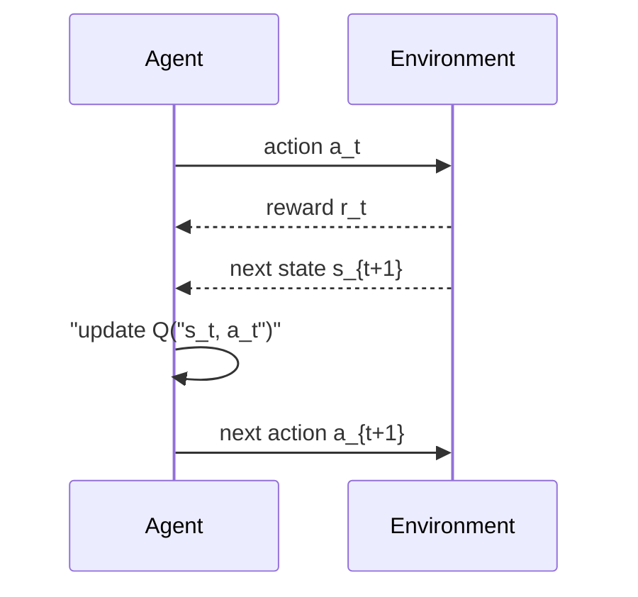

# Reinforcement Learning

Reinforcement learning studies how an agent learns to choose actions through interaction with an environment. Mitchell's final chapter presents the problem through Markov decision processes, delayed reward, Q-learning, exploration, temporal-difference learning, and generalization. It also connects back to the checkers learner from Chapter 1, where values of earlier states were updated from estimated values of later states.

This is a compact introduction compared with modern reinforcement learning, but the core concepts are still central. Current deep RL often replaces tabular values with neural networks and trains at much larger scale, yet it still wrestles with delayed reward, exploration, bootstrapping, instability, and the relation between value functions and policies.

## The agent-environment loop

An agent observes a state $s \in S$, chooses an action $a \in A$, receives a reward $r$, and transitions to a next state $s'$. A policy $\pi$ maps states to actions:

$$
\pi:S \to A.
$$

A Markov decision process (MDP) assumes that the next state and reward depend only on the current state and action, not on the full past history.




*Figure: Agent-environment interface diagram by [Martin Thoma, 2016](https://commons.wikimedia.org/wiki/File:Agent-environment-diagram-rl.svg), CC0 via Wikimedia Commons.*

The training loop is interactive: the agent's current policy changes the future data it receives. Reinforcement learning therefore differs from supervised learning in several ways. The learner is not told the correct action, rewards may be delayed, and exploration is necessary because actions that currently look poor may reveal better long-term reward.

| Issue | Supervised learning | Reinforcement learning |
|---|---|---|
| Training signal | Correct label or target value | Reward, often delayed |
| Data distribution | Usually fixed dataset | Influenced by the agent's policy |
| Main objective | Predict labels or values | Choose actions maximizing return |
| Exploration | Usually not central | Essential |
| Bootstrapping | Optional | Central in TD and Q-learning |

## From returns to Q-learning

The discounted return is:

$$
R_t = r_t + \gamma r_{t+1} + \gamma^2 r_{t+2}+\cdots,
$$

where $0 \leq \gamma \lt 1$ is the discount factor. A high discount factor makes distant rewards influential, while a low discount factor favors short-term payoff. The appropriate value depends on the time scale of the task. For episodic tasks, the episode definition also determines where credit assignment stops and the next independent trial begins.

The optimal action-value function $Q^*(s,a)$ is the maximum expected discounted return achievable after taking action $a$ in state $s$ and then acting optimally. For deterministic transitions,

$$
Q^*(s,a)=r(s,a)+\gamma \max_{a'} Q^*(s',a').
$$

The learned Q function directly determines a greedy policy:

$$
\pi(s)=\arg\max_a Q(s,a).
$$

Q-learning backs an estimate up from the best estimated value at the next state:

$$
Q(s,a) \leftarrow r + \gamma\max_{a'}Q(s',a').
$$

In stochastic settings, an incremental update moves only partway toward that target:

$$
Q(s,a) \leftarrow Q(s,a) + \alpha\left[r+\gamma\max_{a'}Q(s',a')-Q(s,a)\right].
$$

The bracketed term is the temporal-difference error. If the same action in the same state can lead to different rewards or next states, a single observed transition is only a sample. Over many visits, suitable learning rates allow the estimate to average over these outcomes.

## Delayed reward and exploration

If an agent wins a game after fifty moves, the final reward does not immediately identify which earlier moves were good. Temporal-difference learning moves value estimates backward one transition at a time. A state becomes valuable because it leads to a valuable successor; that successor acquired its value from reward or another valuable state. This bootstrapping links Q-learning to the checkers value-function update in Chapter 1 and to dynamic programming methods for MDPs.

Acting greedily during learning can block discovery. Epsilon-greedy action selection chooses a random action with probability $\epsilon$ and the current best action otherwise. An agent that explores too little may never find high-reward regions; one that explores too much may continue taking poor actions after learning a good policy. Other methods vary exploration over time or favor actions with uncertain estimates.

Q-learning is off-policy: under suitable assumptions, it can learn the optimal action-value function while following an exploratory behavior policy. In the tabular case, sufficient exploration and appropriate update conditions give convergence to the optimal Q values for finite MDPs. Mitchell presents deterministic and nondeterministic cases separately to build intuition.

Dynamic programming assumes a known transition and reward model and computes optimal values from that model. Q-learning instead learns from experience without being given the model. This model-free property often costs many interactions; when a model is available or can be learned, planning methods can use samples more efficiently.

## State, reward, and approximation choices

A Q table works only when states and actions are small enough to enumerate. Features or neural networks can estimate $Q(s,a)$ and generalize across states. The update then resembles supervised regression against bootstrapped targets, but those targets change with the learner. The stability assumptions are more delicate than in fixed-dataset regression, and tabular convergence guarantees do not automatically extend to neural-network approximation.

State representation matters just as much. The MDP assumption may hold for the true environment state but fail for the agent's observations. A robot, for example, may need previous sensor readings to infer velocity or hidden context. When important information is missing, the same observation may call for different actions at different times. Mitchell mentions hidden-state extensions while focusing the main treatment on fully observable MDPs.

Reward design is part of the problem specification. Sparse rewards can make learning slow, while poorly shaped rewards can encourage behavior that scores well without solving the intended task. Mitchell's formalism treats the reward function as given; applied reinforcement learning still has to check that the reward represents the desired performance measure.

Several distinctions are easy to lose in an implementation:

- A reward is not a supervised label for the correct action. An action with low immediate reward can still lead to the highest return.
- $Q$ evaluates state-action pairs; a policy chooses actions, often by maximizing $Q$.
- The discount factor encodes a time horizon, so increasing $\gamma$ changes which rewards influence a decision.
- If the observed state omits relevant history, the process is not Markov from the agent's perspective.

## Two Q-learning updates by hand

### A deterministic backup

Suppose an agent in state $s$ takes action $a$, receives $r=5$, and moves to $s'$, where

$$
Q(s',left)=4,\qquad Q(s',right)=7.
$$

With $\gamma=0.9$, first select the best next-state estimate:

$$
\max_{a'}Q(s',a')=\max(4,7)=7.
$$

Discounting that estimate gives

$$
\gamma \max_{a'}Q(s',a')=0.9(7)=6.3.
$$

Adding the immediate reward produces the backup target:

$$
r+\gamma\max_{a'}Q(s',a')=5+6.3=11.3,
$$

so

$$
Q(s,a)\leftarrow 11.3.
$$

The updated value includes both the reward of $5$ and the discounted estimate of future return.

### An incremental temporal-difference step

Now let $Q(s,a)=8$, $r=2$, $\gamma=0.5$, $\max_{a'}Q(s',a')=10$, and $\alpha=0.1$. The target is

$$
target = r+\gamma\max_{a'}Q(s',a')=2+0.5(10)=7.
$$

The temporal-difference error is

$$
\delta = target-Q(s,a)=7-8=-1.
$$

Scaling by the learning rate gives

$$
\alpha\delta=0.1(-1)=-0.1,
$$

and the update becomes

$$
Q_{\text{new}}(s,a)=8-0.1=7.9.
$$

Because the target is below the old estimate, the value decreases by a small amount rather than jumping directly to $7$.

## A minimal tabular implementation

```python
import random
from collections import defaultdict

actions = ["left", "right"]
Q = defaultdict(float)

def choose_action(state, epsilon=0.1):
    if random.random() < epsilon:
        return random.choice(actions)
    return max(actions, key=lambda a: Q[(state, a)])

def q_update(state, action, reward, next_state, alpha=0.1, gamma=0.9):
    best_next = max(Q[(next_state, a)] for a in actions)
    target = reward + gamma * best_next
    Q[(state, action)] += alpha * (target - Q[(state, action)])

Q[("s2", "left")] = 4
Q[("s2", "right")] = 7
q_update("s1", "right", reward=5, next_state="s2", alpha=1.0, gamma=0.9)
print(Q[("s1", "right")])
```

The action selector supplies epsilon-greedy exploration, while `q_update` performs one sampled temporal-difference backup. A complete episodic implementation must also treat terminal transitions explicitly so that no future value is added beyond the end of an episode.

<div className="see-also">

See also: [Learning problems and system design](/cs/machine-learning/learning-problems-and-system-design) · [Artificial neural networks](/cs/machine-learning/artificial-neural-networks) · [Analytical learning](/cs/machine-learning/analytical-learning) · [Combining inductive and analytical learning](/cs/machine-learning/combining-inductive-and-analytical-learning) · [Deeper reinforcement learning coverage](/cs/reinforcement-learning/intro)

</div>
