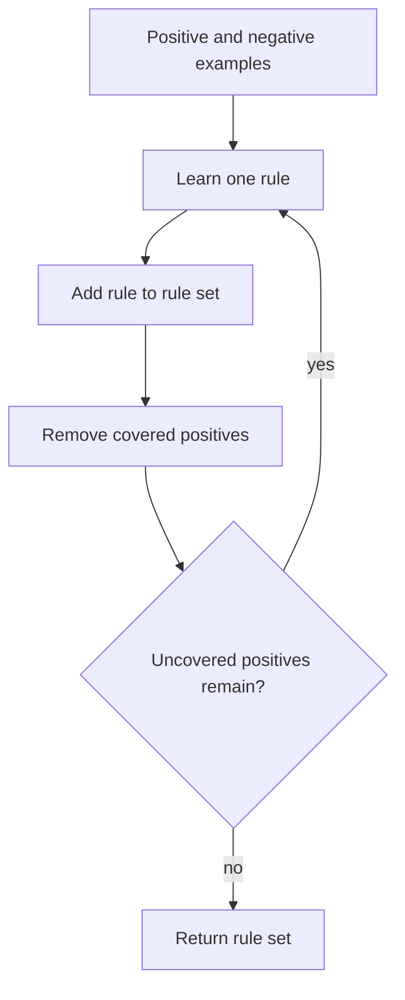

# Rule Learning and ILP

Learning sets of rules returns to symbolic representations, but with more practical machinery than the early concept-learning chapter. Mitchell covers sequential covering, rule evaluation, FOIL, first-order Horn clauses, and inductive logic programming. The goal is to learn readable if-then rules, sometimes with variables and relations rather than fixed attribute vectors.

The chapter is historically important because it shows machine learning interacting with logic programming. Rules can express relational structure that ordinary feature-vector methods hide. A rule learner can describe family relations, list structure, chemical relations, or database facts when examples are naturally relational.

## Building a concept one rule at a time

A propositional rule has the form

$$
IF \; conditions \; THEN \; class.
$$

For example,

$$
IF \; Outlook=Sunny \land Humidity=Normal \; THEN \; PlayTennis=Yes.
$$

A rule covers an example when the example satisfies the rule's conditions. Sequential covering learns one rule at a time, removes the positive examples covered by that rule, and continues with the remaining positives. The learned concept is the disjunction of the individual rules:

$$
h(x)=Rule_1(x)\lor Rule_2(x)\lor \cdots \lor Rule_k(x).
$$



The search is greedy: it commits to one rule before searching for the next. Its basic loop is:

1. Learn a high-precision rule while positive examples remain.
2. Add the rule to the rule set.
3. Remove the positive examples it covers.
4. Stop when enough positives are covered or another stopping criterion applies.

Unlike a decision-tree path, a separately learned rule can use only the conditions needed for one subcase. The resulting description can be more modular, though greedy removal means that later rules depend on earlier choices.

## Specializing without memorizing

Rule learning often searches from general to specific. A general rule covers many positives but may also admit negatives. Adding conditions reduces coverage and should improve precision. A useful rule must be accurate enough to trust and broad enough to remove a meaningful part of the positive set, so quality measures commonly combine positive coverage, negative coverage, and sometimes description length.

Specialization can continue until every negative training example is excluded, but the last few conditions may describe sample accidents. Post-pruning removes conditions when that improves validation performance or an estimated quality measure. A pruned rule may cover a few training negatives and still generalize better.

Three implementation details affect the meaning of the final classifier:

- Covered positives are removed during sequential covering; negatives usually remain to constrain subsequent rules.
- An example left uncovered normally receives a default prediction, often the negative class. It is not automatically treated as unknown unless the system can abstain.
- Rule order matters in a decision list because the first matching rule wins. Unordered rule sets instead need a voting or conflict-resolution policy.

Coverage alone is therefore a poor objective. A broad rule that covers many positives and many negatives can damage every later decision, while an extremely narrow rule may amount to memorization.

## From attribute tests to relations

First-order Horn clauses introduce variables and predicates:

$$
Grandparent(x,z) \leftarrow Parent(x,y) \land Parent(y,z).
$$

Inductive logic programming (ILP) learns logical rules from examples and background knowledge. The learner searches a space of logic programs rather than ordinary attribute tests. FOIL is a top-down ILP algorithm: it begins with a general clause and adds body literals, choosing among candidates with an information-gain measure adapted to first-order rules.

Candidate literals may introduce variables. To learn `Grandparent(x,z)`, for example, FOIL can add an intermediate variable `y` and connect two `Parent` facts. A short clause then states a relational pattern that would require many engineered propositional features if the relations were flattened.

That expressiveness enlarges the search space. Possible literals, variable bindings, and clauses multiply quickly, so ILP systems impose a language bias that limits which predicates and variable patterns may be considered. Unrestricted variables and literals can make the search effectively unbounded.

Background predicates set another hard boundary. Given `Parent`, the learner can express `Grandparent` compactly. Without a predicate that supplies the relevant relation, FOIL cannot discover the intended bridge merely by searching longer. The result depends on the examples, the hypothesis language, and the supplied background knowledge.

Coverage testing is also more expensive than in propositional learning. One labeled relation may depend on many background facts, and a candidate clause can admit many variable bindings. Efficient systems rely on fact indexes, restricted literal generation, and aggressive pruning.

| Approach | Representation | Search direction | Strength | Risk |
|---|---|---|---|---|
| Decision tree rules | Propositional path rules | Tree induction then conversion | Simple and readable | Tree bias controls rule form |
| Sequential covering | Propositional rule set | Often general to specific | Directly learns disjunctions | Rule ordering and pruning matter |
| FOIL | First-order Horn clauses | General to specific | Handles relations and variables | Large search space |
| Inverse resolution | Logic clauses | Inverts deduction | Strong logical foundation | Complex and sensitive to bias |

## Covering a small propositional dataset

Suppose the target is `Buy=Yes` and the two attributes are `Student` and `Coupon`.

| Example | Student | Coupon | Buy |
|---|---|---|---|
| 1 | Yes | Yes | Yes |
| 2 | Yes | No | Yes |
| 3 | No | Yes | Yes |
| 4 | No | No | No |

Use a covering procedure that accepts only rules with no negative coverage. The positive examples are 1, 2, and 3; example 4 is negative. Begin with

$$
IF \; Student=Yes \; THEN \; Buy=Yes.
$$

This rule covers examples 1 and 2, both positive, so add it and remove those two positives. Example 3 remains. A second rule covers it:

$$
IF \; Coupon=Yes \; THEN \; Buy=Yes.
$$

It covers examples 1 and 3 and no negatives. After removing example 3, no positives remain. The rule set is

$$
Student=Yes \Rightarrow Buy=Yes
$$

$$
Coupon=Yes \Rightarrow Buy=Yes.
$$

Example 1 satisfies both rules, examples 2 and 3 satisfy one each, and example 4 satisfies neither. With `No` as the default, all four predictions are correct. The learned concept is $Student=Yes \lor Coupon=Yes$.

## Following FOIL's intermediate variable

Suppose the target is `Grandparent(x,z)`, a positive example is `Grandparent(Alice,Carol)`, and the background facts include `Parent(Alice,Bob)` and `Parent(Bob,Carol)`. Start with the most general clause:

$$
Grandparent(x,z) \leftarrow true.
$$

It covers every pair $(x,z)$, including many negatives. Adding a literal that links $x$ to a new variable gives

$$
Grandparent(x,z) \leftarrow Parent(x,y).
$$

For `x=Alice`, the fact `Parent(Alice,Bob)` binds `y=Bob`, but the rule still leaves $z$ unconstrained. A second literal completes the chain:

$$
Grandparent(x,z) \leftarrow Parent(x,y) \land Parent(y,z).
$$

Substituting $x=Alice$ and $z=Carol$ requires

$$
Parent(Alice,y) \land Parent(y,Carol).
$$

The binding $y=Bob$ makes both literals true:

$$
Parent(Alice,Bob) \land Parent(Bob,Carol).
$$

The intermediate variable expresses the relational bridge needed for grandparenthood. Its value is determined during coverage testing rather than supplied as a pre-engineered feature.

## Executing the propositional rule set

```python
def covers(rule_conditions, example):
    return all(example[attr] == value for attr, value in rule_conditions.items())

examples = [
    {"Student": "Yes", "Coupon": "Yes", "Buy": "Yes"},
    {"Student": "Yes", "Coupon": "No", "Buy": "Yes"},
    {"Student": "No", "Coupon": "Yes", "Buy": "Yes"},
    {"Student": "No", "Coupon": "No", "Buy": "No"},
]

rules = [
    {"Student": "Yes"},
    {"Coupon": "Yes"},
]

for ex in examples:
    predicted = "Yes" if any(covers(rule, ex) for rule in rules) else "No"
    print(ex, "=>", predicted)
```

The `any` expression gives unordered disjunctive semantics: matching either rule predicts `Yes`, and matching neither falls through to the default `No`. An ordered decision list would need to test rules in priority order and stop at the first match.

A logical clause and an empirical guarantee should not be confused. A learned clause may be syntactically valid and entail a prediction under the background facts while still having weak statistical support. Coverage estimates, pruning, and held-out evaluation remain necessary.

<div className="see-also">

See also: [Concept learning](/cs/machine-learning/concept-learning-and-version-spaces) · [Decision tree learning](/cs/machine-learning/decision-tree-learning) · [Genetic algorithms](/cs/machine-learning/genetic-algorithms) · [Analytical learning](/cs/machine-learning/analytical-learning) · [Data mining](/cs/data-mining/intro)

</div>
