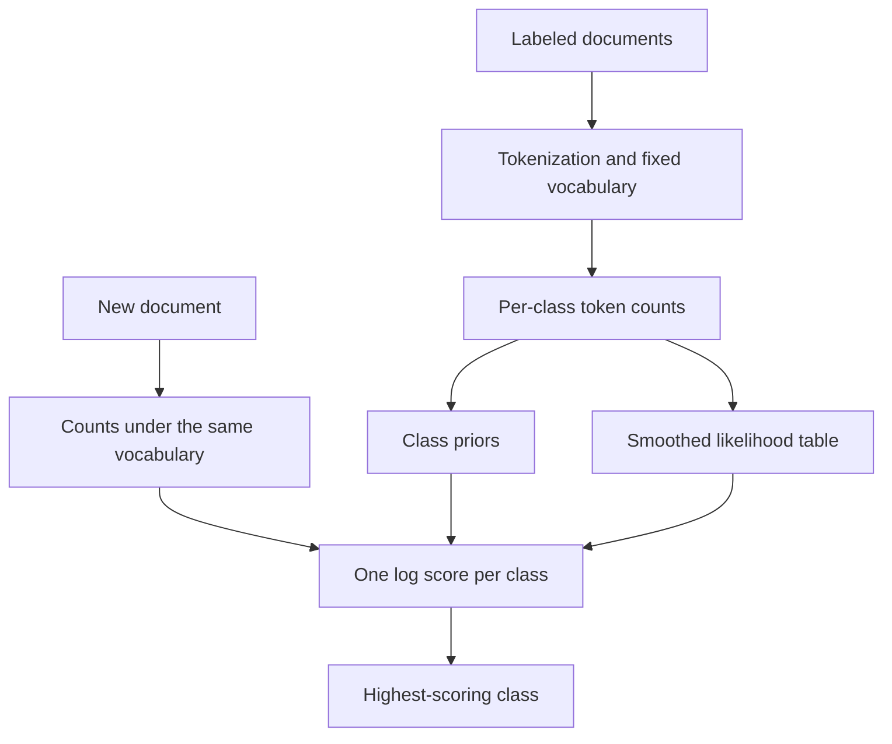

# Naive Bayes and Sentiment Classification

Naive Bayes is still the quickest way to find out whether a text classification dataset contains a learnable lexical signal. Training reduces to counting. Prediction is a sum of table lookups. The resulting word scores are easy to inspect, so leakage and annotation artifacts tend to show themselves early.

Sentiment is the usual teaching example because words such as `excellent`, `tedious`, and `refund` carry recognizable evidence. The same machinery works for topic labels, spam, language identification, and authorship attributes. Its assumptions are plainly wrong for natural language: words depend on neighboring words, syntax, discourse, and document length. The model succeeds because classification can tolerate a poor account of language generation when the class-conditional word distributions remain different enough.

## The generative story behind the counting

Let $C$ be the set of classes and $d$ a document. Classification starts from

$$
\hat c=\arg\max_{c\in C}P(c\mid d).
$$

Bayes' rule gives

$$
P(c\mid d)=\frac{P(d\mid c)P(c)}{P(d)}.
$$

The denominator is the same for every candidate class, so it disappears inside the argmax:

$$
\hat c=\arg\max_{c\in C}P(c)P(d\mid c).
$$

Multinomial Naive Bayes imagines that a class is chosen from the prior $P(c)$ and then every token is drawn independently from a class-specific categorical distribution. If $n(w,d)$ is the count of word $w$ in document $d$,

$$
P(d\mid c)\propto\prod_{w\in V}P(w\mid c)^{n(w,d)}.
$$

The omitted multinomial coefficient depends on the document's counts but not on $c$, so it cannot change the predicted class. Multiplication of many small probabilities underflows quickly. Taking logs converts products to sums and preserves their ordering:

$$
\operatorname{score}(c,d)
=\log P(c)+\sum_{w\in V}n(w,d)\log P(w\mid c).
$$

The class prior is estimated from document counts,

$$
\widehat P(c)=\frac{N_c}{N},
$$

while the word likelihood is estimated from token counts within a class. With add-$\alpha$ smoothing,

$$
\widehat P(w\mid c)=
\frac{n(w,c)+\alpha}
{\sum_{w'\in V}n(w',c)+\alpha|V|}.
$$

Add-one smoothing sets $\alpha=1$. Smaller positive values often work better for large vocabularies because adding a full pseudo-count to every rare type can flatten the distribution too much. The value belongs in a validation search, not in the definition of the model.

## Smoothing is part of the model

Without smoothing, one unseen word makes the entire class likelihood zero. Suppose `masterpiece` appears only in positive training reviews. An unsmoothed negative model assigns it probability zero, so a review containing that token can never be negative, regardless of the remaining words. In log space the problem appears as $\log 0=-\infty$.

Additive smoothing can be read as putting a symmetric Dirichlet prior on each class's word distribution. Every vocabulary item receives $\alpha$ pseudo-occurrences before data is observed. The denominator must include $\alpha\vert V\vert $; adding $\alpha$ only to the numerator produces values that no longer sum to one.

The vocabulary itself needs a fixed policy. If prediction silently adds every new word to $V$, the denominator changes after training and all stored probabilities become inconsistent. Usual choices are to ignore out-of-vocabulary tokens or map them to an `<UNK>` token whose counts were learned by replacing some rare training words. Fitting the vocabulary on the whole corpus leaks test-set information even when labels are hidden.

Class priors can also be smoothed, although this matters mainly when some labels have very few documents. A uniform prior is sometimes chosen deliberately when the training class balance is an artifact of sampling. That choice changes the target distribution and should be documented.

## The classifier is linear in word counts

For binary sentiment, subtract the negative score from the positive score:

$$
\begin{aligned}
\Delta(d)
&=\operatorname{score}(\mathrm{pos},d)
-\operatorname{score}(\mathrm{neg},d)\\
&=\log\frac{P(\mathrm{pos})}{P(\mathrm{neg})}
+\sum_{w\in V}n(w,d)
\log\frac{P(w\mid\mathrm{pos})}{P(w\mid\mathrm{neg})}.
\end{aligned}
$$

Each word has a fixed log-likelihood-ratio weight. Prediction is a linear decision in the vector of token counts, despite the generative derivation. A positive $\Delta(d)$ selects the positive class; a negative value selects the negative class. Repeating a word repeats its contribution, which can make `good good good` much stronger evidence than `good`.

Naive Bayes often becomes overconfident because correlated observations are counted as though they were independent. `awful` and `terrible` appearing together may reflect one underlying judgment, yet the model multiplies both likelihood ratios. The winning label can still be accurate while the normalized posterior probability is poorly calibrated. Do not treat a score of $0.999$ as a reliable risk estimate without calibration checks.

## Choosing the event model

The word *Naive Bayes* covers several related likelihoods. The event model must match the features.

| Variant | Evidence used | Good fit | Characteristic failure |
|---|---|---|---|
| multinomial | token counts | documents where repetition carries signal | long or repetitive text can dominate |
| binary multinomial | each present word counted once | review sentiment and short messages | discards genuine intensity |
| Bernoulli | presence and absence of every vocabulary item | small controlled vocabularies | absence terms are costly and can overwhelm |
| complement NB | statistics from all other classes | imbalanced multiclass text | interpretation is less direct |

Binary multinomial Naive Bayes is common for sentiment: clip document counts to one, then use the multinomial scoring formula. Bernoulli Naive Bayes is different. It includes both present-word factors $P(x_w=1\mid c)$ and absent-word factors $P(x_w=0\mid c)$. With a large vocabulary, thousands of absences contribute to every score.

Feature engineering repairs only the dependencies it explicitly represents. Appending a marker in a negation scope turns `not good` into something like `NOT_good`; word bigrams create a direct feature for the phrase. Character $n$-grams cover spelling variants and expressive forms such as `soooo`. These changes alter the event inventory, so smoothing and minimum-frequency thresholds need retuning.



## Worked example: classifying `good fun`

Use vocabulary $V=\{\mathrm{good},\mathrm{fun},\mathrm{boring}\}$, add-one smoothing, and the following sufficient statistics:

| Class | Documents | `good` | `fun` | `boring` |
|---|---:|---:|---:|---:|
| positive | 3 | 3 | 2 | 0 |
| negative | 2 | 0 | 1 | 3 |

There are five documents, so

$$
P(\mathrm{pos})=\frac35,
\qquad
P(\mathrm{neg})=\frac25.
$$

The positive class contains $3+2+0=5$ tokens from the vocabulary. Its smoothed denominator is $5+1\cdot3=8$:

$$
P(\mathrm{good}\mid\mathrm{pos})=\frac{3+1}{8}=\frac48,
\qquad
P(\mathrm{fun}\mid\mathrm{pos})=\frac{2+1}{8}=\frac38.
$$

The negative class contains four tokens, giving denominator $4+3=7$:

$$
P(\mathrm{good}\mid\mathrm{neg})=\frac17,
\qquad
P(\mathrm{fun}\mid\mathrm{neg})=\frac27.
$$

For a two-token document, direct multiplication is still safe:

$$
\begin{aligned}
S_{\mathrm{pos}}
&=\frac35\cdot\frac48\cdot\frac38
=\frac{36}{320}=0.1125,\\
S_{\mathrm{neg}}
&=\frac25\cdot\frac17\cdot\frac27
=\frac4{245}\approx0.0163.
\end{aligned}
$$

The positive score is larger. Normalizing these two joint scores would give

$$
P(\mathrm{pos}\mid d)
=\frac{0.1125}{0.1125+0.0163}
\approx0.873,
$$

though classification itself needs only the comparison.

## Worked example: how repetition changes the decision

Keep the same model and compare `boring` with `good boring boring`. First calculate the relevant log-ratio weights:

$$
\begin{aligned}
b&=\log\frac{3/5}{2/5}=\log(1.5)\approx0.405,\\
w_{\mathrm{good}}
&=\log\frac{4/8}{1/7}=\log(3.5)\approx1.253,\\
w_{\mathrm{boring}}
&=\log\frac{1/8}{4/7}=\log(7/32)\approx-1.520.
\end{aligned}
$$

For `boring`, the score difference is

$$
\Delta=0.405-1.520=-1.115,
$$

so the prediction is negative. For `good boring boring`, raw multinomial counts give

$$
\Delta=0.405+1.253+2(-1.520)=-1.382.
$$

The repeated negative token wins. With binary counts, `boring` contributes only once:

$$
\Delta_{\mathrm{binary}}=0.405+1.253-1.520=0.138,
$$

and the prediction flips to positive. Neither event model is universally correct; the example exposes exactly what must be decided about repeated evidence.

## Worked example: evaluating the positive label

Suppose a system predicts 12 reviews as positive. Nine are truly positive, and the test set contains 15 positive reviews in total. Then

$$
TP=9,\qquad FP=12-9=3,\qquad FN=15-9=6.
$$

Precision measures correctness among predicted positives:

$$
P=\frac{TP}{TP+FP}=\frac9{12}=0.75.
$$

Recall measures coverage of actual positives:

$$
R=\frac{TP}{TP+FN}=\frac9{15}=0.60.
$$

Their harmonic mean is

$$
F_1=\frac{2PR}{P+R}
=\frac{2(0.75)(0.60)}{0.75+0.60}
=0.667.
$$

Accuracy cannot be recovered without the number of true negatives. On an imbalanced dataset it may also obscure the minority class, so the confusion matrix should accompany any single aggregate score.

## Minimal implementation from sufficient statistics

```python
from collections import Counter, defaultdict
from math import log

train = [
    ("pos", "good fun good"),
    ("pos", "good moving fun"),
    ("neg", "boring dull"),
    ("neg", "boring fun"),
]

alpha = 1.0
class_docs = Counter()
word_counts = defaultdict(Counter)
total_words = Counter()
vocab = set()

for label, text in train:
    words = text.split()
    class_docs[label] += 1
    word_counts[label].update(words)
    total_words[label] += len(words)
    vocab.update(words)

def score(label, text):
    value = log(class_docs[label] / sum(class_docs.values()))
    denominator = total_words[label] + alpha * len(vocab)
    for word in text.split():
        if word in vocab:  # fixed-vocabulary policy: ignore unseen words
            numerator = word_counts[label][word] + alpha
            value += log(numerator / denominator)
    return value

document = "good fun"
scores = {label: score(label, document) for label in class_docs}
prediction = max(scores, key=scores.get)
print(scores, prediction)
```

Production implementations precompute every log prior and log likelihood rather than recalculating them per document. Sparse count matrices make training a handful of reductions. For streaming data, counts can be updated incrementally, provided the vocabulary and smoothing policy remain coherent.

## Reading errors rather than only scores

An overall sentiment label compresses several judgments. A review can praise the acting and dislike the plot; sarcasm can reverse surface polarity; quoted speech may express someone else's view. Domain shift is severe: `unpredictable` is often praise for a film and a warning for a car. Label guidelines need to say whether neutral and mixed cases exist, what target is being judged, and how ties are handled.

Inspect the largest positive and negative log ratios. Names, rating markup, publisher boilerplate, or train/test duplicates point to leakage. Strong reasonable words followed by systematic negation errors point to missing phrase features. Errors concentrated in one source or dialect suggest sampling and annotation problems rather than a smoothing issue.

Naive Bayes and logistic regression should be compared with the same tokenization, split, vocabulary threshold, and metric. The generative model often learns quickly from little data; the discriminative model generally handles correlated features better once enough labels are available. A large model that fails to beat both baselines warrants an audit of its training setup before further tuning.

## Negation, document length, and other modeling decisions

Simple negation marking usually begins after a cue such as `not`, `never`, or `no` and ends at punctuation. Thus `not engaging at all` may become `not NOT_engaging NOT_at NOT_all`. The new token `NOT_engaging` can acquire a negative likelihood without changing the ordinary `engaging` estimate. The rule is deliberately shallow. It mishandles constructions such as `not only funny but moving`, long-distance scope, and implicit negation, but it gives the count model a distinction it otherwise cannot represent.

Word bigrams offer a less rule-specific alternative. They capture `not good`, but data sparsity grows because every phrase is a separate event. Combining unigrams and selected bigrams usually needs a minimum document-frequency rule. Feature selection must be learned from training data only; using label association computed on the complete corpus leaks test labels directly.

Document length affects multinomial evidence twice. Longer documents contribute more token factors, and repeated topic or sentiment words can drive log scores to large magnitudes. This may be desirable when repetitions are independent evidence, but reviews often restate one opinion. Binary counts, length normalization, or separate length features let validation data decide how much repetition should matter. Standard multinomial probabilities are not normalized by test-document length because both class scores see the same length; dividing log likelihood by length changes how the prior competes with lexical evidence.

Class priors matter most for short or uninformative documents. An empty document receives only $\log P(c)$ and therefore selects the majority class. As lexical evidence accumulates, likelihood ratios can overwhelm that prior. A deployment with a changed class prevalence may need updated priors while retaining class-conditional word estimates, provided the language within each class has not shifted.

## Multiclass scores and normalized posteriors

Nothing in multinomial Naive Bayes restricts the label set to two classes. Compute one prior and one smoothed word distribution per class, then choose the largest log score. If a normalized posterior is required, apply log-sum-exp:

$$
P(c\mid d)=\exp\left(s_c-\operatorname{LSE}(s_1,\ldots,s_K)\right),
$$

where $s_c$ is the class log joint and

$$
\operatorname{LSE}(s_1,\ldots,s_K)
=m+\log\sum_j\exp(s_j-m),\qquad m=\max_j s_j.
$$

Subtracting $m$ prevents overflow and underflow. The normalized values can still be badly calibrated because the independence assumption counts correlated words repeatedly. They are useful for ranking and abstention studies only after calibration is measured.

For multilabel tasks, independent one-versus-rest models are more appropriate than one multiclass model because labels need not be mutually exclusive. Each binary model has its own prior, vocabulary statistics, and decision threshold. Rare labels may have too few positive token counts for stable likelihoods, making shared representations or hierarchical labels attractive.

## Dataset construction can dominate the algorithm

Random document splits are unsafe when multiple reviews come from the same author, product, conversation, or template. Author style and product names become shortcuts that appear in both train and test. Grouped splitting asks whether the classifier transfers to new groups. A temporal split asks whether vocabulary survives drift. Both are usually harder and more informative than a random split.

Annotation disagreement should not be erased silently. If annotators disagree on mixed or sarcastic examples, a forced majority label makes the evaluation look more certain than the task. Keeping agreement statistics, allowing an uncertain category, or modeling soft label proportions can better match the evidence. Naive Bayes expects categorical training labels in its simplest form, but fractional class counts can incorporate soft assignments if their interpretation is clear.

Error analysis should sample false positives and false negatives across score ranges, not only the most confident mistakes. Confident errors expose leakage and domain mismatch; borderline errors expose label ambiguity and missing distinctions. Correct high-confidence cases can also reveal shortcuts. A model that predicts sentiment from rating boilerplate will look excellent until the rating markup disappears.

The model's simplicity is an advantage during these checks. Every prediction can be reconstructed from a prior plus token log likelihoods, so unexplained behavior usually traces to counts, vocabulary policy, or preprocessing rather than a hidden computation.

A useful final sanity check is to shuffle the training labels. Performance should fall to chance apart from ordinary sampling noise. If it remains high, the pipeline is leaking labels through filenames, preprocessing, split construction, or cached features. Training on a deliberately tiny subset should also be easy to overfit. Together, the shuffle and overfit checks distinguish a suspiciously informative dataset from a classifier that never receives the intended inputs.

## Related pages

- [Logistic regression for text](/cs/nlp/logistic-regression-for-text)
- [Vector semantics and embeddings](/cs/nlp/vector-semantics-and-embeddings)
- [Information extraction](/cs/nlp/information-extraction)
- [Regular expressions, normalization, and edit distance](/cs/nlp/regular-expressions-normalization-edit-distance)
