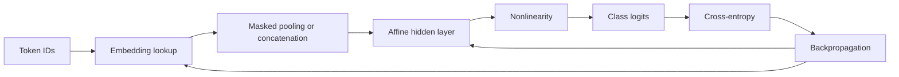

# Neural Networks for NLP

A feedforward network adds one important capability to a linear text classifier: it can learn intermediate features rather than requiring every useful conjunction to be named in advance. The output may still be an ordinary softmax classifier, but it now operates on a representation produced jointly with the classifier.

The gain is easy to overstate. Averaging word embeddings and passing the result through a multilayer perceptron still discards word order. A hidden layer does not recover information already erased by the input representation. Neural models help when their input and architecture preserve the distinctions the task needs, and when the data is sufficient to estimate the extra parameters.

## A network as a stack of affine maps and nonlinearities

For input $x\in\mathbb{R}^d$, a one-hidden-layer classifier is

$$
\begin{aligned}
a &= Wx+b,\\
h &= g(a),\\
z &= Uh+c,\\
\hat y &= \operatorname{softmax}(z).
\end{aligned}
$$

If there are $m$ hidden units and $K$ classes, then $W\in\mathbb{R}^{m\times d}$, $b\in\mathbb{R}^m$, $U\in\mathbb{R}^{K\times m}$, and $c\in\mathbb{R}^K$. Writing the shapes beside an equation is a useful defense against silent broadcasting errors.

The nonlinearity $g$ is essential. With $g(a)=a$, two affine layers collapse:

$$
U(Wx+b)+c=(UW)x+(Ub+c),
$$

which is still one affine map. Depth without nonlinearities adds parameters but no new class of functions.

ReLU is the common simple choice,

$$
\operatorname{ReLU}(a)=\max(a,0),
$$

applied coordinatewise. Its derivative is $1$ for positive inputs and $0$ for negative inputs; a conventional subgradient is chosen at zero. ReLU avoids the severe positive-region saturation of sigmoid and is cheap to compute. A unit that receives negative preactivations for every example has zero gradient and can remain "dead." GELU and related smooth activations are common in transformer blocks, while tanh remains natural in recurrent equations because its bounded signed output fits state updates.

Each hidden ReLU introduces a boundary where one affine response switches on. The network partitions input space into regions and fits a different linear function in each. That piecewise-linear view is more informative than saying that the model vaguely "learns features."

## Tokens enter through a lookup table

Discrete token IDs cannot be fed directly as magnitudes: token 500 is not semantically five times token 100. An embedding table $E\in\mathbb{R}^{\vert V\vert \times d_e}$ assigns each vocabulary item a trainable vector. For token ID $i$, the embedding is row $E_i$.

Looking up $E_i$ is algebraically equivalent to multiplying the one-hot row vector for $i$ by $E$. Direct indexing avoids constructing a mostly zero vector. During a minibatch update, only rows for tokens in that batch receive gradients, though weight decay or some optimizer implementations may affect more parameters.

Rare tokens get few updates and are easily overfit. Word-level vocabularies also have no natural vector for unseen forms. Subword tokenization shares pieces across related or novel words; character encoders go further and construct representations from spelling. Pretrained embeddings supply a useful starting geometry, but static vectors still assign one vector to a word such as `bank` in every context.

### Turning a variable-length document into one vector

A feedforward classifier expects a fixed-size input. Several reductions are common:

| Reduction | Preserves | Loses or risks |
|---|---|---|
| mean pooling | average lexical content, length normalization | order and sharp local evidence |
| sum pooling | token frequency and accumulated evidence | scale varies with length |
| max pooling | strongest activation per coordinate | frequency and most context |
| concatenated window | position inside a fixed window | all tokens outside the window |
| learned attention pooling | task-weighted token mixture | adds parameters and may still blur order |

Padding must be excluded from a mean. If a three-token sentence is padded to length five and the padding embedding is included, its vector is divided by five rather than three. Setting the padding row to zero prevents a direct contribution but does not fix the denominator. A mask must supply the count of real tokens.



## What backpropagation computes

For a gold class $y$, softmax cross-entropy is

$$
L=-\log\hat y_y.
$$

The derivative with respect to each output logit is

$$
\delta^{(z)}_k=\frac{\partial L}{\partial z_k}
=\hat y_k-\mathbb{1}[k=y].
$$

From there the chain rule moves backward:

$$
\begin{aligned}
\frac{\partial L}{\partial U}&=\delta^{(z)}h^\top,\\
\frac{\partial L}{\partial c}&=\delta^{(z)},\\
\delta^{(h)}&=U^\top\delta^{(z)},\\
\delta^{(a)}&=\delta^{(h)}\odot g'(a),\\
\frac{\partial L}{\partial W}&=\delta^{(a)}x^\top,\\
\frac{\partial L}{\partial b}&=\delta^{(a)}.
\end{aligned}
$$

The outer-product form explains which parameters change. An inactive ReLU has $g'(a)=0$, blocking the gradient to its incoming weights for that example. The input gradient $W^\top\delta^{(a)}$ continues into a pooling operation and then into the embedding rows that supplied the pooled vector.

Automatic differentiation performs these operations, but the equations remain useful for debugging detached tensors, wrong dimensions, and unexpectedly zero gradients. Backpropagation is an efficient organization of the chain rule, not a distinct learning objective.

Unlike logistic regression, the objective is nonconvex. Hidden-unit permutations alone create many equivalent parameter settings. Initialization must break symmetry: if two units begin with identical incoming and outgoing weights, their gradients remain identical. Variance-aware initializations keep activations from exploding or shrinking as they pass through layers.

## Worked example: complete forward pass

Take a pooled embedding $x=[1,2]^\top$, two hidden units, and two classes:

$$
W=\begin{bmatrix}1&-1\\0.5&0.5\end{bmatrix},
\quad b=\begin{bmatrix}0\\0\end{bmatrix},
\quad U=\begin{bmatrix}1&0\\0&1\end{bmatrix},
\quad c=\begin{bmatrix}0\\0\end{bmatrix}.
$$

First calculate the hidden preactivation:

$$
\begin{aligned}
a=Wx+b
&=\begin{bmatrix}
1(1)+(-1)(2)\\
0.5(1)+0.5(2)
\end{bmatrix}\\
&=\begin{bmatrix}-1\\1.5\end{bmatrix}.
\end{aligned}
$$

ReLU clips the first coordinate:

$$
h=\begin{bmatrix}0\\1.5\end{bmatrix}.
$$

The identity output matrix gives

$$
z=Uh+c=\begin{bmatrix}0\\1.5\end{bmatrix}.
$$

After subtracting the maximum logit, the exponentials are $[e^{-1.5},e^0]\approx[0.2231,1]$. Therefore

$$
\hat y
=\frac{[0.2231,1]}{1.2231}
\approx[0.1824,0.8176].
$$

Class 2 is predicted. If class 1 is correct, the loss is

$$
L=-\log(0.1824)\approx1.701.
$$

## Worked example: one gradient reaches the first layer

Continue the same example with gold class 1. The logit error is

$$
\delta^{(z)}=\hat y-[1,0]^\top
=\begin{bmatrix}-0.8176\\0.8176\end{bmatrix}.
$$

Because $U$ is the identity,

$$
\delta^{(h)}=U^\top\delta^{(z)}
=\begin{bmatrix}-0.8176\\0.8176\end{bmatrix}.
$$

The first preactivation was negative and the second positive, so the ReLU derivative is $[0,1]^\top$. Elementwise multiplication gives

$$
\delta^{(a)}
=\delta^{(h)}\odot[0,1]^\top
=\begin{bmatrix}0\\0.8176\end{bmatrix}.
$$

The first-layer weight gradient is the outer product

$$
\begin{aligned}
\frac{\partial L}{\partial W}
&=\delta^{(a)}x^\top\\
&=\begin{bmatrix}0\\0.8176\end{bmatrix}
\begin{bmatrix}1&2\end{bmatrix}\\
&=\begin{bmatrix}0&0\\0.8176&1.6352\end{bmatrix}.
\end{aligned}
$$

With learning rate $0.1$, the second row changes from $[0.5,0.5]$ to

$$
[0.5,0.5]-0.1[0.8176,1.6352]
=[0.4182,0.3365].
$$

The first row receives no update from this example because its ReLU was off. The output matrix also changes: $\partial L/\partial U=\delta^{(z)}h^\top$, so only its second column has nonzero entries.

## A fixed-window neural language model

An early neural language model predicts the next token from the previous $n-1$ token embeddings. For context `the cat` with

$$
e(\mathrm{the})=[1,0],\qquad e(\mathrm{cat})=[0,1],
$$

concatenation in temporal order produces

$$
x=[e(\mathrm{the});e(\mathrm{cat})]=[1,0,0,1].
$$

A matrix $W\in\mathbb{R}^{h\times4}$ can give different weights to `the` two positions back and the same embedding one position back. The hidden vector then feeds a vocabulary-sized softmax:

$$
P(w_t\mid w_{t-2},w_{t-1})
=\operatorname{softmax}(Uh+c).
$$

Compared with an $n$-gram table, embeddings share evidence across similar tokens and the hidden layer shares evidence across similar contexts. The window is still fixed. Nothing before $w_{t-2}$ can influence the prediction, which motivates recurrent networks and attention-based models.

Large-vocabulary softmax is expensive because $U$ has one row per output token and normalization scores every row. Hierarchical softmax, sampled losses, and related approximations reduce training cost, though exact probabilities at evaluation still require care.

## Training choices that change the result

Mini-batch stochastic optimization estimates the full-data gradient from a subset of examples. Adam often reaches a useful solution quickly; SGD can generalize well with tuned schedules. Learning rates that are too large cause unstable loss, while very small rates can make a healthy model look broken. Keep training and validation curves rather than relying on the final epoch.

Dropout replaces randomly selected activations with zero during training and rescales the survivors, discouraging brittle co-adaptation. It must be disabled at evaluation. Weight decay constrains parameter magnitudes, while early stopping limits how far fitting proceeds after validation performance stalls. These methods are related but not interchangeable.

Pretrained embeddings can be frozen, fine-tuned, or assigned a smaller learning rate than the classifier. Freezing reduces variance on a small labeled set. Fine-tuning can adapt meanings to a domain but may move rare rows based on very few examples. Report which choice was used.

Random seeds affect initialization, minibatch order, and dropout masks. A difference smaller than run-to-run variation is not persuasive. For small datasets, several runs and a mean with dispersion give a more honest comparison than one favorable seed.

## Masked mean pooling in code

```python
import torch
import torch.nn as nn

class MeanPoolClassifier(nn.Module):
    def __init__(self, vocab_size, emb_dim, hidden_dim, num_classes, pad_id=0):
        super().__init__()
        self.pad_id = pad_id
        self.embedding = nn.Embedding(vocab_size, emb_dim, padding_idx=pad_id)
        self.classifier = nn.Sequential(
            nn.Linear(emb_dim, hidden_dim),
            nn.ReLU(),
            nn.Dropout(0.1),
            nn.Linear(hidden_dim, num_classes),
        )

    def forward(self, token_ids):
        mask = token_ids.ne(self.pad_id).unsqueeze(-1)
        embedded = self.embedding(token_ids)
        summed = (embedded * mask).sum(dim=1)
        lengths = mask.sum(dim=1).clamp_min(1)
        pooled = summed / lengths
        return self.classifier(pooled)  # raw logits

model = MeanPoolClassifier(1000, 64, 32, 3)
batch = torch.tensor([[5, 9, 2, 0], [8, 4, 7, 3]])
labels = torch.tensor([1, 2])
logits = model(batch)
loss = nn.CrossEntropyLoss()(logits, labels)
loss.backward()
```

`CrossEntropyLoss` expects raw logits and performs a stable log-softmax internally. Passing already-normalized probabilities changes the computation. The clamp handles an all-padding row without division by zero, though an empty document policy should be decided explicitly rather than encountered accidentally.

When an averaged-embedding model fails, check information loss before adding layers. Reversing every sentence leaves its pooled vector unchanged. Phrase-sensitive labels call for convolution, recurrence, or attention; a deeper multilayer perceptron on the same average cannot distinguish the sequences.

## Batches, normalization, and the shape of optimization

Minibatches do more than save compute. Their size controls the noise of a gradient estimate. Small batches produce variable directions that can help move through flat regions but make validation curves noisy. Large batches use hardware efficiently and give stable gradients, yet often need a larger learning rate or warmup. Comparing batch sizes while leaving every other optimization setting fixed is rarely a controlled comparison.

Text batches have variable lengths. Bucketing examples with similar lengths reduces padding, while shuffling across buckets preserves enough randomness. If examples are sorted once by length and never reshuffled, the optimizer sees a curriculum that may correlate with labels or document source. Padding masks must follow every operation that mixes token positions, not only the first embedding lookup.

Layer normalization standardizes features within each example and is well suited to variable sequence lengths. Batch normalization uses statistics across examples and can behave awkwardly when padding, length, or batch composition varies. A plain pooled classifier may need neither, but deeper networks often benefit from normalization and residual connections. Adding them changes the optimization geometry, so old learning-rate settings may no longer transfer.

Class imbalance changes minibatch composition. Stratified sampling gives minority examples more updates but alters the effective training distribution. Weighted loss changes error costs without changing which examples are seen. Both can improve minority recall, and both can distort raw probability calibration. The choice should follow the operational objective and be recorded with the evaluation protocol.

## Parameter counts and where capacity goes

In many NLP models the embedding table dominates the parameter count. A vocabulary of $50{,}000$ tokens with $300$-dimensional vectors contains fifteen million parameters before the classifier begins. Most rows may receive sparse updates on a small supervised corpus. Reducing hidden width while leaving a huge trainable vocabulary untouched may save little memory and little overfitting risk.

Tying an input embedding matrix to a language model's output matrix reduces parameters and imposes a useful relation between how a token is read and how it is predicted. The dimensions must match, and the choice is less natural when input and output vocabularies differ. Classification models do not normally have a vocabulary-sized output, so there is nothing analogous to tie.

Freezing pretrained embeddings turns them into fixed input features. The optimizer then estimates only the classifier, which can be a strong small-data baseline. Gradual unfreezing or a smaller embedding learning rate allows limited adaptation. Monitoring nearest neighbors before and after fine-tuning can reveal whether a narrow dataset has distorted broadly useful geometry, though downstream validation remains the deciding evidence.

Capacity should be compared with data volume and label noise. A hidden layer wide enough to memorize every training item can still generalize under strong regularization, but training accuracy alone no longer diagnoses useful learning. Learning curves over increasing training-set sizes are more informative: a persistent train--validation gap suggests variance, while both curves remaining poor suggests missing information, excessive regularization, or an unsuitable architecture.

## Debugging the computation before tuning it

A tiny batch should be overfittable. If the loss cannot approach zero on ten clean examples, suspect a bug in labels, masking, optimizer steps, or the output/loss pairing. This check is stronger than watching a large run slowly improve. Disable dropout during the test and verify that gradients reach embeddings and every intended layer.

Inspect logits rather than only probabilities. Identical logits across examples often mean pooling returned the same vector, perhaps because every token was masked. Constant predictions with changing hidden states point toward the output layer or labels. NaNs usually originate in an excessive learning rate, invalid logarithm, division by a zero length, or half-precision overflow.

Evaluation mode matters. Dropout must stop sampling masks, and modules that maintain running statistics must use their stored values. Forgetting `model.eval()` makes repeated evaluation nondeterministic. Forgetting to return to training mode then silently disables regularization.

Gradient norms can distinguish saturation from disconnection. A parameter with `None` gradient is absent from the graph; a tensor of zeros is connected but received zero local derivative. The remedies differ. Automatic differentiation reports the symptom faithfully, but it cannot say whether the intended computation was built.

<div className="see-also">

See also: [Logistic regression for text](/cs/nlp/logistic-regression-for-text) · [RNNs and LSTMs for sequence modeling](/cs/nlp/rnns-lstms-sequence-modeling) · [Transformers and self-attention](/cs/nlp/transformers-self-attention) · [Vector semantics and embeddings](/cs/nlp/vector-semantics-and-embeddings)

</div>
