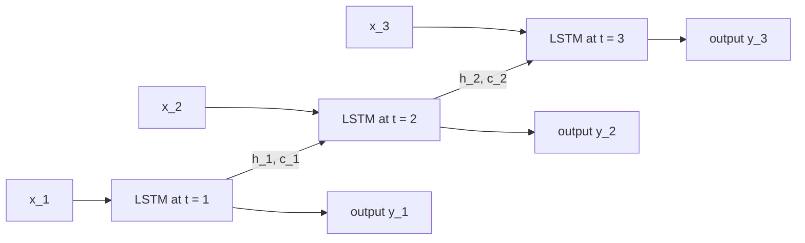

# RNNs and LSTMs for Sequence Modeling

A recurrent network reads a sequence by repeatedly applying the same transition function. Its hidden state is a learned summary of the prefix seen so far. That gives the model two properties missing from a fixed-window feedforward network: it accepts arbitrary sequence lengths, and parameters learned at one position are reused at every other position.

Recurrence does not guarantee memory. A fixed-dimensional state can overwrite an early fact, and learning to preserve it requires gradients to cross many transitions. LSTMs add an explicit cell state and gates that make this path easier to train. They were the standard sequence model for language modeling, tagging, and encoder--decoder systems before transformers, and remain useful when streaming or linear memory matters.

## The recurrent state update

For input vector $x_t$ and previous state $h_{t-1}$, a simple RNN computes

$$
a_t=W_xx_t+W_hh_{t-1}+b,
\qquad
h_t=\tanh(a_t).
$$

The matrices are shared over time. Unrolling the equations shows a deep computation graph whose depth is the sequence length:

$$
h_t=\tanh\left(W_xx_t+W_h\tanh(W_xx_{t-1}+W_hh_{t-2}+b)+b\right).
$$

For next-token language modeling, every state can produce logits and a distribution:

$$
z_t=Uh_t+c,
\qquad
P(w_{t+1}\mid w_1,\ldots,w_t)=\operatorname{softmax}(z_t).
$$

The training targets are the input sequence shifted by one position. Given `<BOS> the cat sat`, the model consumes `<BOS>`, `the`, and `cat` while predicting `the`, `cat`, and `sat`. During teacher-forced training, the input at each step is the gold previous token. During free generation, it is a token sampled or selected from the model's own distribution. The mismatch can compound errors: one poor generated token changes every later conditioning context.

The same recurrent core supports several arrangements:

| Arrangement | Output used | Typical task | Information available |
|---|---|---|---|
| many-to-one | final or pooled states | document classification | prefix in a forward RNN |
| many-to-many | one output per state | POS tagging, NER | prefix, or both directions in a BiRNN |
| autoregressive | next-token output per state | language modeling | generated or gold prefix |
| encoder--decoder | decoder state sequence | translation, summarization | source encoding plus target prefix |

## Why gradients disappear or blow up

Backpropagation through time is ordinary reverse-mode differentiation on the unrolled graph. Because $W_h$ appears at every step, its gradient is the sum of contributions from all those uses. The sensitivity of a later state to an earlier state contains a product of Jacobians:

$$
\frac{\partial h_t}{\partial h_k}
=\prod_{j=k+1}^{t}
\frac{\partial h_j}{\partial h_{j-1}}
=\prod_{j=k+1}^{t}
\operatorname{diag}\left(1-\tanh^2(a_j)\right)W_h.
$$

If typical singular values of these factors are below one, the product shrinks exponentially and early states receive almost no learning signal. Saturated tanh units make the problem worse because $1-\tanh^2(a_j)$ approaches zero. If the factors amplify instead, gradient norms can grow exponentially and produce unstable parameter steps.

Gradient clipping handles the exploding case. Global norm clipping replaces gradient $g$ by

$$
g\leftarrow g\min\left(1,\frac{\tau}{\lVert g\rVert_2}\right),
$$

where $\tau$ is the chosen maximum norm. It preserves direction while limiting magnitude. Clipping does not restore a vanished signal.

Truncated backpropagation through time limits the unrolled graph to a manageable number of steps. The hidden value may be carried into the next chunk, but it is detached from the old graph. This reduces memory and compute, at the cost of discarding gradient paths longer than the truncation window. Stateful streaming and full-sequence training therefore answer different optimization questions even when their forward equations match.

## The LSTM cell as a controlled additive path

An LSTM maintains a cell $c_t$ alongside the exposed hidden state $h_t$:

$$
\begin{aligned}
i_t &= \sigma(W_ix_t+U_ih_{t-1}+b_i),\\
f_t &= \sigma(W_fx_t+U_fh_{t-1}+b_f),\\
o_t &= \sigma(W_ox_t+U_oh_{t-1}+b_o),\\
\tilde c_t &= \tanh(W_cx_t+U_ch_{t-1}+b_c),\\
c_t &= f_t\odot c_{t-1}+i_t\odot\tilde c_t,\\
h_t &= o_t\odot\tanh(c_t).
\end{aligned}
$$

All quantities are vectors. The forget gate $f_t$ chooses how much old cell content remains; the input gate $i_t$ scales a candidate write; the output gate $o_t$ controls what the rest of the network sees. Sigmoid gates lie between zero and one, while the candidate and visible cell content are signed.

The cell update is additive rather than a complete nonlinear rewrite. Holding the gate values fixed for the local derivative,

$$
\frac{\partial c_t}{\partial c_{t-1}}=f_t.
$$

Across several steps the direct path contains a product of forget gates. Values near one preserve both memory and gradient. Values near zero deliberately reset the cell. Gates depend on earlier states too, so the full derivative has additional terms, but the additive path is the central improvement over a simple RNN.

Forget-gate biases are sometimes initialized positively so that early training favors retention. It is a bias, not a guarantee: the learned network can still forget, overwrite, or compress information. LSTMs improve long dependencies but do not provide unbounded exact storage.



## Worked example: one simple-RNN transition

Let

$$
x_t=\begin{bmatrix}1\\0\end{bmatrix},
\qquad
h_{t-1}=\begin{bmatrix}0.5\\-0.5\end{bmatrix},
$$

and

$$
W_x=\begin{bmatrix}1&2\\0&1\end{bmatrix},
\quad
W_h=\begin{bmatrix}0.5&0\\0&0.5\end{bmatrix},
\quad
b=\begin{bmatrix}0\\0\end{bmatrix}.
$$

The input contribution is

$$
W_xx_t
=\begin{bmatrix}1&2\\0&1\end{bmatrix}
\begin{bmatrix}1\\0\end{bmatrix}
=\begin{bmatrix}1\\0\end{bmatrix}.
$$

The recurrent contribution is

$$
W_hh_{t-1}
=\begin{bmatrix}0.5&0\\0&0.5\end{bmatrix}
\begin{bmatrix}0.5\\-0.5\end{bmatrix}
=\begin{bmatrix}0.25\\-0.25\end{bmatrix}.
$$

Thus

$$
a_t=\begin{bmatrix}1.25\\-0.25\end{bmatrix},
$$

and applying tanh coordinatewise gives

$$
h_t
=\begin{bmatrix}\tanh(1.25)\\\tanh(-0.25)\end{bmatrix}
\approx\begin{bmatrix}0.848\\-0.245\end{bmatrix}.
$$

The first coordinate mixes the current input with positive previous state; the second remains negative because its input contribution was zero.

## Worked example: memory over several LSTM steps

Consider one cell coordinate with initial value $c_0=4$. At the first step let $f_1=0.75$, $i_1=0.2$, and $\tilde c_1=-1$. Then

$$
\begin{aligned}
c_1
&=f_1c_0+i_1\tilde c_1\\
&=(0.75)(4)+(0.2)(-1)\\
&=3-0.2=2.8.
\end{aligned}
$$

At the next step suppose the cell receives no new write, $i_2=0$, and has $f_2=0.9$:

$$
c_2=(0.9)(2.8)+0=2.52.
$$

Ignoring the gates' indirect dependence on earlier state, the direct sensitivity to the initial cell is

$$
\frac{\partial c_2}{\partial c_0}=f_2f_1=(0.9)(0.75)=0.675.
$$

After two steps, $67.5\%$ of an infinitesimal change in $c_0$ remains along the direct cell path. If both forget gates were $0.1$, only $1\%$ would remain. The same mechanism supports deliberate retention and deliberate reset.

If the output gate at step two is $o_2=0.6$, the visible hidden value is

$$
h_2=0.6\tanh(2.52)\approx0.6(0.987)=0.592.
$$

The cell can hold a relatively large value while exposing a gated, bounded version to later layers.

## Bidirectionality and the boundary of available context

A bidirectional RNN runs a forward recurrence and a separate backward recurrence:

$$
\overrightarrow h_t=F(x_t,\overrightarrow h_{t-1}),
\qquad
\overleftarrow h_t=B(x_t,\overleftarrow h_{t+1}).
$$

The contextual representation is commonly their concatenation $h_t=[\overrightarrow h_t;\overleftarrow h_t]$. A tagger can then use words on both sides of an ambiguous token. In `book the flight`, right context helps distinguish the verb from the noun use in `read the book`.

The backward state requires future tokens. A BiLSTM cannot emit final online predictions with zero lookahead, and it is invalid for autoregressive next-token generation because it would expose the answer and later tokens. Offline tagging and whole-document encoding are appropriate uses.

For classification, using only the final forward state creates a narrow bottleneck. Pooling all states, adding attention, or combining forward and backward final states often works better. Padding complicates the notion of "final": the last array position may be padding, not the last token. Packed sequences or length-indexed gathering are needed.

## From a single source vector to attention

Early sequence-to-sequence models encoded a source into one final state and initialized a recurrent decoder from it. Long sentences strained that fixed vector. Attention instead keeps every encoder state $h_1,\ldots,h_n$. At decoder step $t$, scores compare decoder state $s_{t-1}$ with each source state:

$$
e_{t,i}=\operatorname{score}(s_{t-1},h_i),
\qquad
\alpha_{t,i}=\frac{\exp(e_{t,i})}{\sum_j\exp(e_{t,j})}.
$$

The context vector is

$$
r_t=\sum_i\alpha_{t,i}h_i.
$$

The decoder conditions its next-token distribution on $r_t$ and its recurrent state. Attention removes the requirement that one final encoder state preserve every source detail. The decoder is still sequential, since $s_t$ depends on $s_{t-1}$ and the previous target token.

## Batching sequences without learning from padding

The tagger below packs sequences so the LSTM does not advance through padding. The loss independently ignores padded target positions.

```python
import torch
import torch.nn as nn
from torch.nn.utils.rnn import pack_padded_sequence, pad_packed_sequence

class BiLSTMTagger(nn.Module):
    def __init__(self, vocab_size, tag_count, emb_dim=64, hidden=128):
        super().__init__()
        self.embedding = nn.Embedding(vocab_size, emb_dim, padding_idx=0)
        self.lstm = nn.LSTM(
            emb_dim, hidden // 2, batch_first=True, bidirectional=True
        )
        self.output = nn.Linear(hidden, tag_count)

    def forward(self, token_ids, lengths):
        embedded = self.embedding(token_ids)
        packed = pack_padded_sequence(
            embedded, lengths.cpu(), batch_first=True, enforce_sorted=False
        )
        packed_states, _ = self.lstm(packed)
        states, _ = pad_packed_sequence(
            packed_states, batch_first=True, total_length=token_ids.size(1)
        )
        return self.output(states)

model = BiLSTMTagger(vocab_size=5000, tag_count=9)
tokens = torch.tensor([[7, 4, 8, 2], [9, 3, 0, 0]])
lengths = torch.tensor([4, 2])
tags = torch.tensor([[1, 5, 5, 2], [1, 3, -100, -100]])

logits = model(tokens, lengths)
loss = nn.CrossEntropyLoss(ignore_index=-100)(
    logits.reshape(-1, 9), tags.reshape(-1)
)
loss.backward()
torch.nn.utils.clip_grad_norm_(model.parameters(), max_norm=5.0)
```

A zero padding embedding alone is insufficient. Without packing, the recurrent biases and previous state continue evolving at padded positions. For token-level losses, `ignore_index` prevents those positions from contributing gradients to the classifier. Sequence lengths should be checked before packing because zero-length items are not accepted by many recurrent utilities.

RNNs process steps serially, limiting training parallelism. Their activation memory and inference state can be linear or constant with respect to the observed stream, depending on whether earlier outputs are retained. Transformers train positions in parallel but standard self-attention compares all pairs of tokens. The better architecture depends on latency, sequence length, hardware, and whether future context is allowed.

## State initialization and sequence boundaries

Zero initial states are a sensible default when every sequence is independent. Learned initial vectors can encode a corpus-wide starting condition, though they add parameters and can overfit small datasets. In encoder--decoder models, the decoder may instead be initialized from an encoder summary. That creates a direct information bottleneck even when attention is also present.

Carrying hidden state between batches is correct only when the batches are consecutive chunks of the same stream. Carrying it from the end of one unrelated document into the next leaks context across examples. Conversely, resetting state at every chunk of one long stream discards useful history. Stateful training needs explicit document-boundary markers and a clear detach schedule.

Detaching a carried state preserves its numeric value while severing gradients into earlier chunks. Without detachment, the computation graph grows across the entire stream and memory use increases until failure. With detachment every $k$ steps, forward memory crosses the boundary but learning signals do not. The truncation length therefore affects which dependencies can be learned, not only hardware usage.

For a bidirectional encoder, padding and reversal interact. A naive backward RNN over a padded tensor begins with padding rather than the last real token for shorter sequences. Packing sequences or reversing only the valid prefix avoids the error. It can otherwise contaminate every backward state even when padded outputs are later masked.

## Decoding creates a search problem

A recurrent language model supplies conditional token probabilities, but generating a sequence requires a decision rule. Greedy decoding selects the highest-probability token at every step. It is fast and can miss a higher-probability complete sequence because an early locally best token may lead to poor continuations.

Beam search keeps several partial hypotheses ranked by accumulated log probability. Each step expands them and retains the best fixed number. Raw log probability favors shorter completed sequences because every additional token contributes a nonpositive term. Length normalization or a length penalty changes that preference, but the chosen correction becomes part of the decoding objective.

Sampling serves a different purpose. Temperature rescales logits before softmax: values below one sharpen the distribution, while values above one flatten it. Top-$k$ and nucleus sampling restrict the candidate set. These procedures do not improve the trained probability model; they trade diversity against likelihood at generation time.

Exposure bias names the gap between teacher-forced training and autoregressive inference. During training the decoder always receives a gold previous token, while at test time it must continue from its own mistakes. Scheduled sampling has been proposed to mix generated tokens into training, but it changes the objective and does not provide a general cure. Sequence-level training and better search address other parts of the problem.

## Diagnosing what the recurrent state retained

Final-state classification should be compared against pooling all recurrent states. If mean or attention pooling improves long documents, the final state was an overly narrow bottleneck. If neither helps, the input representation or recurrent capacity may be inadequate.

Length-stratified evaluation often reveals degradation hidden by an overall metric. A model can perform well on common short sequences and fail sharply beyond the training length distribution. Synthetic probes that place a relevant cue at increasing distances test memory more directly, though success on a probe does not establish broad language understanding.

Gate activations are useful diagnostics but easy to overinterpret. A forget gate near one suggests retention along that coordinate for that example; it does not assign a human-readable concept to the cell. Saturated gates near zero or one across almost all data may indicate useful discrete behavior or poor scaling. Gradient norms and ablation are needed to tell the difference.

Clipping should be logged. If almost every step hits the threshold, the nominal learning rate or initialization may be unstable and clipping is masking it. If clipping never activates, it is harmless insurance. Per-parameter clipping changes gradient direction more than global norm clipping and can distort the balance among gates.

Checkpoint selection should use the metric and sequence regime that matter at deployment. Validation loss can improve while exact-match generation quality stalls, and token accuracy can hide catastrophic errors on long sequences. Save optimizer state with model state if training will resume; recurrent optimization depends on momentum and learning-rate history as well as weights. Hidden states from training batches should not be serialized as model parameters unless the application explicitly defines a persistent stream.

<div className="see-also">

See also: [N-gram language models](/cs/nlp/n-gram-language-models) · [Transformers and self-attention](/cs/nlp/transformers-self-attention) · [Machine translation](/cs/nlp/machine-translation) · [Speech recognition and synthesis](/cs/nlp/speech-recognition-and-synthesis)

</div>
