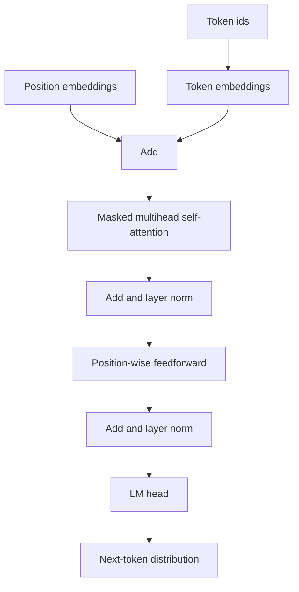

# Transformers and Self-Attention

Transformers replace recurrence with attention over token representations. Jurafsky and Martin present self-attention, multihead attention, transformer blocks, positional embeddings, causal language modeling, generation, and harms. Eisenstein's 2018 text predates the full LLM era but includes the formal ingredients that transformers build on: embeddings, neural language models, attention-based neural machine translation, and non-recurrent sequence transduction.

Each token representation is updated by looking at other tokens. A causal language model restricts that view to the current and previous tokens, while a bidirectional encoder can use the whole input. Stacking attention with feedforward layers and residual connections gives the basic architecture behind modern pretrained language models.

## Computing self-attention

Given input vectors $x_1,\ldots,x_n$, learned projections produce queries, keys, and values:

$$
Q=XW_Q,\qquad K=XW_K,\qquad V=XW_V.
$$

Scaled dot-product attention is

$$
\mathrm{Attention}(Q,K,V)=
\mathrm{softmax}\left(\frac{QK^\top}{\sqrt{d_k}}\right)V.
$$

For token $i$, the weight assigned to token $j$ is proportional to

$$
\exp\left(\frac{q_i^\top k_j}{\sqrt{d_k}}\right).
$$

The $\sqrt{d_k}$ divisor keeps the variance of the dot products under control as the key dimension grows. Without it, the softmax can saturate early in training and produce weak gradients.

Attention is content-dependent, so the same token can acquire different representations in different sentences. The representation of `bank` may attend to `river` in one context and `loan` in another. Such contextualization improved word-sense disambiguation, coreference, question answering, and many classification tasks over static word embeddings.

### A two-key calculation

Let one query attend over two keys:

$$
q=[1,1],\quad k_1=[1,0],\quad k_2=[0,2],
$$

with $d_k=2$. Their dot products are

$$
q^\top k_1=1,\qquad q^\top k_2=2.
$$

Scaling by $\sqrt{2}\approx1.414$ gives

$$
s_1=\frac{1}{1.414}=0.707,\qquad s_2=\frac{2}{1.414}=1.414.
$$

After exponentiation,

$$
e^{s_1}\approx2.028,\qquad e^{s_2}\approx4.113.
$$

The normalized weights are therefore

$$
\alpha_1=\frac{2.028}{2.028+4.113}=0.330,
$$

$$
\alpha_2=\frac{4.113}{6.141}=0.670.
$$

The query places about $33.0\%$ of its weight on key $1$ and $67.0\%$ on key $2$. Small matrices like this are useful classroom calculations because they expose query-key comparison, masking, normalization, and value mixing before tensor libraries hide the individual operations. When implementing attention, the softmax must run across the key dimension for each query.

## Inside a transformer block

**Multihead attention** repeats the attention calculation with separate projections, concatenates the head outputs, and projects the result once more. Individual heads can learn local syntax, delimiter matching, coreference cues, or positional patterns.

A **transformer block** combines multihead attention with a position-wise feedforward network, residual connections, and layer normalization. Attention communicates across positions: a pronoun can gather information from a candidate antecedent, or a verb from its subject. The feedforward network then applies a nonlinear transformation independently at every position.

The residual-stream view treats attention and MLP sublayers as updates written into a shared token representation. Residual connections preserve information across layers, while layer normalization stabilizes optimization. Repeating the block alternates communication between positions with computation at each position.




*Figure: The original Transformer separates encoder self-attention, decoder masked self-attention, and encoder-decoder attention. From [Vaswani et al., 2017](https://arxiv.org/abs/1706.03762), embedded under educational fair use with attribution.*

Depth allows later blocks to combine features built by earlier ones. Early layers often emphasize local lexical and positional information, middle layers may combine syntactic or entity cues, and later layers tend to become more specific to the training objective. This is a heuristic rather than a law. Token-classification tasks can benefit from intermediate layers, whereas generation uses the final layer trained to feed the language-modeling head.

Positional encodings or learned position embeddings supply order information. Without them, self-attention is permutation-equivariant: permuting the input tokens permutes the outputs in the same way. Omitting position information therefore leaves the model unable to distinguish sequences that differ only in order.

## Masks choose the information flow

Attention masks define which token pairs may interact. Causal masks produce left-to-right generation. Bidirectional encoders omit the causal restriction, though they still mask padding as needed. In encoder-decoder models, target tokens can attend to all source states but only to current and earlier target states.

| Attention type | Can attend to future? | Typical model | Common task |
|---|---:|---|---|
| Causal self-attention | no | GPT-style decoder | generation |
| Bidirectional self-attention | yes | BERT-style encoder | classification, tagging |
| Cross-attention | attends to source states | encoder-decoder MT | translation, ASR, TTS |
| Sparse attention | limited pattern | long-context models | long documents |

For a four-token sequence, position $3$ in a causal decoder may attend to positions $1$, $2$, and $3$, but not future position $4$. With zero for allowed positions and $-\infty$ for blocked ones, its mask row is

$$
[0,\;0,\;0,\;-\infty].
$$

The mask is added to the attention scores before softmax. The fourth score becomes $-\infty$, so its probability becomes $0$. A missing or reversed causal mask silently leaks the next-token target during training, making mask tests an important part of model validation.

## Parallel training and the long-context cost

Self-attention connects any two positions in one layer. An RNN instead passes information from token $1$ through many recurrent updates before it can affect token $T$. Transformer training can compute all positions in a sequence with large matrix multiplications, which fits GPU and TPU hardware well; an RNN retains a hard sequential dependency across time.

Full self-attention forms a score for every ordered pair of tokens. Its attention computation costs

$$
O(n^2d),
$$

and the $n\times n$ score matrix is expensive to store for long inputs. Projection and feedforward costs also matter, so big-O alone does not settle comparisons between transformer and recurrent models on real hardware. The quadratic attention term nevertheless motivates limited context windows, sparse attention, retrieval augmentation, recurrence-like memory, and other long-context methods.

Long-input failures need more diagnosis than checking the advertised context window. Truncation, attention dilution, positional extrapolation, retrieval failure, or absent source information can all lower quality. Test long-context behavior directly and confirm how much of the input reaches the model.

## From transformer blocks to a language model

An autoregressive language model factors text left to right:

$$
P(w_1,\ldots,w_T)=\prod_{t=1}^T P(w_t\mid w_1,\ldots,w_{t-1}).
$$

A causal transformer generates by repeatedly predicting the next token. Decoding may use greedy search, beam search, temperature sampling, top-$k$ sampling, or nucleus sampling. Greedy decoding often becomes repetitive, while a high temperature can make output incoherent. Beam search can also produce dull, repetitive text in open-ended generation. The choice of decoder changes model behavior and belongs in the modeling decision, not merely the implementation.

The transformer architecture alone does not produce the behavior associated with a pretrained language model. Tokenization, training data, objective, scale, fine-tuning, prompting, decoding, and deployment constraints all contribute.

## Building one masked block in PyTorch

This small pre-normalized block keeps the two residual updates explicit. In PyTorch's boolean attention masks, `True` marks a blocked query-key pair.

```python
import torch
import torch.nn as nn

batch, length, dim = 2, 5, 16
x = torch.randn(batch, length, dim)

attn = nn.MultiheadAttention(
    embed_dim=dim,
    num_heads=4,
    batch_first=True,
)
norm1 = nn.LayerNorm(dim)
norm2 = nn.LayerNorm(dim)
ffn = nn.Sequential(
    nn.Linear(dim, 4 * dim),
    nn.GELU(),
    nn.Linear(4 * dim, dim),
)

causal_mask = torch.triu(
    torch.ones(length, length, dtype=torch.bool), diagonal=1
)
attn_input = norm1(x)
attn_out, weights = attn(
    attn_input, attn_input, attn_input, attn_mask=causal_mask
)
hidden = x + attn_out
block_out = hidden + ffn(norm2(hidden))

print(block_out.shape)
print(weights.shape)
```

## Interpreting outputs and accounting for harm

Attention weights can be useful diagnostics, but they are not definitive causal explanations of a prediction. Information also flows through values, residual connections, feedforward layers, and later attention heads. Head patterns should be paired with interventions or other attribution methods before making strong interpretive claims.

Transformers can encode social biases, memorize training data, emit toxic or private content, and produce fluent falsehoods. These outcomes follow from broad training distributions and open-ended deployment. Evaluation therefore needs bias, privacy, toxicity, and factuality tests that match the intended setting, not only aggregate language-model loss.

<div className="see-also">

See also: [Pretrained language models](/cs/nlp/pretrained-language-models) · [RNNs and LSTMs for sequence modeling](/cs/nlp/rnns-lstms-sequence-modeling) · [Machine translation](/cs/nlp/machine-translation) · [Dialogue and chatbots](/cs/nlp/dialogue-and-chatbots)

</div>
