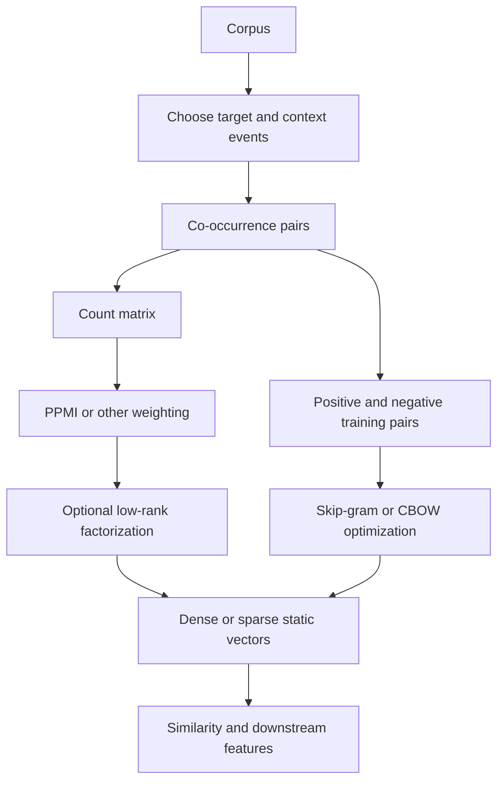

# Vector Semantics and Embeddings

Vector semantics starts from an observable claim: words used in similar linguistic environments tend to have related meanings. A corpus can therefore supply coordinates for a word without a hand-built dictionary. The coordinates may be explicit context counts or dense parameters learned by a prediction objective.

The word *similar* needs care. Two words can share topics, syntactic roles, sentiment, or reference types without being synonyms. `doctor` and `hospital` are topically associated; `doctor` and `nurse` are more substitutable in many sentences. A vector space reflects the corpus and the chosen definition of context, so its geometry has no context-free semantic interpretation.

## Building a word--context matrix

Let rows index target words and columns index contexts. An entry $X_{wc}$ records how often target $w$ occurs with context $c$. Context might mean a neighboring word in a symmetric window, a word at a particular relative position, a dependency relation, or an entire document.

For the sentence `the dog chased the cat` with a window of one, `chased` yields pairs with `dog` and `the`. A position-sensitive design would make `dog@-1` different from `the@+1`. A dependency design might use `dog:nsubj` and `cat:obj`. The resulting vectors answer different questions.

| Context definition | Geometry tends to emphasize | Cost or limitation |
|---|---|---|
| wide symmetric window | topic and broad association | weakens word order and syntax |
| narrow window | local substitutability | fewer observations per word |
| position-labeled window | order-sensitive lexical patterns | more context columns |
| dependency relation | syntactic and functional similarity | requires a parser and inherits its errors |
| document ID | topic and retrieval similarity | coarse for lexical relations |

Raw counts are dominated by frequent words and frequent contexts. A transformation is usually more useful than $X$ itself.

## Weighting counts by informativeness

TF--IDF is mainly a term--document weighting. With $N$ documents and document frequency $\operatorname{df}(t)$,

$$
\operatorname{tfidf}(t,d)
=\operatorname{tf}(t,d)\log\frac{N}{\operatorname{df}(t)}.
$$

Terms frequent in one document but common across few documents receive high weight. Exact systems vary: term frequency may be binary, raw, or logarithmically scaled; inverse document frequency is often smoothed; document vectors are commonly normalized. These variants change numerical values, so an experiment should record the convention rather than saying only "TF--IDF."

For word--context matrices, pointwise mutual information compares observed co-occurrence with independence:

$$
\operatorname{PMI}(w,c)
=\log\frac{P(w,c)}{P(w)P(c)}.
$$

PMI is zero when the pair occurs at the rate predicted by independent marginals. It is positive for attraction and negative for avoidance. Positive PMI discards the negative entries:

$$
\operatorname{PPMI}(w,c)=\max(\operatorname{PMI}(w,c),0).
$$

PPMI keeps a sparse nonnegative matrix and often works well for similarity. Its serious weakness is rare-event inflation. A pair observed once can receive a large value if both marginals are tiny. Minimum count thresholds, smoothing, or context-distribution smoothing reduce the problem. Missing pairs also need interpretation: a zero count is not strong evidence of negative association in a finite corpus.

## Comparing directions with cosine

Cosine similarity is

$$
\cos(u,v)=\frac{u^\top v}{\lVert u\rVert_2\lVert v\rVert_2}.
$$

It compares directions and ignores positive scaling. For count vectors this helps separate context profile from raw frequency. A zero vector has no defined direction; software must choose whether to return zero, missing, or an error.

Cosine can be negative for signed dense vectors, though PPMI vectors are nonnegative. A high cosine does not establish synonymy. Antonyms such as `hot` and `cold` occur in similar contexts and can be near each other. Nearest-neighbor results should be described as distributional similarity under a particular representation.

Euclidean distance retains sensitivity to vector norms. Dot products reward both alignment and magnitude and are the native scores in many embedding objectives. Choosing cosine after training removes norm information that the model may have used, sometimes beneficially and sometimes not.

## Compressing sparse statistics

A word--context matrix may contain hundreds of thousands of columns. Truncated singular value decomposition approximates it as

$$
X\approx U_k\Sigma_kV_k^\top,
$$

where $k$ is much smaller than the original rank. Rows of $U_k\Sigma_k$ are dense word representations. This family of approaches is often called latent semantic analysis when applied to term--document data.

Low-rank approximation shares evidence: two words need not overlap on every explicit context if their patterns can be explained by similar latent directions. It also erases detail and can be expensive on very large matrices. Whether to use $U_k$, $U_k\Sigma_k$, or a fractional power of $\Sigma_k$ changes the geometry. There is no single representation automatically implied by "apply SVD."

Sparse count vectors retain inspectable coordinates. If `coffee` is close to `tea`, one can list the contexts contributing to their dot product. Dense dimensions generally mix many contexts and resist such direct naming. The compactness is useful; the loss of transparency is real.

## Predictive embeddings

Word2vec learns two vector tables: target vectors $u_w$ and context vectors $v_c$. Skip-gram predicts nearby contexts from a target. With negative sampling, an observed pair $(w,c)$ is contrasted with $k$ noise contexts $n_i$:

$$
\log\sigma(v_c^\top u_w)
+\sum_{i=1}^{k}\log\sigma(-v_{n_i}^\top u_w).
$$

The positive dot product is pushed upward and negative dot products downward. Noise examples are usually sampled from a transformed unigram distribution rather than uniformly. Frequent words appear often enough to need subsampling; otherwise they dominate training with weakly informative pairs.

CBOW reverses the prediction direction. It combines context embeddings, often by summing or averaging them, and predicts the center word. CBOW is fast and smooths across a bag of nearby words. Skip-gram gives each target--context pair its own update and often represents rarer words better, at greater training cost.

Negative-sampling skip-gram has a close mathematical relationship to factorizing a shifted PMI matrix under simplifying assumptions. Count-based and predictive methods are therefore not clean opposites. Both extract co-occurrence structure; they differ in weighting, parameterization, optimization, and what is stored explicitly.

GloVe begins from global co-occurrence counts and fits

$$
J=\sum_{i,j}f(X_{ij})
\left(w_i^\top\tilde w_j+b_i+\tilde b_j-\log X_{ij}\right)^2.
$$

The weighting function $f$ limits the influence of very frequent pairs and gives little or no weight to absent pairs. Bias terms absorb much of the marginal-frequency effect. Like word2vec, GloVe produces static type vectors rather than a different vector for each token occurrence.



## Worked example: TF--IDF by hand

Consider three documents:

```text
d1: cat sat cat
d2: dog sat
d3: cat ate fish
```

Using raw term frequency and natural-log IDF, compute the weight of `cat` in $d_1$. The corpus size is $N=3$. The token appears twice in $d_1$, so

$$
\operatorname{tf}(\mathrm{cat},d_1)=2.
$$

It occurs in $d_1$ and $d_3$, hence

$$
\operatorname{df}(\mathrm{cat})=2.
$$

The inverse document frequency is

$$
\operatorname{idf}(\mathrm{cat})
=\log\frac32
\approx0.4055.
$$

Therefore

$$
\operatorname{tfidf}(\mathrm{cat},d_1)
=2(0.4055)
\approx0.8109.
$$

For comparison, `fish` occurs once and appears in only one document:

$$
\operatorname{tfidf}(\mathrm{fish},d_3)
=1\log\frac31
\approx1.0986.
$$

Although `cat` is more frequent within $d_1$, `fish` is more document-specific under this weighting.

## Worked example: PPMI and rare-event sensitivity

Suppose a corpus contains $1000$ target--context pairs. The pair (`coffee`, `drink`) occurs $20$ times; `coffee` appears as target in $50$ pairs; `drink` appears as context in $100$ pairs. Then

$$
P(\mathrm{coffee},\mathrm{drink})=\frac{20}{1000}=0.02,
$$

and

$$
P(\mathrm{coffee})=0.05,
\qquad
P(\mathrm{drink})=0.10.
$$

Independence predicts joint probability $0.05(0.10)=0.005$. Thus

$$
\operatorname{PMI}
=\log\frac{0.02}{0.005}
=\log4
\approx1.386.
$$

The value is positive, so PPMI remains $1.386$. The observed pair is four times as likely as independent marginals predict.

Now consider a pair seen once where each marginal also occurs once. Its empirical probabilities are all $0.001$, giving

$$
\operatorname{PMI}_{\mathrm{rare}}
=\log\frac{0.001}{(0.001)(0.001)}
=\log1000
\approx6.908.
$$

One observation receives a much larger score than the twenty-count `coffee` pair. That is the rare-event bias in numerical form, not evidence that the rare pair carries a more stable semantic relation.

## Worked example: cosine similarity

Let three explicit context coordinates be `drink`, `hot`, and `bark`, with

$$
u_{\mathrm{coffee}}=[2,1,0],
\quad
u_{\mathrm{tea}}=[1,2,0],
\quad
u_{\mathrm{dog}}=[0,0,3].
$$

For coffee and tea, the dot product is

$$
u_{\mathrm{coffee}}^\top u_{\mathrm{tea}}
=2(1)+1(2)+0(0)=4.
$$

Both norms equal $\sqrt{2^2+1^2}=\sqrt5$, so

$$
\cos(u_{\mathrm{coffee}},u_{\mathrm{tea}})
=\frac4{\sqrt5\sqrt5}=\frac45=0.8.
$$

Coffee and dog have dot product zero. Since both norms are nonzero,

$$
\cos(u_{\mathrm{coffee}},u_{\mathrm{dog}})=0.
$$

In this tiny representation, coffee and tea share beverage contexts while dog lies on an unrelated context axis.

## Static vectors, analogies, and context-sensitive meaning

A static embedding assigns one vector to the type `bank`. Financial and river uses are blended according to their corpus frequencies. Sometimes the dominant sense overwhelms the other; sometimes the vector occupies an average region that represents neither cleanly.

Contextual encoders instead produce a vector for each token occurrence. The representation of `bank` in `deposit at the bank` depends on surrounding tokens and differs from its representation in `sat on the river bank`. Layers also specialize: earlier representations tend to retain more local form, while later ones are shaped by the model objective and broader context. Pooling decisions and layer selection matter in downstream use.

Vector offsets can support analogies by searching near $v_b-v_a+v_c$. Successful cases indicate regularities in the learned geometry, not symbolic rules that hold uniformly. Results depend on vocabulary, normalization, corpus balance, and the exclusion of query words from candidates. Intrinsic similarity and analogy benchmarks cover only a narrow slice of utility. Downstream evaluation under the target domain is usually more informative.

## Corpus bias appears in the geometry

Embeddings reproduce statistical associations in their training text, including stereotypes and historical inequities. Nearest neighbors and association tests can reveal some patterns, but a single projection that removes one direction does not settle downstream behavior. Bias can reappear through correlated dimensions, tokenization, labels, or application data.

Evaluation should connect a representation to a use: which groups and language varieties are present, which errors cause harm, and whether similarity is even the right operation. Corpus documentation and subgroup error analysis are more defensible than treating geometric debiasing as a universal preprocessing step.

## A small inspectable PPMI model

```python
from collections import Counter
from math import log, sqrt

sentences = [
    "coffee drink hot",
    "tea drink hot",
    "coffee bean roast",
    "dog bark loud",
]

window = 1
pairs = Counter()
target_totals = Counter()
context_totals = Counter()

for sentence in sentences:
    words = sentence.split()
    for i, word in enumerate(words):
        left = max(0, i - window)
        right = min(len(words), i + window + 1)
        for j in range(left, right):
            if i != j:
                context = words[j]
                pairs[word, context] += 1
                target_totals[word] += 1
                context_totals[context] += 1

total = sum(pairs.values())
contexts = sorted(context_totals)

def ppmi(word, context):
    count = pairs[word, context]
    if count == 0:
        return 0.0
    p_wc = count / total
    p_w = target_totals[word] / total
    p_c = context_totals[context] / total
    return max(log(p_wc / (p_w * p_c)), 0.0)

def vector(word):
    return [ppmi(word, context) for context in contexts]

def cosine(a, b):
    dot = sum(x * y for x, y in zip(a, b))
    norm_a = sqrt(sum(x * x for x in a))
    norm_b = sqrt(sum(y * y for y in b))
    return dot / (norm_a * norm_b) if norm_a and norm_b else 0.0

print(cosine(vector("coffee"), vector("tea")))
print(cosine(vector("coffee"), vector("dog")))
```

The explicit vectors are suitable for corpus inspection, not large-scale training. A production implementation would build a sparse matrix, prune unreliable events, and use optimized sparse linear algebra.

## Frequency is present even when it is not a coordinate

High-frequency words have better-estimated vectors because they participate in more updates, but frequency also changes geometry in less desirable ways. Very common contexts appear with many targets and contribute broad, weak signals. Subsampling frequent tokens in predictive training reduces their computational dominance. In count models, PMI divides by context marginals and TF--IDF downweights common document terms for related reasons.

Rare words sit at the other extreme. Their nearest neighbors can be driven by one accidental context, spelling artifacts, or a shared document. A cosine value does not carry its own confidence interval. Minimum counts, subword composition, and uncertainty-aware reporting are more honest than presenting a rare word's top neighbor as a stable semantic fact.

Vocabulary pruning changes the normalization statistics. Removing rare contexts before calculating PMI is not equivalent to calculating PMI first and deleting columns. The total pair count and marginals change. Corpus preprocessing, window boundaries, sentence segmentation, and whether a token can pair with itself all belong in a reproducible representation specification.

Multiple occurrences within one short window can also be counted in different ways. A frequency-weighted matrix counts every pair; a binary window records only whether the context appeared around a target occurrence. Distance weighting can give adjacent words more influence than distant ones. These choices are semantic assumptions expressed as counting rules.

## Comparing spaces requires alignment

Dense embedding axes have no fixed meaning. Two runs of the same objective can rotate or reflect the space while preserving all internal dot products. Coordinate 17 from one run cannot be compared directly with coordinate 17 from another. Neighbor sets and pairwise similarities are rotation-invariant; raw coordinates are not.

To study semantic change across time, independently trained spaces are often aligned with an orthogonal transformation using a shared anchor vocabulary. The alignment itself assumes that enough anchors are stable. Apparent movement may come from corpus composition, frequency, or optimization noise rather than meaning change. Multiple runs and control words help estimate that background variability.

Averaging independently trained embeddings coordinatewise is invalid without alignment. Concatenating them preserves each geometry but changes dimension and weighting. Training on the combined corpus answers a different question because it erases the separation between sources.

## Composing words into larger units

A sentence vector formed by averaging word embeddings is a strong and surprisingly stubborn baseline. It represents lexical content and ignores order. Weighting words by inverse frequency can keep function words from dominating; subtracting a leading common component is another corpus-dependent adjustment. Both transformations must be fitted on training data.

Additive composition cannot distinguish `dog bites man` from `man bites dog`. Concatenation preserves fixed positions but fails for variable length. Recurrent networks, convolution, and self-attention learn context-sensitive composition, though their output geometry depends on the supervised or self-supervised objective rather than only local co-occurrence.

Static embeddings used as classifier features can be frozen or fine-tuned. Freezing preserves the pretrained space and limits parameters. Fine-tuning can specialize a word such as `positive` differently in medical and sentiment corpora, but rare words may move on scant evidence. Reporting only the source embedding name omits this consequential training choice.

Out-of-vocabulary behavior should be evaluated explicitly. Mapping every unknown form to one vector makes unrelated words identical. Subword models can construct vectors for unseen spellings, but their quality depends on whether the pieces are informative; opaque identifiers and novel scripts remain difficult. Character information improves coverage, not guaranteed semantics.

## Evaluating a representation without circular claims

Intrinsic evaluation compares similarities, analogies, or clusters to a small labeled resource. Such tests are quick and isolate the representation, yet human similarity judgments vary with instructions and domain. Coverage can dominate results when one model lacks many benchmark words.

Extrinsic evaluation inserts the representation into a downstream system. It measures usefulness for that architecture and dataset, not an eternal quality of the vectors. If embeddings are fine-tuned, improvements may come from adaptable initialization rather than their original geometry. Keeping the downstream model and tuning budget fixed is necessary for a fair comparison.

Nearest-neighbor inspection remains valuable as qualitative error analysis. Query frequent, rare, polysemous, demographic, and domain-specific terms rather than selecting only appealing examples. Hubness in high-dimensional spaces can cause a few vectors to appear as neighbors of many queries. Measuring reverse-neighbor counts exposes these hubs and tempers semantic interpretations.

<div className="see-also">

See also: [Pretrained language models](/cs/nlp/pretrained-language-models) · [Logistic regression for text](/cs/nlp/logistic-regression-for-text) · [Semantic role labeling and word-sense disambiguation](/cs/nlp/semantic-role-labeling-and-word-sense-disambiguation) · [Information extraction](/cs/nlp/information-extraction)

</div>
