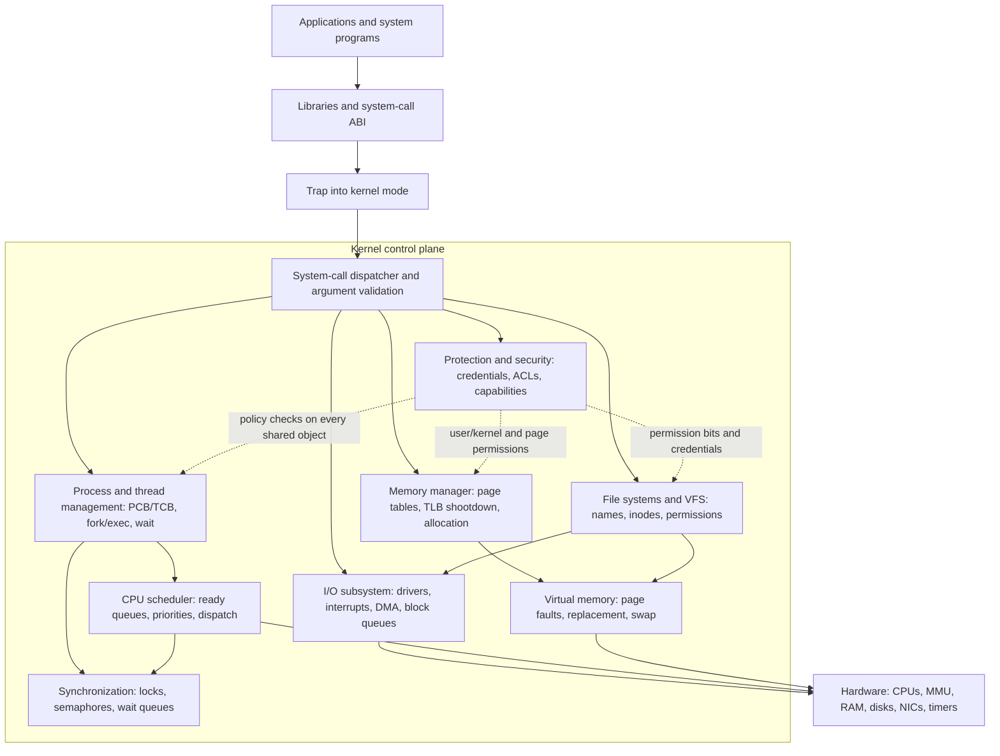

# Operating Systems

Operating systems sit between applications and hardware. They make programs easier to run, keep users and processes from interfering with one another, and allocate scarce resources such as CPU time, memory, storage, devices, and network access. Silberschatz, Galvin, and Gagne organize the subject around this central idea: an OS is both a convenience layer for programs and a control layer for the machine.

*Figure: Linux, BSD, and commercial Unix systems share a long and branching lineage. Image: [Wikimedia Commons](https://commons.wikimedia.org/wiki/File:Unix_history-simple.svg), Eraserhead1, Infinity0, and Sav vas, CC BY-SA 3.0/GFDL.*

The scope follows *Operating System Concepts Essentials*, 2nd edition: overview and structure, process management, concurrency, scheduling, memory, virtual memory, storage, I/O, protection, security, and a Linux case study. The emphasis is on definitions, algorithms, trade-offs, worked examples, and the connections among topics rather than on replacing the textbook.

## The kernel's working vocabulary

An **operating system** is software that manages computer hardware and provides services to application programs. At the center is the **kernel**, the privileged program that remains running and mediates access to hardware resources. Around it are system programs, libraries, shells, graphical environments, daemons, and applications.

A **process** is a program in execution. It owns an address space and resources such as open files. A **thread** is a schedulable path of execution inside a process. Threads share process resources but have their own program counters, registers, and stacks.

**CPU scheduling** chooses which ready process or thread runs next. **Synchronization** coordinates concurrent activities that share data or resources. **Deadlock** is a failure mode where a set of processes waits forever in a cycle of dependencies.

**Main memory management** maps logical addresses to physical memory and protects address spaces. **Virtual memory** extends this model by allowing only part of a process to be resident in RAM, using demand paging and replacement.

A **file system** provides persistent named storage. Its interface defines files, directories, access methods, sharing, and protection. Its implementation maps names and byte ranges to metadata, blocks, free-space structures, caches, and recovery mechanisms.

**Mass storage** includes disks, SSDs, swap space, and RAID arrays. **I/O systems** generalize device access through drivers, interrupts, DMA, buffering, caching, and standard application interfaces.

**Protection** controls access to internal objects such as files, memory, devices, and processes. **Security** addresses broader threats, including malware, authentication failure, cryptographic misuse, network attack, and denial of service.

## Reading from interfaces down to hardware

The chapter sequence begins at the system-call boundary, follows processes through scheduling and memory, then descends into persistent storage and device I/O. Protection and security cut across that stack; the Linux case study closes the loop with a concrete kernel.

| Position | Page | Main coverage |
|---:|---|---|
| 1 | [Operating Systems](/cs/operating-systems/intro) | Course map and conceptual overview |
| 2 | [OS Overview, Services, and Structures](/cs/operating-systems/os-overview-structures) | Services, system calls, kernel organization, booting |
| 3 | [Processes](/cs/operating-systems/processes) | PCB, states, creation, scheduling queues, IPC |
| 4 | [Threads](/cs/operating-systems/threads) | Thread models, libraries, multicore programming, Amdahl's law |
| 5 | [CPU Scheduling](/cs/operating-systems/cpu-scheduling) | FCFS, SJF, priority, RR, real-time and multiprocessor scheduling |
| 6 | [Process Synchronization](/cs/operating-systems/process-synchronization) | Race conditions, critical sections, mutexes, semaphores, monitors |
| 7 | [Deadlocks](/cs/operating-systems/deadlocks) | Necessary conditions, prevention, avoidance, detection, recovery |
| 8 | [Main Memory](/cs/operating-systems/main-memory) | Contiguous allocation, segmentation, paging, TLBs |
| 9 | [Virtual Memory](/cs/operating-systems/virtual-memory) | Demand paging, replacement, thrashing, working sets |
| 10 | [File-System Interface](/cs/operating-systems/file-system-interface) | Files, directories, access methods, mounting, sharing |
| 11 | [File-System Implementation](/cs/operating-systems/file-system-implementation) | Inodes/FCBs, allocation, free space, caching, recovery |
| 12 | [Mass Storage and RAID](/cs/operating-systems/mass-storage-raid) | Disk scheduling, SSDs, swap, RAID, stable storage |
| 13 | [I/O Systems](/cs/operating-systems/io-systems) | Hardware, drivers, interrupts, DMA, kernel I/O subsystem |
| 14 | [Protection and Access Control](/cs/operating-systems/protection-access-control) | Domains, access matrix, ACLs, capabilities |
| 15 | [Security](/cs/operating-systems/security) | Threats, malware, cryptography, authentication, firewalls |
| 16 | [Linux Case Study](/cs/operating-systems/linux-case-study) | Linux architecture, tasks, CFS, VFS, virtual memory |

## Abstraction backed by enforcement

The central operating-systems result is abstraction with enforcement. A good abstraction hides irrelevant hardware detail, but an OS abstraction must also be enforceable against buggy or malicious programs. A file descriptor hides device placement while the kernel checks that the process has the right to use it. A virtual address space gives each process a private memory view while the MMU and kernel page tables reject invalid access.

Several patterns recur throughout the subject:

| Pattern | Appears in | Core idea |
|---|---|---|
| Indirection | Page tables, file descriptors, VFS, capabilities | Insert a controlled mapping between name and object |
| Caching | TLB, page cache, buffer cache, directory cache | Keep recent data near the CPU to avoid slow paths |
| Queuing | Ready queues, device queues, disk queues, print spools | Order competing requests when a resource is busy |
| Atomicity | Locks, semaphores, journaling, system calls | Make a multi-step operation appear indivisible where needed |
| Policy/mechanism split | Scheduling, allocation, protection | Separate what can be done from which choice is made |
| Locality | Virtual memory, caching, disk layout | Recent or nearby references are likely to be useful |
| Least privilege | Protection, security, kernel design | Grant only the rights needed for the current job |

The architecture below places those patterns along the route from an application request to hardware.

Applications enter through a system-call ABI, the dispatcher validates each request, and kernel subsystems cooperate through concrete structures such as PCBs, ready queues, page tables, inodes, and device queues. The dotted edges show protection checks along the paths that manipulate processes, files, and memory rather than in a separate final layer.

Every design choice carries a cost. Preemptive scheduling improves responsiveness but adds context-switch overhead. Paging avoids external fragmentation but adds translation cost and possible page faults. Write-back caching improves speed but complicates crash recovery. Shared memory is fast but requires synchronization. A microkernel can improve isolation but may add communication overhead. RAID can improve availability but is not a backup.

Four questions organize the material:

1. What resource is being abstracted?
2. What kernel data structure records the state?
3. What algorithm chooses among competing requests?
4. What failure or attack is the mechanism trying to prevent?

## Two traces through the system

### Classifying operating-system responsibilities

Classify each event as process management, memory management, storage/file management, I/O management, protection, or security: a timer interrupt preempts a task; a page fault loads a missing page; a user opens a file read-only; a disk controller completes DMA; a login attempt uses a password hash.

1. A timer interrupt that preempts a task belongs primarily to process management and CPU scheduling. The OS saves the running task's context, chooses another ready task, and dispatches it.
2. Loading a missing page after a page fault belongs to virtual memory. The OS validates the address, locates or creates the page, selects a frame, updates the page table, and restarts the instruction.
3. Opening a file read-only crosses the file-system interface and protection. The OS resolves the path and checks whether the requested read access is allowed.
4. A disk controller completing DMA belongs to I/O management. The controller interrupts, the kernel completes the request, and any waiting process can be woken.
5. A login attempt using a password hash belongs to security, especially authentication. The system verifies identity using a stored salted password hash or a stronger authentication mechanism.

Many real events span categories, so the boundaries are a starting point rather than a partition.

### Following `sort` from shell to disk

Trace the major OS services involved when a shell runs `sort input.txt > output.txt`.

1. The shell parses the command line and identifies a program name, an input file, and output redirection.
2. The shell creates a child process. On a UNIX-like system, this commonly uses `fork()`.
3. The child opens `input.txt` for reading. The file system resolves the path, and protection checks read permission.
4. The child opens or creates `output.txt` for writing. The OS checks directory and file permissions, creates metadata if needed, and returns a file descriptor.
5. The child arranges file descriptors so standard output points to `output.txt`.
6. The child replaces its program image with the `sort` executable using an `exec`-style operation.
7. The scheduler gives the process CPU time. If `sort` blocks for file I/O, another ready process may run.
8. Virtual memory maps the executable, stack, heap, and libraries. Page faults bring code and data pages into RAM as needed.
9. The file system and I/O subsystem read input blocks, cache data, and write output blocks.
10. When `sort` exits, the parent shell collects its status and prints another prompt.

One command crosses process creation, file descriptors, protection checks, scheduling, virtual memory, file-system implementation, I/O, and process termination.

## Failure modes worth carrying forward

- Scheduling decisions affect memory pressure; memory pressure affects I/O; file permissions depend on protection; security failures can bypass otherwise clean abstractions. The chapters cannot be studied in isolation.
- The user/kernel boundary matters because applications cannot be trusted with privileged operations.
- FCFS, LRU, semaphores, RAID levels, and access-control models all have workloads where they fit poorly. None is universally best.
- OS calls fail often and for normal reasons, so error handling belongs in every design.
- Mechanism and policy are different: one mechanism can support several policies, and one policy can have several implementations.
- Current Linux, Windows, Android, and iOS behavior will not match every detail of a textbook edition. The concepts persist while implementations evolve.

See also: [OS Overview, Services, and Structures](/cs/operating-systems/os-overview-structures) · [Processes](/cs/operating-systems/processes) · [Virtual Memory](/cs/operating-systems/virtual-memory) · [File-System Implementation](/cs/operating-systems/file-system-implementation) · [Security](/cs/operating-systems/security)

