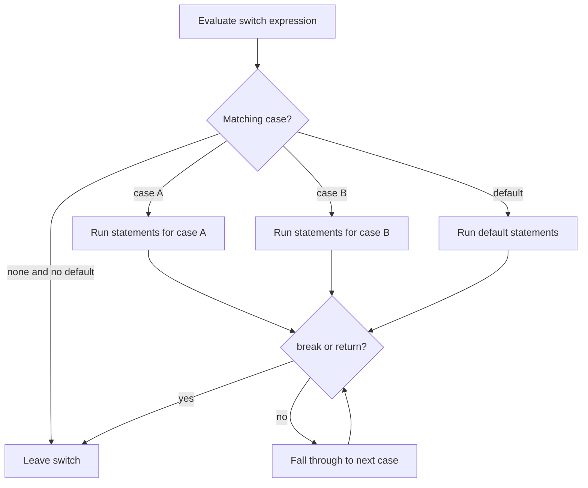

# Control Flow

Control flow is the order in which a C program performs computations. K&R uses `if`, `while`, and `for` before formally describing them; Chapter 3 completes the set with `else if`, `switch`, `do while`, `break`, `continue`, and `goto`. The language provides only a few constructs, but they combine into compact loops, filters, searches, and parsers.

Choose the construct that exposes the shape of the computation. A `for` loop suits cases where initialization, test, and increment belong together. A `while` loop fits input-driven repetition. A `switch` is clear for a fixed set of integer or character cases. `goto` is rare, but K&R does not pretend it is forbidden; it is mainly useful for leaving deeply nested logic or centralizing cleanup in old C code.

## Statements, blocks, and branch ownership

An expression statement is an expression followed by a semicolon:

```c
i++;
x = y + 1;
printf("%d\n", x);
```

A block, or compound statement, is a sequence of declarations and statements inside braces. It counts syntactically as one statement:

```c
if (n > 0) {
    sum += n;
    ++count;
}
```

The `if` statement evaluates an expression. If the expression is nonzero, it executes the true branch; otherwise it executes the optional `else` branch. An `else if` chain is nested `if` statements written in a readable layout:

```c
if (c < 0)
    puts("negative");
else if (c == 0)
    puts("zero");
else
    puts("positive");
```

The dangling-`else` rule attaches an `else` to the nearest previous unmatched `if`. Indentation cannot change the rule. Braces are the reliable way to express the intended grouping, especially when nested decisions are modified later.

An `if` controls exactly one statement unless braces create a compound statement; the same is true of a `for` loop. Adding a second indented line without adding braces is therefore a maintenance bug. K&R's compact formatting works when the controlled statement is truly one statement. Modern code often adds braces consistently because edits are common and compilers do not infer intent from indentation.

## Switch dispatch and fall-through

The `switch` statement compares an integer expression against constant integer case labels. Execution starts at the matching case and continues until a `break`, `return`, or the end of the `switch`.



Case labels are labels, not isolated branches. K&R stresses that fall-through is both useful and dangerous. Several labels can deliberately share one action, as with digit characters; an omitted `break` can also execute the next case by accident.

Suppose a scanner classifies `A`, newline, `5`, and `?` with a `switch` for whitespace and digits and a default for other characters. Starting from

$$
digits = 0,\quad white = 0,\quad other = 0,
$$

`A` reaches `default`, so `other` becomes 1. Newline matches `case '\n'`, so `white` becomes 1. The character `5` matches a digit case, so `digits` becomes 1. Finally, `?` reaches `default`, leaving `digits = 1`, `white = 1`, and `other = 2`. Each case needs a `break` unless fall-through is intentional.

## Choosing and controlling loops

The `while` loop tests before each iteration. The `do while` loop tests after each iteration, so its body runs at least once. The `for` loop

```c
for (expr1; expr2; expr3)
    statement
```

is equivalent to initialization `expr1`, then a `while (expr2)` loop whose body is followed by `expr3`, except that `continue` jumps to `expr3` before retesting.

`break` exits the nearest enclosing loop or `switch`. `continue` skips the rest of the nearest loop body and starts the next iteration. `goto label;` jumps to a labeled statement in the same function.

| Construct | Test location | Typical K&R use | Exit mechanism |
|---|---|---|---|
| `if` | once, before branch | two-way decision | branch completes |
| `else if` | top to bottom | multi-way decision by conditions | first true branch completes |
| `switch` | once, then case jump | character or integer command dispatch | `break`, `return`, fall-through |
| `while` | before body | input loop, sentinel loop | false test, `break`, `return` |
| `for` | before body, with update | array traversal, counted loop | false test, `break`, `return` |
| `do while` | after body | generate at least one digit | false test, `break`, `return` |

Use `while ((c = getchar()) != EOF)` when input controls repetition, `for (i = 0; i < n; ++i)` when processing array elements, and `do while` when the test cannot be meaningful until one pass has run, as in integer-to-string conversion of zero.

The comma operator evaluates left to right and yields the right operand's value. K&R uses it sparingly in `for` loops, for example to reverse a string while advancing `i++` and `j--` together. The commas separating function arguments are not comma operators and do not impose left-to-right evaluation of arguments.

`goto` is unnecessary for ordinary loops and decisions. Its defensible uses in C are narrow: leaving multiple nested loops or jumping to shared cleanup after partial resource acquisition. Even then, the label should be close and the invariant should be obvious.

## Reasoning from loop invariants

For search and parsing code, a loop invariant is often the cleanest argument. In binary search, if the target is present, it remains between `low` and `high` inclusive. Every update must preserve that claim while shrinking the range. In a character scanner, the invariant might be that all characters before the current pointer have already been classified. K&R does not use the term heavily, but its examples are written so these invariants can be checked by inspection.

Search for `x = 13` in the sorted array `v = \{1, 4, 9, 13, 20, 25, 31\}`. Initially,

$$
low = 0,\quad high = 6,
$$

and the first midpoint is

$$
mid = 0 + (6 - 0) / 2 = 3.
$$

Because `v[3]` is `13`, both comparisons are false and the final `else` returns index `3` after one iteration.

For `x = 8`, the bounds evolve as follows:

1. At `mid = 3`, `v[3] = 13`, so set `high = 2`.
2. At `mid = 1`, `v[1] = 4`, so set `low = 2`.
3. At `mid = 2`, `v[2] = 9`, so set `high = 1`.
4. Now `low = 2` and `high = 1`; the loop ends and returns `-1`.

The implementation keeps the invariant explicit and computes the midpoint without adding the two bounds directly:

```c
#include <stdio.h>

int binsearch(int x, const int v[], int n)
{
    int low = 0;
    int high = n - 1;

    while (low <= high) {
        int mid = low + (high - low) / 2;

        if (x < v[mid])
            high = mid - 1;
        else if (x > v[mid])
            low = mid + 1;
        else
            return mid;
    }

    return -1;
}

int main(void)
{
    int v[] = { 1, 4, 9, 13, 20, 25, 31 };
    int n = (int)(sizeof v / sizeof v[0]);

    printf("13 at %d\n", binsearch(13, v, n));
    printf("8 at %d\n", binsearch(8, v, n));
    return 0;
}
```

## Control-flow mistakes that survive indentation

- An `else` may bind to a nearer `if` than the layout suggests. Use braces when an outer `if` owns the `else`.
- A missing `break` in a `switch` falls through to the next case.
- `while (condition);` has an empty body and can loop forever.
- Nested `for` loops make it easy to update the wrong control variable.
- A `continue` in a `for` loop still runs the increment expression.
- In binary search, using `high = mid + 1` when the target is below `v[mid]` can make the loop incorrect or infinite.
- Unrelated work in a `for` header obscures the loop controls; compact expressions are useful only while they remain recognizable as initialization, test, and update.

C has no exception mechanism or automatic cleanup for local resources, so exits carry part of the error-handling design. Short loop bodies and explicit termination conditions help. When a loop has several exits, each should have a specific role: `return` when the answer is known, `break` when a search has failed or completed, and `continue` when the current item should be skipped.

<div className="see-also">

See also: [Tutorial Introduction](/cs/programming/c/tutorial-introduction) · [Types, Operators, and Expressions](/cs/programming/c/types-operators-expressions) · [Functions and Program Structure](/cs/programming/c/functions-program-structure) · [Pointers, Addresses, and Arrays](/cs/programming/c/pointers-addresses-arrays) · [Unix System Interface](/cs/programming/c/unix-system-interface)

</div>
