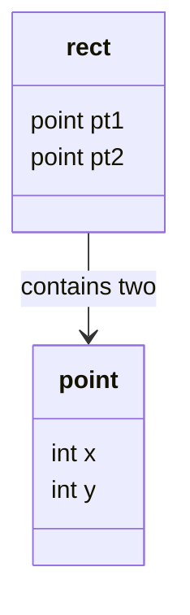

# Structures, Typedef, Unions, and Bit Fields

Structures let C group related objects under one name while keeping each member's type. K&R introduces them with geometric points and rectangles, then moves toward tables, trees, unions, typedefs, and bit fields. The theme is organization: once a program has more than a few related variables, a structure gives those variables a shape that functions can pass, return, store in arrays, and access through pointers.

ANSI C made structure assignment, passing, and returning precise, so structures are real values rather than layout tricks, although they cannot be compared directly. Linked structures and hash tables build on the same rules and are handled separately.

## Declaring and using record types

A structure declaration names a collection of members:

```c
struct point {
    int x;
    int y;
};
```

The tag `point` names this structure type. A variable of that type is declared with:

```c
struct point pt;
```

Members are selected with the `.` operator:

```c
pt.x = 10;
pt.y = 20;
```

A pointer to a structure uses `->` as shorthand for dereference then member selection:

```c
struct point *pp = &pt;
printf("%d\n", pp->x);
```

Nested structures are ordinary members:

```c
struct rect {
    struct point pt1;
    struct point pt2;
};
```

Structures may be initialized with brace-enclosed initializers:

```c
struct point origin = { 0, 0 };
```

`typedef` creates a new name for an existing type:

```c
typedef struct point Point;
typedef int (*Compare)(const void *, const void *);
```

A union stores different member types in the same storage area, one active interpretation at a time:

```c
union value {
    int ival;
    float fval;
    char *sval;
};
```

A bit field declares a small integer field of a specified bit width inside a structure:

```c
struct flags {
    unsigned int is_keyword : 1;
    unsigned int is_extern  : 1;
    unsigned int is_static  : 1;
};
```

## Value semantics, pointers, and incomplete types

The legal structure operations are assignment, copying, taking an address, accessing members, passing to functions, and returning from functions. Structures cannot be compared with `==` or `!=` as whole values. Compare individual members when equality matters.

Passing a structure by value copies it. This is simple and often fine for small structures such as points. For large structures, pass a pointer, preferably a pointer to `const` when the function should not modify the object.

The `.` and `->` operators bind tightly and associate left to right. Parentheses matter when dereferencing a structure pointer manually: `(*pp).x` is correct, while `*pp.x` is parsed as `*(pp.x)` and is wrong when `pp` is a pointer.

`typedef` does not create a new distinct type. It creates another name for an existing type. This improves readability for complicated declarations and supports portability names such as `size_t`, but it does not add runtime checking.

Unions require an external tag or convention to know which member is valid. Reading a different member from the one most recently written is implementation-defined or undefined depending on the case and standard details. K&R's symbol-table example pairs a union with a separate `utype`.

Bit fields are convenient for named flags, but almost every layout detail is implementation-defined: allocation order, alignment, whether fields cross storage units, and exact container choices. Use them for compact in-memory flags when portability of binary layout is not required; use masks when layout must be controlled.

Structure layout is visible enough to matter, but not fully portable at the byte level. The compiler may insert padding between members so that each member is properly aligned. It may also add padding at the end so arrays of the structure keep every element aligned. This means `sizeof(struct point)` is not always the sum of the member sizes in more complicated structures. Code should use `sizeof object` rather than hand-computed sizes.

Designing a structure is also an interface decision. If functions accept and return a small structure such as `struct point`, callers can treat it as a value. If functions accept a pointer to a structure, callers must think about mutation, null pointers, and object lifetime. K&R presents all three approaches: separate scalar arguments, structure values, and structure pointers. The right choice depends on size, clarity, and whether the function needs to modify the original object.

Unions and bit fields are closest to representation-level programming. They are useful in compilers, interpreters, packed state, and low-level interfaces, but they should not be used simply to avoid writing separate fields. If the program needs a variant value, pair the union with an explicit tag. If the program needs named boolean flags and does not expose the binary layout, bit fields can be clear. If the program needs portable serialized bits, masks and explicit shifts are usually better.

Arrays of structures and pointers to structures usually appear together. An array gives compact storage and direct indexing; a pointer lets functions operate on one element without copying it. K&R's table examples use both patterns. The expression `tab[i].name` selects from an array element, while `np->name` selects through a pointer as a linked list is traversed.

A structure type may be mentioned before its members are defined. Such an *incomplete type* has unknown size, so code cannot create an object or take `sizeof` it yet. It can declare pointers, which is enough for self-referential structures:

```c
struct node {
    char *word;
    struct node *next;
};
```

The member cannot be a `struct node` object directly because that would require each node to contain another complete node forever. A pointer has a known fixed size and ends the recursion. Forward declarations also let headers expose an opaque handle while keeping representation private in a source file.

Structure assignment copies the value of every member, including padding in whatever manner the implementation chooses. Pointer members are copied as pointer values; the pointed-to allocation is not duplicated. Such a *shallow copy* can leave two structures referring to the same buffer. If both believe they own it, double-free and use-after-free bugs follow. C has no automatic copy constructor, so an owning structure needs documented initialization, copy, and destruction functions.

Passing by value gives a callee an independent structure object, though any pointer members still refer to shared targets. Passing a pointer permits mutation of the original. A `const struct item *` prevents modification through that pointer but says nothing about aliases elsewhere. Return-by-value is clear for small records, and modern ABIs or compiler optimization often avoid needless temporary copies. Choose the interface for ownership and mutation semantics before guessing about speed.

## Initialization and layout

Positional initialization follows declaration order. Designated initializers, available since C99, attach values to member names and tolerate later insertion or reordering better:

```c
struct point p = { .y = 20, .x = 10 };
```

Members not explicitly initialized are zero-initialized. Assignment after declaration is different from initialization; a brace list by itself is not an assignable structure expression unless a compound literal supplies a type. C99 compound-literal syntax makes the type explicit:

```c
p = (struct point) { .x = 1, .y = 2 };
```

Compilers insert padding to satisfy member alignment. Consider a platform where `char` is one byte with alignment one and `int` is four bytes with alignment four:

```c
struct sample {
    char tag;
    int count;
    char state;
};
```

One common layout puts `tag` at offset 0, three padding bytes before `count` at offset 4, `state` at offset 8, and three trailing padding bytes, for total size 12. Reordering the two characters together may reduce the size to 8 on that platform. The C standard does not promise these exact numbers. `sizeof`, `_Alignof`, and `offsetof` are the proper ways to query the implementation.

Trailing padding ensures that every `count` member in an array remains aligned. It also means bytewise comparison with `memcmp` is not a general substitute for member equality: padding bytes can hold unspecified values, floating-point values have special equality cases, and pointer representations need not compare meaningfully byte by byte. Likewise, dumping raw structure bytes to a file bakes in padding, integer width, byte order, and representation. Serialization should write defined fields in a defined external format.

## How nested structures relate



| Feature | Stores | Access | Best use | Warning |
|---|---|---|---|---|
| `struct` | all members, separate storage | `.` and `->` | records, grouped data | no whole-structure comparison |
| `typedef` | no storage by itself | type name | readability, portability | does not make a new runtime type |
| `union` | one member's storage, shared | `.` and `->` | variant values, low-level overlays | caller must track active member |
| bit field | named bits in storage unit | `.` and `->` | compact flags | layout is implementation-defined |
| enum masks | integer flags | bitwise ops | portable flag logic | less self-documenting than fields |

## Tagged unions make variants explicit

A union's size is sufficient for its largest member, with alignment suitable for every member. All members begin at the same address and overlap. Storing an integer and then storing a pointer replaces the integer representation; there are not two independent values. A separate enumeration records which interpretation currently owns the storage:

```c
enum value_kind { VALUE_INT, VALUE_DOUBLE, VALUE_TEXT };

struct value {
    enum value_kind kind;
    union {
        long integer;
        double real;
        char *text;
    } as;
};
```

Code switches on `kind` before reading `as.integer`, `as.real`, or `as.text`. Constructors can establish the invariant in one place, and a destruction function can free `text` only for `VALUE_TEXT`. Adding a new variant then prompts compiler warnings in exhaustive switches when suitable warning flags are enabled.

Reading a union through a member other than the one most recently stored has narrow language rules and many implementation extensions. It should not be the default technique for reinterpreting floating-point bits. Copying bytes with `memcpy` into an integer type of known width is clearer about the intent and avoids aliasing assumptions, though the result still depends on byte order and floating-point representation. Protocol parsers should decode individual bytes instead of overlaying a union on untrusted input, which can also be misaligned or shorter than expected.

Anonymous unions and structures are available in newer C standards and can reduce member-name nesting, but named layers often document ownership better. The compact spelling is useful when an established codebase already follows it; it is not a reason to obscure which member is active.

## Bit fields versus masks

Bit fields express small values and flags as members. A zero-width unnamed field can force the next field to a new allocation unit, and an unnamed field can reserve bits. The declared base types permitted and the signedness of a plain `int` bit field depend on the language version and implementation. Taking the address of a bit field is impossible because it may not occupy an independently addressable byte.

Hardware register headers sometimes use bit fields, but their layout depends on compiler allocation order, ABI, and target. `volatile` can force accesses to occur, yet it does not standardize which source field maps to which hardware bit, nor does it guarantee an atomic read–modify–write sequence. A write-one-to-clear register can be damaged by an innocent-looking bit-field assignment if the compiler reads the whole register and writes back ones from other flags.

Masks state the representation directly:

```c
enum {
    STATUS_READY = 1u << 0,
    STATUS_ERROR = 1u << 3
};

status |= STATUS_READY;
status &= ~STATUS_ERROR;
if ((status & (STATUS_READY | STATUS_ERROR)) == STATUS_READY) {
    /* ready and no error */
}
```

For file formats, packets, and registers, fixed-width unsigned integers plus shifts and masks make bit positions reviewable. Conversion at the boundary can populate an ordinary structure with named logical fields, keeping representation concerns out of the rest of the program.

## Worked example 1: Canonicalizing a rectangle

Problem: a rectangle is represented by two points, but the input points may arrive in any diagonal order. Given `pt1 = (8, 2)` and `pt2 = (3, 9)`, produce a canonical rectangle whose first point has the smaller coordinates and whose second point has the larger coordinates.

Method:

1. Define the structure:

   ```c
   struct point { int x; int y; };
   struct rect { struct point pt1; struct point pt2; };
   ```

2. Compute minimum coordinates:

$$
\begin{aligned}
   x_{\min} &= \min(8, 3) = 3 \\
   y_{\min} &= \min(2, 9) = 2
   \end{aligned}
$$

3. Compute maximum coordinates:

$$
\begin{aligned}
   x_{\max} &= \max(8, 3) = 8 \\
   y_{\max} &= \max(2, 9) = 9
   \end{aligned}
$$

4. Assign:

   ```c
   out.pt1.x = 3;
   out.pt1.y = 2;
   out.pt2.x = 8;
   out.pt2.y = 9;
   ```

Checked answer: the canonical rectangle is `(3, 2)` to `(8, 9)`. A point `(8, 9)` lies on the excluded top/right boundary if using K&R's half-open convention, while `(7, 8)` is inside.

## Worked example 2: Replacing masks with bit fields

Problem: represent three flags: keyword, external, and static. Turn on external and static, then test whether both are on.

Method with masks:

```c
enum { KEYWORD = 01, EXTERNAL = 02, STATIC = 04 };
unsigned flags = 0;
flags |= EXTERNAL | STATIC;
```

1. Start:

   $$flags = 0.$$

2. Turn on two bits:

   $$flags = 02 | 04 = 06.$$

3. Test:

   $$flags \& (02 | 04) = 06.$$

   Both requested bits are present.

Method with bit fields:

```c
struct flags f = { 0, 0, 0 };
f.is_extern = 1;
f.is_static = 1;
```

1. `f.is_extern` is set to `1`.
2. `f.is_static` is set to `1`.
3. Test:

   ```c
   if (f.is_extern && f.is_static)
       puts("both");
   ```

Checked answer: both representations record the same logical state. Masks give explicit numeric control; bit fields give named member access.

## A complete rectangle value type

```c
#include <stdio.h>

typedef struct {
    int x;
    int y;
} Point;

typedef struct {
    Point pt1;
    Point pt2;
} Rect;

static int min_int(int a, int b) { return a < b ? a : b; }
static int max_int(int a, int b) { return a > b ? a : b; }

Rect canonrect(Rect r)
{
    Rect out;

    out.pt1.x = min_int(r.pt1.x, r.pt2.x);
    out.pt1.y = min_int(r.pt1.y, r.pt2.y);
    out.pt2.x = max_int(r.pt1.x, r.pt2.x);
    out.pt2.y = max_int(r.pt1.y, r.pt2.y);
    return out;
}

int ptinrect(Point p, Rect r)
{
    r = canonrect(r);
    return p.x >= r.pt1.x && p.x < r.pt2.x
        && p.y >= r.pt1.y && p.y < r.pt2.y;
}

int main(void)
{
    Rect r = { { 8, 2 }, { 3, 9 } };
    Point p = { 7, 8 };

    printf("%d\n", ptinrect(p, r));
    return 0;
}
```

The half-open containment rule includes the lower-left edge and excludes the upper-right edge. Adjacent rectangles can then partition a grid without double-counting their shared boundary. Returning `Rect` by value also keeps canonicalization free of caller-visible mutation.

## Errors that survive code review

- Comparing structures directly with `==`. C does not define whole-structure equality.
- Forgetting parentheses in `(*p).member`; prefer `p->member` for structure pointers.
- Assuming a `typedef` hides pointer behavior safely. If the alias is a pointer type, assignment and const placement can become less obvious.
- Reading the wrong member of a union without tracking which member was last stored.
- Depending on bit-field layout for file formats, network protocols, or hardware registers without checking the implementation.
- Passing large structures by value when a `const` pointer would be clearer and cheaper.
- Reusing member names carelessly across unrelated structures, making code harder to scan even though C permits it.
- Using `memcmp` as structure equality when padding or special member representations are present.
- Writing raw structure bytes as a supposedly portable file or wire format.
- Copying an owning pointer member and later freeing it from both copies.

<div className="see-also">

See also: [Linked Structures and Hash Tables](/cs/programming/c/linked-structures-hash-tables) · [Types, Operators, and Expressions](/cs/programming/c/types-operators-expressions) · [Pointers, Addresses, and Arrays](/cs/programming/c/pointers-addresses-arrays) · [Storage Allocation](/cs/programming/c/storage-allocation) · [Modern C Considerations](/cs/programming/c/modern-c-considerations)

</div>
