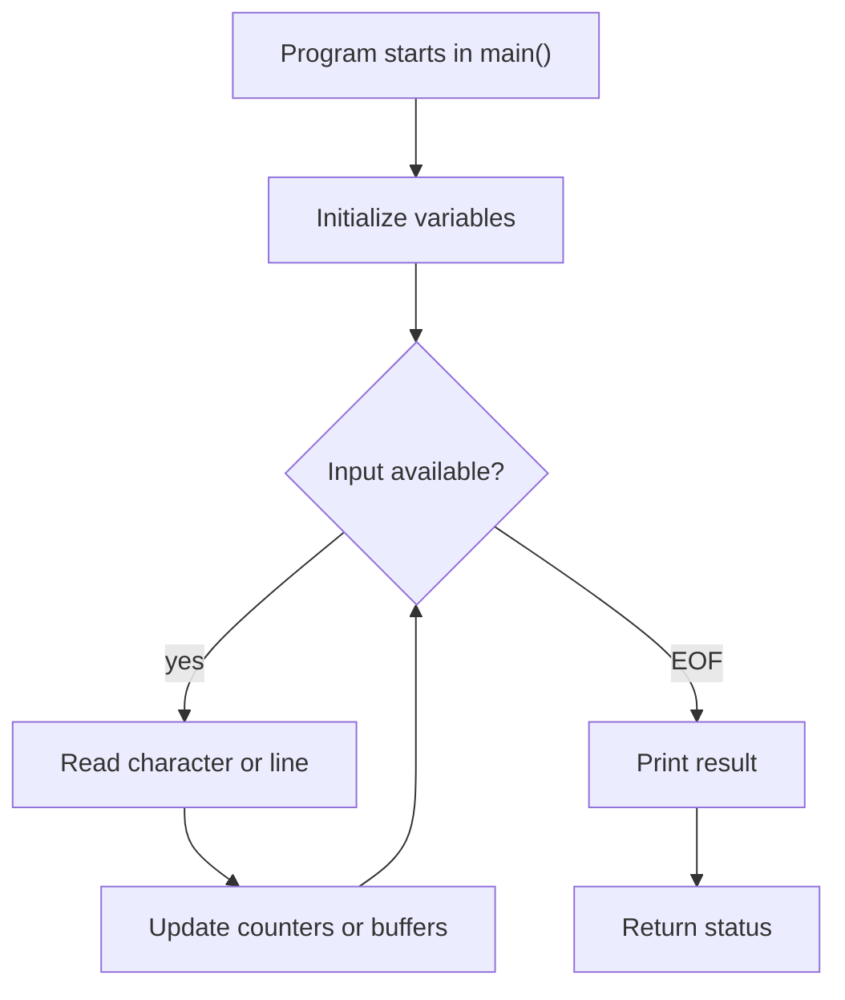

# Tutorial Introduction

K&R begins C by writing complete programs immediately. That is a good way to meet the language: C has few surface features, but every feature is close to the machine, the compiler, and the run-time environment. A tiny program already uses a translation unit, a function named `main`, a standard header, a library call, character constants, integer arithmetic, and a return status to the host environment.

The tutorial chapter does not try to state every rule. It establishes a working core: output with `printf`, variables and arithmetic, `while` and `for`, symbolic constants, character input with `getchar`, arrays, functions, call by value, character arrays, and the first warning about external variables. Later chapters tighten the rules; these examples supply the idioms that make C recognizable.

## A complete program before the rules

The smallest useful hosted program defines `main`, which is called by the execution environment:

```c
#include <stdio.h>

int main(void)
{
    printf("hello, world\n");
    return 0;
}
```

The directive `#include <stdio.h>` is handled before compilation. It provides declarations for standard input and output functions, including `printf`, `getchar`, and `putchar`. A function definition has a return type, a name, a parameter list, and a compound-statement body. `int main(void)` says that `main` returns an `int` status and takes no arguments.

A C program is a collection of definitions and declarations. Variables name objects, and a declaration states their type before use:

```c
int fahr, celsius;
int lower, upper, step;
```

An expression computes a value, often with side effects. The assignment `fahr = lower;` stores a value. The expression `fahr <= upper` is a test; zero means false and nonzero means true. A statement is usually an expression followed by `;`, or a control form such as `while`, `for`, `if`, or a compound statement surrounded by braces.

K&R uses the preprocessor for symbolic constants:

```c
#define LOWER 0
#define UPPER 300
#define STEP 20
```

The preprocessor replaces these names before compilation. They do not allocate storage and are traditionally written in capitals.

## Stream processing as the first C idiom

Many small C programs are filters: read a stream, update some state, and write a result. The same shape appears in file copying, word counting, line filtering, lexical scanning, and command-line tools.

Character input is stored in an `int`, not a `char`, because `getchar` must represent every possible byte value as `unsigned char` plus the distinct value `EOF`. The usual loop is:

```c
int c;

while ((c = getchar()) != EOF)
    putchar(c);
```



Several early idioms recur in larger programs:

| K&R tutorial idiom | Meaning | Why it appears early | Common later refinement |
|---|---|---|---|
| `#include <stdio.h>` | Bring I/O declarations into scope | Needed for `printf`, `getchar`, `putchar` | Add narrower headers such as `<ctype.h>` and `<string.h>` |
| `#define MAXLINE 1000` | Symbolic constant | Avoid magic numbers | Prefer `const` objects where storage and type checking matter |
| `while ((c = getchar()) != EOF)` | Read until no input remains | Classic stream-processing loop | Check errors separately with `ferror` when using streams |
| `char line[MAXLINE]` | Fixed character buffer | Simple storage for text lines | Carry explicit bounds through every operation |
| `return 0;` | Successful program status | Communicates with the environment | Return nonzero on failure |

The tutorial's sequence is deliberately example-driven. A temperature table introduces arithmetic and loops; file copying introduces `EOF`; word counting introduces state; digit counting introduces arrays; `power` introduces functions; and longest-line introduces character arrays. Each program is complete enough to compile while isolating one new interaction among storage, control flow, and library calls.

## Why operand types change the temperature table

Integer arithmetic retains an integer type. In the Fahrenheit-to-Celsius calculation, `5 * (fahr - 32) / 9` avoids the immediate truncation produced by `5 / 9`, but the result is still integral. At least one floating operand is needed for a fractional result, as in `(5.0 / 9.0) * (fahr - 32)`.

For Fahrenheit values 0, 20, 40, 60, and 80, the conversion is

$$
C = \frac{5}{9}(F - 32).
$$

At `F = 80`, the integer form gives

$$
\begin{aligned}
C_{\text{int}} &= 5 \times (80 - 32) / 9 \\
&= 5 \times 48 / 9 \\
&= 240 / 9 \\
&= 26.
\end{aligned}
$$

Integer division discards the fractional part. With floating-point operands,

$$
\begin{aligned}
C_{\text{float}} &= (5.0 / 9.0) \times 48 \\
&= 26.6666\ldots
\end{aligned}
$$

The integer table therefore prints `26` for `80 F`, while a table formatted to one decimal place prints about `26.7`. The formula is unchanged; the operand types control the calculation.

## Counting digits without a parser

Arrays provide a direct representation for counts indexed by digit. Given

```text
a1 b22
90!
```

initialize `ndigit[10]` to zero, maintain `nwhite` and `nother`, and test each character in the order digit, whitespace, other. Once `c >= '0' && c <= '9'` holds, `c - '0'` is an index from 0 through 9.

| Character | Classification | Update |
|---|---|---|
| `a` | other | `nother = 1` |
| `1` | digit | `ndigit[1] = 1` |
| space | whitespace | `nwhite = 1` |
| `b` | other | `nother = 2` |
| `2` | digit | `ndigit[2] = 1` |
| `2` | digit | `ndigit[2] = 2` |
| newline | whitespace | `nwhite = 2` |
| `9` | digit | `ndigit[9] = 1` |
| `0` | digit | `ndigit[0] = 1` |
| `!` | other | `nother = 3` |

The final digit counts are `0:1`, `1:1`, `2:2`, and `9:1`, with all other digit counts zero. Whitespace is `2`; other characters total `3`.

## Separating the longest-line program

Arrays and functions break the longest-line problem into distinct jobs: read a line, compare its length, copy it when it is the longest seen, and print the final result.

Function arguments are passed by value. A function receives copies of scalar arguments, so changing a parameter does not change the caller's variable. An array parameter behaves differently: the expression passed for an array is converted to a pointer to its first element, so the function can modify the elements. That distinction becomes central when pointers are introduced.

Character arrays represent C strings when they end with the null character `'\0'`. The literal `"hello\n"` contains `h`, `e`, `l`, `l`, `o`, newline, and a final null character.

```c
#include <stdio.h>

#define MAXLINE 1000

int getline_kr(char s[], int lim);
void copy(char to[], const char from[]);

int main(void)
{
    int len;
    int max = 0;
    char line[MAXLINE];
    char longest[MAXLINE];

    while ((len = getline_kr(line, MAXLINE)) > 0) {
        if (len > max) {
            max = len;
            copy(longest, line);
        }
    }

    if (max > 0)
        printf("%s", longest);

    return 0;
}

int getline_kr(char s[], int lim)
{
    int c;
    int i;

    for (i = 0; i < lim - 1 && (c = getchar()) != EOF && c != '\n'; ++i)
        s[i] = (char)c;

    if (c == '\n') {
        s[i] = (char)c;
        ++i;
    }

    s[i] = '\0';
    return i;
}

void copy(char to[], const char from[])
{
    int i = 0;

    while ((to[i] = from[i]) != '\0')
        ++i;
}
```

External variables offer another way to share the buffers and lengths: define the objects outside every function, then declare them where needed. They last for the whole execution. K&R also shows why that shorter argument list is often a poor trade: the functions acquire hidden data connections. Passing the arrays and limits keeps the data flow explicit.

## Bounds, terminators, and ambiguous expressions

C supplies little automatic protection for these examples. A character array has exactly its declared size; a function using a buffer must receive or otherwise know its limit; and a string needs a terminating `'\0'`. Writing beyond the array remains an error even when the program appears to run normally.

- Store the result of `getchar()` in `int`, or `EOF` may become indistinguishable from a valid character.
- Parenthesize the assignment in `while ((c = getchar()) != EOF)`. Without the inner parentheses, `c` receives the result of the comparison.
- Integer division truncates toward zero; it does not round to the nearest integer.
- Keep helper functions independent of external variables unless the shared lifetime and hidden dependency are intentional.
- Braces around nested control flow prevent later edits from attaching an `else` to a different `if` than expected.

<div className="see-also">

See also: [Types, Operators, and Expressions](/cs/programming/c/types-operators-expressions) · [Control Flow](/cs/programming/c/control-flow) · [Functions and Program Structure](/cs/programming/c/functions-program-structure) · [Pointers, Addresses, and Arrays](/cs/programming/c/pointers-addresses-arrays) · [Standard I/O and Formatted I/O](/cs/programming/c/standard-io-formatted-io)

</div>
