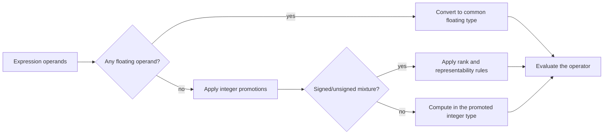

# Types, Operators, and Expressions

C expressions are compact because the language gives direct access to arithmetic, comparisons, bit operations, assignments, and conversions. K&R's second chapter is where C begins to look like a systems language: every object type constrains its values, and the chosen operator often reveals how the representation is being used.

These rules support the later chapters. Pointer arithmetic depends on integer conversions, declarations depend on qualifiers, and robust macros depend on precedence and evaluation rules. K&R's terse style assumes that precision.

## What a declaration promises

The basic arithmetic types introduced by K&R are `char`, `int`, `float`, and `double`, with qualifiers and related forms:

```c
char c;
short s;
int i;
long n;
unsigned int u;
float x;
double y;
long double z;
```

The standard guarantees `sizeof(char) <= sizeof(short) <= sizeof(int) <= sizeof(long)`, along with minimum ranges for the integer types. Exact widths are implementation-defined. Plain `char` is a distinct small integer type and has the same range and representation as either `signed char` or `unsigned char`; which one is implementation-defined. Use an explicitly signed or unsigned form when that distinction carries meaning.

Declarations may initialize objects:

```c
int lower = 0;
const double scale = 5.0 / 9.0;
char msg[] = "warning";
```

External and static objects with omitted initializers are zero-initialized. An uninitialized automatic object has an indeterminate value, and reading that value is generally invalid.

`const` prevents assignment through the qualified lvalue. An unsigned type specifies modular arithmetic. A cast requests an explicit conversion, but can also suppress a warning that would have exposed a mistake. Casts belong at real representation boundaries, such as the generic allocation interfaces used in older C, rather than around expressions the compiler rejects for good reason.

Three related ideas are easy to blur. An **object** is a region of storage, a **value** is the abstract number or character represented there, and a **type** determines the permitted operations and interpretation. `sizeof` reports storage in units of `char`, not a count of value bits. Padding bits and alignment can make representation details differ even when two types have similar ranges.

The standard's minimum ordering of sizes does not require them to be distinct. A common implementation has 8-bit `char`, 16-bit `short`, 32-bit `int`, and 64-bit `long` on many Unix-like 64-bit systems; another common model keeps `long` at 32 bits and makes pointers 64 bits. Portable interfaces use `<stdint.h>` exact-width types only when an exact-width representation is genuinely required, and `size_t` for object sizes and array counts.

Qualifiers describe access constraints rather than deep immutability. In `const int *p`, the pointed-to `int` cannot be modified through `p`; in `int *const p`, the pointer itself cannot be reassigned. `volatile` tells the implementation that accesses are observable and must occur according to the abstract-machine rules. It is used for objects such as memory-mapped registers, but it does not make compound operations atomic and does not provide thread synchronization.

## Constants carry types too

The unsuffixed decimal constant `123` has type `int` when it fits; `123L` is `long`, and `123U` is unsigned. `0x1f` uses hexadecimal notation, while a leading zero makes `037` octal. Floating constants such as `1.0` have type `double` unless suffixed with `f`, `F`, `l`, or `L`.

A character constant such as `'A'` has type `int` in C. A string literal such as `"A"` is an array containing the character and a terminating `'\0'`. Character values should be written symbolically: the decimal digits are guaranteed to be consecutive, so `c - '0'` is the portable conversion from a known digit character to its value.

For `c == '7'`, the conversion and array update are

$$
\begin{aligned}
index &= c - '0' \\
&= '7' - '0' \\
&= 7.
\end{aligned}
$$

After checking that `c` lies from `'0'` through `'9'`, the statement

```c
++ndigit[c - '0'];
```

increments `ndigit[7]`. The preceding range check proves that the index is between 0 and 9.

## How mixed operands find a common type

The usual arithmetic conversions determine the common type of many binary expressions. Integer types narrower than `int` are promoted before arithmetic. Floating operands cause the other operand to be converted to the appropriate floating type. A signed/unsigned mixture may convert the signed value to an unsigned type, so a negative value can become a large positive one.



The exact size of `int` and the signedness of plain `char` remain implementation-defined. K&R points to `<limits.h>` and `<float.h>` for machine properties instead of hard-coded assumptions. Modern targets are more uniform than K&R's, but portable code still uses the implementation's published limits.

### Promotions worked out

Consider a system where `int` is 32 bits and `unsigned int` is also 32 bits. In

```c
int i = -1;
unsigned int u = 1;
printf("%d\n", i < u);
```

`unsigned int` cannot represent every `int`, so `i` is converted to unsigned. Arithmetic is modulo $2^{32}$, and the converted value is

$$
2^{32}-1=4294967295.
$$

The comparison becomes $4294967295\lt 1$, which is false, so the program prints `0`. No bit-level trick in the source announces that change; it follows from the common-type rules.

Narrow integer operands present a different surprise:

```c
unsigned char a = 250;
unsigned char b = 10;
int sum = a + b;
```

If `int` can represent every `unsigned char` value, both operands promote to `int`. The addition produces $260$, not a wrapped byte. Wrap occurs only if that result is converted back:

```c
unsigned char wrapped = a + b;  /* 260 modulo 256 is 4 */
```

Unsigned arithmetic is defined modulo one more than the type's maximum. Signed overflow has undefined behavior, allowing the optimizer to assume it never occurs in a valid execution. Tests such as `if (a + b < a)` can detect unsigned wrap, but are not a valid general method for signed addition. Check bounds before the operation or use an implementation-provided checked-arithmetic facility when available.

Floating-to-integer conversion discards the fractional part toward zero when the remaining value is representable. Converting an out-of-range floating value to an integer is undefined behavior. Integer-to-floating conversion may round because a floating format often cannot represent every large integer exactly.

Enumeration constants have type `int`, while each enumeration type is distinct but compatible with an implementation-chosen integer type. An enum is useful for named states; it does not prevent a cast or corrupted input from producing a value that names no enumerator. Validate values crossing a file, network, or device boundary.

The conditional operator also computes a common result type. In `condition ? -1 : sizeof buffer`, the second alternative has type `size_t`, an unsigned type. The `-1` can therefore convert to a large unsigned value even when that branch is selected. Assigning the result to a signed variable afterward may be implementation-defined if the value does not fit. Matching alternative types avoids a conversion hidden inside otherwise readable control flow.

Conversions at function boundaries follow the declared parameter types. A prototype lets the compiler convert and check arguments. Calling a variadic function has only the default argument promotions for the unnamed portion: `float` becomes `double`, and narrow integers become `int` or `unsigned int`. A `printf` conversion that does not match the promoted argument type produces undefined behavior; the format string is part of the call's type contract.

## Grouping, sequencing, and guarded evaluation

Expressions draw from several operator families:

- arithmetic: `+`, `-`, `*`, `/`, `%`
- relational and equality: `<`, `<=`, `>`, `>=`, `==`, `!=`
- logical: `&&`, `||`, `!`
- bitwise: `&`, `|`, `^`, `~`, `<<`, `>>`
- assignment: `=`, `+=`, `-=`, `*=`, `/=`, `%=` and the bitwise assignment forms
- increment and decrement: `++`, `--`
- conditional: `?:`
- comma: `,`

Precedence determines grouping; it usually says nothing about which operand is evaluated first. Expressions with unsequenced modifications to the same object, such as `a[i] = i++`, have undefined behavior. Splitting such work into statements removes both the ambiguity and the defect.

`&&` and `||` are exceptions with specified left-to-right evaluation and short-circuiting. In `p != NULL && *p == 'x'`, the dereference occurs only when `p != NULL` is true. Both logical operators, as well as comparisons, produce `0` or `1`.

Assignment expressions have the stored value, which permits `a = b = 0`. The conditional operator `?:` is also an expression, so it fits in initializers, arguments, and return statements when the alternatives are simple values. An `if` is clearer once either branch contains several side effects.

Function arguments usually have no specified evaluation order. In `f(i++, i++)`, the modifications are unsequenced relative to one another and the behavior is undefined. Even when two argument expressions have unrelated side effects and the program is valid, relying on which happens first makes output implementation-dependent. Evaluate them in separate statements when order matters.

`sizeof` normally does not evaluate its operand. After `int i = 0;`, the expression `sizeof(i++)` reports the size of `i` and leaves `i` unchanged. A variable-length array is an important exception: evaluating its size can require run-time expressions. `_Alignof` or the modern `alignof` spelling reports alignment rather than storage size.

Precedence can be read as an implicit parse tree. `*p++` means `*(p++)` because postfix increment binds more tightly than unary `*`; it fetches the current pointed-to value and advances the pointer. `(*p)++` instead increments the pointed-to object. Parentheses do not impose an operand evaluation order, but they are useful when the intended grouping is not immediate.

| Expression | Result or rule | Detail to remember |
|---|---|---|
| `7 / 3` | `2` | Integer division discards the fractional part |
| `7 % 3` | `1` | Both operands must have integer type |
| `'8' - '0'` | `8` | Portable for decimal digits |
| `p && *p` | second operand is guarded | Left operand is evaluated first |
| `a > b ? a : b` | the larger value | Only the selected alternative is evaluated |
| `a = b = 0` | both objects become zero | Assignment associates right to left |

Division of signed integers truncates toward zero in modern C. The remainder satisfies

$$
(a/b)b+a\%b=a
$$

whenever the quotient is representable and the divisor is nonzero. Thus `-7 / 3` is `-2`, while `-7 % 3` is `-1`. A remainder is not always a nonnegative mathematical modulus; indexing with it may require adjustment.

## Packing three properties into flags

Bitwise operators manipulate integer representations and suit flags, masks, packed fields, device interfaces, and structure bit-fields. The usual forms are `flags |= MASK` to set bits, `flags &= ~MASK` to clear bits, and `(flags & MASK) != 0` to test them.

Suppose one integer records whether a token is a keyword, external, or static:

```c
enum { KEYWORD = 01, EXTERNAL = 02, STATIC = 04 };
unsigned flags = 0;
```

Set `EXTERNAL` and `STATIC` together:

```c
flags |= EXTERNAL | STATIC;
```

In octal,

$$
\begin{aligned}
EXTERNAL \mathbin{|} STATIC &= 02 \mathbin{|} 04 \\
&= 06.
\end{aligned}
$$

Then clear `EXTERNAL` and test `STATIC`:

```c
flags &= ~EXTERNAL;

if ((flags & STATIC) != 0)
    puts("static");
```

The value changes from `06` to `04`; `STATIC` is on, while `EXTERNAL` and `KEYWORD` are off.

| Mask operation | Effect |
|---|---|
| `x |= 04` | set bit 2 |
| `x &= ~04` | clear bit 2 |
| `(x & 04) != 0` | test bit 2 |

### Extracting and replacing a packed field

Suppose bits 4 through 6 of an unsigned register hold a three-bit mode. The unshifted field mask is binary `111`, or hexadecimal `0x7`. Shift it into place:

$$
\text{MODE\_MASK}=0x7\ll4=0x70.
$$

For register value `0xB5`, extraction first masks and then shifts right:

$$
\begin{aligned}
0xB5\mathbin{\&}0x70&=0x30,\\
0x30\gg4&=0x3.
\end{aligned}
$$

The field therefore contains mode $3$. To replace it with mode $5$, clear the old field and OR in the bounded new value:

```c
unsigned set_mode(unsigned reg, unsigned mode)
{
    const unsigned shift = 4;
    const unsigned mask = 0x7u << shift;
    return (reg & ~mask) | ((mode & 0x7u) << shift);
}
```

Starting from `0xB5`, clearing yields `0x85`; `(5 & 7) << 4` yields `0x50`; the final value is `0xD5`. Masking `mode` prevents higher input bits from corrupting neighboring fields. A caller may instead reject values above $7$ when silent truncation would hide an error.

For an unsigned left operand after integer promotion, left shift multiplies by a power of two and reduces the result modulo one more than the type's maximum when the shift count is valid. A narrow unsigned operand may promote to signed `int`, so the promoted type still has to be checked. A shift count negative or at least the promoted left operand's width is undefined. Right shift of a negative signed value is implementation-defined, so bit protocols and masks are normally expressed with suitably wide unsigned operands.

## A byte classifier using the same rules

This program combines short-circuit-free classification, digit indexing, flags, and the conditional operator. The cast to `unsigned char` keeps calls to `<ctype.h>` within their required domain for every non-`EOF` byte value.

```c
#include <ctype.h>
#include <stdio.h>

enum { SEEN_DIGIT = 01, SEEN_SPACE = 02, SEEN_OTHER = 04 };

int main(void)
{
    int c;
    unsigned flags = 0;
    int ndigit[10] = { 0 };

    while ((c = getchar()) != EOF) {
        if (isdigit((unsigned char)c)) {
            flags |= SEEN_DIGIT;
            ++ndigit[c - '0'];
        } else if (isspace((unsigned char)c)) {
            flags |= SEEN_SPACE;
        } else {
            flags |= SEEN_OTHER;
        }
    }

    for (int i = 0; i < 10; ++i)
        printf("%d%c", ndigit[i], i == 9 ? '\n' : ' ');

    if ((flags & SEEN_OTHER) != 0)
        fprintf(stderr, "input contained non-digit, non-space characters\n");

    return 0;
}
```

## Notation that changes the program

- `'x'` is an integer character constant; `"x"` is an array containing `x` and `'\0'`.
- A leading zero changes an integer literal's base: `010` is eight, not ten.
- Plain `char` has implementation-defined signedness. Convert arbitrary byte values to `unsigned char` before passing them to `<ctype.h>` functions.
- `=` assigns and `==` compares. Assignments in conditions need deliberate parentheses and compiler warnings turned on.
- `&&` and `||` yield exactly `0` or `1`, not an arbitrary nonzero truth value.
- Bitwise `&` has lower precedence than `==`; write `(flags & MASK) == 0`.
- `sizeof(array) / sizeof(array[0])` counts elements only where `array` is still an array. A function parameter written with brackets is adjusted to a pointer, so the same expression there computes a pointer-size ratio.
- Comparing a signed index with `size_t` can convert the index to unsigned. Test that the signed value is nonnegative before converting, or use a size type consistently when negative values are impossible.
- A cast can change the value being computed, but it cannot repair an invalid pointer, extend an object's lifetime, or make signed overflow defined.

<div className="see-also">

See also: [Tutorial Introduction](/cs/programming/c/tutorial-introduction) · [Control Flow](/cs/programming/c/control-flow) · [Preprocessor and Separate Compilation](/cs/programming/c/preprocessor-separate-compilation) · [Structures, Typedef, Unions, and Bit Fields](/cs/programming/c/structures-typedef-unions-bitfields) · [Modern C Considerations](/cs/programming/c/modern-c-considerations)

</div>
