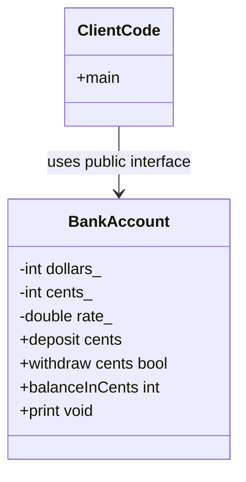

# Classes and Encapsulation

Classes are the point where C++ stops being only a procedural language and becomes a language for defining new types. A class can store data, protect representation details, and provide operations that preserve the meaning of the type. Savitch introduces structures first, then classes, so the transition is concrete: a `struct` groups related variables, while a class usually adds member functions and hides member variables behind a public interface.

Encapsulation is the main idea. A well-designed class lets users think in terms of dates, bank accounts, time values, students, or money amounts instead of raw fields. The implementation can change later, but code using the class should continue to work if the public interface keeps the same contract.

## From a record to a type with rules

A **structure** groups member variables under one type name.

```cpp
struct Date {
    int month;
    int day;
    int year;
};
```

A structure object uses the dot operator to access members.

```cpp
Date due = {12, 31, 2026};
std::cout << due.month << "/" << due.day << "/" << due.year << '\n';
```

A **class** is a user-defined type that can contain member variables and member functions. In typical C++ style, member variables are private and member functions form the public interface.

```cpp
class DayOfYear {
public:
    void set(int month, int day);
    int monthNumber() const;
    int dayOfMonth() const;

private:
    int month_;
    int day_;
};
```

A **member function** is called through an object.

```cpp
DayOfYear today;
today.set(5, 15);
```

The **scope resolution operator** `::` qualifies a member function definition outside the class body.

```cpp
void DayOfYear::set(int month, int day) {
    month_ = month;
    day_ = day;
}
```

An **accessor** returns information without changing the object. A **mutator** changes object state, usually after validation.

```cpp
int DayOfYear::monthNumber() const {
    return month_;
}
```

An **abstract data type** hides representation details. Users know what operations mean, but not how data is stored internally.

The distinction is behavioral rather than syntactic. A `struct` can have constructors, private data, and virtual functions; a `class` can contain only public fields. The keywords differ only in their defaults: members and base classes are public by default in a `struct`, private by default in a `class`. Convention supplies the stronger signal. A `struct` usually says “inspect these fields as one record,” while a `class` says “use these operations and let the type maintain its own rules.”

Each non-static member function has an implicit pointer named `this` that points to the object on which it was called. The expression `today.set(5, 15)` behaves roughly like a function call supplied with `&today`. Inside `set`, `month_` is shorthand for `this->month_`. Writing `this->` explicitly is mainly useful when a parameter has the same name as a member:

```cpp
void Counter::setValue(int value) {
    this->value = value;
}
```

Many codebases instead give members a suffix such as `value_`, which avoids the collision. The implicit object also explains the trailing `const` on a member function: `balance() const` treats `this` as a pointer to const, so ordinary data members cannot be assigned through it.

## The invariant is the center of the design

The default access for `struct` members is public. The default access for `class` members is private. Good C++ style does not rely on this difference alone; it marks the interface intentionally.

Private data protects invariants. Suppose a date object should never have month `13`. If `month_` is public, any code can assign invalid state. If `month_` is private, all changes must pass through member functions that can reject invalid values.

For a month-and-day type, checking both fields independently is too weak: April 31 and February 30 would pass. A representation helper can encode the actual relation:

```cpp
bool DayOfYear::isValid(int month, int day) const {
    static const int days[] = {
        0, 31, 28, 31, 30, 31, 30,
        31, 31, 30, 31, 30, 31
    };
    return month >= 1 && month <= 12 &&
           day >= 1 && day <= days[month];
}
```

This type has no year, so it deliberately cannot represent February 29. Adding leap days would require a year member and a larger invariant; silently accepting the date without enough information would give the class unclear semantics.

The member functions of a class can access private members of any object of the same class, not only the calling object. This matters in comparisons:

```cpp
bool sameDay(const DayOfYear& other) const {
    return month_ == other.month_ && day_ == other.day_;
}
```

Interface and implementation should be conceptually separate even before files are physically separated. The class declaration and comments explain how to use the type. The private data layout and member function bodies explain how the type is implemented.

The public interface should use vocabulary from the problem domain:

| Weak interface | Better interface | Reason |
|---|---|---|
| `setX(int)` | `setMonth(int)` | exposes meaning |
| `getA()` | `balance()` | names the domain value |
| public `rate` | `setInterestRate(double)` | validates mutation |
| public date fields | `set(month, day, year)` | preserves date invariant |

The `const` marker at the end of a member function promises not to change the calling object.

```cpp
double balance() const;
```

This promise is important because const objects and const reference parameters can call only const member functions.

Encapsulation also reduces the number of places that must be audited after a representation change. Suppose `BankAccount` initially stores `int cents_`, then balances become large enough to require a 64-bit integer. If client code uses `deposit`, `withdraw`, and `balanceInCents`, the change is mostly confined to the class. If callers directly manipulate a public field, every caller participates in the representation and may need repair.

Getters and setters are not automatically a good interface. A pair such as `int balance()` and `void setBalance(int)` can recreate public data with extra syntax. An account normally has domain operations—depositing, withdrawing, perhaps transferring—that state why the balance changes. Those operations can check amount ranges, overdraft rules, and overflow at the boundary where the decision belongs.

The strongest useful invariant should hold whenever control is outside a public member function. A mutator may briefly pass through an intermediate state while calculating, but it should either commit a valid final state or leave the original object unchanged. This is the same “all-or-nothing” shape later used by exception-safe code.

## Who can reach which representation



| Member category | Accessible from client code? | Accessible inside member functions? | Typical use |
|---|---:|---:|---|
| `public` member function | yes | yes | interface operation |
| `public` member variable | yes | yes | rare simple aggregate cases |
| `private` member function | no | yes | helper operation |
| `private` member variable | no | yes | representation |

`protected` adds a third access category for the class and its derived classes. It is tempting as an inheritance convenience, but protected data spreads representation knowledge into every subclass. A private member plus a carefully chosen protected or public operation usually keeps the base invariant under tighter control.

A `friend` declaration grants a named function or class access to private members. Friendship can be appropriate for a symmetric non-member operator or a tightly coupled helper, but it bypasses the ordinary interface. Friendship is explicit, neither inherited nor transitive: a friend of a friend receives no access.

## Worked example: designing a validated date class

Problem: Build a date-like class for month and day. Prevent invalid month or day values from entering the object.

Method:

1. Store `month_` and `day_` privately.
2. Provide a `set` mutator.
3. Check the proposed values before assigning.
4. Return `true` for success and `false` for failure.
5. Make accessors const.

```cpp
#include <iostream>

class DayOfYear {
public:
    DayOfYear() : month_(1), day_(1) {}

    bool set(int month, int day) {
        static const int days[] = {
            0, 31, 28, 31, 30, 31, 30,
            31, 31, 30, 31, 30, 31
        };
        if (month < 1 || month > 12 ||
            day < 1 || day > days[month]) {
            return false;
        }
        month_ = month;
        day_ = day;
        return true;
    }

    int monthNumber() const {
        return month_;
    }

    int dayOfMonth() const {
        return day_;
    }

private:
    int month_;
    int day_;
};

int main() {
    DayOfYear date;
    bool ok = date.set(13, 4);
    std::cout << std::boolalpha << ok << '\n';
    std::cout << date.monthNumber() << "/" << date.dayOfMonth() << '\n';
}
```

Checked answer:

1. The default date starts as `1/1`.
2. `set(13, 4)` fails because `13` is outside `1..12`.
3. The function returns `false`.
4. The object remains `1/1`.

The class protects its invariant because clients cannot assign to `month_` directly.

The order of the test matters. Because `||` short-circuits, `day > days[month]` is evaluated only after the month has been shown to lie in `1..12`. Indexing `days[month]` before that check could itself access outside the array. The assignments occur only after every test passes, so a rejected update preserves the old valid date.

## Worked example: comparing two objects of the same class

Problem: Add a member function that tells whether two `TimeOfDay` objects represent the same minute.

Method:

1. Store hour and minute privately.
2. Inside a member function, compare the calling object's private fields with the other object's private fields.
3. Mark the comparison const.

```cpp
#include <iostream>

class TimeOfDay {
public:
    bool set(int hour, int minute) {
        if (hour < 0 || hour > 23 || minute < 0 || minute > 59) {
            return false;
        }
        hour_ = hour;
        minute_ = minute;
        return true;
    }

    bool sameAs(const TimeOfDay& other) const {
        return hour_ == other.hour_ && minute_ == other.minute_;
    }

private:
    int hour_ = 0;
    int minute_ = 0;
};

int main() {
    TimeOfDay start;
    TimeOfDay end;
    start.set(9, 30);
    end.set(9, 30);
    std::cout << std::boolalpha << start.sameAs(end) << '\n';
}
```

Checked answer: `sameAs` returns `true`. Even though `other.hour_` is private, the function is a member of `TimeOfDay`, so it can access private members of any `TimeOfDay` object.

Passing `other` by `const` reference has two effects. The object is not copied merely to compare two integers, and `sameAs` promises not to modify the argument. The trailing `const` makes the separate promise that it will not modify the calling object. Both sides of the comparison can therefore be const objects.

## A small value type: account balance in cents

This class models a small bank account using cents as the representation to avoid floating-point rounding in the stored balance.

```cpp
#include <iostream>

class BankAccount {
public:
    BankAccount() : cents_(0) {}

    bool deposit(int cents) {
        if (cents < 0) {
            return false;
        }
        cents_ += cents;
        return true;
    }

    bool withdraw(int cents) {
        if (cents < 0 || cents > cents_) {
            return false;
        }
        cents_ -= cents;
        return true;
    }

    int balanceInCents() const {
        return cents_;
    }

    void print() const {
        std::cout << "$" << cents_ / 100 << ".";
        int centsPart = cents_ % 100;
        if (centsPart < 10) {
            std::cout << "0";
        }
        std::cout << centsPart << '\n';
    }

private:
    long long cents_;
};

int main() {
    BankAccount account;
    account.deposit(1250);
    account.withdraw(275);
    account.print();
}
```

Storing cents avoids the binary floating-point surprise of representing decimal hundredths in `double`. It does not solve every money problem: currency, rounding policy, overflow, transaction history, and concurrent updates are outside this small model. Even here, `deposit` should check whether addition would exceed the chosen integer range in code that accepts untrusted or very large values. The useful lesson is narrower: the representation and its limits belong behind operations named in the domain.

## Where class interfaces go wrong

- Making all member variables public and losing control of class invariants.
- Treating accessor and mutator functions as useless boilerplate. Their value is validation, abstraction, and future representation changes.
- Forgetting the semicolon after a class or struct definition.
- Omitting `ClassName::` when defining a member function outside the class.
- Forgetting `const` on member functions that do not change the object.
- Writing member functions that expose too much representation detail.
- Confusing an object with a class. A class is the type; an object is a value of that type.
- Using public data for a class that has real invariants or behavior.

Before settling a class interface:

- State the class invariant in one sentence. For `TimeOfDay`, the invariant might be `0 <= hour < 24` and `0 <= minute < 60`; for `BankAccount`, the invariant might be that the stored balance is never negative unless overdraft is explicitly modeled.
- Make constructors establish the invariant immediately. A class that can be created in an invalid state forces every member function to defend against a situation that should not exist.
- Let public functions describe operations in the problem domain. A caller should ask an account to `deposit` or `withdraw`, not fetch a raw representation, modify it, and store it back.
- Keep representation choices replaceable. If clients never see `cents_`, the class can later switch to a larger integer type, a database-backed balance, or a decimal class without changing client code.
- Use `const` member functions aggressively for observers. This lets the same function work for ordinary objects, const objects, and const references passed to functions.
- Prefer small, testable member functions. A member function that validates input, changes state, prints output, and reads from `cin` is difficult to reuse because it mixes several responsibilities.
- Use `struct` for simple passive records and `class` for types with invariants and behavior. The technical difference is default access, but the naming convention communicates design intent to readers.

Try to misuse the class from `main`. If invalid states can be created with ordinary public operations, the interface is too permissive. If a client must know the private representation to use the class correctly, the abstraction is too weak. A well-encapsulated class makes correct use straightforward and incorrect use difficult.

The representation boundary can be judged by asking, "What can change without forcing client code to change?" If the answer is "almost nothing," the class is probably exposing representation instead of behavior. Encapsulation is successful when the private data can evolve while the public operations remain stable.

Object lifetime also constrains an interface. Returning a reference or pointer to a private member lets a caller retain access after the member function ends. A non-const reference can mutate the member without validation; any reference becomes dangling after the object dies. Returning a small value such as an integer balance is safer. For a large value, a const reference may be justified, but its lifetime and invalidation rules become part of the public contract.

Const correctness is transitive only through the object itself. A const member function cannot assign to an ordinary member, but if the class stores a raw pointer, it can still modify the separate object to which that pointer refers. `const` means the observable state of a well-designed abstraction should not change, even where the type system technically permits an indirect mutation. The `mutable` keyword exists for state such as a cache or lock that does not alter the logical value; using it to evade a poor interface defeats the promise clients rely on.

Finally, private access is a compile-time boundary, not a security boundary. An object still occupies memory in the process, and serialization, debugging, or undefined behavior can expose bytes. Encapsulation organizes valid program behavior. It does not encrypt fields or isolate hostile code.

## Related pages

- [constructors and copy semantics](/cs/programming/cpp/constructors-and-copy-semantics)
- [references and operator overloading](/cs/programming/cpp/references-and-operator-overloading)
- [separate compilation and namespaces](/cs/programming/cpp/separate-compilation-and-namespaces)
- [inheritance](/cs/programming/cpp/inheritance)
- [polymorphism](/cs/programming/cpp/polymorphism-and-virtual-functions)
