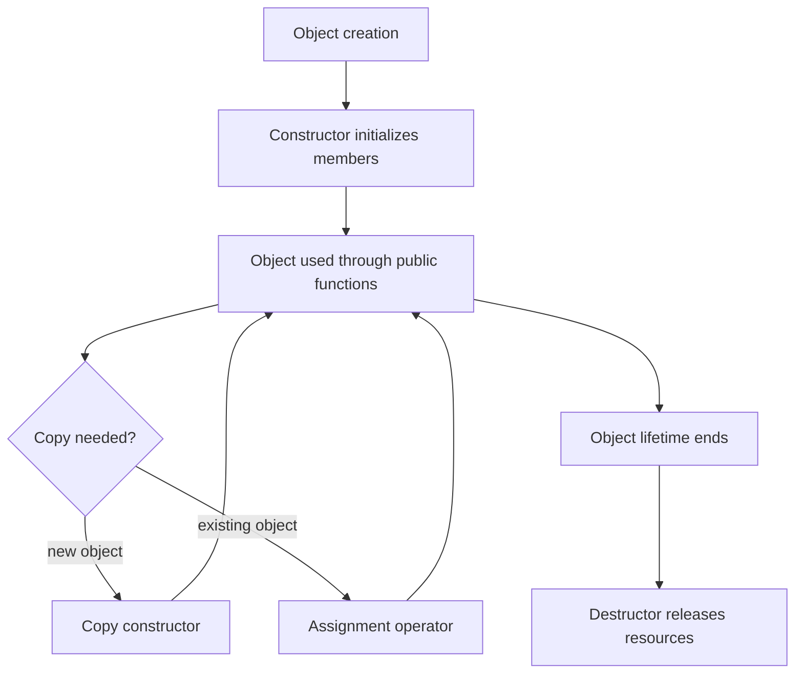

# Constructors and Copy Semantics

Constructors make class objects usable from the moment they are created. Destructors release resources when objects die. Copy constructors and assignment operators define what it means to duplicate an object. Savitch introduces these tools gradually: constructors first for initialization, then `const`, static members, vectors, destructors, copy constructors, and overloaded assignment when classes own dynamic memory.

The guiding principle is resource ownership. If a class only stores simple values, the compiler-generated copy behavior is often fine. If a class owns memory, a file handle, or another resource, memberwise copying is usually not enough. The class must decide whether copying means deep copy, shared ownership, disabled copy, or move-style transfer in modern C++.

## How an object enters and leaves its lifetime

A **constructor** is a member function with the same name as the class and no return type. It initializes new objects.

```cpp
class Point {
public:
    Point() : x_(0.0), y_(0.0) {}
    Point(double x, double y) : x_(x), y_(y) {}

private:
    double x_;
    double y_;
};
```

A **default constructor** can be called with no arguments.

```cpp
Point origin;
```

An **initialization list** initializes members before the constructor body runs.

```cpp
Point(double x, double y) : x_(x), y_(y) {}
```

A **destructor** releases resources and has the form `~ClassName()`.

```cpp
~Buffer() {
    delete[] data_;
}
```

A **copy constructor** creates a new object from an existing object.

```cpp
Buffer(const Buffer& other);
```

An **assignment operator** replaces the value of an existing object.

```cpp
Buffer& operator=(const Buffer& rhs);
```

The **rule of three** says that if a class needs a custom destructor, copy constructor, or copy assignment operator, it likely needs all three.

Modern C++ adds move construction and move assignment, giving the **rule of five**. Savitch's fifth edition centers on copy control, but the same ownership reasoning explains move semantics.

Construction is not assignment to raw storage. Before the constructor body starts, base-class subobjects and data members have already been initialized. The initialization list chooses how. If a member is omitted, it uses its default member initializer or is default-initialized. For a built-in member with neither, that may leave an indeterminate value.

Members are initialized in the order in which they are declared in the class, regardless of their order in the initialization list. Code such as the following is wrong because `size_` is declared after `data_`, so `data_` is initialized first:

```cpp
class Buffer {
    int* data_;
    int size_;
public:
    Buffer(int size) : size_(size), data_(new int[size_]) {}
};
```

Using the constructor parameter directly would repair the allocation, but keeping the list in declaration order is clearer and avoids compiler warnings. Destruction runs in the exact reverse order of completed construction. If construction of a later member throws, already constructed members are destroyed automatically; the class destructor itself does not run because the whole object never completed construction.

## Ownership determines copy behavior

Constructors should establish class invariants. If a `BankAccount` stores dollars and cents separately, every constructor must ensure the representation is consistent.

Initialization lists are not only style; they are required for const members, reference members, and member objects without default constructors. They also avoid unnecessary default construction followed by assignment.

Destructors run automatically when automatic objects leave scope and when dynamic objects are deleted. For an object created with `new`, the destructor runs when `delete` is applied. For arrays created with `new[]`, each element's destructor runs when `delete[]` is applied.

Shallow copy copies pointer values. Deep copy creates independent dynamic storage and copies pointed-to elements.

```text
shallow copy: two objects point to same array
deep copy:    each object owns its own array
```

Assignment must handle self-assignment:

```cpp
if (this == &rhs) {
    return *this;
}
```

It should also avoid destroying the old resource before successfully allocating the new resource. A robust pattern is allocate-copy-delete-swap or copy-and-swap.

Static members belong to the class as a whole rather than to one object. They are useful for shared counters, configuration, or factory state, but should not replace ordinary object state.

Copy construction and copy assignment answer different lifetime questions. In `T b = a;`, `b` has no prior value, so the copy constructor builds it. In `b = a;`, both objects already exist, so assignment must release or reuse `b`'s old resource before taking on `a`'s value. The equals sign in initialization does not imply assignment.

Move operations exploit a temporary or otherwise expendable source. A move constructor can copy a pointer, set the source pointer to null, and avoid copying every element. The moved-from object remains alive and must be destructible and assignable, but its ordinary value is often unspecified. Move operations should usually be `noexcept` when transferring ownership cannot fail; containers such as `std::vector` can then move elements during reallocation while preserving their exception guarantees.

The preferred modern rule is often the **rule of zero**: put ownership in members whose types already implement correct destruction, copying, and moving. Replacing `int* data_` plus `int size_` with `std::vector<int> data_` removes all five special member functions from many classes. The compiler-generated operations compose the vector's value semantics correctly.

When copying has no sensible meaning, say so in the type:

```cpp
class FileLock {
public:
    FileLock(const FileLock&) = delete;
    FileLock& operator=(const FileLock&) = delete;
};
```

Silently sharing a resource is a separate semantic choice, not a cheap substitute for deep copying. Shared ownership is best expressed by an ownership type such as `std::shared_ptr`, whose reference-counting cost and possible cycles are then apparent in the representation.

## Lifetime and the special member functions



| Function | Called when | Typical responsibility |
|---|---|---|
| default constructor | `T obj;` | create valid default state |
| converting constructor | `T obj(arg);` | build from another type |
| copy constructor | `T copy = original;` | create independent copy |
| assignment operator | `a = b;` | replace existing state |
| destructor | scope exit or `delete` | release owned resources |
| move constructor | `T x = std::move(y);` | transfer resources when supported |

The compiler's implicit-generation rules have accumulated historical detail, so a reliable design should not depend on memorizing every corner. A user-declared destructor suppresses implicit move generation in common cases; a reference or const data member may cause assignment to be deleted; a base or member with unavailable copy operations makes the containing operation unavailable. `= default` requests the generated operation explicitly, and `= delete` rejects a call with a direct compile-time diagnostic.

The destructor must not throw. During exception propagation, another thrown exception from a destructor leads to `std::terminate`. Resource wrappers therefore perform cleanup operations that cannot fail or record/report cleanup failure through some separate mechanism.

## Worked example: constructor initialization for a clock time

Problem: Define a `ClockTime` class that stores hour and minute. Normalize `24:00` to `0:00` and reject invalid values.

Method:

1. Store `hour_` and `minute_` privately.
2. Default time is midnight.
3. Constructor with arguments validates ranges.
4. If `hour == 24` and `minute == 0`, store `0:00`.
5. Use a `bool` helper to keep logic readable.

```cpp
#include <cstdlib>
#include <iostream>

class ClockTime {
public:
    ClockTime() : hour_(0), minute_(0) {}

    ClockTime(int hour, int minute) {
        if (!valid(hour, minute)) {
            std::cerr << "Invalid time\n";
            std::exit(1);
        }
        if (hour == 24) {
            hour = 0;
        }
        hour_ = hour;
        minute_ = minute;
    }

    void print() const {
        std::cout << hour_ << ":";
        if (minute_ < 10) {
            std::cout << "0";
        }
        std::cout << minute_ << '\n';
    }

private:
    bool valid(int hour, int minute) const {
        return ((hour >= 0 && hour <= 23) || (hour == 24 && minute == 0))
            && minute >= 0 && minute <= 59;
    }

    int hour_;
    int minute_;
};

int main() {
    ClockTime midnight(24, 0);
    midnight.print();
}
```

Checked answer: the constructor accepts `24:00`, stores `0:00`, and prints `0:00`.

For a reusable library type, terminating the whole process is a harsh response to invalid input. Alternatives include throwing `std::invalid_argument`, returning an optional value from a named factory, or defining a normalization policy. The choice belongs in the constructor's contract. What should not happen is constructing a quietly invalid object and expecting every later member call to rediscover the problem.

## Worked example: shallow copy failure and deep copy fix

Problem: A class owns a dynamic array. Show why the default copy constructor is wrong and how a deep copy fixes it.

Method:

1. A class contains `int* data_`.
2. Default copying copies the pointer.
3. Both objects point to the same array.
4. Changing one object changes the other's apparent data.
5. When both destructors run, the same array may be deleted twice.
6. Define a copy constructor that allocates a new array.

```cpp
#include <algorithm>
#include <iostream>
#include <stdexcept>

class Scores {
public:
    Scores(const int values[], int size)
        : size_(size), data_(new int[size]) {
        std::copy(values, values + size_, data_);
    }

    Scores(const Scores& other)
        : size_(other.size_), data_(new int[other.size_]) {
        std::copy(other.data_, other.data_ + size_, data_);
    }

    ~Scores() {
        delete[] data_;
    }

    int get(int index) const {
        return data_[index];
    }

private:
    int size_;
    int* data_;
};

int main() {
    int raw[] = {80, 90, 100};
    Scores first(raw, 3);
    Scores second = first;
    std::cout << second.get(2) << '\n';
}
```

Checked answer: `second` owns a separate array and prints `100`. When `first` and `second` are destroyed, each deletes only its own storage.

The deep-copy trace is explicit. Constructing `first` allocates block A. Copy-constructing `second` allocates block B of the same length, then copies three integers from A to B. The two `data_` pointers differ. Destruction of `second` frees B; destruction of `first` later frees A. With the generated shallow copy, both pointers would name A, mutation would alias, and the second deletion of A would have undefined behavior.

## Copy assignment with the strong guarantee

This complete rule-of-three example supports assignment safely.

```cpp
#include <algorithm>
#include <iostream>

class DoubleArray {
public:
    explicit DoubleArray(int size)
        : size_(checkedSize(size)), data_(new double[size_]) {
        std::fill(data_, data_ + size_, 0.0);
    }

    DoubleArray(const DoubleArray& other)
        : size_(other.size_), data_(new double[other.size_]) {
        std::copy(other.data_, other.data_ + size_, data_);
    }

    DoubleArray& operator=(const DoubleArray& rhs) {
        if (this == &rhs) {
            return *this;
        }

        double* replacement = new double[rhs.size_];
        std::copy(rhs.data_, rhs.data_ + rhs.size_, replacement);

        delete[] data_;
        data_ = replacement;
        size_ = rhs.size_;
        return *this;
    }

    ~DoubleArray() {
        delete[] data_;
    }

    double& at(int index) {
        return data_[index];
    }

    double at(int index) const {
        return data_[index];
    }

private:
    static int checkedSize(int size) {
        if (size < 0) {
            throw std::invalid_argument("negative array size");
        }
        return size;
    }

    int size_;
    double* data_;
};

int main() {
    DoubleArray a(2);
    a.at(0) = 1.5;
    a.at(1) = 2.5;

    DoubleArray b(1);
    b = a;
    b.at(0) = 9.0;

    std::cout << a.at(0) << " " << b.at(0) << '\n';
}
```

The `checkedSize` helper runs while initializing `size_`, before the allocation for `data_`. A negative argument therefore throws without attempting an enormous allocation after integer conversion. Validation required before member construction cannot be postponed to the constructor body. A vector-backed version would remove the manual ownership code while retaining the same precondition check.

Apart from that input defect, the assignment algorithm gives a strong exception guarantee. Allocation and copying happen before `data_` is deleted. If `new` throws, the function exits and the left-hand object still owns its original block. Only after the replacement is ready does the function commit by deleting the old block and installing the new pointer. A copy-and-swap implementation packages the same transaction: copy the right-hand side into a temporary, swap representations, and let the temporary destroy the former state.

## Failure modes worth tracing by hand

- Assuming constructors return values. They initialize objects; they do not have return types.
- Forgetting to define a default constructor when code needs arrays or default-created objects.
- Doing validation after assigning invalid member state and then returning normally.
- Using assignment in a constructor body when an initialization list is required or clearer.
- Defining a destructor for dynamic memory but forgetting copy constructor and assignment.
- Writing assignment that deletes current storage before checking self-assignment.
- Returning a local object by reference instead of by value.
- Forgetting to make base class destructors virtual when deleting derived objects through base pointers.

A copy-control audit:

- Ask whether the class owns a resource. Dynamic memory, file handles, locks, and network connections all count. If ownership exists, the compiler-generated copy operations may be wrong even when the code compiles cleanly.
- Trace the lifetime of one object on paper: construction, ordinary member calls, copying, assignment, and destruction. Every allocated resource should appear exactly once in the construction path and exactly once in the destruction path.
- In an assignment operator, allocate replacement storage before deleting the old storage when possible. This keeps the original object valid if allocation or copying fails.
- Return `*this` by reference from assignment. This supports chained assignment such as `a = b = c` and matches built-in assignment behavior.
- Test self-assignment explicitly: `x = x;`. A correct assignment operator should leave `x` unchanged and should not free storage before it is copied.
- Prefer member initialization lists for all data members, not just for references and constants. Initialization lists express construction directly and avoid default-construct-then-assign behavior for class-type members.
- If a class only stores standard library members such as `string` and `vector`, the compiler-generated destructor, copy constructor, and assignment operator are usually correct. Manual copy control is mainly needed when the class directly owns a lower-level resource.

Create two objects, copy one into the other, mutate one object, and then let both destructors run. If changing the copy changes the original, the copy is shallow. If the program crashes at destruction, two objects may be trying to free the same resource. These tests are small but catch many copy-control errors.

Array ownership has another syntactic trap: memory acquired by `new T[n]` must be released by `delete[]`, while one object acquired by `new T` uses `delete`. Mixing the forms has undefined behavior even when `T` has a trivial destructor. A null pointer is safe to pass to either matching delete expression, which supports simple moved-from states.

Self-assignment guards are useful in direct resource-managing code, but they are not the whole correctness argument. Aliasing can occur through distinct references that name the same object, and exception safety still matters for non-self assignment. Copy-and-swap naturally tolerates `x = x` without a special branch, at the cost of making a copy. Reuse-oriented assignment can be faster but needs more careful case analysis.

Object slicing is also a copy-semantic problem. Copying a derived object into a base object by value copies only the base subobject; derived state and overriding behavior are gone. Polymorphic hierarchies normally pass objects by reference or pointer and, when value-like copying is required, provide a virtual `clone` operation returning an owning smart pointer.

## Related pages

- [classes and encapsulation](/cs/programming/cpp/classes-and-encapsulation)
- [pointers and dynamic memory](/cs/programming/cpp/pointers-and-dynamic-memory)
- [references and operator overloading](/cs/programming/cpp/references-and-operator-overloading)
- [inheritance](/cs/programming/cpp/inheritance)
- [polymorphism](/cs/programming/cpp/polymorphism-and-virtual-functions)
