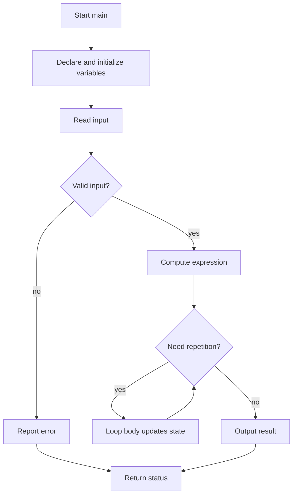

# C++ Basics and Control Flow

C++ begins with a small set of precise rules: every program has a `main`, every variable has a type, expressions are evaluated according to precedence, and execution normally moves from one statement to the next. Control-flow statements are the first tools that let a program stop being a straight-line calculator and start making decisions. Savitch treats these early topics as the grammar of the language: identifiers, declarations, assignment, console I/O, Boolean expressions, branches, loops, and the first contact with file input.

These notes connect Chapter 1 and Chapter 2 into a single foundation. The main idea is that a C++ program is a sequence of state changes. Declarations create named storage, assignments update that storage, input statements fill it from outside the program, output statements reveal it, and control-flow statements choose which updates happen and how often.

## The smallest complete program

A **C++ program** is normally organized around the function `int main()`. Execution starts there. A minimal program includes headers for library facilities and may use `std::` qualification or a `using` declaration.

```cpp
#include <iostream>

int main() {
    std::cout << "Hello, C++\n";
    return 0;
}
```

An **identifier** names a variable, function, constant, class, or namespace member. It starts with a letter or underscore and then uses letters, digits, or underscores. C++ is case-sensitive, so `rate`, `Rate`, and `RATE` are different identifiers. A **keyword** such as `int`, `double`, `if`, `while`, or `return` cannot be reused as an identifier.

Several underscore forms are reserved to the implementation. Names containing a double underscore and names beginning with an underscore followed by an uppercase letter are reserved everywhere; names beginning with an underscore are additionally reserved in the global namespace. Ordinary program names should begin with a letter. Identifiers such as `_Vector` or `__count` can collide with compiler and library internals even though their spelling fits the lexical grammar.

The preprocessor handles `#include` before the compiler analyzes C++ declarations. Including `<iostream>` supplies declarations for stream facilities; it does not paste an executable input system into `main`. After translation, the linker combines object files and required libraries into a program. A compile error generally means the source violates a language rule, while a link error often means a declared function or object has no matching definition.

A **variable declaration** gives a variable a type before use. Common basic types include `int`, `double`, `char`, `bool`, and `std::string`. A declaration may also initialize a variable.

```cpp
#include <string>

int count = 0;
double price = 19.95;
char grade = 'A';
bool passed = true;
std::string name = "Ada";
```

An **assignment statement** stores the value of an expression in a modifiable object.

```cpp
total = subtotal + tax;
count += 1;
```

A **literal** is a value written directly in the program, such as `42`, `3.14`, `'x'`, `"hello"`, `true`, or `false`. Character literals use single quotes. String literals use double quotes. Escape sequences such as `'\n'`, `'\t'`, and `'\0'` represent special characters.

A **declared constant** uses `const` to prevent later modification.

```cpp
const double PI = 3.141592653589793;
const int DAYS_PER_WEEK = 7;
```

Modern C++ also has `constexpr` for values intended to be usable in constant expressions. `const` says an object cannot be modified through that name; it does not always say the value was computed at compile time. For an array bound or template argument, `constexpr` communicates the stronger intent.

A **Boolean expression** evaluates to `true` or `false`. It usually combines comparisons with logical operators.

```cpp
bool inRange = (0 <= score) && (score <= 100);
bool needsReview = (grade == 'F') || (absences > 5);
```

The main control-flow forms are:

```cpp
if (condition) {
    // chosen when condition is true
} else {
    // chosen otherwise
}

while (condition) {
    // repeated while condition remains true
}

for (initialization; condition; update) {
    // counted or indexed repetition
}

switch (choice) {
    case 1:
        break;
    default:
        break;
}
```

Braces introduce a block scope. A name declared inside a branch or loop body stops being usable at the closing brace. A declaration in a `for` initializer, such as `for (int i = 0; ... )`, likewise confines `i` to the loop. Keeping names in the narrowest useful scope shortens their lifetime and prevents accidental reuse of stale state.

## Expressions have types before they have values

C++ evaluates arithmetic using the types of operands. If both operands of `/` are integers, the result uses integer division and discards the fractional part. Thus `9 / 2` is `4`, while `9 / 2.0` is `4.5`. The remainder operator `%` works on integer operands and returns the remainder from integer division.

Type conversion should be explicit when the meaning matters. Savitch emphasizes `static_cast` because it records the programmer's intention directly:

```cpp
double average = static_cast<double>(total) / count;
```

This avoids the common error where `total / count` performs integer division before being assigned to a `double`.

Conversion after the operation is too late. In `static_cast<double>(total / count)`, integer division occurs inside the parentheses and only the truncated result is converted. Casting either operand before `/` changes the operator's common type and preserves the fraction.

Integer arithmetic has limits. Unsigned arithmetic wraps modulo a power of two, but overflow of a signed integer has undefined behavior. A compiler may optimize on the assumption that signed overflow never happens. Large counts and products therefore need a type with a sufficient range and, where inputs are not trusted, an explicit precondition check before the operation.

Floating-point values approximate most decimal fractions. Equality tests after calculation can fail even when two mathematical formulas should agree. A tolerance comparison such as $\vert a-b\vert  \le \varepsilon$ is often better, with the tolerance chosen for the scale and error model of the calculation. Exact quantities such as item counts remain integers; currency usually needs an integer minor-unit or decimal representation when exact cents matter.

Comparison operators have lower precedence than arithmetic operators, and logical operators have lower precedence than comparisons. Parentheses make intent clear:

```cpp
if ((temperature > 90) && (humidity > 0.80)) {
    std::cout << "Heat warning\n";
}
```

C++ uses **short-circuit evaluation** for `&&` and `||`. In `A && B`, if `A` is false, `B` is not evaluated. In `A || B`, if `A` is true, `B` is not evaluated. This is both an efficiency rule and a safety tool:

```cpp
if ((kids != 0) && (pieces / kids >= 2)) {
    std::cout << "Each child gets at least two pieces\n";
}
```

The division is evaluated only when `kids != 0`.

Loops must make progress toward termination. A `while` loop is best when the number of repetitions is not known in advance, such as reading until a sentinel. A `for` loop is best when an index or count is central. A `do-while` loop executes the body at least once, then tests the condition.

File input begins with `std::ifstream`. Even in early programs, checking that the file opened successfully is part of the algorithm, not decoration.

```cpp
#include <fstream>
#include <iostream>

int main() {
    std::ifstream input("numbers.txt");
    if (!input) {
        std::cerr << "Could not open numbers.txt\n";
        return 1;
    }

    int value;
    while (input >> value) {
        std::cout << value << '\n';
    }
}
```

The extraction itself is also a condition. `while (input >> value)` repeats only after a successful integer read. End of file and malformed text both stop the loop, but they are not necessarily equivalent outcomes. A program that requires every token to be an integer should inspect the stream afterward and report malformed input rather than silently treating it as normal completion.

## Choosing a branch or loop form

| Construct | Purpose | Usual question | Common risk |
|---|---|---|---|
| `if` | one-way choice | Should this action happen? | forgetting braces around multiple statements |
| `if-else` | two-way choice | Which of two paths applies? | using `=` instead of `==` |
| multiway `if-else` | ordered conditions | Which condition is first true? | putting broad cases before specific cases |
| `switch` | discrete menu or tag dispatch | Which constant case matches? | missing `break` |
| `while` | pretest repetition | Should another iteration run? | condition never changes |
| `do-while` | posttest repetition | Should the already-started process repeat? | running once when zero times was intended |
| `for` | counted repetition | What are initialization, condition, and update? | extra semicolon after header |



An `if-else if` chain is ordered: after the first true condition, later conditions are skipped. Put narrower cases before broader cases when they overlap. A `switch` compares one integral or enumeration expression against constant labels. It cannot directly express ranges such as `score >= 90`, and fall-through is allowed unless execution reaches `break`, `return`, or an explicit `[[fallthrough]]` marker.

For loops and while loops are largely interchangeable, but their shapes document different reasoning. A counted loop groups its initialization, continuation test, and update in one header. A sentinel loop keeps reading until a special value or stream failure. A traversal loop should use a condition derived from the container boundary rather than a hard-coded number.

Every loop proof has two parts. The invariant describes what remains true at the start of each iteration; a decreasing measure shows termination. In a summation loop, the invariant may say that `sum` equals the total of values already processed. The number of unprocessed values decreases by one each iteration and cannot decrease forever below zero.

## Worked example: avoiding integer division in an average

Problem: A student has scores `8`, `9`, and `10`. Compute the average as a decimal value.

Method:

1. Add the integer scores.

$$
8 + 9 + 10 = 27
$$

2. Count the scores.

$$
n = 3
$$

3. If the program uses `sum / n`, both operands are `int`, so the result is integer division.

$$
27 / 3 = 9
$$

   This example happens to divide evenly, so it hides the danger.

4. Check a less convenient set: `8`, `9`, `9`.

$$
8 + 9 + 9 = 26
$$

Integer division gives:

$$
26 / 3 = 8
$$

The correct average is:

$$
26 / 3.0 = 8.666\ldots
$$

5. Force floating-point division with `static_cast<double>`.

```cpp
#include <iostream>

int main() {
    int a = 8;
    int b = 9;
    int c = 9;
    int sum = a + b + c;
    int count = 3;

    double average = static_cast<double>(sum) / count;
    std::cout << "Average: " << average << '\n';
    return 0;
}
```

Checked answer: the program prints approximately `8.66667`. The cast is applied before division, so no fractional part is lost.

The empty-input case needs a separate decision because division by zero is invalid. A caller can reject `count == 0`, return an optional average, or define a domain-specific convention. Returning zero without documentation would confuse “there were no scores” with “the average score was zero.”

## Worked example: menu loop with `switch`

Problem: Write a small menu that repeatedly lets a user add or subtract from a balance until choosing quit.

Method:

1. Keep state in a `double balance`.
2. Use a `do-while` loop because the menu must appear at least once.
3. Read a character command.
4. Use `switch` for discrete choices.
5. Use `break` in each case to prevent fall-through.
6. Stop when the command is `q`.

```cpp
#include <iostream>

int main() {
    double balance = 0.0;
    char command;

    do {
        std::cout << "(d)eposit, (w)ithdraw, (q)uit: ";
        std::cin >> command;

        switch (command) {
            case 'd': {
                double amount;
                std::cout << "Amount: ";
                std::cin >> amount;
                if (amount >= 0) {
                    balance += amount;
                }
                break;
            }
            case 'w': {
                double amount;
                std::cout << "Amount: ";
                std::cin >> amount;
                if ((amount >= 0) && (amount <= balance)) {
                    balance -= amount;
                }
                break;
            }
            case 'q':
                break;
            default:
                std::cout << "Unknown command\n";
                break;
        }

        std::cout << "Balance: " << balance << '\n';
    } while (command != 'q');

    return 0;
}
```

Checked answer: after `d 100`, `w 30`, `q`, the balance shown before exit is `70`. The `switch` cases are isolated by braces where local variables are declared.

The trace begins with `balance == 0`. Command `d` reads `100`, passes the nonnegative check, and updates the balance to `100`. Command `w` reads `30`; both short-circuited conditions are true, so subtraction leaves `70`. Command `q` performs no update. The loop condition is then false, and control reaches `return 0`. If `std::cin` fails, however, `command` and `amount` handling needs more care; production input loops test extraction and decide whether to retry or exit.

## Putting input validation and a counted loop together

The following complete program combines console input, validation, constants, a counted loop, and formatted output. It computes the price of several items with tax.

```cpp
#include <iomanip>
#include <iostream>

int main() {
    const double TAX_RATE = 0.0825;

    int itemCount;
    std::cout << "How many items? ";
    std::cin >> itemCount;

    if (itemCount <= 0) {
        std::cerr << "Item count must be positive.\n";
        return 1;
    }

    double subtotal = 0.0;
    for (int i = 1; i <= itemCount; ++i) {
        double price;
        std::cout << "Price for item " << i << ": ";
        std::cin >> price;

        if (price < 0.0) {
            std::cerr << "Negative prices are not allowed.\n";
            return 1;
        }

        subtotal += price;
    }

    double tax = subtotal * TAX_RATE;
    double total = subtotal + tax;

    std::cout << std::fixed << std::setprecision(2);
    std::cout << "Subtotal: " << subtotal << '\n';
    std::cout << "Tax: " << tax << '\n';
    std::cout << "Total: " << total << '\n';
    return 0;
}
```

The program's loop invariant is: before iteration `i`, `subtotal` equals the sum of the first `i - 1` accepted prices. Reading and adding the next valid price establishes the statement for the following iteration. When the loop ends at `i == itemCount + 1`, every requested price has been included exactly once.

Using `double` is adequate for a control-flow exercise, but it is not an accounting model. An exact version could read decimal text, validate at most two fractional digits, and store cents in an integer. The tax rule would then need an explicit rounding policy.

## Bugs that survive a quick reading

- Using an uninitialized local variable and assuming it starts at zero. Local variables of fundamental type contain indeterminate values unless initialized.
- Writing `if (x = 10)` when the intention is `if (x == 10)`. The first assigns and then tests the assigned value.
- Chaining inequalities as `0 <= x <= 100`. In C++, write `(0 <= x) && (x <= 100)`.
- Forgetting that `9 / 2` is `4`, not `4.5`.
- Putting a semicolon immediately after a loop header: `for (...) ;`.
- Omitting `break` in a `switch` case and accidentally falling into the next case.
- Mixing `std::cin >> value` with line-based input without consuming the leftover newline.
- Treating any nonzero integer as a preferred Boolean style. It is legal in many contexts, but clear code uses `bool` expressions directly.

The dangling-`else` rule associates an `else` with the nearest unmatched `if`. Braces remove ambiguity for the reader and prevent a later one-line edit from changing which branch owns a statement. Compiler indentation does not affect the parse.

Increment operators also carry a sequencing distinction. `++i` increments and yields the new value; `i++` yields the old value and then increments. As a standalone loop update they have the same visible result for integers. Combining several modifications of one scalar in a single expression is difficult to reason about and can encounter sequencing rules; split the updates into statements.

Input validation must handle stream state, not only numeric range. If `std::cin >> itemCount` encounters letters, the stream enters a failed state and leaves the destination unchanged. Repeating the same extraction without clearing the state and discarding the offending input creates an infinite loop. Programs that do not intend to recover can report the error and return immediately.

<div className="see-also">

See also: [functions and parameters](/cs/programming/cpp/functions-parameters-and-scope) · [arrays](/cs/programming/cpp/arrays) · [strings](/cs/programming/cpp/strings) · [streams and file I/O](/cs/programming/cpp/streams-and-file-io) · [exception handling](/cs/programming/cpp/exception-handling)

</div>
