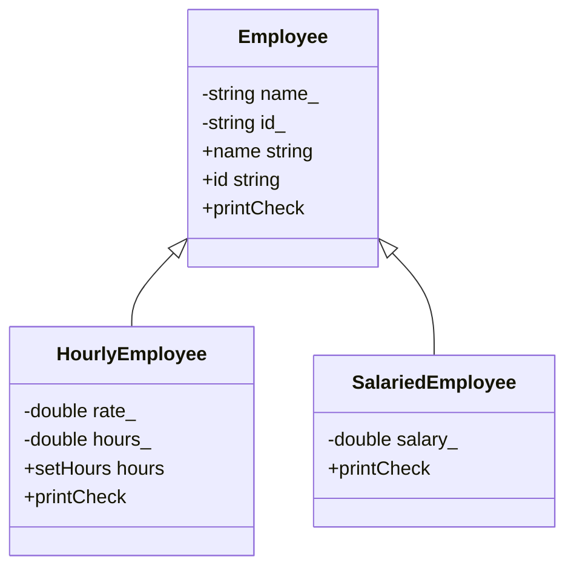

# Inheritance

Inheritance lets a class reuse and specialize another class. A derived class automatically has the data and ordinary member functions of its base class, then adds or redefines behavior for its more specific role. Savitch introduces inheritance through employee classes: an hourly employee and a salaried employee are both employees, but their pay calculations differ.

The most important design question is whether the relationship is truly "is a." If a `SalariedEmployee` is an `Employee`, inheritance may fit. If a `Car` has an `Engine`, composition is better. Inheritance is powerful, but using it where composition belongs creates brittle designs.

## Building a derived type

A **base class** defines common state and behavior.

```cpp
class Employee {
public:
    Employee(const std::string& name, const std::string& id);
    std::string name() const;
    std::string id() const;

private:
    std::string name_;
    std::string id_;
};
```

A **derived class** is declared with a base class list.

```cpp
class HourlyEmployee : public Employee {
public:
    HourlyEmployee(const std::string& name,
                   const std::string& id,
                   double rate);
private:
    double rate_;
};
```

With **public inheritance**, public base members remain public in the derived class. This models substitutability: a derived object can be used where a base object is expected.

A derived class **inherits** ordinary base-class member functions and member variables. Constructors are not inherited in the older style Savitch presents; a derived constructor calls a base constructor in its initialization list.

```cpp
HourlyEmployee::HourlyEmployee(const std::string& name,
                               const std::string& id,
                               double rate)
    : Employee(name, id), rate_(rate) {}
```

A derived class may **redefine** a base member function by declaring and defining a function with the same signature. If the base function is virtual, the derived definition **overrides** it; that dynamic behavior is covered with polymorphism.

The `protected` access level makes a member accessible to derived classes but not to ordinary client code.

Base classes may themselves be inherited with `public`, `protected`, or `private` access. Public inheritance preserves the base interface for clients and represents an “is-a” relationship. Protected and private inheritance change how base public members are exposed; they are implementation techniques and do not offer ordinary client substitutability. Composition is usually clearer when the goal is only to reuse an implementation.

A derived object contains a base-class subobject. The standard specifies construction, conversion, and access behavior around that subobject but does not promise a simplistic byte diagram valid for every compiler. Multiple inheritance, virtual bases, alignment, and virtual dispatch can all affect layout. Code should use language conversions rather than calculate addresses of base parts.

## Construction order and substitutability

Construction proceeds from base to derived:

1. Base class constructor runs first.
2. Derived member objects are initialized.
3. Derived constructor body runs.

Destruction proceeds in reverse:

1. Derived destructor body runs.
2. Derived members are destroyed.
3. Base destructor runs.

Private base members exist inside derived objects, but derived member functions cannot access them by name. They must use public or protected base functions.

```cpp
// Not allowed if name_ is private in Employee:
// std::cout << name_;

// Allowed:
std::cout << name();
```

This preserves encapsulation. If derived classes could freely access base private data, any programmer could bypass the base interface by creating a derived class.

Public inheritance enables upward conversion:

```cpp
HourlyEmployee hourly("Ada", "E101", 40.0);
Employee base = hourly;
```

However, assigning a derived object into a base object slices away the derived part. The base object keeps only the base subobject. Polymorphism with pointers or references is the usual way to avoid slicing when behavior must remain derived-specific.

Inheritance and copy control interact. Derived assignment should account for the base part and the derived part. If dynamic memory is involved, both levels need correct ownership behavior.

The derived initializer list cannot directly initialize private base members. It selects a base constructor, and that constructor establishes the base invariant. If the list omits the base, the compiler tries the base default constructor. Compilation fails when no such constructor exists. The base call is therefore an explicit part of designing every derived constructor, not an optional afterthought.

Substitutability is stronger than “the conversion compiles.” A function accepting an `Employee&` relies on the behavioral promises of `Employee`: valid identity data, meaningful pay operations, or whatever the interface specifies. A derived type must preserve the preconditions and postconditions callers were given. It should not require stricter input or provide weaker results merely because its implementation differs.

Classic shape examples reveal the problem. A mathematical square is a rectangle, but a mutable `Rectangle` interface with independent `setWidth` and `setHeight` operations may not be supportable by `Square` without surprising the caller. The hierarchy fails at the behavioral level even though the nouns sound compatible. Immutable values or different interfaces can remove the contradiction.

Name lookup adds another distinction. Declaring any function named `describe` in the derived class hides base overloads with that name, even if their parameter lists differ. A `using Base::describe;` declaration can bring the base overload set into the derived scope. Overriding, overloading, and hiding are separate mechanisms.

## Reading the employee hierarchy



| Relationship | Use inheritance? | Example |
|---|---:|---|
| "is a" | usually | `HourlyEmployee` is an `Employee` |
| "has a" | no, use composition | `Employee` has an `Address` |
| "uses a" | no, use parameter/member | `ReportPrinter` uses an `ostream` |
| "implemented in terms of" | usually composition | `Stack` implemented with `vector` |

The diagram shows common identity in `Employee` and pay-specific state in each specialization. If clients merely call non-virtual `printCheck` on concrete objects, inheritance provides shared implementation but little abstraction at the call site. The design becomes more valuable when a base reference can invoke a common virtual operation without asking whether the employee is hourly or salaried.

## Worked example: calling a base constructor

Problem: Define `HourlyEmployee` so it initializes the inherited name and id through the `Employee` constructor.

Method:

1. `Employee` owns `name_` and `id_`.
2. `HourlyEmployee` owns `rate_` and `hours_`.
3. The derived constructor must initialize the base subobject first.
4. Use `: Employee(name, id), rate_(rate), hours_(0.0)`.

```cpp
#include <iostream>
#include <string>

class Employee {
public:
    Employee(std::string name, std::string id)
        : name_(name), id_(id) {}

    std::string name() const {
        return name_;
    }

    std::string id() const {
        return id_;
    }

private:
    std::string name_;
    std::string id_;
};

class HourlyEmployee : public Employee {
public:
    HourlyEmployee(std::string name, std::string id, double rate)
        : Employee(name, id), rate_(rate), hours_(0.0) {}

    void setHours(double hours) {
        hours_ = hours;
    }

    double pay() const {
        return rate_ * hours_;
    }

private:
    double rate_;
    double hours_;
};

int main() {
    HourlyEmployee worker("Ada", "E101", 25.0);
    worker.setHours(8.0);
    std::cout << worker.name() << " " << worker.pay() << '\n';
}
```

Checked answer: inherited `name()` returns `"Ada"`, and pay is:

$$
25.0 \times 8.0 = 200.0
$$

The trace is base-first. Storage for the full object is reserved, `Employee(name, id)` constructs the base subobject, `rate_` is initialized, and `hours_` becomes zero. Only then could a derived constructor body run. `setHours(8.0)` later changes derived state, while `name()` operates on the embedded base part. A real payroll type would reject negative rates and hours and would specify overtime and currency rounding; the multiplication here isolates inheritance mechanics.

## Worked example: private base data and accessor use

Problem: A derived `SalariedEmployee` needs to print the employee name, but `Employee::name_` is private.

Method:

1. Do not make `name_` public.
2. Provide `Employee::name() const`.
3. Call `name()` inside the derived member function.
4. This preserves the base class representation.

```cpp
#include <iostream>
#include <string>

class Employee {
public:
    Employee(std::string name) : name_(name) {}

    std::string name() const {
        return name_;
    }

private:
    std::string name_;
};

class SalariedEmployee : public Employee {
public:
    SalariedEmployee(std::string name, double salary)
        : Employee(name), salary_(salary) {}

    void printCheck() const {
        std::cout << "Pay to " << name() << ": " << salary_ << '\n';
    }

private:
    double salary_;
};

int main() {
    SalariedEmployee employee("Grace", 1500.0);
    employee.printCheck();
}
```

Checked answer: the function prints `Pay to Grace: 1500`. It accesses the name through the public base interface rather than touching private storage.

Changing `Employee` later to store a structured personal name would not require `SalariedEmployee` to know the new representation, provided `name()` keeps its contract. Making the field protected would save one accessor call in the source but would bind every derived class to the old string representation.

## Redefinition before virtual dispatch

This example shows redefinition without virtual dispatch. The static type of the object determines which function is called unless virtual functions and references/pointers are used.

```cpp
#include <iostream>
#include <string>

class Employee {
public:
    explicit Employee(std::string name) : name_(name) {}

    void describe() const {
        std::cout << "Employee: " << name_ << '\n';
    }

private:
    std::string name_;
};

class Contractor : public Employee {
public:
    Contractor(std::string name, std::string agency)
        : Employee(name), agency_(agency) {}

    void describe() const {
        Employee::describe();
        std::cout << "Agency: " << agency_ << '\n';
    }

private:
    std::string agency_;
};

int main() {
    Contractor contractor("Lin", "Systems Group");
    contractor.describe();
}
```

Inside `Contractor::describe`, the qualified call `Employee::describe()` deliberately selects the base implementation. Without qualification, `describe()` would resolve to the derived function and recurse indefinitely. The call on `contractor` uses the derived function because the expression's static type is `Contractor`; no run-time dispatch is involved.

If the object is passed by base reference and `describe` is not virtual, the base function is selected:

```cpp
void report(const Employee& employee) {
    employee.describe();
}
```

Calling `report(contractor)` then prints only the employee line. Adding `virtual` in the base and `override` in the derived changes that behavior. The `override` specifier asks the compiler to verify that the signatures truly match, catching accidental differences in `const`, reference qualification, or parameters.

## Hierarchies that fight their own interface

- Using inheritance for "has a" relationships.
- Expecting a derived class to access private base members directly.
- Forgetting to call the right base constructor in a derived constructor.
- Confusing redefining with overloading.
- Forgetting that constructors, destructors, and assignment have special inheritance rules.
- Assigning derived objects into base variables and accidentally slicing derived data.
- Overusing `protected` data and weakening base-class encapsulation.
- Forgetting that public inheritance is a promise of substitutability.

Before adding a base class:

- Test the substitution rule: anywhere a base object is expected, a derived object should make sense without surprising the caller. If this is false, public inheritance is probably the wrong relationship.
- Keep base classes stable and small. Every public or protected member becomes part of the contract inherited by derived classes, so a large base interface creates many ways to break substitutability.
- Prefer private data in the base class plus protected or public member functions when derived classes need controlled access. Protected data often turns representation details into long-term obligations.
- Put shared behavior in the base class only when it is truly common. If a derived class must constantly ignore or work around inherited functions, the hierarchy is sending the wrong message.
- Separate "is a" from "uses a." A `Rectangle` may use two `Point` objects, but it is not a `Point`. Composition keeps that relationship explicit.
- Check constructor order when debugging initialization. Base-class constructors run before derived-class constructors, and derived destructors run before base destructors.
- If the hierarchy will be used polymorphically, design the base class with virtual functions from the start. Retrofitting virtual behavior later can change semantics throughout the program.

Write ordinary-language statements about the proposed relationship. "A savings account is an account" supports public inheritance. "A car has an engine" supports composition. "A file logger uses an output stream" suggests membership or dependency, not inheritance. The language test is not a formal proof, but it catches many designs that use inheritance only to borrow code.

Another useful check is to read every inherited public function from the derived-class point of view. If a derived class cannot honestly support one of those inherited operations, clients will eventually discover the mismatch through surprising behavior. That is a design problem, not just an implementation detail.

A base class should represent a real abstraction rather than a convenient storage bundle. If derived classes share data but not behavior, a helper object or member variable may be better. Inheritance is strongest when clients can program against the base interface and remain deliberately unaware of the derived class they are using.

Implementing one small example with both inheritance and composition exposes the tradeoff. If the composition version has fewer special cases and clearer construction, keep composition. If the inheritance version lets a caller use several derived objects through one base interface without checking their exact types, inheritance is earning its place.

If a base pointer will own derived objects, the base destructor belongs in the public virtual interface.

That destructor rule has a precise scope. Deleting a derived object through a base pointer whose destructor is non-virtual has undefined behavior. A base that is never used for polymorphic deletion can instead have a protected non-virtual destructor, preventing clients from attempting it. Making every class destructor virtual without a polymorphic role adds a dispatch slot and communicates an extension point that may not exist.

Downcasting from base to derived should be rare in client logic. `dynamic_cast` can check a polymorphic object at run time, but a chain of casts usually means the common base interface is missing an operation or the caller is working at the wrong abstraction level. `static_cast` downcasts without a run-time check and has undefined behavior if the object is not actually of the target derived type.

Multiple inheritance can model a type satisfying several independent interfaces, especially when those bases contain little or no state. Inheriting implementation from several stateful bases raises harder questions about duplicate base subobjects and the diamond pattern. Virtual inheritance can share a common base, but it changes construction responsibilities. A single-base hierarchy or composition remains easier to audit when it expresses the model adequately.

<div className="see-also">

See also: [classes and encapsulation](/cs/programming/cpp/classes-and-encapsulation) · [constructors and copy semantics](/cs/programming/cpp/constructors-and-copy-semantics) · [polymorphism](/cs/programming/cpp/polymorphism-and-virtual-functions) · [pointers and dynamic memory](/cs/programming/cpp/pointers-and-dynamic-memory) · [templates](/cs/programming/cpp/templates)

</div>
