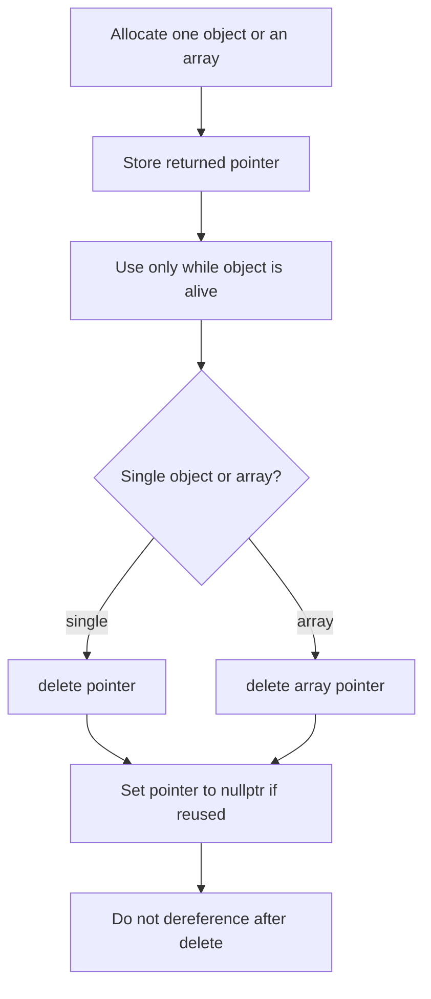

# Pointers and Dynamic Memory

Pointers expose the address-based side of C++. They make it possible to create objects whose lifetime is controlled explicitly, build dynamic arrays, share objects without copying them, and implement linked data structures. Savitch introduces pointers after arrays because array parameters already behave like addresses; pointers make that mechanism explicit.

The power of pointers is balanced by responsibility. A pointer can point to a valid object, point to nothing, point to an object that has already been destroyed, or be uninitialized. Correct pointer programs maintain ownership and lifetime invariants as carefully as numeric programs maintain arithmetic invariants.

## Addresses, pointees, and lifetime

A **pointer** is a value that stores the address of an object. A pointer variable has a pointer type.

```cpp
int value = 42;
int* ptr = &value;
```

The **address-of operator** `&` produces the address of an object. The **dereference operator** `*` accesses the object pointed to by a pointer.

```cpp
*ptr = 100; // changes value
```

The same symbol `*` appears in several contexts:

| Syntax | Meaning |
|---|---|
| `int* p` | declaration of pointer to `int` |
| `*p` | dereference pointer `p` |
| `a * b` | multiplication |

A **dynamic variable** is created at run time with `new`.

```cpp
int* p = new int;
*p = 17;
```

The **freestore** or **heap** is the memory area used for dynamically allocated objects. Use `delete` to destroy a single dynamic object:

```cpp
delete p;
p = nullptr;
```

A **dynamic array** is created with `new[]` and destroyed with `delete[]`.

```cpp
int* values = new int[count];
delete[] values;
```

A **dangling pointer** points to storage whose object has been destroyed. A **memory leak** occurs when dynamic storage is no longer reachable and therefore cannot be deleted.

The **arrow operator** `->` combines dereference and member access.

```cpp
struct Point {
    double x;
    double y;
};

Point* point = new Point{1.0, 2.0};
std::cout << point->x << '\n'; // same as (*point).x
delete point;
```

`nullptr` is the null pointer literal introduced in C++11. It converts to any object-pointer type without also behaving like the integer zero, which avoids overload ambiguities associated with older `NULL` macros. A null pointer points to no object. Comparing it is valid; dereferencing it is undefined behavior.

Const placement describes either the pointee or the pointer itself:

| Declaration | Meaning |
|---|---|
| `const int* p` | pointer to an integer that cannot be changed through `p` |
| `int* const p` | fixed pointer to a modifiable integer |
| `const int* const p` | fixed pointer to a const integer |

Reading declarations from the name outward helps: in `int* const p`, `p` is const, then a pointer, then to int. Top-level pointer constness disappears when a pointer is passed by value because the parameter receives its own copied address; constness of the pointed-to value remains significant.

## Aliasing, arithmetic, and ownership

Pointer assignment copies an address, not the object being pointed to. After this code, `p` and `q` point to the same dynamic integer:

```cpp
int* p = new int(10);
int* q = p;
*q = 20;
```

Now `*p` is also `20`. There is still only one dynamic integer.

Dynamic arrays connect naturally to pointer arithmetic and array indexing. If `a` points to the first element, `a[i]` means the element `i` positions after `a`. Built-in array variables act like fixed pointer values to their first elements in many expressions, but an array variable itself cannot be reassigned.

```cpp
int fixed[3] = {1, 2, 3};
int* p = fixed;    // OK
// fixed = p;      // not OK
```

When a class owns dynamic memory, the default copy behavior is usually wrong. Default memberwise copying copies pointer values, causing two objects to point to the same dynamic storage. That can cause double deletion, accidental sharing, or stale data. Destructors, copy constructors, and assignment operators define the required ownership behavior.

Modern C++ often uses standard containers and smart pointers instead of raw owning pointers. Savitch's raw-pointer treatment remains essential because it explains how arrays, dynamic allocation, linked lists, and class copy semantics work underneath.

Pointer arithmetic is defined only within one array object, including a special one-past-the-end position. If `p` points at element zero, `p + n` can point one past the last element and may be used as a boundary, but it cannot be dereferenced. Forming unrelated addresses by arithmetic or subtracting pointers from different arrays has undefined behavior. The machine may represent addresses as integers, yet the C++ object model imposes stricter provenance and lifetime rules.

Two pointers that hold the same address alias the same object. Mutation through one is observed through the other. Setting one alias to null after deletion does not update the rest; they remain dangling. Nulling a pointer is therefore a local defensive step, not a substitute for an ownership model.

Use `std::unique_ptr<T>` for exclusive dynamic ownership that should move but not copy. Use `std::shared_ptr<T>` only when ownership genuinely has multiple independent participants; it adds reference-counting work and cannot reclaim a cycle without `std::weak_ptr`. A raw pointer or reference can still be the right expression for temporary non-owning access when the owner and lifetime are clear.

Allocation can fail by throwing `std::bad_alloc`. More commonly, an operation after allocation throws. If the resource is already held by a vector or smart pointer, stack unwinding releases it. With a raw local owning pointer, every exceptional and early-return path must reach the matching delete, which is easy to miss.

## What pointer assignment actually copies

```text
Pointer assignment copies the address:

int* p = new int(42);
int* q = p;

       +-----+
p ---> | 42  |
       +-----+
q -----^

*q = 99 changes the shared object:

       +-----+
p ---> | 99  |
       +-----+
q -----^
```



## Worked example: tracing pointer assignment

Problem: Predict the output.

```cpp
#include <iostream>

int main() {
    int* p1 = new int;
    int* p2 = new int;

    *p1 = 10;
    *p2 = 20;
    std::cout << *p1 << " " << *p2 << '\n';

    p1 = p2;
    std::cout << *p1 << " " << *p2 << '\n';

    *p1 = 30;
    std::cout << *p1 << " " << *p2 << '\n';

    delete p2;
}
```

Method:

1. Two dynamic integers are created.
2. `*p1 = 10`, `*p2 = 20`.
3. First output is `10 20`.
4. `p1 = p2` copies the address stored in `p2`.
5. Now both pointers point to the integer that contains `20`.
6. The original integer containing `10` has no pointer to it, so it is leaked.
7. Second output is `20 20`.
8. `*p1 = 30` changes the object shared by `p1` and `p2`.
9. Third output is `30 30`.

Checked answer:

```text
10 20
20 20
30 30
```

The code intentionally demonstrates a leak. A production version would delete the object pointed to by `p1` before overwriting `p1`.

That repair must occur before aliasing: `delete p1; p1 = p2;`. Deleting after the assignment would instead delete the shared `20` object and leave both variables dangling, while the original `10` object would still be leaked. The order follows ownership: release the resource currently owned through `p1`, then make `p1` a non-owning alias or define a new ownership policy.

## Worked example: dynamic array average

Problem: Read `n`, allocate an array of `n` exam scores, and compute the average.

Method:

1. Read `n`.
2. Validate `n > 0`.
3. Allocate `new double[n]`.
4. Fill indexes `0` through `n - 1`.
5. Sum all values.
6. Divide by `n`.
7. Release with `delete[]`.

```cpp
#include <iostream>

int main() {
    int n;
    std::cout << "Number of scores: ";
    std::cin >> n;

    if (n <= 0) {
        std::cerr << "Need at least one score.\n";
        return 1;
    }

    double* scores = new double[n];
    double total = 0.0;

    for (int i = 0; i < n; ++i) {
        std::cout << "Score " << i + 1 << ": ";
        std::cin >> scores[i];
        total += scores[i];
    }

    double average = total / n;
    std::cout << "Average: " << average << '\n';

    delete[] scores;
    scores = nullptr;
}
```

Checked answer: for inputs `3`, `80`, `90`, `100`, the total is:

$$
80 + 90 + 100 = 270
$$

and the average is:

$$
270 / 3 = 90
$$

The array is released with `delete[]`, matching `new[]`.

If reading a score fails after allocation, the example continues with invalid stream state and an unchanged array element. A safer modern version validates input into an `std::vector<double>`, whose destructor covers every return and exception path. If raw allocation is the subject of the exercise, the loop must detect failure, call `delete[] scores`, and return before using the incomplete total.

## A resource-owning buffer

This class owns a dynamic array and follows the basic rule of three: destructor, copy constructor, and assignment operator.

```cpp
#include <algorithm>
#include <iostream>
#include <stdexcept>

class IntBuffer {
public:
    explicit IntBuffer(int size)
        : size_(checkedSize(size)), data_(new int[size_]) {
        std::fill(data_, data_ + size_, 0);
    }

    IntBuffer(const IntBuffer& other)
        : size_(other.size_), data_(new int[other.size_]) {
        std::copy(other.data_, other.data_ + size_, data_);
    }

    IntBuffer& operator=(const IntBuffer& rhs) {
        if (this == &rhs) {
            return *this;
        }

        int* newData = new int[rhs.size_];
        std::copy(rhs.data_, rhs.data_ + rhs.size_, newData);

        delete[] data_;
        data_ = newData;
        size_ = rhs.size_;
        return *this;
    }

    ~IntBuffer() {
        delete[] data_;
    }

    int& operator[](int index) {
        return data_[index];
    }

    int size() const {
        return size_;
    }

private:
    static int checkedSize(int size) {
        if (size < 0) {
            throw std::invalid_argument("negative buffer size");
        }
        return size;
    }

    int size_;
    int* data_;
};

int main() {
    IntBuffer a(3);
    a[0] = 10;
    a[1] = 20;
    a[2] = 30;

    IntBuffer b = a;
    b[1] = 99;

    std::cout << a[1] << " " << b[1] << '\n';
}
```

`checkedSize` runs before allocation and prevents a negative `int` from becoming a huge unsigned allocation size. The buffer still has an intentionally low-level interface: `operator[]` performs no bounds check, and it lacks a const overload. A production value type would normally use `std::vector<int>` or add checked `at` operations, const access, moves, and a size type capable of representing the allocation.

The assignment operator allocates and copies before deleting the old array. If allocation fails, the left operand retains its original value. The explicit self-assignment check prevents reading from storage just deleted by the same object. Copy-and-swap can express the same strong guarantee with less repeated ownership logic.

## Undefined behavior tends to look ordinary

- Dereferencing an uninitialized pointer.
- Using a pointer after `delete`.
- Using `delete` for memory allocated with `new[]`, or `delete[]` for memory allocated with `new`.
- Losing the only pointer to dynamic memory and leaking it.
- Assuming pointer assignment copies the pointed-to object.
- Forgetting self-assignment checks in assignment operators that delete old storage.
- Returning a pointer to a local automatic variable.
- Writing outside a dynamic array because the allocated size is not tracked.

For each pointer:

- Write down who owns each dynamically allocated object. If the answer is "several parts of the program," the design is probably ambiguous unless shared ownership is deliberately modeled.
- Initialize pointers immediately. A pointer should either hold a valid address or `nullptr`; an uninitialized pointer contains an indeterminate address and must not be dereferenced or deleted.
- After `delete`, set the pointer to `nullptr` when the pointer will remain in scope and might be tested later. This does not fix all aliasing problems, but it prevents accidental reuse through that variable.
- Prefer one allocation and one deallocation path. Functions with many early returns are safer when dynamic storage is owned by a class object rather than manually released at every exit.
- Distinguish pointer equality from value equality. `p == q` asks whether two pointers hold the same address; `*p == *q` asks whether the pointed-to values compare equal.
- For dynamic arrays, store the size next to the pointer in the owning object. A raw pointer alone does not remember how many elements were allocated.
- Use standard containers when the array size is the only dynamic feature. A `vector<int>` usually expresses a growable array more safely than `int*` plus manual capacity management.

Replace every raw pointer in a small program with the phrase "address of ...". If the phrase is not meaningful, the pointer probably does not have a clear role. For example, `int* scores` might be "address of the first element of a dynamic array of scores," but that sentence also reveals that the size must be stored somewhere else.

When reviewing a function, pair every allocation with the cleanup path that owns it. If the allocation happens in one function and deletion in another, document that transfer clearly or wrap the resource in an object whose destructor makes the transfer unnecessary.

Each pointer should express observation or ownership. Observing pointers may point to objects owned elsewhere and must not delete them. Owning pointers are responsible for cleanup and should usually be wrapped in a class so destruction is automatic.

Drawing memory as two regions helps with an initial trace: local pointer variables usually occupy stack storage, while objects created with `new` use dynamic storage. Deleting the dynamic object does not remove the pointer variable; it only makes the stored address unsafe to use.

The common “stack versus heap” sketch is useful but incomplete. Objects with automatic storage duration are often implemented on a call stack, but the C++ standard specifies storage duration and lifetime rather than mandating those physical regions. A compiler may optimize an object into registers or remove it entirely while preserving observable behavior.

Dereferencing requires more than a non-null numeric address. The pointer must designate a live object of a compatible type and meet alignment requirements. A pointer to a local variable becomes invalid when its scope exits; a pointer into a vector may become invalid after reallocation; a pointer to a deleted object is invalid even if a later allocation happens to reuse the same address.

`delete` is valid only for the pointer value produced by the matching `new` expression, subject to permitted base-class conversions. Deleting a pointer into the middle of an array, deleting stack storage, or deleting the same allocation twice is undefined behavior. A no-op on `nullptr` is guaranteed, which simplifies destructors and moved-from states.

Low-level memory tools and compiler sanitizers are useful because undefined behavior may remain quiet in ordinary tests. AddressSanitizer can detect many out-of-bounds accesses, use-after-free errors, and double deletions. It supplements ownership reasoning; it cannot prove that every possible path is safe.

Valgrind-style leak checkers can also report allocations that remain reachable or are lost at process exit. A clean report is useful evidence, but only exercised paths are observed. Unit tests should cover early returns, failed allocations where controllable, copy and move paths, and destruction after partial work.

## Related pages

- [arrays](/cs/programming/cpp/arrays)
- [strings](/cs/programming/cpp/strings)
- [constructors and copy semantics](/cs/programming/cpp/constructors-and-copy-semantics)
- [linked data structures](/cs/programming/cpp/linked-data-structures)
- [polymorphism](/cs/programming/cpp/polymorphism-and-virtual-functions)
