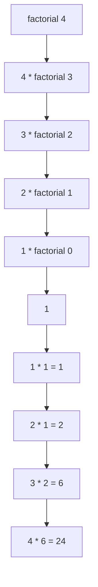

# Recursion

Recursion is a way to solve a problem by reducing it to smaller versions of the same problem. A recursive function calls itself directly or indirectly. Savitch presents recursion as a design technique, not a magic trick: identify a base case that needs no recursive call, identify a recursive case that moves closer to the base case, and trust the smaller call to do the smaller job.

Recursion is especially natural for numbers written digit by digit, divide-and-conquer search, tree traversal, expression parsing, and backtracking. It is not always faster than iteration, but it can make the structure of a solution match the structure of the problem.

## A function may delegate to a smaller call

A **recursive function** contains a call to itself, directly or through another function.

```cpp
void countdown(int n) {
    if (n <= 0) {
        return;
    }
    std::cout << n << '\n';
    countdown(n - 1);
}
```

A **base case** or **stopping case** handles a small input without recursion.

```cpp
if (n == 0) {
    return 1;
}
```

A **recursive case** calls the same function on a smaller or simpler input.

```cpp
return n * factorial(n - 1);
```

The **call stack** stores activation frames for active function calls. Each recursive call gets its own parameters and local variables.

**Stack overflow** occurs when recursive calls are too deep for available stack memory, often because a base case is missing or unreachable.

**Tail recursion** occurs when the recursive call is the final action of the function. Some compilers can optimize simple tail recursion, but C++ does not require all such calls to be optimized.

The smaller call has the same contract as the original call. When writing `factorial(n - 1)`, reasoning does not reopen the implementation and mentally trace every nested level. It assumes the contract for a smaller valid argument, then asks whether multiplying by `n` produces the required result. This separation is the recursive counterpart of trusting a called helper function.

Progress needs a well-founded measure: a quantity that cannot decrease forever. A nonnegative integer argument, the length of a remaining range, or the height of a finite tree can serve. “Looks smaller” is not enough if a path can oscillate between states or cross below the base case.

## Correctness, work, and stack depth

Every correct recursive function needs progress toward a base case. A common proof structure is induction:

1. Prove the base case is correct.
2. Assume the function works for smaller inputs.
3. Show the recursive case uses those smaller correct results to solve the current input.

For factorial:

$$
0! = 1
$$

and for $n \gt  0$:

$$
n! = n(n - 1)!
$$

The recursive function:

```cpp
int factorial(int n) {
    if (n == 0) {
        return 1;
    }
    return n * factorial(n - 1);
}
```

follows the formula directly.

Recursion can use more memory than iteration because every active call occupies stack space. For a simple `factorial(n)`, recursion depth is `n + 1`, so stack usage is $O(n)$. An iterative version can use $O(1)$ extra stack space.

Binary search is a recursive design pattern over sorted arrays. It compares with the middle element, then searches only the left or right half.

$$
T(n) = T(n / 2) + O(1)
$$

This yields $O(\log n)$ comparisons.

Mutual recursion occurs when functions call each other. For example, `isEven(n)` may call `isOdd(n - 1)`, and `isOdd(n)` may call `isEven(n - 1)`.

Time and stack space answer different questions. Factorial makes one smaller call per level, giving

$$
T(n) = T(n-1) + O(1) = O(n),
$$

and holds $O(n)$ frames. Binary search also holds one frame per level, but the problem size halves, so both its time and recursive stack are $O(\log n)$. A recursive tree traversal may take $O(n)$ time while using only $O(h)$ stack space, where $h$ is the tree height; a balanced tree has logarithmic height, while a chain has linear height.

Naive Fibonacci branches twice:

$$
T(n) = T(n-1) + T(n-2) + O(1).
$$

The same subproblems are recomputed many times, producing exponential growth. Memoization stores results by argument and reduces the work to a linear number of distinct subproblems. Bottom-up iteration often supplies the same dynamic-programming result with less stack overhead.

Tail-call elimination is permitted but not guaranteed. A release build may optimize a tail-recursive call while a debug build retains every frame. Code whose input can reach millions of linear steps should use an explicit loop when bounded stack use is required.

## Reading the call stack



| Problem shape | Recursive pattern | Base case |
|---|---|---|
| digits of a number | process `n / 10`, then `n % 10` | `n < 10` |
| factorial | `n * factorial(n - 1)` | `n == 0` |
| sum array range | first element plus sum of rest | empty range |
| binary search | search half of range | empty range or match |
| tree traversal | visit child subtrees | null child |

In the factorial diagram, descent creates suspended multiplications. The frame for `factorial(4)` cannot return until the result of `factorial(3)` arrives. Unwinding evaluates the multiplications in reverse call order. Local variables from different frames have separate storage even though they have the same source name.

## Worked example: writing digits vertically

Problem: Write the digits of `1234` one per line.

Method:

1. If the number is one digit, print it.
2. Otherwise, print all digits except the last using a recursive call.
3. Then print the last digit.
4. For integer arithmetic:

$$
1234 / 10 = 123
$$

$$
1234 \% 10 = 4
$$

```cpp
#include <iostream>

void writeVertical(int n) {
    if (n < 10) {
        std::cout << n << '\n';
    } else {
        writeVertical(n / 10);
        std::cout << n % 10 << '\n';
    }
}

int main() {
    writeVertical(1234);
}
```

Trace:

1. `writeVertical(1234)` calls `writeVertical(123)`, then plans to print `4`.
2. `writeVertical(123)` calls `writeVertical(12)`, then plans to print `3`.
3. `writeVertical(12)` calls `writeVertical(1)`, then plans to print `2`.
4. `writeVertical(1)` prints `1`.
5. The suspended calls resume and print `2`, then `3`, then `4`.

Checked answer:

```text
1
2
3
4
```

The stated contract covers nonnegative integers. With a negative input, the base test and remainder behavior would print a minus sign incorrectly or recurse through negative quotients in an unintended way. A wrapper can print `'-'`, convert the magnitude safely to a wider or unsigned type, and then call a helper whose precondition is nonnegative. The most negative signed integer needs care because its positive magnitude may not fit in the same signed type.

## Worked example: recursive binary search

Problem: In the sorted array `{2, 5, 9, 14, 20, 33, 41}`, find the index of `20`.

Method:

1. Search range `low = 0`, `high = 6`.
2. Middle index is:

$$
\lfloor(0 + 6) / 2\rfloor = 3
$$

   `a[3] == 14`.
3. Since `20 > 14`, search right half: `low = 4`, `high = 6`.
4. Middle index is:

$$
\lfloor(4 + 6) / 2\rfloor = 5
$$

   `a[5] == 33`.
5. Since `20 < 33`, search left half: `low = 4`, `high = 4`.
6. Middle index is `4`.
7. `a[4] == 20`, so return `4`.

```cpp
#include <iostream>

int binarySearch(const int a[], int low, int high, int target) {
    if (low > high) {
        return -1;
    }

    int mid = low + (high - low) / 2;
    if (a[mid] == target) {
        return mid;
    }
    if (target < a[mid]) {
        return binarySearch(a, low, mid - 1, target);
    }
    return binarySearch(a, mid + 1, high, target);
}

int main() {
    int data[] = {2, 5, 9, 14, 20, 33, 41};
    std::cout << binarySearch(data, 0, 6, 20) << '\n';
}
```

Checked answer: the function returns index `4`.

The failure trace is equally important. Searching for `18` first examines indexes `3`, then `5`, then `4`. Since `18 < 20`, the next range is `low = 4`, `high = 3`. The base test returns `-1` before computing a midpoint. Each unsuccessful comparison strictly shortens the inclusive range, so termination follows.

The midpoint expression `low + (high - low) / 2` avoids the overflow risk of `(low + high) / 2` when two large positive indexes are added. Its precondition is still a valid range within the array.

## Mutual recursion, with a narrow domain

This program demonstrates mutual recursion for even and odd numbers.

```cpp
#include <cstdlib>
#include <iostream>

bool isOdd(unsigned int n);

bool isEven(unsigned int n) {
    if (n == 0) {
        return true;
    }
    return isOdd(n - 1);
}

bool isOdd(unsigned int n) {
    if (n == 0) {
        return false;
    }
    return isEven(n - 1);
}

int main() {
    for (unsigned int n = 0; n <= 5; ++n) {
        std::cout << n << " even? " << std::boolalpha << isEven(n) << '\n';
    }
}
```

Using an unsigned domain makes the decreasing measure explicit and avoids negating the most-negative signed integer, which would overflow. The example is pedagogical rather than efficient: `n % 2 == 0` answers the question in constant time and constant stack space. Mutual recursion is more convincing in parsers where grammar rules genuinely refer to one another.

## When recursive structure goes wrong

- Missing a base case.
- Writing a recursive case that does not make the input smaller or simpler.
- Trusting recursion without checking the first few traces by hand.
- Duplicating expensive recursive calls, such as naive Fibonacci, and accidentally creating exponential work.
- Using recursion where an iterative loop is clearer and safer.
- Forgetting that every recursive call has separate local variables.
- Causing stack overflow with extremely deep recursion.
- Modifying global state in recursive functions without carefully undoing it during backtracking.

Before writing the recursive body:

- Identify the measure that gets smaller on every recursive call. For factorial it is `n`; for a list it might be the number of remaining nodes; for a binary search it is the length of the current interval.
- Write the base case before the recursive case. If the base case is unclear, the recursive version is probably not ready to code.
- Check that the recursive call uses a strictly smaller or simpler problem. A call such as `f(n)` from inside `f(n)` is immediate infinite recursion; a call such as `f(n - 1)` still fails if `n` can become negative without a base case.
- Decide what each call returns. Many recursive bugs happen because the programmer makes the recursive call but forgets to use or return its result.
- Trace a small input completely. For a function on `n`, try `n = 0`, `n = 1`, and `n = 2` before trusting larger inputs.
- Separate "do work before the recursive call" from "do work after the recursive call." The first gives forward-order behavior; the second often gives reverse-order behavior.
- Watch stack depth. Recursion is elegant for trees and divide-and-conquer algorithms, but a simple loop may be safer for a million-element linear process.

Write the function's contract without mentioning recursion. For example, "`sum(a, n)` returns the sum of the first `n` values" is clearer than "`sum` calls itself on a smaller array." The recursive case should then combine one small piece of work with a call that satisfies the same contract for a smaller input.

For debugging, add temporary output that prints the argument at function entry and just before returning. Increasing indentation on each call exposes the shape of the call tree and separates two common failures: never reaching the base case, and reaching the base case but combining returned values incorrectly.

The recursive solution should mirror the structure of the data. Recursion is natural for trees because each subtree is itself a tree. It is also natural for divide-and-conquer ranges because each subrange is the same kind of problem. For simple counting loops, recursion may add stack cost without adding clarity.

Converting a simple loop to recursion and back shows where state lives. The loop version usually carries it in variables; the recursive version carries it in parameters and return values. Comparing the two forms separates the essential computation from artifacts of the control structure.

Also compare tail-recursive and non-tail-recursive shapes. A tail-recursive function returns the recursive call directly, while a non-tail-recursive function still has work to do after the call returns. That difference affects tracing and, in some languages, optimization.

Backtracking adds a second invariant: every failed branch must undo any state it added before another branch begins. A maze solver may mark a square, recursively try each neighbor, then unmark the square if all choices fail. Forgetting the undo step makes later branches see state belonging to an abandoned path. Passing an independent state value avoids undo work but may copy much more data.

Recursing over externally supplied tree or graph data needs a depth policy. A mathematically valid input can be shaped as a million-node chain and overflow the process stack. An explicit stack container turns call depth into dynamic storage and permits a checked limit. Graph traversal also needs a visited set; otherwise a cycle violates the assumption that recursive descent reaches a null child.

Exceptions unwind recursive frames automatically, destroying completed local objects on the way out. Manual resources held only by raw pointers can still leak. The same RAII rule used elsewhere becomes more important when many return and failure paths are nested across calls.

Memoization changes the state model. A cache key must contain every input that affects the result; omitting part of the state can reuse an answer from a different subproblem. The stored result must also remain valid for the cache's lifetime. Local memo tables passed by reference make ownership and one top-level computation clear, while global caches can accidentally mix independent runs and retain memory indefinitely.

Divide-and-conquer recursion also needs a combine-cost analysis. Merge sort makes two half-size calls, then merges in linear time, giving $T(n)=2T(n/2)+O(n)=O(n\log n)$. Halving the input does not alone guarantee logarithmic total time when both halves are explored.

<div className="see-also">

See also: [functions and parameters](/cs/programming/cpp/functions-parameters-and-scope) · [arrays](/cs/programming/cpp/arrays) · [linked data structures](/cs/programming/cpp/linked-data-structures) · [STL algorithms and iterators](/cs/programming/cpp/stl-algorithms-and-iterators) · [templates](/cs/programming/cpp/templates)

</div>
