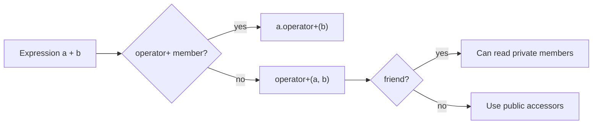

# References and Operator Overloading

References and operator overloading make user-defined types feel like built-in types when used carefully. A reference gives another name for an existing object. Operator overloading lets a class define meanings for operators such as `+`, `==`, `<<`, `>>`, `[]`, and assignment. Savitch groups these ideas with friend functions because many useful operator overloads must either access private data or support conversions on both operands.

The goal is not to overload every possible operator. The goal is to make class objects obey the same mental model users already have for numbers, strings, streams, and arrays. A good overloaded operator is unsurprising, efficient enough, and consistent with the rest of the class interface.

## References are aliases, not nullable handles

A **reference** is an alias for an existing object.

```cpp
int value = 10;
int& alias = value;
alias = 20; // value is now 20
```

References must be initialized when declared and normally cannot be reseated to refer to another object.

A **const reference** can bind to an object for read-only access.

```cpp
void printMoney(const Money& amount);
```

An **overloaded operator** is a function whose name is `operator` followed by an operator symbol.

```cpp
Money operator+(const Money& left, const Money& right);
bool operator==(const Money& left, const Money& right);
```

An operator can be overloaded as a nonmember function, member function, or friend function. At least one operand must be a class or enumeration type. You cannot redefine built-in behavior for two plain `int` operands.

A **member operator** uses the left operand as the calling object.

```cpp
class Counter {
public:
    Counter operator+(const Counter& rhs) const;
};
```

A **friend function** is not a member, but it has access to private members because the class grants access.

```cpp
class Money {
    friend Money operator+(const Money& left, const Money& right);
private:
    int cents_;
};
```

Stream operators normally return the stream by reference so chaining works:

```cpp
std::ostream& operator<<(std::ostream& out, const Money& amount);
std::istream& operator>>(std::istream& in, Money& amount);
```

A reference must bind during initialization. Later assignment writes through the reference rather than rebinding it:

```cpp
int first = 1;
int second = 2;
int& ref = first;
ref = second;        // first becomes 2; ref still names first
```

The referred object must outlive every use of the reference. Binding a const reference can extend the lifetime of a temporary in certain direct initialization contexts, but returning a reference to a local object is still invalid. References hide null checks and pointer syntax, so they are best when an object is required and its lifetime is guaranteed externally.

Reference collapsing and rvalue references extend the model in modern C++, mainly for moves and forwarding. An `T&&` can bind to a temporary, allowing a function to transfer resources from an expiring object. Ordinary operator interfaces still use `const T&` for read-only operands unless ownership transfer is part of the operation.

## Operators should preserve the symbol's usual expectations

Operator overloading is function overloading with operator syntax. The expression:

```cpp
sum = a + b;
```

can call:

```cpp
Money operator+(const Money& a, const Money& b);
```

For symmetric binary operators, nonmember functions are often better than members because automatic conversion can apply to both operands. If `Money` has a constructor from `int`, this works with a nonmember `operator+`:

```cpp
Money total = 25 + baseAmount;
```

If `operator+` is only a member of `Money`, then the left operand must already be a `Money` object, so `25 + baseAmount` will not match.

Use member operators when the operation must modify or select from the calling object, such as assignment, subscript, function call, or compound assignment:

```cpp
class Scores {
public:
    int& operator[](int index);
    const int& operator[](int index) const;
};
```

Assignment operators return `*this` by reference:

```cpp
T& T::operator=(const T& rhs);
```

This supports chaining such as `a = b = c`.

Avoid overloading operators whose built-in evaluation rules are too special. Savitch warns especially about `&&`, `||`, and comma because overloaded versions do not preserve the short-circuit or sequencing behavior programmers expect.

Several operators must be members, including assignment, subscript, function call, and arrow. Others can be members or nonmembers. Operators for streams must be nonmembers because the left operand is an existing stream class that the user-defined type cannot modify.

Overloading cannot change precedence, associativity, or number of operands. A binary `+` remains binary and groups left to right; `*` still binds tighter than `+`. It also cannot invent new symbols or overload `.` and `::`. Evaluation rules come from the language grammar before the selected operator function runs.

Compound assignment is a useful primitive:

```cpp
Money& Money::operator+=(const Money& rhs) {
    cents_ += rhs.cents_;
    return *this;
}

Money operator+(Money left, const Money& right) {
    left += right;
    return left;
}
```

Taking `left` by value intentionally creates the result object, then reuses the mutation logic. The compiler can move into that parameter when the left operand is temporary. One implementation now defines the consistency between `+` and `+=`.

Conversion constructors affect operator candidates. Mark a one-argument constructor `explicit` unless implicit conversion is part of the type's intended arithmetic. Otherwise an unrelated integer may silently become `Money` in a call or comparison. Named factories can make units clearer, such as `Money::fromCents(375)`.

## Member or nonmember

| Operator | Usually member? | Usually nonmember/friend? | Reason |
|---|---:|---:|---|
| `=` | yes | no | must modify left object |
| `[]` | yes | no | left operand is container object |
| `()` | yes | no | object behaves like function |
| `+=` | yes | sometimes | modifies left object |
| `+` | sometimes | yes | symmetric value operation |
| `==` | sometimes | yes | symmetric comparison |
| `<<` | no | yes | left operand is stream |
| `>>` | no | yes | left operand is stream |



## Worked example: adding money using cents

Problem: Represent money as total cents and overload `+` and `<<`.

Method:

1. Store one integer invariant: total cents.
2. To add two money objects, add their cents.

$$
\mathrm{sumCents} = \mathrm{leftCents} + \mathrm{rightCents}
$$

3. Return a new `Money` object.
4. Print dollars as `cents / 100`.
5. Print cents as `abs(cents % 100)` with leading zero if needed.

```cpp
#include <cstdlib>
#include <iomanip>
#include <iostream>

class Money {
public:
    explicit Money(long long cents = 0) : cents_(cents) {}

    long long cents() const {
        return cents_;
    }

    friend Money operator+(const Money& left, const Money& right) {
        return Money(left.cents_ + right.cents_);
    }

    friend std::ostream& operator<<(std::ostream& out, const Money& amount) {
        const long long cents = amount.cents_;
        if (cents < 0) {
            out << "-";
        }
        const unsigned long long magnitude = cents < 0
            ? 0ULL - static_cast<unsigned long long>(cents)
            : static_cast<unsigned long long>(cents);
        const char oldFill = out.fill('0');
        out << "$" << magnitude / 100 << "."
            << std::setw(2) << magnitude % 100;
        out.fill(oldFill);
        return out;
    }

private:
    long long cents_;
};

int main() {
    Money coffee(375);
    Money sandwich(825);
    std::cout << coffee + sandwich << '\n';
}
```

Checked answer:

1. `coffee` stores `375`.
2. `sandwich` stores `825`.
3. Sum is `1200`.
4. `1200 / 100 == 12`, `1200 % 100 == 0`.
5. Output is `\$12.00`.

The unsigned-magnitude calculation also handles the most-negative signed value; directly writing `cents = -cents` would overflow for that one value. The stream's fill character is restored after formatting because manipulators can alter persistent stream state. `std::setw` applies only to the next formatted field.

The addition can still overflow `long long`. A financial type must either check before addition, use a wider checked representation, or specify another policy. Choosing integer cents removes binary fraction error but does not remove finite-range arithmetic.

## Worked example: prefix and postfix increment

Problem: Define a counter that supports both `++c` and `c++`.

Method:

1. Prefix increment changes the object and returns the changed object by reference.
2. Postfix increment must return the old value.
3. C++ distinguishes postfix by a dummy `int` parameter.

```cpp
#include <iostream>

class Counter {
public:
    explicit Counter(int value = 0) : value_(value) {}

    Counter& operator++() {
        ++value_;
        return *this;
    }

    Counter operator++(int) {
        Counter old(*this);
        ++value_;
        return old;
    }

    int value() const {
        return value_;
    }

private:
    int value_;
};

int main() {
    Counter c(5);
    Counter before = c++;
    Counter after = ++c;

    std::cout << before.value() << " "
              << c.value() << " "
              << after.value() << '\n';
}
```

Step-by-step:

1. Start with `c == 5`.
2. `before = c++` stores old value `5`, then changes `c` to `6`.
3. `after = ++c` first changes `c` to `7`, then stores `7`.
4. Final output is `5 7 7`.

Checked answer: the postfix result preserves the pre-increment value, while prefix returns the updated value.

Postfix typically costs an extra copy because its result represents the old value. In a loop whose iterator supports both forms and the old value is unused, prefix avoids requiring that old snapshot. Optimizers often remove the difference for simple integer-like types, but defining both overloads with their conventional semantics remains important.

## Subscript operators need const and mutable views

This class demonstrates `operator[]` with const and non-const overloads.

```cpp
#include <iostream>
#include <stdexcept>

class FixedTriple {
public:
    FixedTriple(int a, int b, int c) : data_{a, b, c} {}

    int& operator[](int index) {
        check(index);
        return data_[index];
    }

    const int& operator[](int index) const {
        check(index);
        return data_[index];
    }

private:
    void check(int index) const {
        if (index < 0 || index >= 3) {
            throw std::out_of_range("FixedTriple index");
        }
    }

    int data_[3];
};

int main() {
    FixedTriple values(10, 20, 30);
    values[1] = 99;

    const FixedTriple& view = values;
    std::cout << view[0] << " " << view[1] << " " << view[2] << '\n';
}
```

The non-const overload returns `int&`, so `values[1] = 99` assigns directly to the stored element. The const overload returns `const int&`, allowing reads from `view` while rejecting assignment. Overload resolution selects between them from the constness of the object expression.

Standard containers traditionally leave `operator[]` unchecked and offer a separate checked `at` function. `FixedTriple` chooses checked subscript access, which is legal because the operation's domain remains recognizable. Its signed index makes the negative test direct; an interface using `std::size_t` would check only the upper bound but could receive a converted negative argument as a very large value.

## Surprising overloads and dangling results

- Returning references to local temporaries from overloaded operators.
- Making `operator+` modify the left operand. That surprises users; use `operator+=` for mutation.
- Forgetting to return `std::ostream&` or `std::istream&` from stream operators.
- Overloading `&&`, `||`, or comma and expecting built-in short-circuit or sequencing behavior.
- Implementing postfix `++` as if it were prefix `++`.
- Making every operator a friend when public accessors or member functions would suffice.
- Returning non-const references from const objects.
- Ignoring self-assignment in `operator=`.

Before keeping an overload:

- Overload an operator only when the meaning is natural for the type. `+` for rational numbers is clear; `+` for opening a file or printing a report is surprising.
- Preserve expected algebraic behavior when possible. If `a + b` creates a new value, it should not mutate `a`; if `a += b` mutates `a`, it should return `*this` by reference.
- Use nonmember functions for symmetric binary operators when the left operand may need conversion. This is one reason `operator+` is often implemented in terms of `operator+=`.
- Use references to avoid unnecessary copies, but never return a reference to a local variable. Returning by value is correct for most arithmetic-like operators.
- Keep stream operators conventional: `operator<<` should return `ostream&`, and `operator>>` should return `istream&`, so chained operations keep working.
- Do not overload operators merely to make code shorter. The result should be more readable to someone who knows the mathematical or domain meaning.
- Remember that some operators cannot be overloaded and that overloading does not change precedence. A custom `operator*` still has multiplication precedence even if the operation is not numeric multiplication.

Compare the overloaded operator with the built-in operator it resembles. If `a + b + c` should work, `operator+` must return a value that can participate in another `+`. If `cout << x << y` should work, `operator<<` must return the same stream. Chaining behavior is often the easiest way to detect a wrong return type.

For reference parameters, ask whether `const` would still allow the function to do its job. If yes, use `const`. This one decision prevents many accidental mutations and lets the function accept temporaries, const objects, and ordinary variables with the same interface.

The deciding question is whether the overloaded operator would surprise a reader in an expression. Operator syntax removes the function name, so the symbol itself must carry the meaning. If a named member function would be clearer, use the named function.

Writing both a named function and an operator for a small numeric class exposes the readability difference. `add(a, b)` is explicit, while `a + b` is compact and conventional. Keep the operator only when the compact expression is still easier to read.

Comparison operators should agree. If `a == b`, neither should be less than the other. If an ordering is provided for use in ordered containers, it must be a strict weak ordering; contradictory results can break container invariants. C++20's three-way comparison can generate a consistent family of comparisons for memberwise value types, but only when that memberwise order matches the domain.

Input operators need transactional behavior. Parse into temporary variables, validate them, and assign to the target only after success. On malformed input, set the stream's failure state and leave the existing object unchanged. Partially modifying an object before the final token succeeds makes chained extraction difficult to recover from.

Friendship should remain narrow. A friend operator is reasonable when it needs the representation for an efficient symmetric operation, but friendship is not required merely because an operator is a nonmember. Public observers often supply enough information and keep the private representation confined to the class.

Assignment has an identity requirement that arithmetic operators do not. After `a = b`, `a` remains the same object at the same address but holds a value corresponding to `b`; references previously bound to `a` still refer to it. A resource-owning assignment operator must release or replace the old representation without changing that identity, handle `a = a`, and leave a valid object if copying fails.

Stream insertion should normally observe rather than mutate the value. Formatting choices that belong to the caller—field width, decimal precision, locale—should be respected where possible. A type can print a canonical representation, but resetting unrelated flags on the stream surprises code composing several insertions. Saving and restoring only state that the overload changes keeps the effect local.

The arrow operator is unusual. An overloaded `operator->` must return a pointer or another object on which `operator->` can be applied again; the language repeats the process until it reaches a built-in pointer. Smart pointers use this rule to offer member access to an owned object. Overloading it for a type with no pointer-like role would conceal too much behavior behind familiar syntax.

References cannot represent optional absence, so a function returning “an element if found” needs another design. It may return a pointer, an iterator whose end value signals failure, or an optional reference wrapper. Inventing a sentinel object and returning its reference makes mutation and lifetime semantics unclear.

<div className="see-also">

See also: [functions and parameters](/cs/programming/cpp/functions-parameters-and-scope) · [classes and encapsulation](/cs/programming/cpp/classes-and-encapsulation) · [constructors and copy semantics](/cs/programming/cpp/constructors-and-copy-semantics) · [pointers and dynamic memory](/cs/programming/cpp/pointers-and-dynamic-memory) · [STL algorithms and iterators](/cs/programming/cpp/stl-algorithms-and-iterators)

</div>
