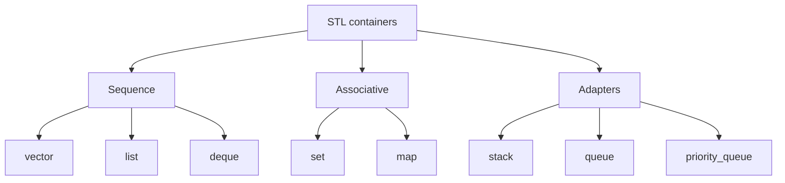

# STL Containers

The Standard Template Library gives C++ reusable containers such as `vector`, `list`, `set`, and `map`. Savitch places the STL after templates, exceptions, and linked data structures because STL containers are class templates that hide most of the memory management details while preserving efficient specialized behavior.

Container choice follows the operations a program performs. A `vector` is usually the first choice for a growable sequence with fast indexing. A `list` supports efficient insertion and deletion when an iterator already identifies the position. A `set` stores unique ordered keys, while a `map` associates ordered keys with values.

## Three container families

A **container** is an object that stores a collection of values. STL containers are template classes:

```cpp
vector<int> scores;
list<string> names;
set<int> uniqueIds;
map<string, int> counts;
```

A **sequence container** stores elements in a linear order controlled primarily by insertion position:

- `vector<T>`: dynamic array with fast indexing.
- `list<T>`: doubly linked list with efficient insertion and deletion at known positions.
- `deque<T>`: double-ended queue with efficient insertion at both ends.

An **associative container** orders elements by key:

- `set<T>`: unique keys.
- `multiset<T>`: keys may repeat.
- `map<Key, Value>`: unique keys associated with values.
- `multimap<Key, Value>`: repeated keys allowed.

A **container adapter** exposes a restricted interface over an underlying container:

- `stack<T>`: last-in, first-out.
- `queue<T>`: first-in, first-out.
- `priority_queue<T>`: highest-priority element removed first.

An **iterator** identifies a position in a container and connects containers to STL algorithms.

## Storage, access, and complexity

The standard containers manage their own storage. For most programs, this removes the need to write manual `new[]`, `delete[]`, linked-list destructors, and copy constructors. A `vector<int>` can grow dynamically, copy safely, and free its own storage when it goes out of scope.

Different containers optimize different operations:

```cpp
vector<int> v;
v.push_back(10);      // efficient at the end
cout << v[0] << endl; // constant-time indexing
```

```cpp
map<string, int> count;
count["apple"] += 1;  // find or create key, then increment
```

The expression `m[key]` for a `map` is convenient, but it inserts a default value when the key is not already present. Use `find` when you need to test for existence without insertion.

```cpp
map<string, int>::iterator it = count.find("apple");
if (it != count.end()) {
    cout << it->second << endl;
}
```

`set` and `map` keep elements ordered by key and guarantee logarithmic search, insertion, and deletion. `vector` gives constant-time indexing, but growth may reallocate its storage and invalidate iterators, pointers, and references to its elements.

Container adapters intentionally hide operations outside their access discipline. A `stack` provides `push`, `pop`, and `top`, but no iteration over all elements. Its `pop` operation removes an item without returning it, so read `top()` first when the value is needed. The same rule applies to `queue::front()` and `queue::pop()`.



| Container | Best at | Cost to access by index | Typical insert/search cost | Notes |
|---|---|---:|---:|---|
| `vector` | Compact sequence, indexing | `O(1)` | End insert amortized `O(1)`, search `O(n)` | Default first choice |
| `list` | Insert/delete at known position | `O(n)` by traversal | Known-position insert `O(1)` | No random access |
| `set` | Unique sorted keys | Not indexed | `O(log n)` | Stores keys only |
| `map` | Key-value lookup | Not numerically indexed | `O(log n)` | `operator[]` can insert |
| `stack` | LIFO behavior | Not available | Top push/pop `O(1)` | Adapter |
| `queue` | FIFO behavior | Not available | Back push/front pop `O(1)` | Adapter |

## Quiz scores favor contiguous storage

Suppose a program frequently appends quiz scores and computes their average, rarely inserts in the middle, and sometimes accesses a score by index. The central operations are append, traverse, and index.

`vector<int>` has efficient `push_back`, compact storage, and constant-time indexing. `list<int>` has no constant-time indexing and spends additional memory on links, so its known-position insertion advantage does not help this workload.

```cpp
vector<int> scores;
scores.push_back(90);
scores.push_back(80);
scores.push_back(100);
```

The sum is

$$
90 + 80 + 100 = 270
$$

and the average is

$$
270 / 3 = 90.
$$

For these access patterns, `vector<int>` is the better default.

## Word counts exploit ordered lookup

Consider the sequence `red blue red green blue red`. Starting with an empty `map<string, int>`, the expression `count[word] += 1` inserts a missing word with the default integer value `0`, then increments the stored count.

The updates are:

1. `red` is inserted and incremented to `1`.
2. `blue` is inserted and incremented to `1`.
3. The existing count for `red` becomes `2`.
4. `green` is inserted and incremented to `1`.
5. The existing count for `blue` becomes `2`.
6. The existing count for `red` becomes `3`.

| Word | Count |
|---|---:|
| `blue` | 2 |
| `green` | 1 |
| `red` | 3 |

Iteration follows key order rather than first appearance.

## Combining sequences, sets, and maps

The word-count program uses a `vector` to retain the input sequence, a `map` to count by sorted key, and a `set` to retain one copy of each word:

```cpp
#include <iostream>
#include <map>
#include <set>
#include <string>
#include <vector>
using namespace std;

int main() {
    vector<string> words;
    words.push_back("red");
    words.push_back("blue");
    words.push_back("red");
    words.push_back("green");
    words.push_back("blue");
    words.push_back("red");

    map<string, int> counts;
    set<string> uniqueWords;

    for (size_t i = 0; i < words.size(); ++i) {
        counts[words[i]] += 1;
        uniqueWords.insert(words[i]);
    }

    cout << "counts" << endl;
    for (map<string, int>::const_iterator it = counts.begin();
         it != counts.end(); ++it) {
        cout << it->first << ": " << it->second << endl;
    }

    cout << "unique word count: " << uniqueWords.size() << endl;
}
```

Adapters are useful when restricted access expresses the program's rules:

```cpp
#include <iostream>
#include <queue>
#include <stack>
using namespace std;

int main() {
    stack<int> undo;
    undo.push(10);
    undo.push(20);
    undo.push(30);

    cout << "last action: " << undo.top() << endl;
    undo.pop();

    queue<int> line;
    line.push(101);
    line.push(102);
    line.push(103);

    cout << "first customer: " << line.front() << endl;
    line.pop();
    cout << "next customer: " << line.front() << endl;
}
```

## Lookups, ordering, and invalidation

Several interface details affect correctness:

- `map[key]` inserts a missing key, so it is the wrong operation for a read-only existence test. Use `find`, `contains` in C++20, or another non-inserting lookup.
- `stack::pop` and `queue::pop` return no value. Read `top()` or `front()` before removal.
- `list` and `set` do not support `operator[]`. A `map` does, but its argument is a key rather than a numeric position.
- A duplicate insertion into `set` leaves only one copy. Use `multiset` when repetitions matter, or a `map` when their counts matter.
- A growing `vector` may reallocate, leaving saved iterators, pointers, and references stale. Node-based containers have different invalidation rules.

Start with `vector` unless the workload calls for another structure. It is compact, cache-friendly, easy to traverse, and supports random access. Choose `list` when stable iterators and frequent insertion or deletion at already-known positions matter more than indexing and compact storage. Choosing it merely because insertions are theoretically constant-time ignores the cost of finding the position.

Choose `map` when each key has one associated value and ordered traversal is useful. Choose `set` when uniqueness itself matters. Use adapters when the restricted interface is part of the design: a `stack` prevents access to non-top elements, while a `queue` states first-in, first-out behavior directly.

Order is part of the semantics. `vector` preserves insertion order until explicitly reordered; `set` and `map` iterate in key order; `stack` and `queue` expose only the next removable item. Replacing a sequence with an ordered associative container can therefore change program behavior even when it stores the same values.

Prefer values with automatic ownership inside containers. Raw owning pointers reintroduce manual memory management and complicate copying, destruction, and exception safety.

One useful selection exercise is to name the three dominant operations before choosing a type:

- Append, index, traverse suggests `vector`.
- Look up by name, update a count, print sorted keys suggests `map`.
- Retain unique IDs suggests `set`.

For a sharper comparison, solve the word-frequency example with a sorted `vector` of pairs and then with a `map`. The first version exposes the search and insertion work; the second packages ordered key lookup behind the container interface.

<div className="see-also">

See also: [templates](/cs/programming/cpp/templates) · [stl algorithms and iterators](/cs/programming/cpp/stl-algorithms-and-iterators) · [linked data structures](/cs/programming/cpp/linked-data-structures) · [arrays](/cs/programming/cpp/arrays) · [exception handling](/cs/programming/cpp/exception-handling)

</div>
