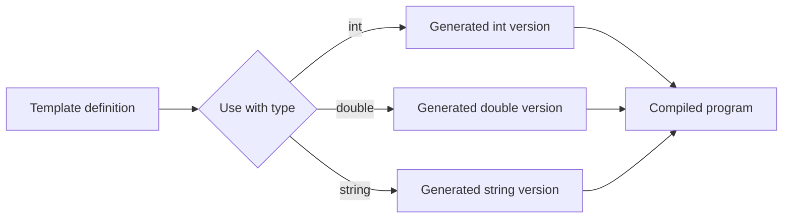

# Templates

Templates let C++ describe a pattern for code instead of one fixed function or one fixed class. Savitch introduces them as a way to avoid rewriting the same algorithm for `int`, `double`, `char`, or a user-defined class when the logic is identical and only the type changes.

The important idea is that a template is checked and instantiated by the compiler. It is not a run-time container of unknown values. A function template such as `swapValues` or `maximum` becomes an actual function for each set of types used by the program, provided those types support the operations used inside the template body.

## From one definition to a family of entities

A **function template** defines a family of functions. A type parameter stands for a type that will be supplied later.

```cpp
template <class T>
T maximum(T first, T second) {
    return (first < second) ? second : first;
}
```

The keyword `typename` can be used instead of `class` in a template parameter list:

```cpp
template <typename T>
void swapValues(T& first, T& second);
```

A **class template** defines a family of classes:

```cpp
template <class T>
class Pair {
public:
    Pair(T first, T second);
    T getFirst() const;
    T getSecond() const;
private:
    T first;
    T second;
};
```

An **instantiation** is the compiler-created version for a concrete type, such as `Pair<int>` or `maximum<double>`.

Template code is usually placed in header files because the compiler needs the full template definition when it instantiates the code. Separating a template declaration into a header and its definition into an ordinary `.cpp` file often causes linker errors unless explicit instantiation is used.

Parameters may represent values as well as types. A fixed-size buffer can take a non-type parameter:

```cpp
template <typename T, std::size_t N>
class FixedBuffer {
    T data_[N];
};
```

`FixedBuffer<int, 8>` and `FixedBuffer<int, 16>` are different class types. The bound participates in compile-time checking and can affect layout. Template-template parameters can represent templates themselves, but ordinary generic code rarely needs that extra layer.

An alias template gives a reusable name to a family of types without defining a new type:

```cpp
template <typename T>
using StringMap = std::map<std::string, T>;
```

`StringMap<int>` is exactly the corresponding map type, not a wrapper requiring conversion.

## Deduction and operation requirements

Templates express generic programming. The same source definition can produce functions or classes for many different types:

```cpp
cout << maximum(3, 9) << endl;          // T is int
cout << maximum(2.5, 1.75) << endl;     // T is double
```

The template body determines the requirements on the type. If a template uses `<`, then the type must support `<`. If a template writes to an output stream, the type must support `operator<<`. These requirements may be implicit in older C++ code, but they are still real.

For a function template call, the compiler often deduces the type parameter from the arguments. In `maximum(3, 9)`, both arguments are `int`, so `T` is `int`. In `maximum(3, 9.5)`, deduction is not a single exact type for both arguments, so the programmer may need to convert explicitly or call `maximum<double>(3, 9.5)`.

Class templates usually require the type argument in the declaration:

```cpp
Pair<string> name("Ada", "Lovelace");
Pair<int> dice(3, 6);
```

Template classes can have member functions defined outside the class body, but every definition must repeat the template prefix and use the specialized class name:

```cpp
template <class T>
T Pair<T>::getFirst() const {
    return first;
}
```

The proof of reuse is direct. If the algorithm's steps are independent of the exact type and depend only on operations such as assignment, comparison, or output, then replacing the concrete type by a type parameter preserves the algorithm's structure. The compiler checks whether the concrete type satisfies the needed operations when the template is instantiated.

Deduction uses the parameter patterns rather than arbitrary result-type reasoning. For `template<class T> T maximum(T, T)`, arguments of `int` and `double` produce conflicting deductions. An explicit `maximum<double>(3, 9.5)` converts the integer after choosing `T`, while a two-parameter design can deliberately compute a common result type. The latter changes the contract and should be added only when mixed types are meaningful.

Modern concepts make requirements part of the declaration. A constrained maximum can require an ordering relation and produce a shorter diagnostic when the requirement fails. Before concepts, substitution failure and overload techniques expressed similar constraints less directly. Even unconstrained introductory templates have a conceptual contract; writing it down prevents accidental reliance on numeric-only operations.

Dependent names are looked up in stages. A name whose meaning depends on `T` may need the keyword `typename` to tell the parser that it denotes a type:

```cpp
template <typename Container>
void visit(const Container& c) {
    typename Container::const_iterator it = c.begin();
}
```

The keyword is about parsing a dependent qualified name, not about introducing another template parameter.

Each used specialization can generate code, so templates may increase object-file size and compile time. Linkers can often merge identical instantiations. Explicit instantiation can centralize selected specializations in a `.cpp` file when build costs justify the extra organization, but the ordinary header-defined model is simpler.

## Instantiation happens from actual use



| Template kind | Produces | Example use | Typical purpose |
|---|---|---|---|
| Function template | Family of functions | `swapValues<int>` | Generic algorithms |
| Class template | Family of classes | `Pair<string>` | Generic data structures |
| Template parameter | Placeholder for a type or value | `class T` | Type-independent source |
| Instantiation | Concrete generated code | `Pair<double>` | Compilable specialized version |

The diagram is conceptual: the compiler need not emit a separate callable function for every specialization if it inlines, merges, or otherwise optimizes them. The language behavior is as if the corresponding specialization existed and was type-checked.

## Worked example: deducing a maximum function

Problem: Define a generic `maximum` function and determine what happens in these calls:

```cpp
maximum(7, 12)
maximum(2.5, 1.25)
maximum('b', 'z')
```

Method:

1. Write the template:

   ```cpp
   template <class T>
   T maximum(T first, T second) {
       if (first < second) {
           return second;
       }
       return first;
   }
   ```

2. For `maximum(7, 12)`, both arguments are `int`. The compiler instantiates:

   ```cpp
   int maximum(int first, int second) {
       if (first < second) {
           return second;
       }
       return first;
   }
   ```

   Since `7 < 12`, the return value is `12`.

3. For `maximum(2.5, 1.25)`, both arguments are `double`. Since `2.5 < 1.25` is false, the return value is `2.5`.

4. For `maximum('b', 'z')`, both arguments are `char`. Characters are compared by values in the execution character set. On the ordinary ASCII-compatible implementations assumed by the example, `'b' < 'z'`, so the return value is `'z'`.

Checked answer: the calls produce `12`, `2.5`, and `'z'`. Each call uses the same template source but a different instantiated type.

The tie behavior is also part of the contract. When neither argument is less than the other, this implementation returns `first`. For user-defined partial orders or floating-point NaNs, “maximum” may be less straightforward than the name suggests. Generic code still needs domain semantics, not only compilable operators.

## Worked example: building a `Pair` class template

Problem: Create a `Pair<T>` class template and trace the object `Pair<int> scores(80, 95)`.

Method:

1. Define the template class:

   ```cpp
   template <class T>
   class Pair {
   public:
       Pair(T first, T second) : first(first), second(second) {}
       T getFirst() const { return first; }
       T getSecond() const { return second; }
   private:
       T first;
       T second;
   };
   ```

2. Instantiate with `int`:

   ```cpp
   Pair<int> scores(80, 95);
   ```

3. Substitute `T = int` conceptually:

   ```cpp
   class PairInt {
   public:
       PairInt(int first, int second) : first(first), second(second) {}
       int getFirst() const { return first; }
       int getSecond() const { return second; }
   private:
       int first;
       int second;
   };
   ```

4. Evaluate the accessors:

   - `scores.getFirst()` returns `80`.
   - `scores.getSecond()` returns `95`.

Checked answer: `scores` stores two integers, and the template gives type-safe access without using casts or `void*`.

The two values must have the same type in this design. A pair of name and score would require two parameters, `Pair<std::string, int>`, or the standard `std::pair`. Modern class template argument deduction can infer template arguments from constructors in many declarations, but writing them explicitly remains useful when the intended type is not obvious.

## Generic selection sort and its real contract

```cpp
#include <iostream>
#include <string>
using namespace std;

template <class T>
void swapValues(T& first, T& second) {
    T temp = first;
    first = second;
    second = temp;
}

template <class T>
void selectionSort(T a[], int size) {
    for (int start = 0; start < size - 1; ++start) {
        int smallest = start;
        for (int i = start + 1; i < size; ++i) {
            if (a[i] < a[smallest]) {
                smallest = i;
            }
        }
        swapValues(a[start], a[smallest]);
    }
}

template <class T>
void printArray(const T a[], int size) {
    for (int i = 0; i < size; ++i) {
        cout << a[i] << " ";
    }
    cout << endl;
}

int main() {
    int numbers[] = {5, 2, 9, 1};
    string words[] = {"pear", "apple", "orange"};

    selectionSort(numbers, 4);
    selectionSort(words, 3);

    printArray(numbers, 4);
    printArray(words, 3);
}
```

The sort template requires assignable elements and a `<` operation whose result defines a consistent ordering. `swapValues` additionally copies through a temporary; move-only types therefore do not work with this version. `std::swap` uses moves where available, and `std::sort` has better asymptotic complexity than selection sort. The example isolates template mechanics rather than competing with the standard algorithm.

Array parameters decay to pointers, so `selectionSort` receives no bound from `a`. The caller-supplied `size` must describe the same array and be nonnegative. An iterator-pair or span interface can carry a range more directly.

```cpp
#include <iostream>
using namespace std;

template <class T>
class Box {
public:
    explicit Box(T value) : value(value) {}

    T getValue() const {
        return value;
    }

    void setValue(T newValue) {
        value = newValue;
    }

private:
    T value;
};

int main() {
    Box<int> count(5);
    Box<double> temperature(21.5);

    count.setValue(count.getValue() + 1);
    cout << count.getValue() << endl;
    cout << temperature.getValue() << endl;
}
```

`Box<T>` owns its value, so construction and `setValue` copy or move `T` according to the parameter choices. Returning `T` from `getValue` copies the stored value. For a large type, `const T& getValue() const` avoids that copy but exposes a reference whose lifetime is tied to the box and which can be invalidated by later replacement. Generic interfaces face the same value-versus-view decision as non-template classes.

## Where generic assumptions leak

- Putting a template definition only in a `.cpp` file and then including only the declaration elsewhere. Most template definitions must be visible at the point of instantiation.
- Assuming templates accept every type. A type must support every operation the template body uses.
- Mixing argument types and expecting deduction to guess a common type. `maximum(3, 4.5)` may need an explicit template argument or a conversion.
- Forgetting `Pair<T>::` and the repeated `template <class T>` prefix on out-of-class member definitions.
- Writing code that works for built-in types but fails for classes because it depends on missing operators such as `<` or `<<`.
- Creating a huge template when an ordinary function would be clearer. Templates pay off when the same logic truly applies to multiple types.

For a new template:

- Write down the operations required of `T`. A sorting template needs comparison; a printing template needs stream insertion; a numeric template may need addition, multiplication, or a default value.
- Keep template definitions visible to translation units that instantiate them. For ordinary projects, that usually means placing the full template definition in a header.
- Prefer simple type parameters before adding multiple parameters, non-type parameters, or specialization. A complicated template is harder to diagnose when substitution fails.
- Test a template with at least two different types. If it works only for `int`, the code may be accidentally depending on integer-specific behavior.
- Avoid assuming that `T()` is a meaningful neutral value. Some types have no cheap default construction, and others may default to a value that is not mathematically neutral.
- Keep error messages in mind. Template errors can be long because the compiler reports the instantiation path; smaller helper functions make those messages easier to read.
- Use STL templates as models. Containers such as `vector<T>` and algorithms such as `sort` show how generic code can remain type-safe while still compiling to concrete specialized operations.

Instantiate the template mentally with a user-defined class, not only `int`. If the body uses `<`, ask where that class gets `operator<`. If the body uses `T total = 0`, ask whether `0` can initialize that type. The exercise catches hidden assumptions that built-in numeric tests do not expose.

When a template error is long, find the first line that mentions your source file and the concrete type used for `T`. That is usually where the compiler discovered that an operation required by the template is unavailable or ambiguous.

Specialization changes a template for selected arguments. A full specialization supplies one exact case; partial specialization can match a family of class-template arguments. Function templates cannot be partially specialized and are usually customized with overloading instead. Specialization should preserve the primary template's public meaning, or callers will receive type-dependent surprises.

Templates interact with namespaces through argument-dependent lookup. An unqualified helper call inside a template may find functions associated with the eventual argument type at instantiation. The standard `using std::swap; swap(a, b);` pattern permits a type-specific nonmember `swap` while retaining the standard fallback. Hard-qualifying every customization call can block that extension mechanism.

Static data members and local statics exist separately for each specialization. A counter inside `Cache<int>` does not automatically share state with `Cache<double>`. That separation follows from the fact that the specializations are different types, but it can surprise code that intended one process-wide registry.

Perfect forwarding is a more advanced template pattern built on forwarding references and `std::forward`. It preserves whether a caller supplied an lvalue or rvalue when passing the argument onward. Writing `std::move` unconditionally would treat named lvalues as expendable; passing the named parameter normally would lose rvalue information. Factory and wrapper utilities use forwarding when avoiding an extra copy matters, but a simple by-value or const-reference interface is easier when the distinction has no semantic value.

Compile-time branching with `if constexpr` discards the unchosen branch during instantiation. It lets one template select operations based on type properties without requiring both branches to compile for every `T`. An ordinary `if` still type-checks both branches. This facility can clarify a small genuine type distinction, though many branches keyed on exact types suggest separate overloads or a missing common interface.

Variadic templates accept a parameter pack of zero or more types or values. The standard library uses them for tuples, emplacement, and call wrappers. Fold expressions combine a pack with an operator. They are powerful, but diagnostics and evaluation rules become harder to read; a fixed number of parameters should remain fixed when the problem itself has a fixed shape.

Generic code should avoid narrowing hidden inside instantiation. If a template accumulates sizes in `int`, it may work in tests and fail for a large container whose `size_type` is wider. Deriving related types from iterator traits or using `auto` for exact intermediate results often preserves the caller's range. Explicit conversions still belong at boundaries where the intended loss is known.

## Related pages

- [functions, parameters, and scope](/cs/programming/cpp/functions-parameters-and-scope)
- [references and operator overloading](/cs/programming/cpp/references-and-operator-overloading)
- [classes and encapsulation](/cs/programming/cpp/classes-and-encapsulation)
- [arrays](/cs/programming/cpp/arrays)
- [stl containers](/cs/programming/cpp/stl-containers)
