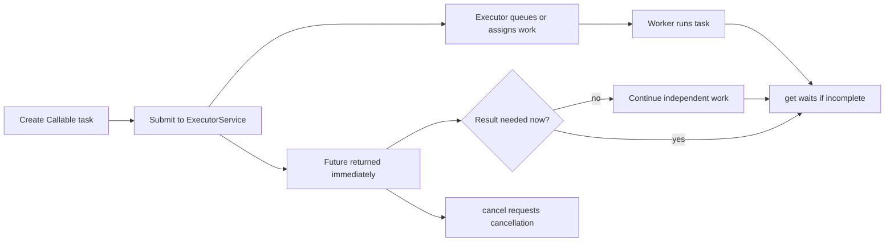

# Concurrent Utilities and Executors

The main thread chapter teaches the core monitor model: `Thread`, `Runnable`, `synchronized`, `wait`, and notification. Java 5 added `java.util.concurrent`, which packages recurring coordination patterns into executors, futures, concurrent collections, explicit locks, and synchronizers. The package does not remove the need to reason about ownership and visibility. It supplies better building blocks than a new hand-written monitor for every problem.

The central change is to treat a unit of work separately from the thread that happens to run it. A task says what to compute. An executor owns policy: how many threads exist, where submitted work waits, and what happens during overload or shutdown.

## A task is not a thread

`Runnable` represents work with no returned value. `Callable<V>` represents work that returns a `V` and may throw a checked exception. Passing either to an executor does not promise immediate or parallel execution; an executor may run it later, on a pool worker, or even in the submitting thread.

`Executor` has the small command-style interface `execute(Runnable)`. `ExecutorService` adds `submit`, bulk operations, and lifecycle methods. Submitting a callable returns a `Future<V>`, a handle for one eventual outcome.



The separation supports several execution policies without changing the task. A single-thread executor serializes work and preserves task order. A fixed pool bounds the worker count. A cached pool creates and reuses threads according to demand. A scheduled executor runs work after delays or at repeated times. The factory methods in `Executors` are convenient, though their queueing and growth policies should be inspected before using them under sustained load.

Starting a raw `Thread` for each request has no natural admission limit. Thread stacks consume memory, context switching consumes CPU, and a burst can create more runnable threads than the machine can use. A pool bounds one resource, but it does not automatically bound the waiting queue. A fixed pool created by the usual factory uses an unbounded queue, so overload may appear as growing memory use and increasing latency instead of rejected submissions.

`ThreadPoolExecutor` exposes the underlying choices: core and maximum pool sizes, keep-alive time, work queue, thread factory, and rejection handler. With an unbounded queue, the pool ordinarily stays at its core size because work can always be queued; the maximum size then has little effect. A bounded queue turns capacity into an explicit design decision and makes overload observable.

Pool size follows workload rather than a universal constant. CPU-bound tasks usually gain little from far more active threads than available processors. Tasks that spend much of their lifetime waiting on independent I/O can use more threads because other work runs during the wait. One rough model is

$$
N_{threads}\approx N_{cpu}U_{cpu}\left(1+\frac{W}{C}\right),
$$

where $W/C$ is waiting time divided by compute time and $U_{cpu}$ is the desired utilization. Measurements must replace the estimate because tasks contend for memory bandwidth, downstream services, locks, and connection pools. A hundred executor threads do not help if all need ten database connections.

Rejection policy defines overload behavior after both workers and queue are full. Aborting surfaces failure to the submitter; discarding loses work; running in the caller can slow producers and provide backpressure. None is automatically correct. The choice depends on whether work may be dropped, retried, persisted, or allowed to slow the request path.

Thread factories provide names, daemon policy, priority, and uncaught-exception handling. Meaningful names turn a thread dump from a collection of pool numbers into evidence about which subsystem is stalled. A task submitted with `submit` captures its exception in the future, so an uncaught-exception handler is not a substitute for observing returned futures.

## What a `Future` actually guarantees

`Future.get()` has three relevant outcomes. It returns the task's value, throws `ExecutionException` whose cause is the task failure, or throws `InterruptedException` because the waiting thread was interrupted. The overload with a timeout can also throw `TimeoutException`. A timeout does not itself cancel the task.

`cancel(false)` succeeds only if cancellation can prevent completion without interrupting a running task. `cancel(true)` may interrupt a worker running the task. Interruption is cooperative: code that swallows `InterruptedException`, ignores the interrupt flag, or performs a non-interruptible operation may continue. Cancellation is therefore a state transition and a request, not forceful thread termination.

The memory model supplies an important handoff. Actions before submitting a task happen-before that task's actions. Actions performed by the asynchronous computation happen-before another thread successfully returns from `Future.get()`. The caller does not need an extra volatile field merely to publish the returned result through the future.

Calling `get` immediately after every `submit` can accidentally serialize the program:

```java
for (Callable<Result> task : tasks) {
    Future<Result> f = pool.submit(task);
    results.add(f.get());       // waits before submitting the next task
}
```

Submit all independent tasks first, retain their futures, and then collect results. `invokeAll` performs this pattern for a collection and returns futures in input order after all tasks finish. Completion order can differ from submission order; `ExecutorCompletionService` is useful when results should be consumed as soon as each task completes.

### Worked scheduling example

Suppose a two-thread pool receives tasks `A`, `B`, and `C` in that order. Their run times are $5$, $2$, and $1$ seconds, and all arrive at time zero. Workers start `A` and `B`; `C` waits in the queue.

At $t=2$, `B` finishes and its worker starts `C`. At $t=3$, `C` finishes. `A` finishes at $t=5$. Submission order was `A, B, C`, but completion order was `B, C, A`.

If the caller invokes `futureA.get()` first, it waits until $t=5$ and only then observes the already completed results for `B` and `C`. Retrieving futures in submission order does not change execution order, but it can delay result processing. A completion service would make `B` available at $t=2$ and `C` at $t=3$.

A more serious pool dependency can deadlock. If both workers run parent tasks that submit child tasks to the same two-thread pool and then call `get`, the children stay queued while both workers wait. Either avoid blocking dependencies inside the same bounded pool or reserve capacity through a design that accounts for them.

## Executor ownership includes shutdown

An application component that creates an executor normally owns its shutdown. A method that merely receives a shared executor should not close it behind the caller's back.

`shutdown()` rejects new tasks but lets already submitted tasks finish. `shutdownNow()` attempts to interrupt active tasks and returns tasks that never started; it cannot guarantee that running work stops. `awaitTermination` lets an owner wait for orderly completion, commonly followed by a stronger cancellation attempt if a deadline expires.

```java
pool.shutdown();
try {
    if (!pool.awaitTermination(30, TimeUnit.SECONDS)) {
        pool.shutdownNow();
        if (!pool.awaitTermination(30, TimeUnit.SECONDS))
            System.err.println("pool did not terminate");
    }
} catch (InterruptedException ex) {
    pool.shutdownNow();
    Thread.currentThread().interrupt();
}
```

Restoring the interrupt flag preserves the cancellation request for the caller. Executor worker threads are commonly non-daemon threads, so forgetting shutdown can keep a short command-line application alive after `main` returns.

Scheduled execution distinguishes fixed rate from fixed delay. Fixed-rate scheduling aims at a sequence of nominal start times and may begin a late run soon after the previous one finishes; fixed-delay scheduling waits the stated delay after one run completes before scheduling the next. Repeated executions of one periodic task do not overlap through the same schedule, but a long-running task can fall behind. Wall-clock changes and task exceptions also need explicit handling for jobs that matter operationally.

## Concurrent collections have operation-level contracts

A synchronized wrapper such as `Collections.synchronizedMap` serializes individual method calls using one lock. Iteration still requires external synchronization on the documented mutex because a sequence of iterator calls is a larger operation. Concurrent collections use specialized algorithms and expose different traversal guarantees.

`ConcurrentHashMap` permits concurrent retrievals and updates without one global application-visible lock. In its Java 5 form it rejects null keys and values, removing ambiguity between no mapping and a mapping to null. Its iterators are weakly consistent: they do not throw `ConcurrentModificationException` merely because another thread updates the map, and they may reflect some updates made during traversal.

`CopyOnWriteArrayList` copies its backing array on each structural write. Iterators see a stable snapshot and need no external lock, which suits small listener lists that are read often and changed rarely. It is a poor fit for frequent mutation or very large lists.

Thread-safe methods do not make an arbitrary method sequence atomic. This check-then-act sequence races:

```java
if (!map.containsKey(key))
    map.put(key, value);
```

Two threads may both observe absence and both insert. In Java 5, `ConcurrentMap.putIfAbsent` combines the decision and update. The return value is the prior value, or null when the insertion succeeded because null values are prohibited:

```java
Value prior = map.putIfAbsent(key, candidate);
Value chosen = prior == null ? candidate : prior;
```

The candidate may still have been constructed redundantly. If creation has side effects or is expensive, the surrounding design must account for that; `putIfAbsent` makes publication atomic, not construction lazy.

## Locks and conditions express explicit protocols

`synchronized` automatically releases a monitor when its block exits. `Lock` separates acquisition and release, enabling interruptible acquisition, timed attempts, and multiple condition queues. Every successful acquisition must be paired with `unlock` in `finally`:

```java
lock.lock();
try {
    updateProtectedState();
} finally {
    lock.unlock();
}
```

`ReentrantLock` is reentrant like a Java monitor: the owning thread can acquire it again and must release it the same number of times. An optional fairness policy favors longer-waiting threads under contention, but can reduce throughput. Fairness does not mean a complete application-level ordering guarantee.

A `Condition` belongs to one lock and splits waiters into named queues such as `notEmpty` and `notFull`. `await` atomically releases the associated lock while waiting and reacquires it before returning. The predicate must be checked in a loop because wakeups may be spurious and another thread may consume the condition before the awakened thread reacquires the lock.

### One step through a bounded buffer

Assume a buffer capacity of two and current size two. A producer acquires the lock, finds `size == capacity`, and calls `notFull.await()`. That call releases the lock. A consumer acquires it, removes one item, changes the size to one, and signals `notFull` before unlocking. The producer wakes, reacquires the lock, checks the predicate again, inserts its item, and can signal `notEmpty`.

Using `if` instead of `while` fails when two producers wake for one free slot. The first fills it; the second later acquires the lock and must observe that the buffer is full again. The loop makes the shared-state predicate authoritative rather than treating a signal as a reservation.

```java
lock.lock();
try {
    while (queue.size() == capacity)
        notFull.await();
    queue.add(item);
    notEmpty.signal();
} finally {
    lock.unlock();
}
```

The wait method is interruptible, so the surrounding method must either propagate `InterruptedException` or restore the interrupt status if it cannot. Swallowing it converts a cancellation request into unexplained latency.

## Synchronizers encode common state machines

Several utilities remove the need to invent a custom counter protocol:

| Utility | State and use | Reuse |
|---|---|---|
| `CountDownLatch` | Threads wait until a count reaches zero | One-shot |
| `Semaphore` | Permits bound concurrent access to a resource | Reusable |
| `CyclicBarrier` | A fixed group waits for every member at a phase | Reusable by phase |
| `Exchanger` | Two threads rendezvous and swap objects | Reusable |

A latch initialized to three can represent three startup tasks. Each task calls `countDown` in `finally`; the coordinator calls `await`. Counts move $3\to2\to1\to0$, and reaching zero releases every waiter. Missing a decrement leaves the coordinator blocked, so placing it in `finally` is part of the protocol.

A semaphore with five permits limits a service to five concurrent users. Acquisition should precede the guarded activity, and release belongs in `finally` only after a successful acquire. A semaphore controls admission; it does not by itself protect mutable state used by admitted threads.

## Failure patterns to look for

- A task holds a lock while waiting on a future whose computation needs the same lock. Neither pool sizing nor timeouts repair the circular dependency.
- A broad `catch (Exception)` logs `InterruptedException` and continues. The thread has lost the request to stop unless it restores the flag or propagates the exception.
- An executor queue is unbounded, so an overload test reports good throughput briefly while latency and heap use grow without limit.
- A concurrent collection replaces a map, but a multi-call invariant remains unprotected. Choose an atomic collection method or lock the whole state transition.
- Library code creates a private pool per call. Reuse an owned, bounded service at an appropriate lifetime instead of multiplying threads and shutdown responsibilities.
- `Future.get()` runs on a user-interface or request-handling thread with no timeout, turning asynchronous work into an unbounded pause at the worst boundary.

`CompletableFuture`, virtual threads, and structured-concurrency APIs belong to later Java releases. They change composition or thread cost, but the older questions remain: who owns execution, where can work wait, how is cancellation propagated, and which state transition is atomic?

<div className="see-also">

See also: [Threads, Synchronization, and the Memory Model](/cs/programming/java/threads-synchronization-memory-model) · [Collections, Iteration, and Maps](/cs/programming/java/collections-iteration-maps) · [Interfaces, Nested Classes, and Enums](/cs/programming/java/interfaces-nested-classes-enums) · [Exceptions and Assertions](/cs/programming/java/exceptions-assertions)

</div>
