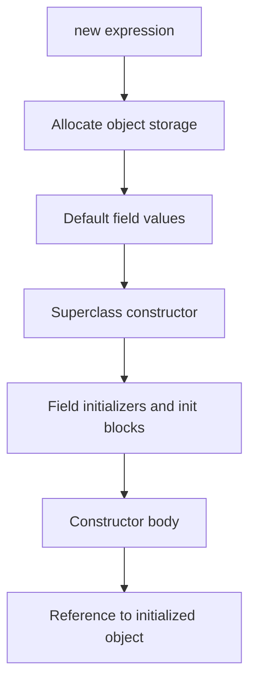

# Constructors, Methods, and Overloading

Construction and method invocation are the everyday mechanics of object-oriented Java. A constructor gives a new object its initial state. A method gives clients a named operation. The keyword `this` names the current receiver, making it possible to distinguish fields from parameters and to delegate among constructors or methods.

Overloading lets several methods or constructors share a name when their parameter lists differ. This can make APIs natural, but it also means the compiler must choose a most specific applicable method. The source book treats this choice as a precise language rule, not as a matter of intuition. Good overloaded APIs make the intended choice obvious to both compiler and reader.

## What a call binds and initializes

Chapter 2 supplies the material on object creation, initialization, methods, `this`, overloading, static member imports, `main`, and native methods. The important distinctions concern when a call is selected and which receiver or object state it acts on.

**Constructor invocation.** Creation and initialization of a new object, usually through `new`. A constructor can delegate within its class using `this(...)` or to a superclass constructor using `super(...)`.

**Initialization order.** The sequence of default field values, superclass construction, explicit field initializers, initialization blocks, and constructor bodies. Tracking it prevents use of state before it is ready.

**Receiver.** The object on which an instance method is invoked. Inside the method, `this` refers to that receiver.

**Parameter.** A method or constructor variable initialized by the caller's argument. A parameter name can shadow a field name, making `this.field` useful.

**Return value.** A value whose type appears in the method header; a `void` method returns no value.

**Overloading.** Multiple methods or constructors with the same name but different parameter lists. The compiler chooses among them using argument types and conversion rules.

**Varargs.** A variable-arity parameter, written with `...`, that receives zero or more trailing arguments as an array. Java 5 added this feature.

**Native method.** A method declared in Java but implemented outside Java, usually to connect with platform-specific code. The source treats native methods as a boundary, not ordinary application style.

## Centralizing construction and resolving overloads

**Constructors should centralize validity.** A class with several constructors should avoid duplicating validation inconsistently. Constructor delegation lets one constructor perform common checks and initialization for the others, preserving the same invariant through every public entry point.

**`this` identifies the receiver precisely.** It distinguishes `this.name`, the field, from `name`, the parameter, and can pass the current object to another method. Using it where shadowing or receiver identity matters prevents ambiguity.

**Overloading is compile-time selection.** The compiler selects an overloaded method from the compile-time argument types and applicable conversions. Runtime dynamic dispatch applies only after a signature has been chosen.

**Varargs are arrays at the method boundary.** A varargs parameter is received as an array. It improves call-site convenience, but the method must still handle length and values carefully. Overloaded varargs methods become hard to read when several calls appear applicable.

**A method's contract includes effects as well as return type.** The signature identifies arguments and return type; documentation and implementation define state changes, exceptions, and invariants. A `void` method may still perform the class's central state transition.

When tracing an invocation, do it in two passes. First, choose the signature: list the method name, argument expressions, compile-time argument types, and conversions allowed for overload resolution. Second, choose the implementation: if the selected method is an instance method and can be overridden, dynamic dispatch uses the actual receiver object's class. Constructors are different: they are not inherited and not dynamically dispatched. This two-pass separation is a compact way to avoid many errors around overloaded methods, subclass methods, and calls through superclass references.



| Feature | Chosen when? | Main question |
|---|---|---|
| Constructor overload | Compile time | Which parameter list matches the `new` arguments? |
| Method overload | Compile time | Which signature is most specific and applicable? |
| Method override | Runtime after signature choice | Which implementation belongs to the receiver object? |
| Varargs call | Compile time | Are fixed arguments enough, or is an array created for extras? |

## Delegating rectangle construction

Problem: Design `Rectangle(int width, int height)` and `Rectangle(int side)` so both reject nonpositive sizes.

Method:

1. Identify the invariant: width and height must both be greater than zero.
2. Put the full validation in the two-argument constructor because it has all state explicitly.
3. Make the one-argument square constructor delegate with `this(side, side)` as its first statement.
4. If `side` is invalid, the delegated constructor rejects it using the same rule as every other rectangle.
5. Store the validated arguments in private final fields.

Checked answer: Both constructors produce valid rectangles or throw the same exception for invalid dimensions. The invariant is centralized in one constructor body.

## Why `print(x)` selects `print(Object)`

Problem: Suppose a class has `print(Object o)` and `print(String s)`, and the variable is declared `Object x = "hi";`. Which overload is selected by `print(x)`?

Method:

1. Overload selection uses the compile-time type of the argument expression.
2. The variable `x` is declared as `Object`, even though its runtime value is a `String` object.
3. `print(Object)` is applicable directly. `print(String)` would require treating the compile-time `Object` expression as a `String`, which overload resolution does not assume.
4. The selected signature is therefore `print(Object)`.
5. If `print(Object)` is an instance method overridden in a subclass, dynamic dispatch may choose a subclass implementation of that same signature, but it will not switch to `print(String)`.

Checked answer: `print(Object)` is selected. Overloading is decided before runtime receiver dispatch and uses compile-time argument types.

## Constructor delegation beside overload selection

```java
public class ConstructorOverloadDemo {
    static class Rectangle {
        private final int width;
        private final int height;

        Rectangle(int side) {
            this(side, side);
        }

        Rectangle(int width, int height) {
            if (width <= 0 || height <= 0) {
                throw new IllegalArgumentException("positive dimensions required");
            }
            this.width = width;
            this.height = height;
        }

        int area() {
            return width * height;
        }
    }

    static void print(Object value) {
        System.out.println("Object: " + value);
    }

    static void print(String value) {
        System.out.println("String: " + value);
    }

    public static void main(String[] args) {
        Rectangle square = new Rectangle(5);
        System.out.println(square.area());

        Object text = "hello";
        print(text);
        print((String) text);
    }
}
```

## Ambiguous calls and duplicated validation

- Do not duplicate constructor validation in several places if delegation can centralize it.
- Do not forget that `this(...)` or `super(...)` must be the first statement when used in a constructor.
- Do not confuse overloaded method choice with overridden method dispatch.
- Do not create overloaded methods whose calls differ only by subtle boxing, widening, or varargs choices unless the API benefit is clear.
- Do not let parameter names shadow fields accidentally. Use clear names or `this.field` where the distinction matters.

<div className="see-also">

See also:

- [Classes, Objects, and Encapsulation](/cs/programming/java/classes-objects-encapsulation): explains the invariants constructors protect.
- [Inheritance, Polymorphism, and Object](/cs/programming/java/inheritance-polymorphism-object): separates overriding from overloading.
- [Primitives, Operators, and Conversions](/cs/programming/java/primitives-operators-conversions): supplies conversion rules used in overload resolution.
- [Generics, Wildcards, and Erasure](/cs/programming/java/generics-wildcards-erasure): shows how generic methods add another layer to method selection.

</div>
