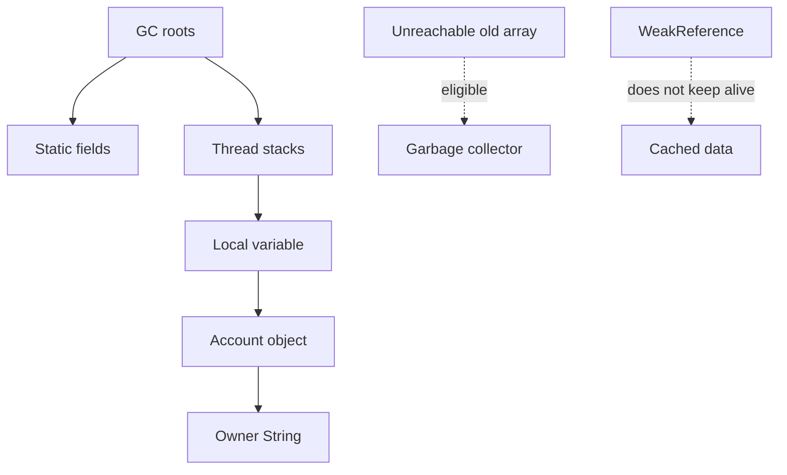

# Garbage Collection, References, and Memory

Java manages object memory through garbage collection. Programs allocate objects, keep references to the objects they still need, and the runtime reclaims objects that are no longer reachable. This does not eliminate resource management, but it changes what programmers manage directly: object memory is automatic, while files, sockets, locks, and other external resources still require explicit cleanup.

The source book's memory chapter focuses on reachability. An object is alive for program purposes while it can be reached from active roots through strong references. Reference objects such as soft, weak, and phantom references allow programs to interact with reachability in controlled ways. Finalization is covered, but with strong warnings about design hazards.

## Reachability and reference strength

Chapter 17 supplies the model of garbage collection, finalization, collector interaction, reachability states, and reference objects. Whether an object remains alive depends on paths from roots, not on the age or location of its allocation.

**Garbage collection.** Automatic reclamation of memory occupied by objects that are no longer reachable by the program.

**Reachability.** Whether an object can be accessed from active roots through local variables, static fields, thread stacks, and other reachable objects.

**Strong reference.** An ordinary reference that keeps its target strongly reachable while the reference itself is reachable.

**Soft reference.** A reference to an object that may be reclaimed under memory pressure, historically associated with caches.

**Weak reference.** A reference that does not keep its referent alive, useful for associations that should disappear when an object is otherwise unused.

**Phantom reference.** A reference used with a reference queue for cleanup coordination after an object becomes phantom reachable.

**Finalization.** A mechanism by which an object's `finalize` method may be invoked before reclamation. The source warns against relying on it for ordinary cleanup.

**Object resurrection.** Making an otherwise unreachable object reachable again during finalization or related logic; a strong design warning.

## Tracing the live object graph

**Reachability, not scope alone, determines collection.** A local variable going out of scope removes one possible reference, but the object remains alive if another path reaches it. A newly allocated object may still become eligible for collection as soon as no live reference reaches it.

**Garbage collection does not close resources on time.** The collector reclaims memory, not external resources on a predictable schedule. Program logic must close file streams rather than leaving them for finalization.

**Finalization is uncertain and hazardous.** The runtime does not promise prompt finalization, and finalizers can create ordering, performance, security, and resurrection problems. Designs that depend on finalizer timing need replacement.

**Reference objects are specialized tools.** Soft and weak references suit cached or associated data that should not force an object to remain alive. They are not ordinary field substitutes, and code must handle a missing referent.

**Reading a reference can change reachability.** Storing a non-null result from `get` in a local creates a strong reference while that local remains live. Copy the referent once before checking and using it.

To reason about garbage collection, draw an object graph. Mark roots such as active locals, static fields, and live thread objects. Follow strong references from those roots. Every object reached by that traversal is strongly reachable. Objects not reached may be reclaimable, subject to softer reference categories and runtime details. Then separately list non-memory resources. If an object owns a file, socket, native handle, or lock, ask where program logic releases it. Garbage collection may eventually reclaim object memory, but correctness should not depend on when that happens.



| Reference kind | Keeps object alive? | Typical source-era use |
|---|---|---|
| Strong reference | Yes | Ordinary object graph |
| Soft reference | Not necessarily under pressure | Memory-sensitive cache |
| Weak reference | No | Associations such as weak maps |
| Phantom reference | No direct `get` use | Cleanup coordination after reachability |
| Finalizer reference | Runtime-managed | Discouraged as cleanup strategy |

## Why clearing `b` does not free its node

Problem: Given `Node a = new Node(); Node b = new Node(); a.next = b; b = null;`, decide whether the second node is collectible.

Method:

1. `a` is a local variable holding a strong reference to the first node.
2. The first node's `next` field holds a strong reference to the second node.
3. The variable `b` is set to `null`, so it no longer refers directly to the second node.
4. However, the second node is still reachable from root `a` through `a.next`.
5. Therefore the second node is not eligible for collection while `a` remains live and `a.next` still points to it.

Checked answer: The second node is still reachable. Clearing one variable is not enough when another strong path remains.

## Stabilizing a weak referent during use

Problem: A weak reference may contain a cached byte array. Show why the referent should be copied to a strong local before use.

Method:

1. Call `ref.get()` to retrieve the referent. The result may be `null` if the object has already been cleared.
2. Store the result in a local variable, such as `byte[] data = ref.get();`.
3. Test the local variable for `null`.
4. If it is non-null, use the local variable for the whole operation. That local is a strong reference while it remains live.
5. Do not call `ref.get()` once for the null check and again later for use, because the second call could see a cleared reference.

Checked answer: The checked pattern is `T value = ref.get(); if (value != null) use(value);`. The local variable stabilizes the referent for the current operation.

## Observing a weak reference without assuming collection

```java
import java.lang.ref.WeakReference;

public class ReferenceDemo {
    static class Data {
        private final String name;

        Data(String name) {
            this.name = name;
        }

        public String toString() {
            return name;
        }
    }

    public static void main(String[] args) {
        Data data = new Data("cached");
        WeakReference<Data> ref = new WeakReference<Data>(data);

        Data strong = ref.get();
        if (strong != null) {
            System.out.println("using " + strong);
        }

        data = null;
        strong = null;
        System.gc();

        Data maybe = ref.get();
        System.out.println(maybe == null ? "cleared or may be cleared" : "still present: " + maybe);
    }
}
```

## Timing assumptions the collector does not promise

- Do not rely on `System.gc()` as a command that immediately collects a specific object. It is only an interaction request.
- Do not use finalizers for timely release of files, sockets, or locks.
- Do not assume setting one reference to `null` makes an object collectible if other strong paths remain.
- Do not call `WeakReference.get()` twice when one strong local would make the operation stable.
- Do not confuse memory cleanup with logical cleanup. Object memory and external resources have different lifecycles.

<div className="see-also">

See also:

- [Tokens, Values, and Variables](/cs/programming/java/tokens-values-variables): explains reference variables and object sharing.
- [I/O Streams, Files, Serialization, and NIO](/cs/programming/java/io-streams-files-serialization-nio): shows explicit cleanup for non-memory resources.
- [Collections, Iteration, and Maps](/cs/programming/java/collections-iteration-maps): includes weak map ideas in collection design.
- [Threads, Synchronization, and the Memory Model](/cs/programming/java/threads-synchronization-memory-model): connects reachability to live threads and memory visibility.

</div>
