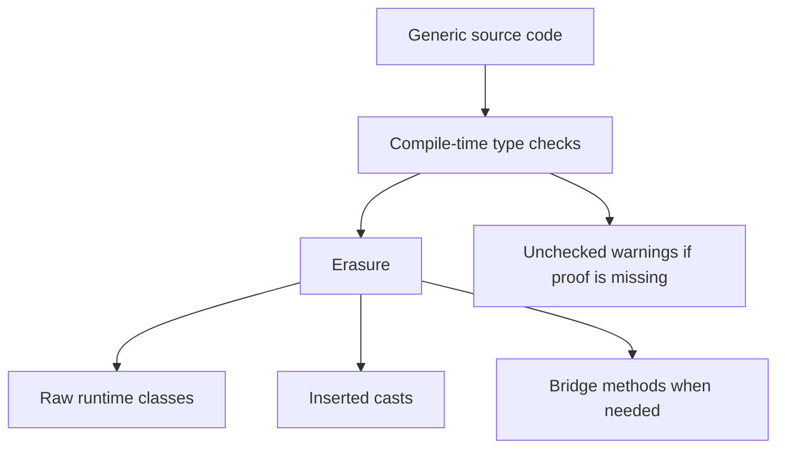

# Generics, Wildcards, and Erasure

Generics are one of the major Java 5 additions emphasized by the fourth edition. They let classes, interfaces, methods, and constructors express type relationships without giving up reusable code. A `List<String>` says that the list is intended to contain strings; a `Comparable<T>` says that comparison is tied to a type parameter; a generic method can preserve a relationship between input and output types.

The source book also stresses the cost of migration compatibility. Java generics are implemented with erasure rather than fully reified runtime type arguments. That choice allowed old and new code to interoperate, but it explains raw types, unchecked warnings, limits around generic arrays, bridge methods, and why some type information is not available at runtime.

## Type parameters before and after erasure

Chapter 11 covers generic declarations, generic methods and constructors, wildcard capture, erasure, raw types, method finding, and extension of generic classes; Appendix A supplies the migration context. Most of the type relationships exist for compile-time proof rather than runtime reification.

**Type parameter.** A placeholder such as `T`, `E`, or `K` declared by a generic type or method. Use or inference supplies the actual type argument.

**Parameterized type.** A generic type with actual type arguments, such as `List<String>` or `Map<String, Integer>`.

**Bound.** A restriction such as `<T extends Number>` that lets generic code use operations known through the bound.

**Wildcard.** An unknown type argument written `?`. Bounds such as `? extends T` and `? super T` express producer and consumer relationships.

**Generic method.** A method that declares type parameters before its return type, often relating several arguments and the result.

**Erasure.** The compilation strategy that removes most type-argument information from runtime representation while inserting casts and bridge methods as needed.

**Raw type.** A generic type name used without type arguments, such as `List`. Raw types preserve compatibility with pre-generics code at the cost of unchecked risks.

**Wildcard capture.** The compiler's treatment of an unknown wildcard as a specific, unnamed type within a limited context.

## Variance rules that preserve type safety

**Generics move type errors earlier.** Without generics, a collection accepts any `Object`, and mistakes may appear later as failed casts. With `List<String>`, the compiler rejects the wrong element type even though the runtime representation is not fully specialized.

**Invariance is deliberate.** `List<Integer>` is not a subtype of `List<Number>`, even though `Integer` is a subtype of `Number`. Otherwise, code could insert a `Double` into an integer list. Wildcards express safe one-way use.

**Use `extends` for producers and `super` for consumers.** A `List<? extends Number>` produces readable numbers, but the unknown exact element type prevents arbitrary additions. A `List<? super Integer>` consumes integers, while reads yield only `Object` without further knowledge.

**Unchecked warnings identify migration boundaries.** Raw types and some casts let old and new code interoperate, but the compiler warns when it cannot prove type safety. The warning often marks a boundary that should be tightened.

**Erasure shapes what reflection and arrays can do.** Runtime checks cannot generally distinguish `List<String>` from `List<Integer>`. Arrays do carry runtime component types, so generic array creation is restricted. The mismatch is a central limit of Java generics.

A reliable generic-design method is to decide whether each parameter is an input producer, an output consumer, or both. If a method only reads elements from a source, an upper-bounded wildcard often makes it more flexible. If it only writes elements to a destination, a lower-bounded wildcard may be right. If it both reads and writes values of the same exact element type, use a named type parameter. Then look for raw types and unchecked warnings; each warning marks a place where the compiler has lost evidence. The source's discussion of erasure is not an implementation curiosity. It is the reason these design rules exist.



| Type form | Can read as | Can add | Typical use |
|---|---|---|---|
| `List<T>` | `T` | `T` | Exact element type needed |
| `List<? extends Number>` | `Number` | Usually only `null` | Producer of numbers |
| `List<? super Integer>` | `Object` | `Integer` values | Consumer of integers |
| Raw `List` | `Object` with unchecked casts | Anything | Legacy boundary only |
| `List<?>` | `Object` | Usually only `null` | Unknown but type-safe list |

## Copying from a producer into a consumer

Problem: Design a method that copies integers from a source list into a destination list that can accept integers.

Method:

1. The source produces values to read. If it produces `Integer` or a subtype, `List<? extends Integer>` is flexible, though `Integer` is final in practice.
2. For a numeric example, use `<T>` and source `List<? extends T>` so the source can produce values compatible with `T`.
3. The destination consumes values. It can be a `List<T>` or a list of some supertype of `T`, so use `List<? super T>`.
4. Loop through the source and add each value to the destination. Reading from the source yields `T`; writing to the destination accepts `T`.
5. The same method can copy from `List<Integer>` to `List<Number>` when `T` is inferred as `Integer` or as a compatible type according to the call.

Checked answer: A checked signature is `<T> void copy(List<? extends T> source, List<? super T> dest)`. The bounds match producer and consumer roles.

## The `Double` that invariance keeps out

Problem: Explain the bug that would occur if a `List<Integer>` could be assigned to a `List<Number>` variable.

Method:

1. Assume `List<Integer> ints = new ArrayList<Integer>();`.
2. If assignment to `List<Number> nums = ints;` were allowed, `nums` and `ints` would refer to the same list object.
3. A `List<Number>` should accept any `Number`, so `nums.add(Double.valueOf(3.14))` would seem legal.
4. The underlying list would now contain a `Double` even though it is also known as a `List<Integer>` through `ints`.
5. Reading from `ints` as `Integer` would fail the type promise.

Checked answer: The assignment is forbidden to preserve type safety. Use a wildcard when a method only needs producer or consumer behavior instead of exact list element type.

## Encoding producer and consumer roles

```java
import java.util.ArrayList;
import java.util.List;

public class GenericsDemo {
    public static <T> void copy(List<? extends T> source, List<? super T> destination) {
        for (T value : source) {
            destination.add(value);
        }
    }

    public static double sum(List<? extends Number> values) {
        double total = 0.0;
        for (Number value : values) {
            total += value.doubleValue();
        }
        return total;
    }

    public static void main(String[] args) {
        List<Integer> ints = new ArrayList<Integer>();
        ints.add(Integer.valueOf(1));
        ints.add(Integer.valueOf(2));

        List<Number> numbers = new ArrayList<Number>();
        copy(ints, numbers);

        System.out.println(numbers);
        System.out.println(sum(numbers));
    }
}
```

## Where type evidence disappears

- Do not use raw types in new code except at unavoidable legacy boundaries. They remove compile-time evidence.
- Do not expect `List<Integer>` to be assignable to `List<Number>`. Generic types are invariant unless wildcards express a safe relationship.
- Do not create generic arrays casually. Array runtime type checks and erased generic type arguments do not fit cleanly together.
- Do not ignore unchecked warnings. They mark places where type safety depends on programmer reasoning rather than compiler proof.
- Do not overuse wildcards in return types. Callers often need a concrete relationship that a named type parameter expresses better.

<div className="see-also">

See also:

- [Collections, Iteration, and Maps](/cs/programming/java/collections-iteration-maps): applies generics to everyday container APIs.
- [Interfaces, Nested Classes, and Enums](/cs/programming/java/interfaces-nested-classes-enums): explains generic interfaces such as `Comparable<T>`.
- [Annotations and Reflection](/cs/programming/java/annotations-reflection): returns to generic type inspection limits.
- [Primitives, Operators, and Conversions](/cs/programming/java/primitives-operators-conversions): explains boxing needed for primitive values in generic collections.

</div>
