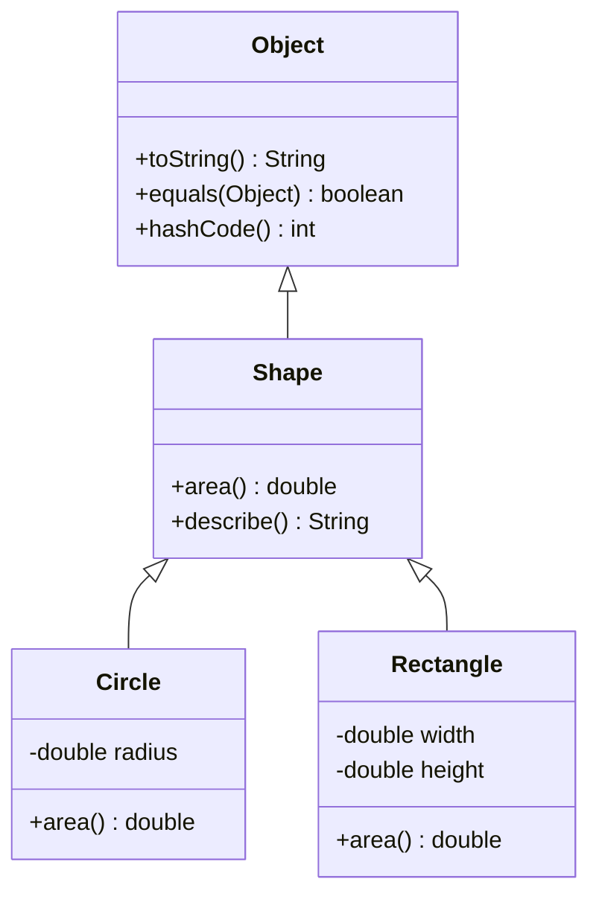

# Inheritance, Polymorphism, and Object

Inheritance lets a class extend another class, reusing and refining behavior under a subtype relationship. A subclass object can be used where a superclass reference is expected, and overridden instance methods are selected dynamically according to the actual object. That is the heart of Java polymorphism.

The source book is careful about inheritance because extension is powerful but easy to misuse. A superclass contract must remain valid for subclass objects. Fields should usually remain private, `protected` must be understood precisely, `final` can prevent unsafe extension, and `Object` methods such as `toString`, `equals`, `hashCode`, and `clone` have contracts that affect all classes.

## The subtype contract

Chapter 3 covers extension, constructor chains, inherited and redefined members, type compatibility, `protected`, `final`, abstract classes, `Object`, cloning, and design for extension. Every feature depends on a subtype preserving the promises of its supertype.

**Superclass.** The class named after `extends`, or `Object` when none is named explicitly. Its accessible members and contract constrain every subclass.

**Subclass.** A class that extends a superclass, possibly adding fields and methods, overriding inherited methods, and invoking superclass constructors through `super`.

**Overriding.** A subclass implementation of an inherited instance method, subject to signature and return-type compatibility. Runtime dispatch chooses the implementation.

**Polymorphism.** The ability of a superclass reference to hold a subclass object, with overridden instance calls dispatched by the actual object's class.

**`protected`.** Access from the same package and from subclasses under specific rules; it is more restricted than “public to subclasses.”

**`final` method or class.** A method that cannot be overridden or a class that cannot be extended. Finality can preserve contracts or close undesigned extension points.

**Abstract class.** A class that cannot be instantiated directly and may require subclasses to implement abstract methods while still providing shared fields and concrete methods.

**`Object`.** The root of the class hierarchy. Every object supports its declared methods, either inherited directly or overridden.

## Dispatch, construction, and extension boundaries

**A subclass must honor the superclass contract.** Client code using a superclass reference should continue to work with a subclass object. Overrides may specialize behavior while preserving expectations about arguments, results, state, and exceptions. Inheritance is therefore a design commitment, not only a code-sharing device.

**Dynamic dispatch applies to instance methods, not fields.** The receiver's runtime class selects an overridden method implementation. Field access follows declared-type rules, so hiding a field in a subclass does not create useful polymorphism.

**Constructors are chained, not inherited.** A subclass constructor arranges for superclass construction before completing its own initialization. Constructors are neither overridden nor inherited like methods.

**`protected` exposes representation to future subclasses.** A protected member can support extension, but it also locks in details for subclass code. Protected state should be a deliberate extension API rather than a convenience.

**`Object` methods are global contracts.** Overriding `toString`, `equals`, `hashCode`, or `clone` affects debugging, collections, copying, and logical equality. Their contracts matter even in small domain objects.

When evaluating inheritance, write down three questions. First, is the subclass truly substitutable for the superclass, or is it only reusing code? Second, which methods are intended extension points, and are their preconditions and postconditions documented? Third, what state is private, protected, final, or exposed through methods? If these questions cannot be answered, composition or forwarding may be clearer than subclassing. The source's design advice around extension is practical: inheritance should be designed into a class, not discovered accidentally by someone extending it later.



| Mechanism | Compile-time view | Runtime behavior |
|---|---|---|
| Superclass reference | Declared type controls accessible members | Object may be any compatible subclass |
| Overridden method | Signature selected by declared type | Implementation selected by receiver class |
| Field access | Resolved by declared type rules | Not dynamically dispatched like methods |
| Constructor | Chosen by `new` expression or `super` call | Runs in construction chain |

## Dispatch through a `Shape` reference

Problem: A `Shape` reference refers to a `Circle` object. Determine which `area` method runs.

Method:

1. Declare `Shape s = new Circle(2.0);`. The compile-time type of `s` is `Shape`, so only members available through `Shape` may be called directly.
2. Call `s.area()`. The compiler checks that `Shape` declares or inherits an accessible `area` method.
3. At runtime, the receiver object is a `Circle`.
4. Because `area` is an instance method and `Circle` overrides it, dynamic dispatch selects `Circle.area`.
5. The result is computed using the circle's radius, not a generic shape implementation.

Checked answer: `Circle.area` runs. The declared type controls whether the call is legal, while the runtime receiver class controls the overridden implementation.

## Preserving a `Range` invariant across subclasses

Problem: A superclass `Range` stores `low` and `high`. Decide whether subclasses should access those fields directly.

Method:

1. Identify the invariant: `low <= high`.
2. If fields are protected, a subclass can assign `low = 10; high = 1;` and break the invariant unless every subclass is careful.
3. If fields are private, subclasses cannot corrupt the representation directly.
4. Provide protected or public methods such as `contains`, `lowerBound`, `upperBound`, or a checked `reset` operation.
5. If a future implementation stores a center and width instead of endpoints, method-based access can keep subclass code working.

Checked answer: The checked design keeps fields private unless direct subclass access is a deliberate, documented extension point. Methods preserve the invariant and keep representation flexible.

## Two shapes behind one abstract type

```java
public class PolymorphismDemo {
    static abstract class Shape {
        abstract double area();

        public String toString() {
            return getClass().getName() + " area=" + area();
        }
    }

    static class Circle extends Shape {
        private final double radius;

        Circle(double radius) {
            this.radius = radius;
        }

        double area() {
            return Math.PI * radius * radius;
        }
    }

    static class Box extends Shape {
        private final double width;
        private final double height;

        Box(double width, double height) {
            this.width = width;
            this.height = height;
        }

        double area() {
            return width * height;
        }
    }

    public static void main(String[] args) {
        Shape[] shapes = { new Circle(2.0), new Box(3.0, 4.0) };
        for (int i = 0; i < shapes.length; i++) {
            System.out.println(shapes[i]);
        }
    }
}
```

## Extension points that break contracts

- Do not use inheritance only to share code when the subtype relationship is false. Composition or forwarding may be clearer.
- Do not make fields protected by default. Protected members are extension contracts and can restrict future implementation changes.
- Do not confuse method overriding with field hiding or method overloading.
- Do not override `equals` without considering `hashCode`. Collections depend on their relationship.
- Do not call overridable methods from constructors without understanding that subclass state may not yet be initialized.

<div className="see-also">

See also:

- [Classes, Objects, and Encapsulation](/cs/programming/java/classes-objects-encapsulation): supplies the private-state discipline that inheritance can weaken.
- [Constructors, Methods, and Overloading](/cs/programming/java/constructors-methods-overloading): separates overload choice from overridden method dispatch.
- [Interfaces, Nested Classes, and Enums](/cs/programming/java/interfaces-nested-classes-enums): compares class inheritance with interface-based contracts.
- [Collections, Iteration, and Maps](/cs/programming/java/collections-iteration-maps): uses `equals`, `hashCode`, `Comparable`, and `Comparator` contracts.

</div>
