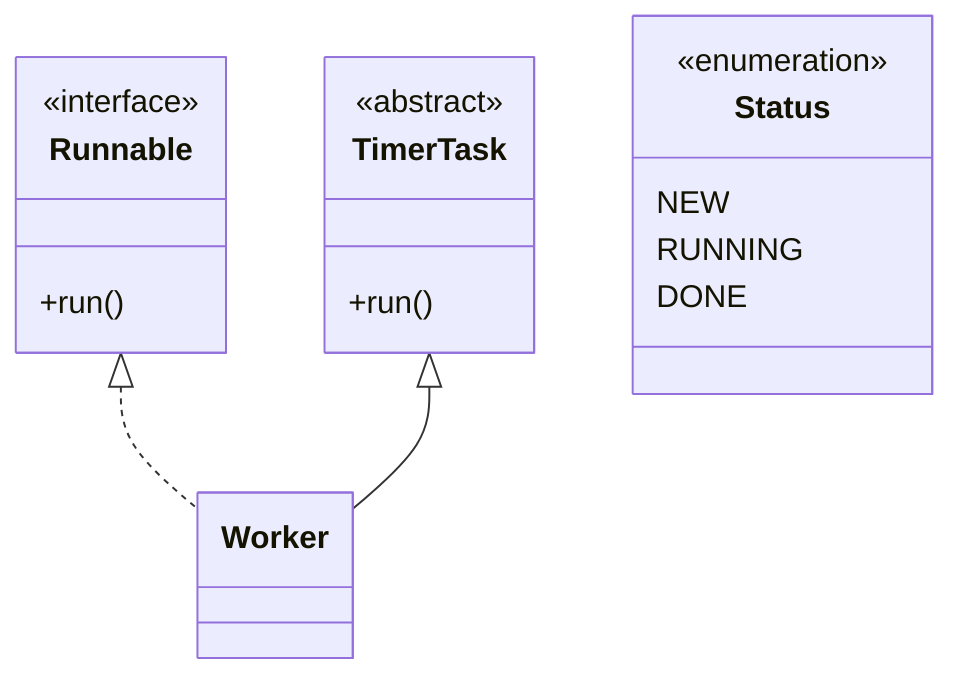

# Interfaces, Nested Classes, and Enums

Interfaces define contracts independent of a single class hierarchy. A class can extend only one class, but it can implement multiple interfaces, which makes interfaces Java's main tool for expressing roles such as comparable, iterable, runnable, cloneable, or serializable. The source book predates lambda syntax, so single-method interfaces are shown through named or anonymous classes rather than lambda expressions.

Nested classes and enums add structure. A nested type can keep helper code close to the class that uses it, while an enum defines a fixed set of named instances with type safety. These features reduce loose conventions: instead of passing arbitrary integers for a mode, use an enum; instead of exposing a helper class globally, nest it where its relationship is clear.

## Roles, enclosing instances, and closed sets

Chapters 4, 5, and 6 cover interfaces, marker interfaces, nested types, inner classes, local and anonymous classes, enum declarations, enum constants, and `java.lang.Enum`. These constructs describe roles, lexical ownership, or a fixed value domain without forcing everything into one class hierarchy.

**Interface.** A contract that classes can implement. Source-era interfaces declare constants and abstract methods; default methods came later.

**Implementation.** A class's concrete methods satisfying an interface contract. An interface variable can refer to an object of any implementing class.

**Marker interface.** An interface with no methods that marks a property recognized by library code, such as `Serializable` or `Cloneable`.

**Static nested class.** A nested type associated with its enclosing class name but without an implicit enclosing-object reference.

**Inner class.** A non-static nested class whose instances are associated with, and can access, an enclosing instance.

**Anonymous class.** A class declared and instantiated in one expression, often for a small interface implementation or simple extension.

**Enum.** A type with a fixed set of named constants. Its constants are objects and may have fields, constructors, and methods.

**Functional-interface boundary.** The source uses interfaces such as `Runnable`; Java 8 lambda expressions and `@FunctionalInterface` came later.

## Choosing a relationship that says enough

**Interfaces express capability without forcing superclass choice.** A class may extend one useful superclass and still implement several interfaces. It can promise multiple roles while inheriting implementation from only one class.

**Interface variables support polymorphism.** A variable of interface type can hold any implementing object. Calls through it dispatch to the object's implementation just as overridden class methods do.

**Anonymous classes work best when small.** Keeping a short implementation beside its use can help, but a long anonymous class hides control flow and makes debugging harder.

**Enums are stronger than integer constants.** An enum limits values to declared constants, supports `switch`, inherits useful methods from `Enum`, and prevents unrelated constant sets from being mixed.

**Default methods and lambdas are outside the source.** Modern Java interfaces add default and static methods and work with lambdas. The mechanisms here are the Java 5 foundation those features build on.

When choosing among a class, interface, nested type, anonymous class, and enum, ask what kind of relationship you are representing. Use a class for shared implementation and object state. Use an interface for a role that unrelated classes can implement. Use a static nested class when a helper belongs conceptually under an outer type but does not need an outer object. Use an inner class when it genuinely needs enclosing instance state. Use an enum when the set of values is closed and named. Use anonymous classes only when the implementation is short enough that naming it would add more noise than clarity.



| Type form | Main purpose | Source-era note |
|---|---|---|
| Interface | Declare a role or capability | No default methods in the source |
| Anonymous class | Small one-off implementation | Keep short and local |
| Static nested class | Namespaced helper type | No enclosing instance reference |
| Inner class | Helper tied to enclosing object | Has access to enclosing instance |
| Enum | Closed set of typed constants | Can have fields and methods |

## Replacing numeric job states with an enum

Problem: A program uses `0`, `1`, and `2` to represent job states. Replace them with a safer enum.

Method:

1. Name the concept: the values are not arbitrary numbers; they are states.
2. Declare `enum JobState \{ NEW, RUNNING, DONE \}` so only those constants are valid values.
3. Change variables from `int state` to `JobState state`.
4. Replace comparisons such as `state == 1` with `state == JobState.RUNNING`.
5. Use a `switch` or methods on the enum if behavior depends on the state.

Checked answer: The checked result is a typed state model. Code cannot accidentally assign `17` as a state, and readers see the domain names instead of decoding numbers.

## Depending on comparison rather than representation

Problem: A method needs to sort objects that can compare themselves. Should it require a specific class or an interface?

Method:

1. Identify the required operation: the method needs comparison, not a particular representation.
2. Use an interface such as `Comparable<T>` to express the comparison role.
3. Any class that implements the interface can be accepted, even if the classes are otherwise unrelated.
4. The method calls the interface method, and dynamic dispatch reaches each object's implementation.
5. Avoid requiring a superclass unless the method actually needs shared implementation or state from that superclass.

Checked answer: The checked design depends on an interface role. This reduces coupling and lets unrelated classes participate if they satisfy the comparison contract.

## One job exposed through two interface roles

```java
public class InterfaceEnumDemo {
    enum JobState {
        NEW, RUNNING, DONE
    }

    interface Described {
        String description();
    }

    static class Job implements Described, Runnable {
        private JobState state = JobState.NEW;

        public String description() {
            return "Job is " + state;
        }

        public void run() {
            state = JobState.RUNNING;
            System.out.println(description());
            state = JobState.DONE;
        }
    }

    public static void main(String[] args) {
        Described described = new Job();
        System.out.println(described.description());

        Runnable task = (Runnable) described;
        task.run();
        System.out.println(described.description());
    }
}
```

## Leaky nesting and weak domain models

- Do not treat interfaces as weak classes. They are contracts and should be designed around meaningful roles.
- Do not write long anonymous classes inside complex methods. Name the class when the behavior needs explanation.
- Do not use integer constants for a closed domain when an enum would make illegal values impossible.
- Do not assume source-era interfaces include default methods. That is a later Java feature outside this book.
- Do not confuse a static nested class with an inner class. Only the inner class carries an enclosing instance relationship.

<div className="see-also">

See also:

- [Inheritance, Polymorphism, and Object](/cs/programming/java/inheritance-polymorphism-object): compares class extension with interface roles.
- [Generics, Wildcards, and Erasure](/cs/programming/java/generics-wildcards-erasure): explains generic interfaces such as `Comparable<T>` and `Iterable<E>`.
- [Threads, Synchronization, and the Memory Model](/cs/programming/java/threads-synchronization-memory-model): uses `Runnable` as a core thread task interface.
- [Collections, Iteration, and Maps](/cs/programming/java/collections-iteration-maps): uses interfaces for collection contracts.

</div>
