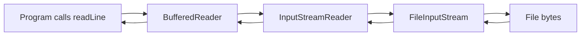

# I/O Streams, Files, Serialization, and NIO

The source book's I/O chapter uses the word stream in the classic Java sense: a sequence of bytes or characters flowing from a source to a destination. This is not the later Java 8 `java.util.stream` API for functional-style collection processing. Source-era I/O streams are about files, memory buffers, filters, readers, writers, object serialization, and checked `IOException`.

I/O is a library topic where language features become practical. You need classes, inheritance, wrapping, interfaces, exceptions, `finally` cleanup, arrays, strings, and sometimes synchronization. The stream classes are designed for composition: a file stream supplies bytes, a buffering stream improves efficiency, a reader decodes bytes into characters, and a data or object stream interprets structured values.

## Choosing the data layer

Chapter 20 covers byte and character streams, readers and writers, filter layers, data streams, files, object serialization, `IOException`, and an introduction to NIO. The first decision is whether the program is moving bytes, text, primitive values, or an object graph.

**Byte stream.** Raw 8-bit input or output through classes such as `InputStream` and `OutputStream`.

**Character stream.** Character input or output through `Reader` and `Writer`, used for text where decoding and encoding matter.

**Filter stream.** A wrapper that adds buffering, data conversion, pushback, object serialization, or another focused behavior.

**Buffering.** Combining small operations into larger operations on the underlying source or destination to reduce overhead.

**File.** In the source-era API, `File` represents filesystem pathnames and supports inspection, creation, deletion, and listing of files and directories.

**Serialization.** Writing an object graph to bytes and reading an equivalent graph back, subject to class compatibility and serialization rules.

**`IOException`.** The checked exception family for I/O failures; methods must catch or declare these failures.

**New I/O.** The `java.nio` model of buffers, channels, and related abstractions beyond classic streams; the source gives only an introduction.

## Building and closing a stream stack

**Choose byte streams for bytes and readers/writers for text.** Binary data should not pass through character APIs. Text needs deliberate decoding and encoding. `InputStreamReader` and `OutputStreamWriter` bridge the two models by applying a character encoding.

**Wrapping is the central stream design pattern.** A program can place buffering over a file stream, a reader over a byte stream, or an object stream over an output stream. Each wrapper adds one responsibility while delegating to the layer beneath it.

**Close resources reliably.** I/O objects often hold scarce operating-system resources. The source-era idiom uses `finally` so `close` runs after success, failure, or early return. Later try-with-resources automates the same obligation.

**Serialization preserves graphs, not design quality.** It can write shared object graphs, but creates compatibility, security, and versioning concerns. A class should be deliberately designed for serialization rather than accidentally made persistent.

**NIO changes the abstraction.** Buffers and channels alter the programming model rather than merely making classic streams faster. The source stops at the boundary and basic concepts.

When reading stream code, draw the wrapper stack from outermost object to innermost source or destination. Calls are made on the outer object, but actual bytes or characters eventually come from or go to the innermost object. Then mark where exceptions can be thrown and where cleanup happens. This visual stack explains why closing the outer wrapper is usually enough, why buffering changes performance but not logical content, and why mixing byte and character layers without an explicit bridge is a design smell.



| Need | Source-era class family | Notes |
|---|---|---|
| Raw bytes | `InputStream` / `OutputStream` | Binary files, network bytes, byte arrays |
| Text characters | `Reader` / `Writer` | Decode and encode character data |
| Efficiency | `BufferedInputStream`, `BufferedReader`, etc. | Reduce many small underlying operations |
| Primitive data values | `DataInputStream` / `DataOutputStream` | Structured binary primitive values |
| Object graph persistence | `ObjectInputStream` / `ObjectOutputStream` | Requires serialization design |
| Buffer/channel model | `java.nio` | Introduced as new I/O taste |

## Assembling a line-oriented text reader

Problem: Read lines of text from a file using source-era I/O classes.

Method:

1. Start with the physical source: a file path. `FileInputStream` can read bytes from that file.
2. Because the content is text, bridge bytes to characters with `InputStreamReader` and a chosen encoding where available.
3. Because line-by-line reading benefits from buffering and a line API, wrap the reader in `BufferedReader`.
4. Call `readLine()` in a loop until it returns `null`, which is the expected end-of-input signal.
5. Close the outer reader in a `finally` block so the underlying stream is also closed.

Checked answer: The checked wrapper stack is `BufferedReader` over `InputStreamReader` over `FileInputStream`. The loop ends on `null`, while I/O failures are reported with `IOException`.

## When a count map is suitable for serialization

Problem: A program has a `HashMap<String, Integer>` of counts and wants to save it for later. Decide whether object serialization is suitable.

Method:

1. Check whether every object reachable from the map is serializable. Strings and wrapper integers are serializable in the standard library.
2. Ask whether the file is only for this Java program and compatible versions of its classes. Serialization is less suitable as a long-term external data format.
3. Use `ObjectOutputStream` around a file output stream to write the object graph.
4. Use `ObjectInputStream` to read it back, then cast with care because deserialization returns `Object`.
5. Handle `IOException` and possible class-related failures at the boundary.

Checked answer: Serialization can work for a short-lived Java-specific persistence need. For stable interchange, a deliberate text or binary format may be better.

## Counting lines with source-era cleanup

```java
import java.io.BufferedReader;
import java.io.ByteArrayInputStream;
import java.io.IOException;
import java.io.InputStream;
import java.io.InputStreamReader;

public class IODemo {
    static int countLines(byte[] data) throws IOException {
        InputStream in = null;
        BufferedReader reader = null;
        try {
            in = new ByteArrayInputStream(data);
            reader = new BufferedReader(new InputStreamReader(in));
            int count = 0;
            while (reader.readLine() != null) {
                count++;
            }
            return count;
        } finally {
            if (reader != null) {
                reader.close();
            } else if (in != null) {
                in.close();
            }
        }
    }

    public static void main(String[] args) throws IOException {
        byte[] data = "one\ntwo\nthree\n".getBytes("UTF-8");
        System.out.println(countLines(data));
    }
}
```

## Encoding, ownership, and persistence traps

- Do not confuse classic I/O streams with the later `java.util.stream` API. This source covers byte and character I/O streams.
- Do not read text through byte APIs without thinking about character encoding.
- Do not forget to close the outermost stream or reader. Cleanup is part of the I/O contract.
- Do not use exceptions to signal normal end-of-input when a stream method already has an end marker such as `-1` or `null`.
- Do not assume serialization is a neutral file format. It ties data to Java class structure and compatibility rules.

<div className="see-also">

See also:

- [Exceptions and Assertions](/cs/programming/java/exceptions-assertions): explains checked `IOException` and cleanup with `finally`.
- [Strings, Regular Expressions, Formatter, and Scanner](/cs/programming/java/strings-regex-formatter-scanner): handles text read from streams.
- [Collections, Iteration, and Maps](/cs/programming/java/collections-iteration-maps): often stores parsed I/O results.
- [Packages, Documentation, System, and Internationalization](/cs/programming/java/packages-documentation-system-i18n): covers system streams and locale-aware text concerns.

</div>
