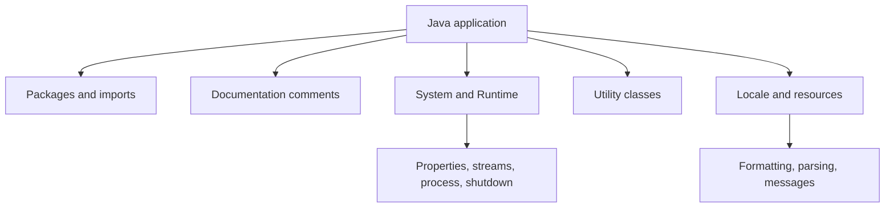

# Packages, Documentation, System, and Internationalization

The later source chapters widen from individual language constructs to the organization and environment of Java programs. Packages create namespaces and access boundaries. Documentation comments describe contracts for tools and readers. Utility classes provide formatting, random numbers, timers, UUIDs, math, scanning, and observable patterns. System classes expose standard streams, properties, environment interactions, process creation, shutdown behavior, and security checks.

Internationalization and localization explain why text, dates, numbers, currency, resources, and calendars cannot be hard-coded as if every user shared one language and region. The source also surveys standard packages and application evolution across language, library, and virtual-machine versions. Modern build tools such as Maven and Gradle, and Java 9 modules, are outside this 2005 source and appear here only as later ecosystem boundaries.

## Packages as namespace and access boundary

A **package** groups related top-level types under a namespace and participates in access control. Package names are usually chosen to avoid global collisions. A top-level type or member with no explicit `public`, `private`, or `protected` modifier has package access, so a package can serve as a genuine design boundary rather than a directory convention.

An **import** lets source code refer to types or static members by shorter names. It neither includes code nor changes runtime loading. If a class is used, the dependency exists whether its name is imported or fully qualified. Static imports can reduce noise around constants and utility methods, but heavy use obscures where names originate.

Good package design groups types that form a coherent internal unit. Read it from the client's side: identify the public entry points, keep representation helpers package-private, and avoid turning implementation details into permanent API commitments.

A `package` declaration belongs at the start of a compilation unit, after comments and before imports. Its name determines the declared namespace; the source directory layout normally mirrors that name so compilers, build tools, and class loaders can find the type. The unnamed package is tolerable for a one-file exercise but cannot be imported by code in named packages and gives no useful ownership boundary.

Only one public top-level type is normally declared per source file, and the filename matches that type. A compilation unit may contain additional package-private top-level types. Their class files remain separate even though their source was shared.

Access control depends on both package and inheritance:

| Modifier | Same class | Same package | Subclass in another package | Unrelated external code |
|---|---:|---:|---:|---:|
| `private` | yes | no | no | no |
| package access | yes | yes | no | no |
| `protected` | yes | yes | yes, through inheritance rules | no |
| `public` | yes | yes | yes | yes |

`protected` is broader than “subclasses only” because every class in the same package also receives access. Across a package boundary, a subclass cannot use a protected instance member through an arbitrary superclass instance; access must occur through the subclass relationship. Package-private is often a cleaner choice for helpers that should collaborate locally without becoming extension points.

Imports resolve source names. `import a.b.Widget` and `import a.b.*` do not recursively import subpackages. Two on-demand imports that expose the same simple type name require a single-type import or a fully qualified use to resolve the ambiguity. `java.lang` and types in the current package are available without explicit imports.

### Choosing visibility for a parser package

Suppose a package contains `Parser`, `Token`, and `TokenBuffer`. Clients should call `Parser` without depending on the buffer representation.

1. Treat `Parser` as the public entry point.
2. Treat `TokenBuffer` as an internal collaboration detail.
3. Make `Parser` public when callers outside the package need it.
4. Leave `TokenBuffer` package-private so neighboring classes can use it while outside clients cannot name it.
5. Document the behavior promised by `Parser`, not the current token-storage scheme.

The package then enforces the intended split: public API outside, cooperating implementation types inside.

If `TokenBuffer` later changes from an array to a deque, client source is unaffected because clients could never name it. If it had been public and appeared in a return type, that representation would be part of the compatibility surface. Removing public access can break source and binary clients even if `Parser` itself is unchanged.

## Javadoc records the client contract

A **documentation comment** begins with `/**` and is processed by tools such as Javadoc to produce API documentation. Useful API documentation states what clients may rely on: parameters, return values, exceptions, side effects, null handling, and threading expectations. Narrating the current implementation invites comment skew when the code changes.

The same distinction applies to package documentation. Describe the role of the package and its supported entry points; avoid inventories that merely repeat the generated type list.

Tags should add machine-recognizable structure where the contract needs it. `@param` explains constraints or meaning rather than restating the parameter name; `@return` states the result including special cases; `@throws` states the condition under which an exception occurs. `@since` records API availability, and `@deprecated` should name the replacement and migration reason.

```java
/**
 * Parses one decimal port number.
 *
 * @param text characters containing only an integer from 1 through 65535
 * @return the parsed port
 * @throws NullPointerException if text is null
 * @throws IllegalArgumentException if text is not a valid port
 */
public static int parsePort(String text) {
    // implementation
}
```

The comment tells a caller about range, accepted syntax, and failures. It does not describe local variables or the chosen parsing loop. If the implementation begins accepting surrounding whitespace, either the contract or the code must change deliberately.

Documentation is also where thread safety, mutability, ownership, and units belong. “Returns elapsed time” is incomplete if callers cannot tell whether the value is seconds or milliseconds and whether it is wall-clock or monotonic time. Examples can clarify a contract, but they should not be the only specification of edge cases.

## Where a Java application meets its environment

`System` exposes standard streams, properties, time-related methods, array copying, and hooks into runtime services. `Runtime` represents the running application environment and includes process creation and shutdown-related operations. These APIs cross portability and security boundaries: system properties may be restricted, external commands differ by operating system, and shutdown behavior depends on the host environment.

The late chapters can be organized by the boundary each facility crosses:



| Topic | Source coverage | Boundary note |
|---|---|---|
| Packages and imports | Package naming, access, contents, and annotations | Java 9 modules are later and not covered |
| Documentation comments | Javadoc-style comments and tags | Build-site generation is outside the source |
| System programming | `System`, `Runtime`, processes, shutdown, and security | Platform policy affects behavior |
| Internationalization | `Locale`, resource bundles, currency, dates, calendars, and text | Defaults should not be assumed universal |
| Build tools | Not a source topic | Maven and Gradle are later ecosystem tools |

Deployment assumptions deserve an explicit audit: local files, process permissions, default locale, default encoding, time zone, and security policy all vary between environments.

### Time, properties, and process boundaries

`System.currentTimeMillis()` represents wall-clock time and can jump when the system clock is corrected. It suits timestamps, not measuring a duration that must be monotonic. `System.nanoTime()` is intended for elapsed-time differences; its origin is arbitrary, so only differences from the same running virtual machine are meaningful:

```java
long start = System.nanoTime();
doWork();
long elapsedNanos = System.nanoTime() - start;
```

System properties are Java key-value settings such as `java.version` and `user.dir`. Environment variables come from the hosting process environment. They are separate namespaces with different setup mechanisms. Both are external input: a missing value needs a defined fallback or error, and sensitive values should not be dumped wholesale into diagnostics.

`System.arraycopy` copies a contiguous region and handles overlapping ranges in the same array. Its bounds and type checks occur at run time. Copying three elements from source positions $1$ through $3$ to destination positions $0$ through $2$ is one operation:

```java
int[] source = {10, 20, 30, 40, 50};
int[] target = {0, 0, 0, 0};
System.arraycopy(source, 1, target, 0, 3);
// target is now {20, 30, 40, 0}
```

For external processes, `ProcessBuilder` accepts the executable and each argument as separate strings. That avoids asking a shell to reinterpret one concatenated command line. The child still has platform-specific executable names, paths, environment, working directory, stream behavior, and permissions. Its standard output and error must be consumed or redirected; otherwise a child that fills an OS pipe can block while the parent waits for exit.

Shutdown hooks run during an orderly virtual-machine shutdown, but they are not a durability guarantee. They may run concurrently, have limited time, and do not run after every abrupt termination. Persistent data should be committed during normal operation rather than postponed entirely to a hook.

## Locale-sensitive data belongs outside control flow

A **locale** represents language, country, and variant information used by locale-sensitive formatting, parsing, and resource lookup. A **resource bundle** supplies locale-specific resources, commonly text messages, without embedding every translation in program logic.

Dates, currency, number formats, collation, messages, and calendars vary by locale. Locale-aware classes and resource bundles keep those choices separate from the program's control flow.

A locale is a formatting and language preference, not a geographic truth about the user. The locale can be chosen by an application, supplied by a request, or inherited as a process default. Library code should accept it explicitly when output becomes user-facing. `Locale.ROOT` is useful for locale-neutral transformations used by protocols and internal identifiers.

Case conversion can be locale-sensitive. Using the default locale to lowercase a protocol token makes program behavior depend on the host. Human-language display text and machine identifiers need different policies. Unicode support alone does not solve translation, plural rules, collation, date conventions, or text expansion in layouts.

For a localized greeting, store the text under a stable key such as `greeting`, choose the requested `Locale`, load the corresponding bundle, and print the value returned for that key. Supporting another language then requires new resource data rather than another branch in the program.

Formatting follows the same pattern:

```java
import java.text.NumberFormat;
import java.util.Locale;

public class LocaleSystemDemo {
    public static void main(String[] args) {
        Locale us = Locale.US;
        Locale korea = Locale.KOREA;
        double amount = 12345.67;

        NumberFormat usCurrency = NumberFormat.getCurrencyInstance(us);
        NumberFormat krCurrency = NumberFormat.getCurrencyInstance(korea);

        System.out.println("Java version: " + System.getProperty("java.version"));
        System.out.println("US: " + usCurrency.format(amount));
        System.out.println("Korea: " + krCurrency.format(amount));
    }
}
```

The two formatters apply different currency symbols, grouping conventions, and fraction rules to the same numeric value. Neither should be replaced by hand-built string concatenation.

Currency formatting also attaches meaning that the bare `double` does not contain. Formatting `12345.67` with a Korean locale selects the locale's usual currency; it does not convert a dollar amount into won. Currency conversion requires an exchange rate and a specified effective time. For monetary arithmetic, binary floating point may also be unsuitable when exact decimal rounding is required.

### Parsing one localized number

Take the text `1,234.50` under a US number format. The grouping separator is comma and the decimal separator is period, so the parsed value is $1234.50$. Under a locale that uses comma for the decimal separator, the same characters may be rejected, partially parsed, or interpreted differently depending on the parser configuration.

```java
NumberFormat parser = NumberFormat.getNumberInstance(Locale.US);
ParsePosition pos = new ParsePosition(0);
Number value = parser.parse("1,234.50", pos);

if (value == null || pos.getIndex() != "1,234.50".length())
    throw new IllegalArgumentException("invalid number");
```

The steps are explicit: choose the locale, start at index zero, parse, and verify that parsing consumed the complete input. Merely receiving a non-null `Number` is insufficient because many text parsers accept a valid prefix and stop before trailing junk.

Formatting is not necessarily round-trip serialization. A formatter may round to a configured number of fraction digits, insert non-breaking spaces, or choose locale-specific symbols. Stable file and network formats should define their own locale-neutral grammar rather than reuse a display formatter.

## Resource lookup and message composition

`ResourceBundle` maps stable keys to locale-specific values. A common family might contain a base bundle plus more specific bundles for a language or language-and-country combination. Lookup constructs candidates from the requested locale, moving from more specific to less specific names. The default-locale candidate chain may also be consulted before the base bundle, according to the control policy. The base remains important as a complete final fallback, not merely as one translation among peers.

Suppose the base bundle contains `greeting=Hello`, a Korean bundle contains the corresponding Korean greeting, and no Korean-country-specific file exists. A request for a Korean locale first seeks the most specific candidate, then the Korean language bundle, and returns its `greeting`. A missing key can fall through to a parent bundle; if no bundle supplies it, lookup fails rather than returning the key automatically.

Keys should describe message roles, not contain the source sentence itself. Renaming an English sentence then does not silently break every translation lookup. Translators also need context about placeholders and where the text appears.

`MessageFormat` composes localized messages with numbered arguments. Do not concatenate translated fragments around a name or count: languages order words differently, and a translator needs control over the whole sentence. Its apostrophe quoting rules are easy to miss, so messages containing apostrophes need tests with real bundle text.

Dates require an explicit time zone as well as locale. Locale chooses presentation conventions; time zone maps an instant to local civil fields. Storing an instant, formatting it in a requested zone, and labeling that zone are separate steps. A default-zone timestamp in a log becomes ambiguous when the application moves hosts or daylight-saving rules change.

## Assumptions that tend to leak

- Making every helper class public turns internal types into API commitments.
- Imports shorten names; they do not remove dependencies.
- Documentation that repeats method bodies becomes stale faster than contract documentation.
- Default locale, time zone, encoding, and security policy are machine-dependent.
- Maven, Gradle, and Java modules are useful modern context, but they are not topics in the source book.
- Formatting a number as another locale's currency changes its label and punctuation, not its economic value.
- A resource bundle fallback can hide an untranslated key during testing; enumerate keys or compare bundle coverage before release.
- A process argument list is safer than one shell command string, but the invoked program still treats its arguments as untrusted input.

## Related Java notes

- [Quick Tour, Platform, and First Programs](/cs/programming/java/quick-tour-platform): introduces the platform and package layout.
- [Strings, Regular Expressions, Formatter, and Scanner](/cs/programming/java/strings-regex-formatter-scanner): continues with formatting and text processing.
- [I/O Streams, Files, Serialization, and NIO](/cs/programming/java/io-streams-files-serialization-nio): covers files and external resources used by system code.
- [Annotations and Reflection](/cs/programming/java/annotations-reflection): connects package annotations with metadata inspection.
