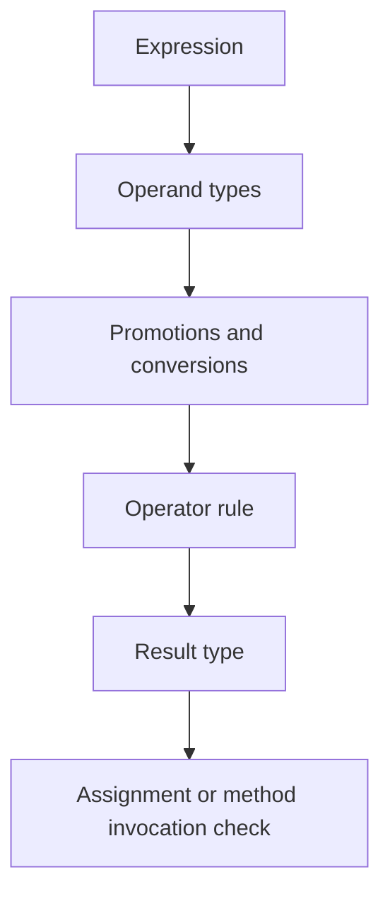

# Primitives, Operators, and Conversions

Java has primitive types for numeric, character, and boolean values, and reference types for objects and arrays. The distinction affects assignment, method invocation, default values, arithmetic, comparison, and boxing. Ordinary Java code crosses between the two domains often enough that neither can be treated as a special case.

Operators keep expressions compact, but conversions happen between the tokens. Arithmetic may promote smaller integer types to `int`; integer division discards a remainder; compound assignment includes an implicit cast; and `==` compares either primitive values or reference identity. The reliable question is always two-part: what value does the expression produce, and what is its type?

## The primitive and wrapper split

A **primitive type** stores a non-object value. Java's primitive categories are the integral types (`byte`, `short`, `int`, `long`, and `char`), the floating-point types (`float` and `double`), and `boolean`.

A **wrapper type** such as `Integer`, `Double`, `Character`, or `Boolean` supplies an object representation of a primitive value. **Boxing** converts a primitive to the corresponding wrapper when a reference is required; **unboxing** extracts the primitive when an operation requires it.

Autoboxing removes ceremony around generic collections and wrapper-based APIs, but the primitive/reference boundary still matters. A wrapper may be `null`, so unboxing can throw `NullPointerException`. Wrapper identity is also separate from numeric equality; caching makes identity comparisons especially misleading.

For example:

```java
Integer boxed = Integer.valueOf(15);
int unboxed = boxed.intValue();
```

The explicit methods show the two conversions that autoboxing syntax can otherwise conceal.

Unlike C, Java fixes the sizes and two's-complement behavior of integral primitive types. `byte` is 8-bit signed, `short` is 16-bit signed, `int` is 32-bit signed, and `long` is 64-bit signed. `char` is an unsigned 16-bit UTF-16 code unit with range $0$ through $65535$. It is not guaranteed to hold one complete Unicode character because supplementary code points use a surrogate pair.

`float` uses 32-bit IEEE 754 binary floating point and `double` uses 64-bit binary floating point. Their values include positive and negative infinity, NaN, and signed zero. `boolean` has only `true` and `false`; Java does not convert integers or references to boolean conditions.

Fields receive default values when an object or array is created: numeric zero, `false`, or `null` as appropriate. Local variables do not receive a usable default merely because they were declared. The compiler requires a local variable to be definitely assigned before reading it.

### Literals choose the starting type

An unsuffixed integral literal is normally `int` if representable; suffix `L` requests `long`. An unsuffixed floating literal is `double`; suffix `F` requests `float`. Thus `float f = 0.1;` does not compile without a cast because the literal is a `double`, while `float f = 0.1F;` does.

Decimal, hexadecimal, binary, and octal spellings describe the same integral values. A leading zero denotes octal, so `010` is eight. Underscores may separate digits where the grammar permits them and do not change the value.

The most negative `int`, $-2^{31}$, has no corresponding positive `int`. The token sequence `-2147483648` is handled as the special boundary case permitted for the decimal literal under unary minus; attempting to write positive `2147483648` as an `int` literal fails. `Integer.MIN_VALUE == -Integer.MIN_VALUE` is true because negation overflows back to the same bit pattern.

## Trace an expression from operands to destination

**Numeric promotion** converts operands to the types required by an operator. Most arithmetic on `byte`, `short`, and `char` first promotes their values to `int`. The result type belongs to the expression itself; a later assignment does not retroactively change how that expression was evaluated.



A useful tracing routine is to annotate each subexpression with a type, starting with literals and variables. Apply promotions, then the operator, and only then check assignment or method-invocation conversion.

Binary numeric promotion first unboxes wrapper operands when needed. If either operand is `double`, both become `double`; otherwise `float`, then `long`, then `int` wins. The smaller integral types never remain the result type of ordinary binary arithmetic.

Assignment conversion is a separate stage. Widening from `int` to `long`, or from `float` to `double`, needs no cast. Narrowing may discard high bits or precision and normally requires a cast. A constant expression receives one useful exception:

```java
byte ok = 100;       // constant value fits
// byte bad = 128;   // constant value is out of range
int n = 100;
// byte b = n;       // n is not a constant expression
```

The compiler can prove the first value fits from the expression itself. A `final int` initialized with a constant expression may also participate in constant narrowing; an ordinary variable cannot, even if its run-time value happens to be small.

| Operation family | Example | Governing rule | Question to ask |
|---|---|---|---|
| Arithmetic | `a + b`, `x / y` | Numeric promotion determines the result type | Are both operands integers? |
| Comparison | `x < y`, `a == b` | Produces `boolean`; `==` depends on operand kind | Are references being compared by identity? |
| Logical | `&&`, `||`, `!` | Operates on `boolean`; short-circuit forms may skip work | Can the right side be skipped? |
| Bitwise | `&`, `|`, `^`, `~`, shifts | Operates on integral values, or booleans for `&`, `|`, and `^` | Is sign extension relevant? |
| Assignment | `=`, `+=`, `*=` | Stores after the applicable conversion checks | What is the declared type on the left? |
| Member access | `obj.method()`, `Type.field` | `.` selects a field, method, or nested type | Is the receiver a type name or a reference? |

**Precedence** determines how operators group in the absence of parentheses; **associativity** resolves operators at the same precedence level. The rules are precise, but parentheses are often better documentation around mixed arithmetic, bit operations, and assignments used as subexpressions.

Java evaluates operands left to right. `f() + g()` calls `f` before `g`, although the operator still performs numeric promotion on their returned values. `&&`, `||`, and `?:` go further by conditionally skipping an operand. `&` and `|` on booleans evaluate both sides, which matters when the right side has a side effect or unsafe dereference.

## Integer division happens before assignment

Consider:

```java
int a = 7 / 2;
double b = 7 / 2;
double c = 7 / 2.0;
```

For `a`, both operands are integer literals, so integer division produces `3`. The expression assigned to `b` is evaluated the same way; only afterward is `3` widened to `3.0`. In the final line, `2.0` is a `double`, so binary numeric promotion converts the other operand and the division produces `3.5`.

The results are therefore `a == 3`, `b == 3.0`, and `c == 3.5`. Assigning an integer result to `double` cannot restore a fraction already discarded.

Remainder follows truncated division. For integer operands with nonzero divisor,

$$
a=(a/b)b+(a\%b).
$$

Since `-7 / 2` is `-3`, `-7 % 2` is `-1`. `%` is therefore a remainder operator, not a mathematical modulo function that always returns a nonnegative value. `Math.floorMod(-7, 2)` returns `1` when a nonnegative residue is required.

Integer division by zero throws `ArithmeticException`. Floating-point division follows IEEE 754 instead: `1.0 / 0.0` is positive infinity, `-1.0 / 0.0` is negative infinity, and `0.0 / 0.0` is NaN.

## Why `s += 5` and `s = s + 5` differ

A **compound assignment** combines an operator with assignment and includes a conversion back to the left-hand variable's type. Given:

```java
short s = 10;
s += 5;
```

the binary addition promotes `s` to `int`, but the compound-assignment rule converts the result back to `short`. It behaves roughly like `s = (short) (s + 5)`, except that the left-hand expression is evaluated only once.

By contrast, `s = s + 5` exposes the `int` result of `+`. Assigning that result to `short` is a narrowing conversion, so an explicit cast is required. The implicit conversion in `+=` can still overflow or truncate; compilation does not prove that the narrowed value is numerically safe.

The “left side once” rule matters for arrays. In `a[index()] += value()`, the array reference and index are evaluated once before the right operand. Rewriting it as `a[index()] = (T)(a[index()] + value())` would call `index()` twice and could access different elements.

## Overflow and bit operations are defined, but still hazardous

Integral overflow wraps modulo $2^w$ for a type width $w$. For `int`, compute

$$
2{,}147{,}483{,}647+1.
$$

The mathematical result is $2{,}147{,}483{,}648$. Its low 32 bits are hexadecimal `0x80000000`, interpreted as `Integer.MIN_VALUE`, or $-2{,}147{,}483{,}648$. Java does not throw for this ordinary addition. `Math.addExact` and related methods can request an exception when overflow must be detected.

Shift operators promote a `byte`, `short`, or `char` left operand to `int`. `>>` is an arithmetic right shift and extends the sign bit; `>>>` shifts zeros into the high positions. For

```java
int x = -8;            // 0xfffffff8
int a = x >> 2;        // 0xfffffffe, which is -2
int b = x >>> 2;       // 0x3ffffffe, which is 1073741822
```

the two operators preserve different interpretations of the bit pattern. Shift distances are masked: an `int` shift uses only the low five bits, so `1 << 32` is the same as `1 << 0`, not zero and not an error. Code should validate an external shift count rather than relying on that masking.

Bitwise `&`, `|`, and `^` also work on booleans, producing boolean results without short-circuiting. They do not convert booleans to integers.

Narrowing an integer keeps the low-order bits and then interprets them in the destination type. Casting integer $300$ to `byte` retains hexadecimal `0x2c`, because

$$
300\bmod256=44.
$$

The result is therefore $44$. Casting $200$ to `byte` retains `0xc8`; as an 8-bit signed value that represents $-56$. A cast asserts that this conversion is intended, not that the source value lies in the destination range.

Widening an integer is exact, but widening `int` or `long` to floating point can lose low-order precision. Every 32-bit `int` is exactly representable as `double`, while not every 64-bit `long` is. Converting the rounded floating result back can therefore fail to reproduce the original long even though the first conversion required no cast.

Before comparing values of mixed numeric types, Java applies promotion. A large `long` compared with a nearby `float` may compare equal because the long is converted to a float whose spacing is coarse at that magnitude. “Widening” describes the set of representable magnitudes and language permission, not a guarantee that every numeric value remains exact.

## Floating point has its own equality cases

Binary floating point cannot represent most decimal fractions exactly. `0.1 + 0.2 == 0.3` is false under `double` arithmetic because the rounded operands and rounded sum do not equal the nearest representation chosen for `0.3`. Decimal financial quantities that require specified base-10 rounding often use `BigDecimal`, constructed from a decimal string or by `BigDecimal.valueOf`, rather than from the already rounded binary value of `new BigDecimal(0.1)`.

NaN compares unequal to every value, including itself:

```java
double x = Double.NaN;
boolean same = x == x;              // false
boolean nan = Double.isNaN(x);       // true
```

Positive and negative zero compare equal with primitive `==`, but can behave differently in division: `1.0 / 0.0` is positive infinity and `1.0 / -0.0` is negative infinity. Wrapper comparison and ordering methods define their own total-order details, so primitive `==`, `Double.equals`, and `Double.compare` should not be treated as interchangeable.

## Equality depends on the operand category

For primitive operands, `==` compares values after the applicable promotions. For references, it tests whether both references designate the same object, or whether both are `null`. Content equality is normally expressed by `equals`, under the contract defined by the class.

This distinction is easy to lose when boxing is involved. Two `Integer` references can represent the same number without reference identity being the right comparison. Unbox them for numeric comparison or use `equals` when comparing wrapper values as objects.

### A boxing trace with `null` and overloads

Consider:

```java
Integer count = null;
// int next = count + 1;
```

The `+` operator requires numeric operands. Java first tries to unbox `count` by calling its integer-value conversion; because the reference is null, the expression throws before addition.

Method selection can also prefer a widening primitive conversion over boxing:

```java
static String choose(long x)    { return "long"; }
static String choose(Integer x) { return "Integer"; }

String result = choose(1);
```

The literal `1` has type `int`. Widening it to `long` is selected in an earlier overload phase than boxing it to `Integer`, so `result` is `"long"`. Autoboxing convenience does not erase overload-resolution rules.

Wrapper caches are an implementation-visible reason to reject identity comparisons. Some small boxed values may reuse instances, making `a == b` appear to work, while larger or differently created wrappers do not. `a.equals(b)` expresses wrapper value equality, provided `a` is non-null; `Objects.equals(a, b)` handles null references symmetrically.

## One trace with all the conversions exposed

```java
public class OperatorTrace {
    public static void main(String[] args) {
        int a = 7 / 2;
        double b = 7 / 2;
        double c = 7 / 2.0;

        short s = 10;
        s += 5;

        Integer boxed = Integer.valueOf(s);
        int unboxed = boxed.intValue();

        System.out.println("a = " + a);
        System.out.println("b = " + b);
        System.out.println("c = " + c);
        System.out.println("s = " + s);
        System.out.println("unboxed = " + unboxed);
    }
}
```

The output is `a = 3`, `b = 3.0`, `c = 3.5`, `s = 15`, and `unboxed = 15`.

## Failure modes worth checking

- A `double` destination does not force floating-point division if the division expression has already used integer operands.
- `==` does not compare object content unless identity is the intended relation.
- Unboxing a `null` wrapper throws at runtime.
- Dense precedence combinations are easier to misread than an equivalent parenthesized expression.
- Compound assignment has its own conversion rule and evaluates its left-hand side only once.
- Integer overflow wraps silently unless a checked arithmetic method is used.
- `char` arithmetic produces `int`, and a `char` may contain only half of a supplementary Unicode character.
- Floating NaN needs `isNaN`; equality with NaN is always false.
- Shift distances are masked to five bits for `int` and six for `long`.

## Continue with expressions in context

- [Tokens, Values, and Variables](/cs/programming/java/tokens-values-variables): supplies the declared types and values used by expressions.
- [Control Flow, Arrays, and Strings](/cs/programming/java/control-flow-arrays-strings): uses boolean expressions to drive branches and loops.
