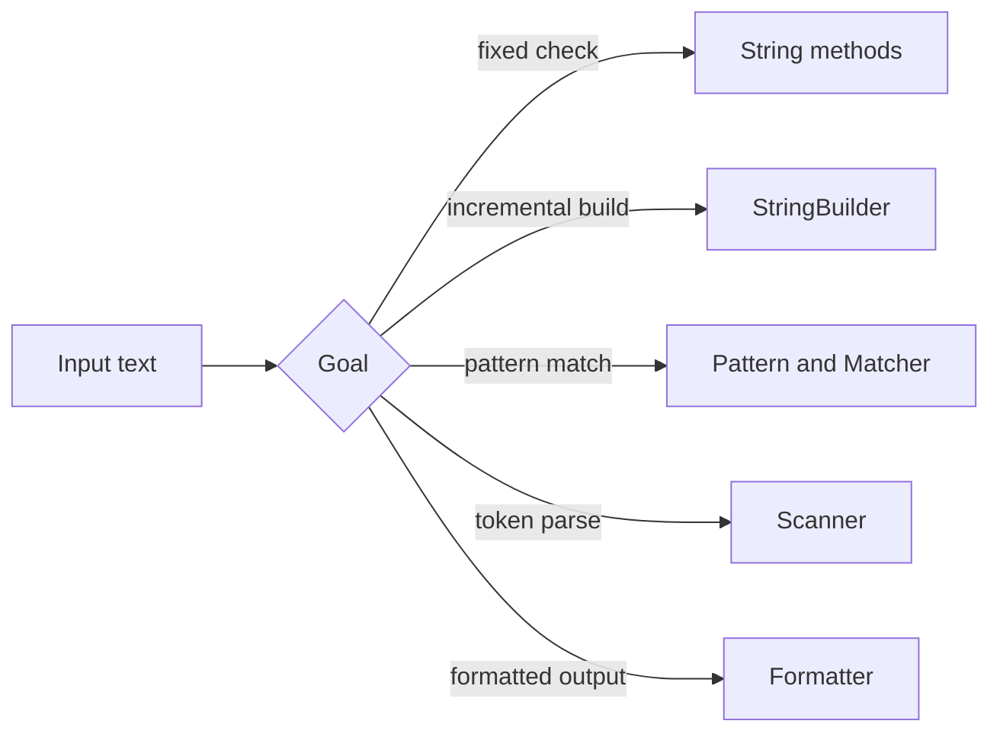

# Strings, Regular Expressions, Formatter, and Scanner

Text handling in Java centers on immutable `String` objects, mutable builders, regular expressions, formatted output, and token scanning. Text appears in command-line arguments, diagnostics, files, reports, parsed input, resource bundles, and object descriptions, so choosing the right abstraction matters early.

The first split is between immutable and mutable text. A `String` value does not change after creation. A `StringBuilder` changes as text is appended, inserted, or replaced, then produces a `String` at the boundary where immutable text is required. Regex and `Scanner` add two different forms of parsing, while `Formatter` controls conversion from values to text.

## Immutable strings, mutable construction

`String` represents an immutable sequence of UTF-16 code units. A method that appears to alter a string returns a new value instead:

```java
String name = "ada";
String displayName = name.toUpperCase();
```

`name` still refers to `"ada"`. Immutability allows strings to be shared without one holder changing the text observed by another.

`StringBuilder` is a mutable sequence intended for incremental construction. Appending in a loop expresses the changing state directly and usually avoids the chain of intermediate strings created by repeated concatenation. Call `toString()` when the result crosses into an API that expects immutable text.

Both types implement `CharSequence`, the common interface for readable character sequences. APIs that accept `CharSequence` can work with a `String`, a builder, or another compatible representation without promising mutation.

String equality is content equality. `a.equals(b)` compares sequences of code units; `a == b` compares references. Literals and other constant strings may be interned, so identity can appear to work in a small test and then fail for text read from input or constructed at run time. `equalsIgnoreCase` performs a case-insensitive comparison but is not a substitute for locale-aware collation.

The compiler normally rewrites one concatenation expression into efficient construction machinery. The expensive pattern is repeated reassignment across loop iterations:

```java
String result = "";
for (String part : parts)
    result = result + part;
```

Each iteration must preserve the previous immutable result and produce a larger one, so total copying can grow quadratically with the final length. A builder keeps reusable capacity:

```java
StringBuilder result = new StringBuilder();
for (String part : parts)
    result.append(part);
String text = result.toString();
```

`StringBuilder` is not synchronized. `StringBuffer` has synchronized methods for older shared-mutable designs, but sharing one text builder between threads usually complicates ownership more than it helps. Keep construction local when possible.

## Choose the unit of text before the API

Text code may operate on whole strings, tokens, regex matches, UTF-16 code units, Unicode code points, or formatted fields. Confusing those units causes subtle bugs: `length()` counts code units, `Scanner.nextInt()` consumes one token, and `replaceAll` interprets both a regex pattern and regex replacement syntax.



| Task | Suitable source-era tool | Reason |
|---|---|---|
| Append many pieces in a loop | `StringBuilder` | Mutable construction |
| Check an exact prefix | `String.startsWith` | Simpler than a regex |
| Validate a shape such as digits-dash-digits | `Pattern` / `Matcher` | The pattern language fits |
| Parse whitespace-separated numbers | `Scanner` | Token and primitive parsing |
| Align report columns | `Formatter` | Width and conversion rules |

Direct string methods are preferable for fixed equality, prefix, suffix, and index checks. Regex earns its complexity when the shape of the text is variable.

Slicing follows half-open bounds. `text.substring(begin, end)` includes `begin` and excludes `end`, so its code-unit length is `end - begin`. An empty slice is valid when the bounds are equal. Every index still refers to UTF-16 code units, which matters when a boundary can fall between surrogate halves.

## Compiling a pattern and walking its matches

A **regular expression** describes a set of matching strings. `Pattern` stores the compiled expression; `Matcher` applies it to one character sequence and carries the current match state.

```java
Pattern code = Pattern.compile("[A-Z]{2}-[0-9]{3}");
Matcher matcher = code.matcher("ID AB-123 and bad A-99");
while (matcher.find()) {
    System.out.println("matched " + matcher.group());
}
```

Here `find()` searches for successive matching regions, whereas a full-input validation would normally use `matches()`. Compiling a reused regex once also keeps the pattern separate from the input being examined.

Java source escaping and regex escaping are separate layers. To match a literal decimal point, the regex engine needs `\.`. A Java string literal must escape that backslash, so the source spelling is `"\\."`. `Pattern.quote(userText)` is safer when arbitrary input should be treated as literal pattern text rather than regex syntax.

Parentheses create capturing groups. After a successful match, `group()` returns the whole region, while `group(1)` returns the first captured region. Noncapturing parentheses `(?:...)` group alternatives or quantifiers without allocating a numbered capture. Anchors `^` and `$` constrain positions, while `matches()` already requires the entire input region to match.

### Extracting fields from one identifier

Take input `AB-123` and pattern `([A-Z]{2})-([0-9]{3})`. The first group requires exactly two uppercase ASCII letters, the hyphen is literal, and the second group requires exactly three ASCII digits.

1. The matcher starts at code-unit index $0$ and consumes `AB` for group 1.
2. It consumes `-` at index $2$.
3. It consumes `123` for group 2 and reaches the input end.
4. `matches()` returns true because the whole region was consumed.
5. `group(1)` is `AB`; `group(2)` is `123`; parsing group 2 as an integer gives $123$.

```java
Pattern id = Pattern.compile("([A-Z]{2})-([0-9]{3})");
Matcher m = id.matcher("AB-123");
if (m.matches()) {
    String prefix = m.group(1);
    int number = Integer.parseInt(m.group(2));
}
```

This pattern deliberately accepts only ASCII letters and digits. `\d` and Unicode-aware character properties can express broader sets when the input contract calls for them.

Quantifiers are greedy by default. In `<b>one</b><b>two</b>`, the pattern `<b>.*</b>` can consume from the first opening tag through the final closing tag. A reluctant `.*?` stops earlier, but regular expressions remain a poor general parser for nested markup. More seriously, ambiguous nested quantifiers can cause extensive backtracking on a near miss. Patterns applied to untrusted long input should be tested for worst-case behavior, not only correct matches.

Replacement strings have their own syntax: `$1` refers to a captured group and backslash escapes replacement characters. `Matcher.quoteReplacement` treats arbitrary replacement text literally. Quoting the pattern alone does not quote the replacement.

Convenience methods on `String` still use regex rules. `split(".")` does not split on a literal dot because dot matches almost any character; `split("\\.")` supplies the escaped regex. By default, `split` discards trailing empty fields. Splitting `"a,b,"` on comma produces two elements unless a negative limit is supplied, in which case the final empty field is retained. That difference matters for fixed-column records where an empty last column is data.

`replace` treats its target literally, while `replaceAll` treats the first argument as a regex and the second as a regex replacement. Choosing the direct method prevents two extra mini-languages from entering a literal substitution.

A `Matcher` is stateful and tied to its current input. Methods such as `find`, `start`, and `group` refer to the latest successful match; calling group access before success or after a failed match is invalid. `Pattern` objects are immutable and safe to reuse, while a matcher should stay confined to one matching operation or thread.

## Laying out report fields with `Formatter`

`Formatter` and the convenience method `String.format` separate output layout from value computation. A format string specifies conversion, width, precision, and alignment; the supplied arguments must have compatible types.

To produce an aligned name and score:

```java
String line = String.format("%-10s %6.2f", "Ada", 95.5);
```

`%-10s` places the string in a ten-character, left-aligned field. `%6.2f` places the floating-point value in a six-character field with two digits after the decimal point. The result is `Ada         95.50`: the name occupies its field, followed by the literal space in the format.

The format string is part of the output contract. Mismatched conversions fail at runtime, and locale-sensitive numeric output should use an explicit locale when the surrounding protocol or audience requires one.

Width is a minimum, not a truncation limit. If `"Alexandria"` is formatted with `%5s`, the full ten-character string appears. Precision has conversion-specific meaning: for `%f` it controls digits after the decimal point, while for strings it limits the maximum number of characters emitted.

`%n` writes the platform line separator and suits human-readable text files; `\n` is the line-feed character required by many network and file formats. Argument indexes such as `%2$s` let localized formats reorder values. Reusing a previous argument with `<` can reduce repetition but often makes long format strings harder to audit.

Formatting `1234.5` with `Locale.US` and `%,.2f` yields a representation shaped like `1,234.50`. A locale that uses comma as its decimal separator and another grouping character produces different text from the same value. Protocol output should choose a locale explicitly, often `Locale.ROOT`, rather than inherit the host default.

## A scanner loop must always advance

`Scanner` tokenizes input according to a delimiter pattern and can parse primitive values from those tokens. In the source-era API it also implements `Iterator<String>`. Its convenience depends on understanding delimiter and locale behavior.

Given `red 10 blue 2.5 green`, the following loop sums the numeric tokens:

```java
Scanner scanner = new Scanner("red 10 blue 2.5 green");
double total = 0.0;
while (scanner.hasNext()) {
    if (scanner.hasNextDouble()) {
        total += scanner.nextDouble();
    } else {
        scanner.next();
    }
}
```

The result is `12.5`. The `else` branch is essential: `hasNextDouble()` only inspects the next token, so a failed test does not consume it. Grammar-heavy or performance-sensitive parsing usually benefits from a more explicit parser.

`Scanner` defaults to whitespace delimiters and a default locale. `useDelimiter`, `useLocale`, and `useRadix` alter those rules. The scanner may buffer input while looking ahead, so it is convenient for interactive or modest token streams rather than a universal high-throughput parser.

Token methods and line methods observe the same cursor differently. After `nextInt()`, the delimiter following the integer remains available; an immediate `nextLine()` consumes the rest of that line, which may be empty. For input

```text
42
Ada
```

`nextInt()` returns $42$. The following `nextLine()` returns the empty remainder before the first newline, and the next `nextLine()` returns `Ada`. A parser should either stay consistently token-oriented, consume the pending line deliberately, or read whole lines and parse them separately.

When a scanner wraps a file or socket, closing it closes the underlying readable resource. Closing a scanner over `System.in` also closes standard input for the rest of the process. Resource ownership should be decided at the boundary rather than inferred from convenience.

## UTF-16 indexing is not character counting

Java's string API indexes UTF-16 code units. A Unicode code point outside the Basic Multilingual Plane occupies a surrogate pair, so `length()` may report two for what a user perceives as one character. APIs such as `codePointCount`, `codePointAt`, and `offsetByCodePoints` are available when code-point processing is the intended unit. Grapheme clusters, such as a base letter plus combining marks, can span multiple code points and require still higher-level text handling.

For the string `"A😀B"`, the letters each use one UTF-16 code unit and the emoji uses two. Therefore `length()` is $4$, while `codePointCount(0, text.length())` is $3$. The emoji begins at code-unit index $1$; `codePointAt(1)` returns its full code point, but `charAt(1)` returns only the high surrogate.

Advancing by one code point from index $1$ requires `offsetByCodePoints(1, 1)`, which returns index $3$. Adding one to the index would land at $2$, between the surrogate pair. Code-point-safe indexing still does not count what a reader sees as a character: an emoji plus a variation selector or skin-tone modifier can contain multiple code points, and a combining accent can join a preceding letter.

Case conversion can also change length. A transformation need not map one code point to one code point, and locale may affect the result. Allocate through the returned `String` rather than attempting in-place character replacement with a fixed-size array.

## Putting the text tools together

```java
import java.util.Scanner;
import java.util.regex.Matcher;
import java.util.regex.Pattern;

public class TextToolsDemo {
    public static void main(String[] args) {
        String[] names = { "Ada", "Linus", "Grace" };
        StringBuilder builder = new StringBuilder();
        for (int i = 0; i < names.length; i++) {
            builder.append(String.format("%-8s %5.1f%n", names[i], 90.0 + i));
        }
        System.out.print(builder.toString());

        Pattern code = Pattern.compile("[A-Z]{2}-[0-9]{3}");
        Matcher matcher = code.matcher("ID AB-123 and bad A-99");
        while (matcher.find()) {
            System.out.println("matched " + matcher.group());
        }

        Scanner scanner = new Scanner("red 10 blue 2.5 green");
        double total = 0.0;
        while (scanner.hasNext()) {
            if (scanner.hasNextDouble()) {
                total += scanner.nextDouble();
            } else {
                scanner.next();
            }
        }
        System.out.println("total = " + total);
    }
}
```

## Checks for text-processing code

- Store the value returned by a `String` operation; the original string is unchanged.
- Prefer a direct string method when the match is fixed rather than pattern-shaped.
- Consume a nonmatching scanner token so the loop advances.
- Distinguish code units, code points, and user-perceived characters.
- Keep format conversions synchronized with their argument types and intended locale.
- Escape Java string syntax and regex syntax as two distinct layers.
- Quote untrusted replacement text separately from untrusted pattern text.
- Do not mix token and line scanning without accounting for the delimiter left at the cursor.
- Test regexes on long near-miss input when they cross a trust boundary.

## Notes that supply and consume text

- [Control Flow, Arrays, and Strings](/cs/programming/java/control-flow-arrays-strings): introduces loop-based string and array processing.
- [I/O Streams, Files, Serialization, and NIO](/cs/programming/java/io-streams-files-serialization-nio): supplies text sources and sinks.
- [Packages, Documentation, System, and Internationalization](/cs/programming/java/packages-documentation-system-i18n): connects formatting with locale-sensitive output.
- [Collections, Iteration, and Maps](/cs/programming/java/collections-iteration-maps): uses parsed tokens to populate collections.
