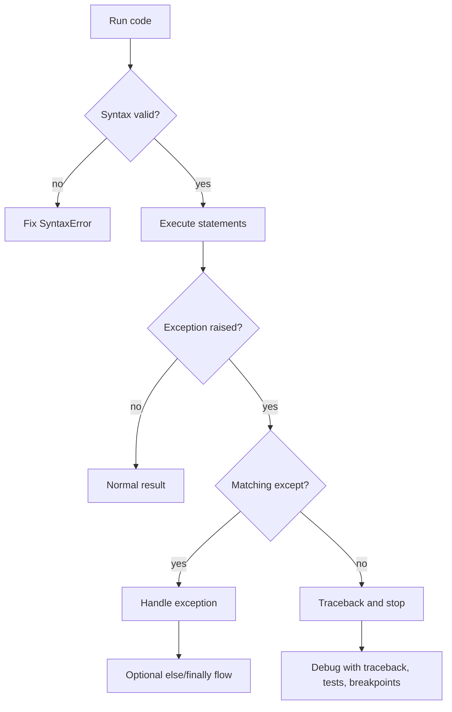

# Errors, Exceptions, and Debugging

Errors are not a side topic in programming; they are how a running program tells you which assumption failed. Halvorsen's textbook distinguishes syntax errors from exceptions, shows examples such as missing quotes and division by zero, and introduces `try`, `except`, and `finally`. It also has a short debugging chapter that frames debugging as the process of finding and resolving defects.

The practical goal is not to prevent every error message. The goal is to make failures local, understandable, and recoverable when recovery is possible. Syntax errors must be fixed before the program runs. Exceptions may indicate invalid input, missing files, unavailable resources, or programmer mistakes. Debugging is the disciplined process of reducing the distance between observed behavior and intended behavior.

## Parse failures, runtime failures, and tracebacks

A **syntax error** is invalid Python grammar. The interpreter cannot run the program until it is fixed:

```python
print("Hello"
```

An **exception** is an error detected while a syntactically valid program runs. Examples include `ZeroDivisionError`, `TypeError`, `ValueError`, `FileNotFoundError`, `KeyError`, and `IndexError`.

A **traceback** is the stack of calls that led to an exception. Read it from bottom for the exception type and message, then move upward to find which of your lines triggered the failure.

A **`try` block** contains code that may raise an exception. An **`except` block** handles selected exception types. An **`else` block** runs if no exception occurred. A **`finally` block** runs whether or not an exception occurred.

```python
try:
    value = float(text)
except ValueError:
    value = None
else:
    print("conversion succeeded")
finally:
    print("conversion attempted")
```

To **raise** an exception is to signal a failure explicitly:

```python
raise ValueError("window must be positive")
```

A **debugger** lets a programmer pause execution, inspect variables, step through code, and resume. Editors such as Spyder, VS Code, PyCharm, and Visual Studio provide integrated debuggers; Python also includes `pdb`.

## Catch only what can be handled

The first key result is that exception types matter. Catching bare `except:` hides too much, including programming mistakes and keyboard interrupts. Catch the narrow exception you expect:

```python
try:
    number = float(text)
except ValueError:
    ...
```

The second result is that exceptions should be handled at the level that can do something useful. A low-level parsing function may raise `ValueError`; a user-interface function may catch it and print a helpful message. Catching too early often loses context.

The third result is that `finally` is for cleanup, not ordinary success logic. Context managers often make `finally` unnecessary for files because `with` handles cleanup directly.

The fourth result is that `assert` is for internal sanity checks and tests, not user input validation in production code. Python can run with assertions disabled using optimization flags.

The fifth result is that debugging is faster when you can reproduce the failure. Capture the input, the expected behavior, the actual behavior, and the smallest code path that shows the issue. Random changes without a hypothesis waste time.

The sixth result is that logging is often better than scattered `print()` statements in larger programs. The standard `logging` module can include timestamps, severity levels, module names, and output destinations.

A seventh result is that an exception message should help the next person act. `ValueError("bad")` is technically an error, but `ValueError("window must be positive")` tells the caller what rule was violated. Include the invalid value when it is safe and useful, especially at boundaries such as command-line arguments or input files. Avoid messages that expose secrets such as passwords, tokens, or private data.

An eighth result is that debugging benefits from narrowing. If a script fails after reading a file, transforming data, plotting, and saving output, do not inspect all of it at once. First confirm that the file was read. Then confirm the parsed data shape. Then confirm the transformation on one row. Then confirm the plot input. Each confirmation reduces the search space. This is the same reason tests are valuable: they make assumptions executable.

Finally, not every exception should be recovered from. A command-line tool may catch invalid user input and show a friendly message. A library function should often raise a clear exception and let the caller decide. A program that silently "recovers" from corrupt data may produce a wrong answer, which is worse than stopping with a useful traceback.

Python exceptions form a class hierarchy. Catching `OSError` also catches subclasses such as `FileNotFoundError` and `PermissionError`; catching `Exception` covers most application failures but intentionally excludes control-flow exceptions such as `KeyboardInterrupt` and `SystemExit`, which inherit directly from `BaseException`. Ordering matters: put a specific handler before a broad parent handler or the specific one can never run.

The exception object carries structured information in addition to its message. `OSError` instances may expose `filename` and `errno`; custom exceptions can store domain fields. Code should branch on exception type or documented attributes, not parse human-readable message text that may change across versions or locales.

An `except` suite runs only for exceptions raised in its associated `try` suite. Exceptions raised inside the handler are new failures. The `else` suite is useful because it keeps successful follow-up code outside the protected region. If that follow-up fails, it is not mistaken for the narrow operation the handler was designed to recover from.

## Raising, translating, and chaining exceptions

Raise an exception at the point where an invariant is known to be violated. Use `ValueError` when an argument has the right general type but an unacceptable value, `TypeError` when an API explicitly checks an inappropriate type, and a domain-specific class when callers need to distinguish a business or protocol failure from built-in errors.

```python
class ConfigurationError(Exception):
    """Configuration is present but invalid."""

def positive_port(value: str) -> int:
    try:
        port = int(value)
    except ValueError as exc:
        raise ConfigurationError(f"invalid port {value!r}") from exc
    if not 1 <= port <= 65535:
        raise ConfigurationError(f"port out of range: {port}")
    return port
```

`raise ... from exc` records explicit causality. The traceback shows the low-level conversion failure and the configuration-level meaning. A bare `raise` inside a handler re-raises the current exception with its original traceback, useful after logging or partial cleanup. `raise ... from None` suppresses display of an irrelevant implementation detail, but should be used sparingly because hidden causes make diagnosis harder.

Custom exception hierarchies let a library offer one broad catch point and several precise ones. For example, `PackageError` can be the base for `ParseError` and `TransportError`. Callers that can retry transport failures catch the latter; callers that only need to add top-level context catch the base. Avoid defining a distinct class for every message when no caller will behave differently.

## EAFP, validation, and race conditions

Python code often follows “easier to ask forgiveness than permission”: attempt the operation and catch its expected failure. Looking before leaping can be clearer for cheap pure conditions, such as rejecting an empty list before division. For external state, checking first can be wrong because state changes between check and use. Testing whether a file exists and then opening it still permits deletion or permission changes in the gap. Opening directly and catching `FileNotFoundError` handles the actual operation.

Exception handling should not wrap routine success paths at extremely fine granularity without reason, nor should it replace clear conditionals. Dictionary `.get()` is clearer when absence is normal and a default is valid. A `KeyError` handler is clearer when lookup and use form one atomic idea or when computing a default would be expensive. The expected frequency and meaning of failure guide the choice.

Validation at an input boundary can improve messages, but repeating internal checks everywhere adds noise. Once a parser has converted and validated a record, downstream functions can rely on the documented type and invariants. Assertions can encode those internal assumptions during development. They cannot protect security, money, file integrity, or user input because optimized execution may remove them.

## From failure to a useful diagnosis



| Exception | Common cause | Better response |
|---|---|---|
| `ValueError` | Text cannot be converted to number | Ask again or reject record |
| `TypeError` | Operation on incompatible type | Fix caller or validate input |
| `KeyError` | Missing dictionary key | Use `.get()`, defaults, or validate schema |
| `IndexError` | Sequence index out of range | Check length or loop directly |
| `FileNotFoundError` | Missing path | Show path, create file, or fail clearly |
| `ZeroDivisionError` | Divisor is zero | Validate denominator |

Read a traceback from the final line upward. The final line names the exception and message. The frames above show calls from outermost to innermost; the last frame in code you control is often the immediate failure site. That line may only reveal the symptom. If `total / count` fails because `count` is zero, inspect where `count` was produced and which assumption allowed an empty collection.

Tracebacks preserve local line context but not every value. A debugger can stop on a raised exception before the stack unwinds. In `pdb`, `where` displays the stack, `up` and `down` move among frames, `p expression` evaluates an expression, `next` advances over a line, and `step` enters a call. `breakpoint()` invokes the configured debugger and is safer than scattering permanent prints through library code.

Logging should add information once, at the layer that owns it. If every layer logs the same exception and re-raises, one failure becomes a page of duplicate messages. `logging.exception()` inside a handler includes the traceback. At a command boundary, it may be appropriate to log an operational error and return a nonzero exit status; inside a reusable library, raising with context is usually enough.

## Worked example 1: handle invalid numeric input

Problem: ask for a temperature and convert it to Fahrenheit, but do not crash when the user types invalid text.

Initial code:

```python
text = input("Celsius: ")
celsius = float(text)
fahrenheit = celsius * 9 / 5 + 32
print(fahrenheit)
```

If the user enters `abc`, `float("abc")` raises `ValueError`.

Method:

1. Wrap only the risky conversion in `try`.
2. Catch `ValueError`.
3. Keep the successful calculation outside or in the `else` block.
4. Print a clear message for invalid input.

Work:

```python
text = input("Celsius: ")

try:
    celsius = float(text)
except ValueError:
    print(f"{text!r} is not a valid number")
else:
    fahrenheit = celsius * 9 / 5 + 32
    print(f"{fahrenheit:.1f} F")
```

Step-by-step for input `20`:

1. `float("20")` succeeds and returns `20.0`.
2. The `except` block is skipped.
3. The `else` block computes `68.0`.
4. Output is `68.0 F`.

Step-by-step for input `abc`:

1. `float("abc")` raises `ValueError`.
2. The `except ValueError` block runs.
3. The `else` block does not run.
4. Output is `'abc' is not a valid number`.

Checked answer: valid input calculates; invalid input is reported without a traceback.

## Worked example 2: debug an off-by-one error

Problem: a function should return the average of every three consecutive readings, but it misses the final window.

Buggy code:

```python
def moving_average(values):
    result = []
    for start in range(0, len(values) - 3):
        window = values[start:start + 3]
        result.append(sum(window) / 3)
    return result
```

For `values = [10, 20, 30, 40]`, expected windows are `[10, 20, 30]` and `[20, 30, 40]`, so expected averages are `[20.0, 30.0]`.

Method:

1. Print or inspect `start` values.
2. For length `4`, `range(0, len(values) - 3)` becomes `range(0, 1)`.
3. That produces only `0`.
4. The last valid start index is `len(values) - 3`, which is `1`.
5. Because `range` excludes the stop value, the stop must be `len(values) - 3 + 1`.

Fixed code:

```python
def moving_average(values):
    result = []
    for start in range(0, len(values) - 3 + 1):
        window = values[start:start + 3]
        result.append(sum(window) / 3)
    return result
```

Check:

1. For length `4`, range is `range(0, 2)`, producing `0` and `1`.
2. `start = 0` gives average `(10 + 20 + 30) / 3 = 20.0`.
3. `start = 1` gives average `(20 + 30 + 40) / 3 = 30.0`.

Checked answer: `[20.0, 30.0]`.

## A recovery policy at the batch boundary

```python
import logging

logging.basicConfig(level=logging.INFO, format="%(levelname)s: %(message)s")

def safe_mean(values):
    if not values:
        raise ValueError("cannot compute mean of empty data")
    return sum(values) / len(values)

datasets = [[1, 2, 3], [], [10, 20]]

for data in datasets:
    try:
        average = safe_mean(data)
    except ValueError as error:
        logging.warning("skipping dataset %r: %s", data, error)
    else:
        logging.info("mean of %r is %.2f", data, average)
```

The snippet uses explicit validation, a narrow exception handler, and logging with severity levels.

The loop is intentionally written so one bad dataset does not stop later datasets from being processed. That is a recovery policy, and it belongs at the level that owns the batch. The `safe_mean` function itself does not decide to skip anything; it raises a clear exception. This separation keeps the calculation honest and lets different callers choose different policies. A command-line report might skip bad input, while a test or scientific analysis might stop immediately.

## A repeatable debugging loop

Begin by making the failure deterministic. Save the exact input, random seed, environment, and command. State the expected result and observed result in concrete terms. “Sometimes wrong” is not yet a reproducible defect; “input X returns 14 instead of 15 on Python Y” is.

Reduce the case without changing the behavior. Remove unrelated files, columns, requests, or function calls. A minimal reproducer reveals which assumptions are essential and is easier to turn into a regression test. When the failure appeared after a known-good revision, binary search over changes can find the first bad version much faster than reading every intervening diff.

Form one hypothesis and choose an observation that can disprove it. If a moving window misses an item, inspect generated indices before rewriting the averaging code. If data become `None`, stop where the value first changes rather than adding guards at the final crash. Assertions, temporary logging, and conditional breakpoints are instruments for testing the hypothesis.

Once fixed, write a test that fails for the original bug and passes for the correction. Then remove diagnostic noise that no longer serves operations. A fix without a regression test can disappear during a later refactor, especially when the erroneous edge case looked harmless.

## Failure-handling mistakes

- Catching every exception with bare `except:` and hiding real bugs.
- Placing too much code inside `try`, making it unclear which operation failed.
- Printing an error but continuing with invalid data.
- Using `assert` for user-facing validation.
- Ignoring tracebacks instead of reading the bottom exception type and relevant file line.
- Debugging by changing many things at once. Change one hypothesis at a time.
- Swallowing exceptions in libraries that should let callers decide how to handle failure.
- Raising a replacement exception without chaining, which discards the low-level cause.
- Retrying every failure, including invalid input that will never succeed unchanged.
- Logging the same traceback at every layer before re-raising it.

<div className="see-also">

See also: [Files and Context Managers](/cs/programming/python/files-and-context-managers) · [Control Flow and Comprehensions](/cs/programming/python/control-flow-and-comprehensions) · [Testing and the Scientific Stack](/cs/programming/python/testing-and-scientific-stack) · [Standard Library Highlights](/cs/programming/python/standard-library-highlights)

</div>
