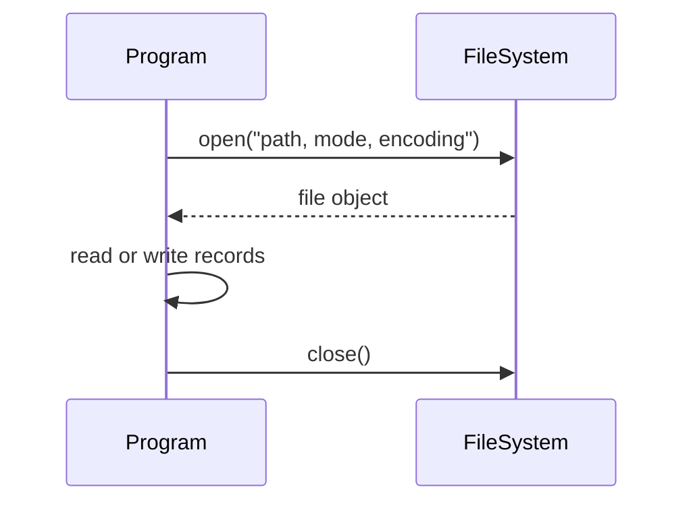

# Files and Context Managers

Files let Python programs persist data beyond one run. The textbook introduces the built-in `open()` function, file modes such as read, write, append, and create, and simple data logging examples. That is the right foundation, but modern Python code should add two habits immediately: use context managers with `with`, and prefer `pathlib.Path` for filesystem paths.

File handling is a boundary between a program and the outside world. That boundary can fail: a file may not exist, a directory may be missing, permissions may block access, data may have the wrong encoding, or a record may be malformed. Good file code is explicit about mode, encoding, expected format, and cleanup.

## Paths, streams, and modes

A **file object** is returned by `open()` and provides methods such as `.read()`, `.readline()`, `.write()`, and iteration over lines.

A **file mode** controls what operations are allowed:

```python
open("data.txt", "r")  # read text
open("data.txt", "w")  # write text, replacing existing content
open("data.txt", "a")  # append text
open("data.txt", "x")  # create new file, fail if it exists
open("image.png", "rb") # read binary
```

Text mode is the default, but specifying it can improve clarity. Binary mode uses bytes and is required for images, compressed files, and arbitrary binary data.

A **context manager** is an object used with `with` that sets up and tears down a resource reliably:

```python
with open("data.txt", "r", encoding="utf-8") as file:
    text = file.read()
```

When the block ends, the file is closed even if an exception occurs.

`pathlib.Path` is a standard library class for paths:

```python
from pathlib import Path

path = Path("logs") / "temperature.txt"
```

It avoids many platform-specific string path problems.

A **record** is one logical unit in a file, often one line in a text file. A **delimiter** separates fields inside a record, such as a comma in CSV.

## Text is decoded bytes

The first key result is that `with open(...)` should be the default pattern. Manual `close()` works in tiny examples, but it is easy to forget when exceptions occur. A context manager makes cleanup structural.

The second result is that file modes have consequences. Mode `"w"` truncates existing files. Mode `"a"` preserves existing content and writes at the end. Mode `"x"` is useful when overwriting would be a bug. A surprising number of data-loss mistakes come from using `"w"` casually.

The third result is that text needs an encoding. If no encoding is specified, Python uses a platform default. That can differ across machines. Use `encoding="utf-8"` for most modern text files unless a specific format requires something else.

The fourth result is that iteration over a file reads line by line and is memory efficient:

```python
with open("large.txt", encoding="utf-8") as file:
    for line in file:
        ...
```

Use `.read()` when the whole file is expected to be small and needed as one string.

The fifth result is that standard formats deserve standard parsers. Use `json` for JSON, `csv` for CSV, and `configparser` or `tomllib` for configuration formats where appropriate. Manual `.split(",")` is fine for controlled exercises but fails on quoted commas and escaped delimiters.

The sixth result is that paths and files should be validated at the boundary. Check whether a path exists when absence is expected, create directories when needed, and raise clear errors when input is invalid.

A seventh result is that file formats are contracts. A text file with one float per line is simple, but it cannot store units, timestamps, sensor names, or missing values without inventing extra conventions. CSV handles tables. JSON handles nested records. Plain text handles human-readable logs. Choosing a format is part of the design, not an afterthought. When another program will read the file, document or enforce the schema.

An eighth result is that file writes should be considered failure-prone. A disk can be full, a directory can be missing, or a file can be locked by another process. For important data, write to a temporary file and then replace the target, or use a database designed for transactional updates. That is beyond beginner exercises, but the habit begins with not ignoring exceptions from file operations.

Finally, keep parsing and computation separate. A reader function should convert file text into structured Python values. A calculation function should accept those values without knowing which file they came from. This makes it possible to test the calculation with in-memory sample data and test the parser with tiny fixture files.

At the operating-system boundary, files contain bytes. A text stream inserts an encoder and decoder between those bytes and Python `str` objects. Reading UTF-8 bytes as a legacy encoding may produce wrong characters without raising an error; reading invalid UTF-8 normally raises `UnicodeDecodeError`. An explicit encoding records the format assumption. The optional `errors` policy controls malformed input: `strict` fails, `replace` inserts replacement characters, and `ignore` discards bytes. Silent loss is rarely suitable for data pipelines.

Text mode also performs newline translation. Python presents line endings as `\n` under universal-newline reading even if a file used a platform-specific convention. For CSV, the module documentation recommends opening with `newline=""` so the CSV parser controls embedded and record newlines correctly. Binary mode performs neither decoding nor newline conversion; reads return `bytes`, writes require bytes-like values, and byte offsets have their literal meaning.

File objects maintain a current position. `.tell()` reports it and `.seek()` moves it, subject to restrictions of text streams where character encodings make arbitrary byte offsets unsafe. Sequential iteration is simpler and usually faster for large text. Seeking is useful for binary formats with explicit offsets or for rewinding a small stream, but a database or indexed format is better when random lookup dominates.

Writes are buffered. Returning from `.write()` does not necessarily mean bytes have reached physical storage. Closing or flushing pushes Python's buffer toward the operating system; `os.fsync()` can request stronger durability from the OS, though hardware and filesystem guarantees still vary. Most reports and caches do not need that cost. Data whose loss would be serious needs an explicit durability design rather than an assumption that `close()` is a transaction.

## What `with` actually guarantees

A context manager implements `__enter__` and `__exit__`. `with` calls `__enter__`, binds its result after `as`, and calls `__exit__` when control leaves the block by normal completion, `return`, or exception. If `__exit__` returns a truthy value, it suppresses the exception. Most resource managers return a false value so failures continue after cleanup.

The essential control flow is equivalent to a `try`/`finally`: acquire the resource, run the body, then release it. Context managers apply beyond files to locks, database transactions, temporary directories, redirected output, and numerical state. They express a bounded lifetime in the indentation of the program.

`contextlib.contextmanager` can build a manager from a generator. Code before `yield` acquires, the yielded value enters the block, and `finally` code releases:

```python
from contextlib import contextmanager

@contextmanager
def opened_utf8(path, mode="r"):
    file = path.open(mode, encoding="utf-8")
    try:
        yield file
    finally:
        file.close()
```

This wrapper is educational but redundant because file objects already implement the protocol. Custom managers earn their place when acquisition and cleanup form a domain operation that cannot be expressed by an existing manager. `ExitStack` helps when the number of resources is determined dynamically; it closes them in reverse acquisition order.

## The lifetime of an open file



| Mode | Meaning | Creates file? | Existing content | Typical use |
|---|---|---:|---|---|
| `"r"` | read | no | preserved | read input |
| `"w"` | write | yes | replaced | generate output |
| `"a"` | append | yes | preserved | logs |
| `"x"` | exclusive create | yes | error if exists | avoid overwrite |
| `"rb"` | read binary | no | preserved | images or binary data |
| `"wb"` | write binary | yes | replaced | generated binary output |

## Paths and filesystem boundaries

`Path` joins components with `/`, exposes names and suffixes, and offers methods such as `.exists()`, `.mkdir()`, `.iterdir()`, `.read_text()`, and `.write_text()`. The convenience read/write methods open and close automatically, making them suitable for small whole-file operations. Streaming still needs an explicit `open()` block.

Relative paths are resolved against the process's current working directory, not automatically against the source file. A script launched from an editor and the same script launched from another directory can therefore find different files. Configuration should define whether a path is relative to the working directory, a project root, a user-data directory, or the module location. Hiding that decision behind repeated `chdir()` calls makes behavior difficult to reason about.

Checking `.exists()` before opening is useful for user-interface choices but does not guarantee the later operation: another process can remove or replace the path between calls. Attempt the operation and handle the expected exception when correctness depends on it. Similar races affect “check then create”; mode `x` asks the filesystem to perform exclusive creation as one operation.

Paths received from users are also trust-boundary data. Joining an upload name such as `../settings.ini` to a destination may escape the intended directory. Code that writes untrusted names should reject traversal, generate its own storage name, or resolve and verify containment according to a well-defined policy. Symlinks add another layer, so security-sensitive code needs operating-system-aware handling rather than a string-prefix test.

## Choosing a format

| Format | Strength | Limitation | Suitable use |
|---|---|---|---|
| Plain lines | Human-readable and streamable | Schema is implicit | one value or event per line |
| CSV | Interoperable tables | Types and nested data are weak | rectangular records |
| JSON | Named and nested values | No comments; numbers and dates need conventions | configuration and exchange records |
| Binary format | Compact and exact types | Requires a specified decoder | images, arrays, protocol payloads |

CSV should be handled with `csv`, because quoting allows delimiters and line breaks inside a field. JSON should be handled with `json`, which validates syntax and escapes strings. Neither format validates the intended schema by itself. A successful parse can still lack required fields, contain an unexpected unit, or use a string where the program expects a number. Parsing turns bytes into generic Python values; validation turns those values into trusted application data.

## Worked example 1: write and read a small log

Problem: write temperature readings to a text file, one reading per line, then read them back as floats.

Method:

1. Choose a path.
2. Open the file for writing with UTF-8.
3. Write each numeric value as text followed by newline.
4. Open the file for reading.
5. Strip each line and convert to `float`.
6. Check that the read values match the original values.

Work:

```python
from pathlib import Path

path = Path("temperature_log.txt")
readings = [21.5, 22.0, 20.75]

with path.open("w", encoding="utf-8") as file:
    for value in readings:
        file.write(f"{value}\n")

loaded = []
with path.open("r", encoding="utf-8") as file:
    for line in file:
        loaded.append(float(line.strip()))
```

Step-by-step:

1. The first `with` block opens the file and guarantees closure.
2. The loop writes:

```text
21.5
22.0
20.75
```

3. The second `with` block reads one line at a time.
4. `line.strip()` removes the newline.
5. `float(...)` converts the text to a number.

Checked answer:

```python
loaded == [21.5, 22.0, 20.75]
```

The values survive a write-read cycle.

## Worked example 2: write structured data as JSON

Problem: save experiment metadata and readings in a format that preserves structure better than plain lines.

Method:

1. Represent the data as dictionaries and lists.
2. Use the `json` module instead of manual formatting.
3. Write with indentation for readability.
4. Read the file back and check fields.

Work:

```python
import json
from pathlib import Path

data = {
    "experiment": "heating-test",
    "unit": "C",
    "readings": [21.5, 22.0, 20.75],
}

path = Path("experiment.json")
with path.open("w", encoding="utf-8") as file:
    json.dump(data, file, indent=2)

with path.open("r", encoding="utf-8") as file:
    loaded = json.load(file)
```

Step-by-step:

1. `json.dump` converts Python dictionaries, lists, strings, and numbers to JSON text.
2. `indent=2` makes the file easier for humans to inspect.
3. `json.load` parses the text back into Python objects.
4. `loaded["unit"]` is `"C"`.
5. `loaded["readings"][1]` is `22.0`.

Checked answer:

```python
loaded["experiment"] == "heating-test"
sum(loaded["readings"]) / len(loaded["readings"]) == 21.416666666666668
```

The structure is explicit, so a later script does not have to guess which line means unit and which line means data.

## A typed CSV boundary

```python
import csv
from pathlib import Path

def write_readings_csv(path, rows):
    with path.open("w", newline="", encoding="utf-8") as file:
        writer = csv.DictWriter(file, fieldnames=["time_s", "temp_c"])
        writer.writeheader()
        writer.writerows(rows)

def read_readings_csv(path):
    with path.open("r", newline="", encoding="utf-8") as file:
        reader = csv.DictReader(file)
        return [
            {"time_s": int(row["time_s"]), "temp_c": float(row["temp_c"])}
            for row in reader
        ]

path = Path("readings.csv")
rows = [{"time_s": 0, "temp_c": 21.5}, {"time_s": 10, "temp_c": 22.0}]
write_readings_csv(path, rows)
print(read_readings_csv(path))
```

The `csv` module handles delimiters and newlines more reliably than manual string concatenation.

This code also separates serialization from calculation. The writer receives rows that are already structured, and the reader returns rows with corrected types. A later average-temperature function should not need to know that the data came from CSV. That separation is what makes the file layer replaceable: the same calculation could be fed by JSON, a database query, or a hard-coded test list. Good file code turns external bytes into internal values and back again with as little hidden policy as possible.

## Replacing a file without exposing a partial write

Opening an important target with `w` truncates it before new content is complete. If serialization fails halfway or the process stops, the old valid file is gone and the new one is partial. A safer pattern writes a temporary file in the same directory, flushes and closes it, then replaces the target with `os.replace()`. Same-filesystem replacement is atomic on mainstream local filesystems, meaning readers see either old or new name content rather than half a rename. Durability across power loss is a separate concern.

```python
import json
import os
import tempfile
from pathlib import Path

def write_json_atomic(path: Path, value) -> None:
    path.parent.mkdir(parents=True, exist_ok=True)
    fd, temporary_name = tempfile.mkstemp(dir=path.parent, prefix=path.name)
    temporary = Path(temporary_name)
    try:
        with os.fdopen(fd, "w", encoding="utf-8") as file:
            json.dump(value, file, indent=2)
            file.write("\n")
            file.flush()
            os.fsync(file.fileno())
        os.replace(temporary, path)
    except BaseException:
        temporary.unlink(missing_ok=True)
        raise
```

Creating the temporary file in the target directory keeps replacement on the same filesystem. The exclusive temporary-file creation avoids a predictable-name race. The cleanup re-raises the original failure after removing a leftover. Applications with concurrent writers, network filesystems, or strict crash-durability requirements need stronger coordination or a transactional store.

## File-handling mistakes

- Forgetting to close files when not using `with`.
- Using `"w"` and accidentally erasing a file that should have been appended to.
- Reading an entire large file into memory when line-by-line iteration would be safer.
- Omitting `encoding="utf-8"` and getting platform-specific behavior.
- Splitting CSV lines manually even though quoted fields can contain commas.
- Building paths with string concatenation instead of `Path` or `os.path.join`.
- Catching file errors and silently continuing, which hides missing input data.
- Treating `flush()` as a full transactional or hardware-durability guarantee.
- Checking existence and assuming a later open cannot race with another process.
- Loading valid JSON or CSV and skipping application-level schema validation.

## Related pages

- [Strings and Text Processing](/cs/programming/python/strings-and-text-processing)
- [Errors, Exceptions, and Debugging](/cs/programming/python/errors-exceptions-and-debugging)
- [Modules, Packages, and Environments](/cs/programming/python/modules-packages-and-environments)
- [Standard Library Highlights](/cs/programming/python/standard-library-highlights)
