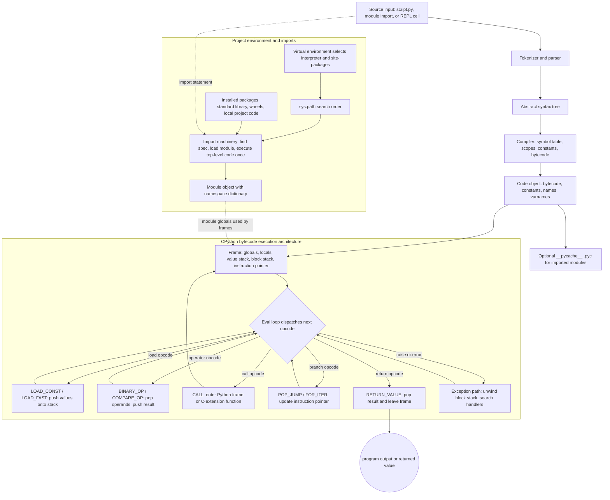

# Python Programming

These notes begin with Hans-Petter Halvorsen's *Python Programming* (2019; copyright text dated August 12, 2020; ISBN `978-82-691106-4-7`). It is an introductory text: motivation and setup lead into first scripts, variables, packages, plotting, control flow, functions, classes, modules, files, errors, debugging, environments, editors, and a short scientific-computing section.

The same sequence remains useful, with a few additions needed for larger scripts: virtual environments, context managers, comprehensions, decorators, dataclasses, iterators, `pathlib`, testing, and the scientific stack. The source supplies the beginner path; the added material connects it to current project habits.

## From source text to a running program

**Python** is a high-level, general-purpose language used for scripting, scientific computing, simulation, web and database work, and education. An implementation executes Python programs; CPython, the reference implementation assumed in most of these notes, first compiles source to bytecode and then interprets that bytecode.

Interactive mode provides a REPL with the `>>>` prompt. Script mode runs a `.py` file. Editors and IDEs—IDLE, Visual Studio Code, Spyder, PyCharm, Wing, and Jupyter among them—sit around those same execution modes, adding facilities such as debugging, project navigation, terminals, notebooks, and interpreter selection.

A **module** is an importable unit, commonly a Python file. A **package** groups modules under a shared import namespace. The standard library supplies modules such as `math`; NumPy, SciPy, Matplotlib, and pandas are separately installed distributions that expose importable packages.

An **environment** is the selected interpreter together with the packages available to it. The source discusses the official distribution, Anaconda, pip, Conda, and virtual environments. Environment management belongs near the start because many apparent code errors are really interpreter or package-selection errors.

The runtime path below joins the language pipeline to imports and environments. Source becomes an abstract syntax tree and then a code object. Frames execute its bytecode, while imported modules contribute namespace dictionaries used as globals.



## The textbook's route from setup to scientific work

The extracted table of contents moves from immediate use toward program structure, then returns to tools and mathematical applications.

| Part | Chapters | Main topics |
|---|---|---|
| I. Getting Started with Python | 1-4 | Introduction, what Python is, installation, editors, first scripts, variables, built-ins, standard library, packages, plotting |
| II. Python Programming | 5-12 | `if`, loops, arrays, functions, classes, modules, files, error handling, debugging, package installation |
| III. Python Environments and Distributions | 13-15 | Environments, pip, Conda, virtual environments, Anaconda, Enthought Canopy |
| IV. Python Editors | 16-22 | Python editors, Spyder, Visual Studio Code, Visual Studio, PyCharm, Wing Python IDE, Jupyter Notebook |
| V. Python for Mathematics Applications | 23 | Basic math functions, statistics, trigonometric functions, polynomials |
| VI. Resources | 24 | Distributions, libraries, editors, tutorials, Visual Studio resources |
| VII. Solutions to Exercises | final section | Exercise solutions |

Small exercises drive that progression: print a message, assign variables, compute a formula, import a module, plot values, loop over data, define functions, create classes, write files, and handle exceptions. Reading can establish vocabulary, but execution and correction build the skill.

Python's compact syntax does not remove constraints. Names need no declarations, but values still have types. Blocks use no braces, but indentation is syntax. Users do not run a separate compiler command in the usual workflow, but syntax, import, type, and runtime errors still carry precise information.

External libraries are central rather than peripheral. The language core stays relatively small while packages extend it into numerical work, plotting, data analysis, web development, and other domains. Imports, environment isolation, and package installation are therefore basic fluency.

## Topic map for a modern first pass

| Notes page | Primary source connection | Added emphasis |
|---|---|---|
| [Setup, REPL, and Environments](/cs/programming/python/setup-repl-and-environments) | Chapters 2-3, 12-13 | Virtual-environment workflow and interpreter diagnostics |
| [Syntax, Variables, and Types](/cs/programming/python/syntax-variables-and-types) | Chapter 4 | Mutability, truthiness, aliasing, and naming practice |
| [Operators and Expressions](/cs/programming/python/operators-and-expressions) | Chapters 4-5 | Precedence, identity versus equality, modulo use |
| [Control Flow and Comprehensions](/cs/programming/python/control-flow-and-comprehensions) | Chapter 5 | Idiomatic loops, `enumerate`, comprehensions |
| [Strings and Text Processing](/cs/programming/python/strings-and-text-processing) | Chapter 4 | Formatting, parsing, encoding, raw strings |
| [Containers and Idioms](/cs/programming/python/containers-and-idioms) | Chapter 5 | Lists, tuples, sets, dictionaries, idiomatic iteration |
| [Functions, Arguments, and Decorators](/cs/programming/python/functions-arguments-and-decorators) | Chapter 6 | Defaults, closures, lambdas, decorators, type hints |
| [Modules, Packages, and Environments](/cs/programming/python/modules-packages-and-environments) | Chapters 8, 12-13 | Import design, package isolation, dependency confusion |
| [Files and Context Managers](/cs/programming/python/files-and-context-managers) | Chapter 9 | `with`, `pathlib`, JSON and CSV basics |
| [Errors, Exceptions, and Debugging](/cs/programming/python/errors-exceptions-and-debugging) | Chapters 10-11 | Narrow exception handling, traceback reading, logging |
| [Classes, OOP, and Dataclasses](/cs/programming/python/classes-oop-and-dataclasses) | Chapter 7 | Dunder methods, properties, inheritance, dataclasses |
| [Iterators, Generators, and Functional Tools](/cs/programming/python/iterators-generators-and-functional-tools) | Chapters 5-6 foundation | `yield`, lazy pipelines, `itertools`, `functools` |
| [Standard Library Highlights](/cs/programming/python/standard-library-highlights) | Chapters 4, 9, 23 foundation | `pathlib`, `collections`, `datetime`, `json`, `re` |
| [Concurrency Overview](/cs/programming/python/concurrency-overview) | Beyond main source scope | Threading, multiprocessing, and `asyncio` orientation |
| [Testing and the Scientific Stack](/cs/programming/python/testing-and-scientific-stack) | Exercises and Chapter 23 | `unittest`, pytest basics, NumPy, pandas, Matplotlib |

Several workflows are legitimate. The official installer and IDLE are enough for first programs; Anaconda and Spyder suit numerical exploration; Visual Studio Code and PyCharm help with larger projects; Jupyter combines code, equations, plots, and narrative analysis. The important invariant is knowing which interpreter holds the current state and installed packages.

## A first project path: logging and plotting data

A new programmer building a simple data logger can postpone decorators, dataclasses, concurrency, and advanced iterators. The necessary route is shorter:

1. Use [Setup, REPL, and Environments](/cs/programming/python/setup-repl-and-environments) to run Python, recognize the REPL, and execute a `.py` script.
2. Read [Syntax, Variables, and Types](/cs/programming/python/syntax-variables-and-types) for numbers, strings, names, and conversion from text input.
3. Continue with [Operators and Expressions](/cs/programming/python/operators-and-expressions) for arithmetic, comparisons, unit conversions, and time calculations.
4. Add [Control Flow and Comprehensions](/cs/programming/python/control-flow-and-comprehensions) so the logger can repeat readings and reject bad data.
5. Use [Containers and Idioms](/cs/programming/python/containers-and-idioms) to hold readings in lists or dictionaries.
6. Read [Files and Context Managers](/cs/programming/python/files-and-context-managers) for safe writes and later reads.
7. Finish with the NumPy and Matplotlib orientation in [Testing and the Scientific Stack](/cs/programming/python/testing-and-scientific-stack).

If each record contains elapsed time and temperature, named fields preserve more information than a line of bare numbers:

```python
rows = [
    {"time_s": 0, "temp_c": 21.5},
    {"time_s": 10, "temp_c": 22.0},
]
```

CSV is suitable for that two-column structure. Keep writing and reading in separate functions, convert strings to `int` and `float` at the file boundary, and verify a round trip with a small sample:

```python
def round_trip_ok(write_func, read_func, path, rows):
    write_func(path, rows)
    loaded = read_func(path)
    return loaded == rows
```

## Diagnosing the active interpreter

Editor and installation problems often reduce to running a different Python from the one that received the package installation. This short diagnostic records the executable, version, platform, and working directory selected by the current process:

```python
import platform
import sys
from pathlib import Path

def python_study_snapshot():
    return {
        "executable": sys.executable,
        "version": sys.version.split()[0],
        "platform": platform.platform(),
        "working_directory": str(Path.cwd()),
    }

if __name__ == "__main__":
    for key, value in python_study_snapshot().items():
        print(f"{key}: {value}")
```

## Habits that prevent early confusion

- Treat old version numbers as historical context, not an instruction to reproduce the source environment. The book names Python 3.7.0 because it was current when written; the stable Python 3 concepts matter more.
- Run examples and change them. Passive reading hides indentation, import, state, and type errors.
- Identify the active interpreter before debugging `ModuleNotFoundError` or reinstalling packages.
- REPL sessions, notebook kernels, and scripts hold state differently. Restarting or rerunning them can produce different results when earlier definitions are implicit.
- Learn how imports and package managers relate instead of memorizing library names.
- Variables, functions, loops, containers, and files should feel routine before advanced language machinery.
- A plot or printout is evidence, not a correctness proof. Small assertions and tests catch boundary cases that output inspection misses.

<div className="see-also">

See also: [Setup, REPL, and Environments](/cs/programming/python/setup-repl-and-environments) · [Syntax, Variables, and Types](/cs/programming/python/syntax-variables-and-types) · [Files and Context Managers](/cs/programming/python/files-and-context-managers) · [Errors, Exceptions, and Debugging](/cs/programming/python/errors-exceptions-and-debugging) · [Testing and the Scientific Stack](/cs/programming/python/testing-and-scientific-stack)

</div>
