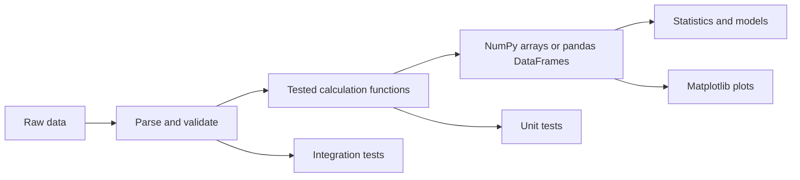

# Testing and the Scientific Stack

Testing and scientific computing sit at different ends of many Python courses, but they reinforce each other. Testing asks whether code behaves as intended. Scientific computing asks Python to calculate, transform, and visualize data correctly. The bridge between them is a collection of small calculations with explicit inputs, checkable outputs, and recorded assumptions.

The most important habit is to separate calculation from presentation. A function that returns a result can be tested. A plotting function that depends on a tested calculation is easier to trust. A data-analysis notebook that uses small tested helpers is more reproducible than one long sequence of manually edited cells.

## What a test establishes

A **test** is code that checks other code. A test usually arranges input, calls the unit under test, and asserts the expected result.

`unittest` is Python's standard library testing framework. It uses test classes and assertion methods:

```python
import unittest

class TestMath(unittest.TestCase):
    def test_addition(self):
        self.assertEqual(2 + 3, 5)
```

`pytest` is a popular third-party testing framework. It can run simple test functions with plain `assert` statements:

```python
def test_addition():
    assert 2 + 3 == 5
```

A **unit test** checks a small piece, such as one function. An **integration test** checks several pieces working together, such as file parsing plus calculation.

NumPy provides efficient arrays and numerical functions. pandas provides labeled tabular data structures such as `DataFrame`. Matplotlib provides plotting. SciPy provides scientific algorithms for optimization, integration, signal processing, interpolation, and more. These packages are third-party libraries, often installed through Anaconda, Conda, or `pip`.

A **vectorized** operation applies an operation to many values using optimized array code rather than a Python loop.

A **fixture** in testing is setup data or resources used by tests. In pytest, fixtures can be functions decorated with `@pytest.fixture`.

## Test behavior, not implementation details

The first key result is that tests should be deterministic. A test should not depend on the current time, random data, network availability, or a file left over from a previous run unless those dependencies are controlled.

The second result is that floating-point tests need tolerances. Decimal-looking values often have binary approximations. Instead of checking exact equality for computed floats, use `math.isclose`, `pytest.approx`, or NumPy testing helpers.

The third result is that small pure functions are the easiest to test. A function that accepts data and returns data can be tested without files, user input, plots, or global state.

The fourth result is that NumPy arrays change the way code should be written. Instead of looping over every element in Python, write array expressions:

```python
fahrenheit = celsius * 9 / 5 + 32
```

where `celsius` may be an entire NumPy array.

The fifth result is that pandas is for labeled table operations, not a replacement for every list of dictionaries. It shines when data has columns, missing values, grouping, joins, time indexes, and export/import needs.

The sixth result is that plots are outputs, not proofs. A plot can reveal a problem, but tested calculations and clear data transformations are what make the result defensible.

A seventh result is that tests should cover boundaries from the domain, not just from the code. Temperature conversion has known reference points such as freezing and boiling water. A parser has empty input, malformed input, and valid input with extra whitespace. A statistical function has one value, repeated values, negative values, and sometimes missing data. Good test cases come from what the program means, not only from which branches appear in the implementation.

An eighth result is that scientific libraries reward vector thinking. If a calculation is naturally "apply this formula to every value," an array expression is usually clearer and faster than a Python loop. If the operation is "group rows by label and compute a summary," pandas may express it directly. If the task is a small teaching example, a plain list may still be best. Choose the tool by the shape of the data and the question being asked.

Finally, reproducibility is more than a passing test. Record package dependencies, keep raw data separate from derived data, make notebooks restartable from a clean kernel, and avoid hidden manual steps. A result that cannot be rerun is hard to trust, even when the code looked correct once.

A test is an executable claim about behavior. Good tests fail when that claim is broken and remain stable when the implementation is refactored without changing behavior. Testing a private loop counter or exact sequence of helper calls couples the suite to current structure. Testing the returned values, raised exceptions, written records, or public state protects the contract.

Unit and integration tests fail differently. A pure numerical function can be checked against hand calculations in milliseconds. A file-to-report integration test checks that parsing, validation, calculation, and serialization agree, but a failure has a larger search area. A useful suite has many narrow checks and a smaller number of boundary-spanning checks. End-to-end tests then cover a few critical user paths rather than every numerical corner.

Parametrization keeps a family of examples together:

```python
import pytest

@pytest.mark.parametrize(
    ("celsius", "fahrenheit"),
    [(0, 32), (100, 212), (-40, -40)],
)
def test_c2f_reference_points(celsius, fahrenheit):
    assert c2f(celsius) == fahrenheit
```

The three cases remain independently reported. A fixture is appropriate when setup has a lifecycle or is reused, such as a temporary directory, database connection, or representative dataframe. Local literal inputs are clearer than a fixture used by only one small test. Fixture scope also matters: sharing mutable data across tests can make results depend on execution order.

Some functions are better checked by properties than by a long list of outputs. A temperature round trip should return the starting value within tolerance. Sorting twice should equal sorting once. Normalized nonnegative weights should sum to one. These invariants cover many possible inputs and expose mistaken assumptions. Property-based testing libraries can generate cases, but ordinary parametrized tests already capture many domain properties.

## Numerical equality and error budgets

Floating-point tolerance must reflect the calculation, not merely silence a failure. `math.isclose(a, b, rel_tol=r, abs_tol=s)` accepts values when

$$
|a-b|\le\max(r\max(|a|,|b|),s).
$$

Relative tolerance scales with magnitude. Absolute tolerance matters near zero, where any nonzero difference has large relative error. Array helpers such as `numpy.testing.assert_allclose` report mismatched elements and use both tolerances. The chosen values should come from algorithmic error, input precision, and expected platform variation.

NaN requires deliberate handling because it is unequal to itself. A test that expects missing output should check `np.isnan`; a comparison helper may offer an `equal_nan` option. Infinity may be legitimate for a mathematical limit or evidence of overflow. Tests should distinguish those meanings instead of accepting all non-finite values.

Exact equality remains correct for integers, strings, shapes, category labels, and results whose algorithm promises exact representation. It is also appropriate for certain floating operations with exact expected bit patterns, but broad numerical pipelines rarely have that promise. Rounding both sides before comparison changes the quantities and can hide errors near rounding boundaries; tolerance checks state the intended error bound more directly.

## A testable scientific workflow



| Tool | Install status | Best for | Example |
|---|---|---|---|
| `unittest` | standard library | Built-in test suites | `python -m unittest` |
| `pytest` | third-party | Concise tests and fixtures | `pytest` |
| NumPy | third-party | Numeric arrays | `np.array([1, 2, 3])` |
| pandas | third-party | Tables and labeled data | `pd.DataFrame(...)` |
| Matplotlib | third-party | Plots | `plt.plot(x, y)` |
| SciPy | third-party | Scientific algorithms | optimization, integration |

## NumPy arrays: shape, dtype, and broadcasting

NumPy speed comes from dense typed arrays and compiled loops. Every array has a shape, a data type, and strides describing how indices map to memory. Those properties are part of a numerical function's contract. An operation can produce numerically plausible but wrong output when broadcasting aligns an unintended axis.

For arrays shaped $(n,1)$ and $(n,)$, subtraction produces an $(n,n)$ result: the trailing dimensions differ as 1 versus $n$, so NumPy expands both. Reshaping both to $(n,)$ for paired scalars or both to $(n,1)$ for column vectors avoids the outer difference. Tests should assert output shape before checking values when shape errors are dangerous.

Data type also changes results. Integer arrays cannot represent fractions; fixed-width integers overflow according to their type; `float32` has less precision and range than `float64`. NumPy often promotes mixed operands, but in-place operations may attempt to cast back to the original dtype. Constructing measured data with `dtype=float` is a useful explicit choice when later calculations divide or store missing values.

Slicing generally returns a view that shares memory, while advanced indexing commonly returns a copy. Mutating a view can change the source array unexpectedly. `np.shares_memory` can diagnose uncertain cases, and `.copy()` makes isolation explicit. Tests that reuse one array fixture should return a fresh copy if the function under test mutates its input.

Vectorization removes Python-loop overhead, but it can allocate large temporary arrays. An expression that combines several full-size intermediates may exhaust memory even though each operation is fast. Chunking, in-place operations where safe, or a library routine that fuses work can be better. Measure real array sizes rather than assuming vectorized always means efficient.

## pandas and labeled alignment

pandas aligns `Series` and `DataFrame` operations by labels, not merely by row position. Adding two series with different indexes creates the union of labels and missing values where one side is absent. That behavior is powerful for time series and joins, yet it surprises code that expected element-by-element positional arithmetic. Reset, validate, or deliberately align indexes at data boundaries.

Missing values complicate type and aggregation behavior. Many reductions skip missing values by default, so a mean can be computed from fewer observations than expected. Tests should cover all-missing groups, duplicated keys, absent columns, and unexpected categories. Schema validation before a long transformation produces a clearer failure than a later `KeyError` or silent coercion.

Chained indexing can operate on a temporary object and lead to ambiguous assignment. `.loc` expresses row and column selection in one operation. A transformation pipeline is easier to inspect when each step has a named input/output contract and when row counts, unique keys, units, and ranges are asserted at important boundaries.

## Worked example 1: test a conversion function

Problem: test a Celsius-to-Fahrenheit function with known reference values and a round trip.

Function:

```python
def c2f(celsius):
    return celsius * 9 / 5 + 32

def f2c(fahrenheit):
    return (fahrenheit - 32) * 5 / 9
```

Method using pytest:

1. Write test functions whose names begin with `test_`.
2. Check exact values that are exactly representable enough for this formula.
3. Use an approximate check for round trips.

Tests:

```python
import pytest

def test_c2f_reference_points():
    assert c2f(0) == 32
    assert c2f(100) == 212

def test_round_trip_body_temperature():
    assert f2c(c2f(37)) == pytest.approx(37)
```

Step-by-step:

1. `c2f(0)` computes `0 * 9 / 5 + 32 = 32`.
2. `c2f(100)` computes `100 * 9 / 5 + 32 = 212`.
3. `c2f(37)` gives `98.6`.
4. `f2c(98.6)` mathematically gives `37`.
5. `pytest.approx(37)` allows tiny floating-point error.

Checked answer: all tests should pass. If the formula accidentally used `5 / 9` in `c2f`, the reference tests would fail immediately.

## Worked example 2: compute and plot an array transformation

Problem: convert several Celsius readings to Fahrenheit, compute the mean, and prepare a plot.

Data:

```python
celsius = [0, 10, 20, 30]
```

Method:

1. Convert the list to a NumPy array.
2. Apply the formula once to the whole array.
3. Compute the mean using NumPy.
4. Plot Celsius vs Fahrenheit with Matplotlib.

Work:

```python
import numpy as np
import matplotlib.pyplot as plt

celsius = np.array([0, 10, 20, 30], dtype=float)
fahrenheit = celsius * 9 / 5 + 32
average_f = fahrenheit.mean()

plt.plot(celsius, fahrenheit, marker="o")
plt.xlabel("Celsius")
plt.ylabel("Fahrenheit")
plt.title("Temperature conversion")
```

Step-by-step:

1. `np.array` creates a numeric array: `[0., 10., 20., 30.]`.
2. The multiplication and addition are vectorized.
3. Results:

$$
\begin{aligned}
0^\circ C &\to 32^\circ F \\
10^\circ C &\to 50^\circ F \\
20^\circ C &\to 68^\circ F \\
30^\circ C &\to 86^\circ F
\end{aligned}
$$

4. The mean is:

$$
\begin{aligned}
(32 + 50 + 68 + 86) / 4 &= 236 / 4 \\
                       &= 59
\end{aligned}
$$

Checked answer:

```python
fahrenheit.tolist() == [32.0, 50.0, 68.0, 86.0]
average_f == 59.0
```

The plot should be a straight line because the conversion formula is linear.

## Testing a small numerical helper

```python
from math import isclose

def mean(values):
    if not values:
        raise ValueError("values must not be empty")
    return sum(values) / len(values)

def test_mean_regular_values():
    assert mean([10, 20, 30]) == 20

def test_mean_float_values():
    assert isclose(mean([0.1, 0.2, 0.3]), 0.2, rel_tol=1e-12)

def test_mean_empty_values():
    try:
        mean([])
    except ValueError as error:
        assert "empty" in str(error)
    else:
        raise AssertionError("mean([]) should raise ValueError")
```

This code is written so it can be run by pytest as plain test functions, while using only the standard library.

When converting this style to a larger project, keep tests close to the behavior they protect. A `tests/` directory can mirror the source layout, with test files named after modules. Use small fixtures for representative data instead of depending on large local files. For scientific work, store expected values that can be checked independently, such as hand-calculated reference points or values from a trusted source. The goal is not to test Python or NumPy themselves; it is to test your assumptions, formulas, parsing rules, and data transformations.

## Randomness, plots, and reproducibility

Randomized algorithms need controlled generators. NumPy's `default_rng(seed)` produces a local generator rather than mutating process-wide random state. Tests can pass a seeded generator or test statistical properties over a sufficiently large deterministic sample. A test should not demand one exact sample sequence unless that sequence is part of the contract; algorithm implementations can change while remaining statistically correct.

Plots are best tested below the pixel level. Verify the data sent to the plot, axis labels, number of lines, or that saving creates a nonempty output. Exact image comparisons are useful for stable rendering components but can be brittle across library versions, fonts, and platforms. Visual review still matters for communication: a correct array can be plotted with a misleading axis, clipped label, or inappropriate scale.

Notebook reproducibility requires execution from a clean kernel in top-to-bottom order. Hidden state appears when a cell depends on a variable created by an earlier run but no longer by preceding cells. Move reusable calculations into modules, keep notebook cells focused on orchestration and explanation, and run the complete notebook before publishing results.

Dependencies are part of the experiment. Record Python and package versions in an environment file or project metadata, and store raw data or a stable retrieval description separately from derived artifacts. A seed controls pseudorandomness but does not guarantee identical parallel floating-point reductions or identical results across library versions and hardware.

## Testing mistakes in numerical code

- Testing only the "happy path" and skipping invalid input, empty data, and boundary values.
- Comparing computed floats with exact equality when a tolerance is needed.
- Letting tests depend on files in the current working directory without creating them in the test.
- Mixing calculation, printing, plotting, and input in one function, which makes testing difficult.
- Installing NumPy or pandas into one environment and running the notebook or script in another.
- Using pandas for tiny problems where a list of dictionaries or `csv` is simpler.
- Trusting a plot without checking the underlying data transformation.
- Choosing a loose tolerance only after seeing a test fail, without an error budget.
- Ignoring array shape because broadcasting produced an output without raising.
- Reusing mutable fixtures so one test contaminates another.
- Letting a notebook depend on out-of-order cell execution.

## Related pages

- [Functions, Arguments, and Decorators](/cs/programming/python/functions-arguments-and-decorators)
- [Errors, Exceptions, and Debugging](/cs/programming/python/errors-exceptions-and-debugging)
- [Modules, Packages, and Environments](/cs/programming/python/modules-packages-and-environments)
- [Standard Library Highlights](/cs/programming/python/standard-library-highlights)
