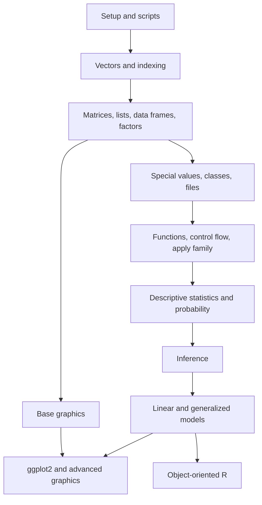

# R

R is a language for programming with data and an environment for statistics, graphics, simulation, and modeling. Tilman M. Davies's *The Book of R* develops those parts in a deliberate order: the language first, then programming structures, probability and statistics, statistical modeling, and richer graphics.

The course follows the same arc. Interactive console work and scripts lead into vectors, matrices, lists, data frames, factors, files, functions, apply-style iteration, descriptive statistics, probability distributions, inference, regression, generalized models, object-oriented behavior, and plotting systems.

## The objects an R analysis is built from

**R** evaluates expressions interactively, binds objects in environments, and ships with libraries for data manipulation, probability, modeling, and graphics. **Base R** refers to the language and packages distributed with R itself. Davies uses a base-R-first approach so that data structures and evaluation rules are understood before contributed packages enter the workflow.

**CRAN**, the Comprehensive R Archive Network, is the main distribution network for R and contributed packages. Packages such as `ggplot2`, spreadsheet readers, and 3D graphics tools are installed from CRAN or another repository and attached with `library()` when their exported names are needed.

A **script** is a saved `.R` file whose commands can be rerun. Scripts give an analysis a reproducible order; console history and saved workspace images do not provide the same guarantee.

An **object** is a value bound to a name. Vectors, matrices, arrays, lists, data frames, factors, functions, fitted models, test results, and plots are all objects. A **data frame** is the main rectangular data object: a list of equal-length columns whose types or classes may differ.

A **model formula** is compact syntax for relating variables. In `mpg ~ wt + hp`, `mpg` is the response and `wt` and `hp` are predictors. Fitting functions use the formula together with a data environment to construct a model matrix and response.

## From vectors to fitted models

The textbook divides naturally into five blocks:

| Textbook block | Chapters | Coverage |
|---|---:|---|
| The language | 1-8 | setup, vectors, indexing, matrices, nonnumeric values, data frames, classes, files, base plotting |
| Programming | 9-12 | function calls, scoping, conditions, loops, writing functions, apply family, errors and visibility |
| Statistics and probability | 13-16 | descriptive statistics, data visualization, probability, common distributions |
| Testing and modeling | 17-22 | confidence intervals, hypothesis tests, ANOVA ideas, linear regression, multiple regression, diagnostics, model selection |
| Advanced graphics | 23-26 | devices, customization, grammar of graphics, color, contours, surfaces, and 3D plotting concepts |

The dependencies are easier to see as a path through data structures and analysis:



The reading order retains that dependency chain:

| Position | Page | Main role |
|---:|---|---|
| 2 | [Getting started with R](/cs/programming/r/getting-started-rstudio-packages) | Console, RStudio workflow, packages, help, scripts |
| 3 | [Vectors, arithmetic, and comparison](/cs/programming/r/vectors-arithmetic-comparison) | Numeric and character vectors, vectorization, logical tests |
| 4 | [Indexing, names, and recycling](/cs/programming/r/indexing-names-recycling) | Subsetting, named lookup, replacement, recycling rules |
| 5 | [Matrices and arrays](/cs/programming/r/matrices-and-arrays) | Rectangular atomic data, dimensions, matrix algebra |
| 6 | [Lists and data frames](/cs/programming/r/lists-and-data-frames) | Heterogeneous containers and tabular data |
| 7 | [Factors and categorical data](/cs/programming/r/factors-and-categorical-data) | Levels, ordered categories, model contrasts |
| 8 | [Special values, classes, and coercion](/cs/programming/r/special-values-classes-coercion) | `NA`, `NaN`, `Inf`, `NULL`, type, class, conversion |
| 9 | [Reading and writing data](/cs/programming/r/reading-and-writing-data) | CSV, spreadsheet, RDS/RData, graphics files |
| 10 | [Control flow, functions, and scoping](/cs/programming/r/control-flow-functions-scoping) | `if`, loops, functions, environments |
| 11 | [Apply family](/cs/programming/r/apply-family) | `apply`, `lapply`, `sapply`, `vapply`, `mapply` |
| 12 | [Probability distributions](/cs/programming/r/probability-distributions) | `d/p/q/r` distribution functions and simulation |
| 13 | [Descriptive statistics](/cs/programming/r/descriptive-statistics) | Center, spread, tables, grouped summaries |
| 14 | [Base graphics](/cs/programming/r/base-graphics) | Procedural plotting and file devices |
| 15 | [ggplot2 graphics](/cs/programming/r/ggplot2-graphics) | Grammar of graphics, mappings, geoms, facets |
| 16 | [Statistical inference](/cs/programming/r/statistical-inference) | Confidence intervals, hypothesis tests, categorical tests |
| 17 | [Linear and generalized models](/cs/programming/r/linear-and-generalized-models) | `lm`, diagnostics, prediction, `glm` overview |
| 18 | [Advanced graphics and 3D plots](/cs/programming/r/advanced-graphics-3d) | Color, contours, surfaces, higher-dimensional plots |
| 19 | [Object-oriented R](/cs/programming/r/object-oriented-r) | S3, S4, generic functions, class-based behavior |

There is no separate full tidyverse chapter because the textbook develops `ggplot2`, not a modern `dplyr`/`tidyr`/`magrittr` workflow. Base R remains the backbone, with the `ggplot2` material linked through the grammar of graphics.

## Choosing a route through an analysis

Different questions enter the sequence at different points:

| Learning question | Start with | Continue with |
|---|---|---|
| How do I start an R analysis reproducibly? | [Getting started with R](/cs/programming/r/getting-started-rstudio-packages) | [Reading and writing data](/cs/programming/r/reading-and-writing-data), [Control flow, functions, and scoping](/cs/programming/r/control-flow-functions-scoping) |
| Why does R operate on whole columns at once? | [Vectors, arithmetic, and comparison](/cs/programming/r/vectors-arithmetic-comparison) | [Indexing, names, and recycling](/cs/programming/r/indexing-names-recycling), [Apply family](/cs/programming/r/apply-family) |
| How do tables and categories work? | [Lists and data frames](/cs/programming/r/lists-and-data-frames) | [Factors and categorical data](/cs/programming/r/factors-and-categorical-data), [Special values, classes, and coercion](/cs/programming/r/special-values-classes-coercion) |
| How do I summarize and plot data? | [Descriptive statistics](/cs/programming/r/descriptive-statistics) | [Base graphics](/cs/programming/r/base-graphics), [ggplot2 graphics](/cs/programming/r/ggplot2-graphics) |
| How do I run tests and models? | [Statistical inference](/cs/programming/r/statistical-inference) | [Linear and generalized models](/cs/programming/r/linear-and-generalized-models) |
| Why does `summary()` change behavior? | [Special values, classes, and coercion](/cs/programming/r/special-values-classes-coercion) | [Object-oriented R](/cs/programming/r/object-oriented-r) |

Suppose a CSV file contains plant measurements and treatment groups. The task is to clean missing values, summarize growth by treatment, plot the result, and fit a simple model. The focused route is:

```text
reading-and-writing-data
  -> lists-and-data-frames
  -> factors-and-categorical-data
  -> special-values-classes-coercion
  -> descriptive-statistics
  -> base-graphics or ggplot2-graphics
  -> statistical-inference
  -> linear-and-generalized-models
```

Import comes first because the data must become a reliable R object. Data frames and factors establish the types of measurements and treatments. Missing-value and coercion checks precede summaries; plots and models follow once the structure is known. Arrays and 3D plotting can wait because the task does not depend on them.

## How a regression becomes an R object

Simple linear regression introduces an equation, fitted coefficients, residuals, inference, and predictions. R represents the variables as data-frame columns, the equation as a formula, and the fitted result as a classed object:

```r
fit <- lm(mpg ~ wt, data = mtcars)

coef(fit)
# (Intercept)          wt
#   37.285126   -5.344472

head(fitted(fit), 3)
#        Mazda RX4    Mazda RX4 Wag       Datsun 710
#         23.28261         21.91977         24.88595

head(resid(fit), 3)
#        Mazda RX4    Mazda RX4 Wag       Datsun 710
#        -2.282610        -0.919770        -2.085952

predict(fit, newdata = data.frame(wt = 3))
#        1
# 21.25171
```

The fitted equation is

$$
\begin{aligned}
\widehat{mpg} &= 37.285126 - 5.344472 \cdot wt.
\end{aligned}
$$

At `wt = 3`, the calculation gives `37.285126 - 5.344472 * 3 = 21.251710`, matching `predict`. The `fit` object contains more than the printed coefficients: it is an S3 object of class `"lm"`, so generic functions such as `summary`, `plot`, `resid`, `fitted`, and `predict` dispatch to methods written for linear models. The same object–generic–method relationship recurs across tests, models, and plots.

## Working habits that matter in R

- RStudio is an editor and workflow environment; R performs the computation. Keeping that distinction clear helps when code runs differently from a terminal or another editor.
- Function names are less informative than object structure. `str()` often settles questions about columns, classes, and nested components faster than another guessed command.
- Scripts should run from top to bottom without depending on a saved workspace or unseen console history.
- Graphics belong in data checking as well as final presentation. Distributions, outliers, and coding errors often appear before a model is fitted.
- The textbook's `ggplot2` chapters do not amount to a complete tidyverse course. Base-R data structures and semantics still explain what the plotting code receives.

<div className="see-also">

See also: [Getting started with R](/cs/programming/r/getting-started-rstudio-packages) · [Vectors, arithmetic, and comparison](/cs/programming/r/vectors-arithmetic-comparison) · [Reading and writing data](/cs/programming/r/reading-and-writing-data) · [Statistical inference](/cs/programming/r/statistical-inference) · [Linear and generalized models](/cs/programming/r/linear-and-generalized-models)

</div>
