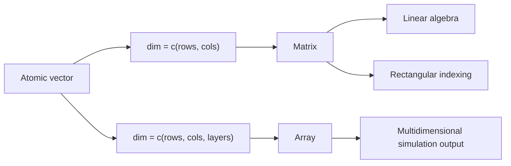

# Matrices and Arrays

Vectors are one-dimensional. Matrices and arrays extend the same atomic-vector storage into two or more dimensions. This matters in R because many mathematical and statistical procedures are naturally rectangular: a data table, a design matrix for regression, an image grid, a covariance matrix, or a simulated result with dimensions for replicate, variable, and parameter.

The book's matrix chapter connects everyday R syntax with linear algebra. A matrix still contains one atomic type, but it has a `dim` attribute that tells R how to arrange the values into rows and columns. Arrays generalize that idea to three or more dimensions. The key mental model is that R stores the values in a vector and layers dimension metadata on top.

## Dimensions laid over an atomic vector

A **matrix** is a two-dimensional atomic object with rows and columns. It is created with `matrix`, `cbind`, `rbind`, or by assigning `dim` to a vector. All elements have the same atomic type.

An **array** is a matrix generalized to more than two dimensions. For example, `array(1:24, dim = c(3, 4, 2))` has 3 rows, 4 columns, and 2 layers.

**Column-major order** means R fills matrices down columns by default. `matrix(1:6, nrow = 2)` produces a first column `1, 2`, second column `3, 4`, and third column `5, 6`.

**Matrix indexing** uses two positions inside brackets: `x[row, column]`. Leaving one side blank selects all rows or all columns. For example, `x[2, ]` selects row 2, and `x[, 3]` selects column 3.

**Matrix multiplication** uses `%*%`, while `*` is element-wise multiplication. This distinction is critical: `A * B` multiplies corresponding entries; `A %*% B` performs linear algebra multiplication where rows of `A` are combined with columns of `B`.

## Construction, coercion, and indexing

Matrix creation is controlled by dimensions and fill direction:

| Function or operator | Purpose | Example |
|---|---|---|
| `matrix(x, nrow, ncol)` | Build a matrix from a vector | `matrix(1:6, nrow = 2)` |
| `byrow = TRUE` | Fill across rows instead of down columns | `matrix(1:6, 2, byrow = TRUE)` |
| `rbind` | Stack rows | `rbind(c(1, 2), c(3, 4))` |
| `cbind` | Bind columns | `cbind(x = 1:3, y = 4:6)` |
| `dim` | Read or set dimensions | `dim(A)` |
| `t` | Transpose | `t(A)` |
| `diag` | Create or extract diagonal | `diag(3)` |
| `solve` | Solve systems or invert matrices | `solve(A, b)` |

For matrix multiplication, the number of columns in the left matrix must equal the number of rows in the right matrix. If $A$ is $m \times n$ and $B$ is $n \times p$, then $AB$ is $m \times p$.

$$
\begin{aligned}
(AB)_{ij} &= \sum_{k=1}^{n} A_{ik}B_{kj}.
\end{aligned}
$$

R's `drop` behavior is a frequent surprise. Selecting one row or one column from a matrix usually drops the matrix structure and returns a vector. Use `drop = FALSE` when the result must remain a matrix, especially inside functions.

Arrays use the same idea with more indices: `x[i, j, k]`. In statistics, arrays are useful for simulation output where one dimension can represent replications, another variables, and another scenarios.

Because a matrix is atomic, combining unlike values applies R's coercion hierarchy. Adding a character column to numeric columns with `cbind` can turn the whole result into a character matrix. A data frame is the appropriate rectangular structure when columns genuinely have different types. `data.matrix` or `model.matrix` can convert selected tabular data to numeric form, but factor and character encoding rules must be checked rather than assumed.

One-index subsetting follows the underlying column-major vector. If `M` has $n$ rows, element $(i,j)$ has linear position

$$
i+(j-1)n.
$$

For a three-row matrix, `M[2, 3]` is therefore `M[8]`. Two-index notation communicates the geometry better, while linear indexing is useful when an algorithm deliberately treats all cells as one vector.

Logical and name indexing work on dimensions as they do on vectors. `M[M < 0] <- 0` uses a logical matrix to replace every negative entry. `M[c("A", "C"), "Feb", drop = FALSE]` selects named rows and one named column. Names reduce positional mistakes, but duplicated names are allowed and can make selection ambiguous. Validate uniqueness when names act as identifiers.

R recycles shorter vectors in many element-wise operations. Subtracting a length-$p$ vector from an $n$ by $p$ matrix does not automatically mean “subtract by column”; recycling follows the column-major underlying vector and may accidentally appear correct. `sweep` states the margin explicitly. It also checks dimensions more clearly than relying on implicit recycling.

## Column-major storage as a map

```text
matrix(1:6, nrow = 2)

       col1 col2 col3
row1     1    3    5
row2     2    4    6

Underlying vector order: 1, 2, 3, 4, 5, 6
Fill path: down first column, down second column, down third column
```



Column-major order aligns R with BLAS and LAPACK conventions used by its linear-algebra routines. Consecutive values in one column are adjacent in memory. Most R code should favor clear vectorized operations over hand-tuned traversal, but storage order explains both `matrix()` filling and why imported row-major binary data may need reshaping or transposition.

Assigning `dim(x) <- c(2, 3)` does not reorder `x`; it changes how the same six values are indexed and printed. Likewise, `as.vector(M)` drops dimensions in column order. Transpose `t(M)` creates the mathematical transpose and a new arrangement; merely swapping the `dim` attribute would reinterpret positions without moving corresponding values and would not compute the transpose.

## Worked example 1: Matrix multiplication by hand and in R

Problem: multiply

$$
A =
\begin{bmatrix}
1 & 2 & 3 \\
4 & 5 & 6
\end{bmatrix},
\quad
B =
\begin{bmatrix}
10 & 20 \\
30 & 40 \\
50 & 60
\end{bmatrix}.
$$

Method:

1. Check dimensions. `A` is $2 \times 3$ and `B` is $3 \times 2$, so multiplication is defined.
2. The result has dimension $2 \times 2$.
3. Compute each entry as a row-column dot product.
4. Verify with `%*%`.

Manual work:

$$
\begin{aligned}
C_{11} &= 1(10) + 2(30) + 3(50) = 220 \\
C_{12} &= 1(20) + 2(40) + 3(60) = 280 \\
C_{21} &= 4(10) + 5(30) + 6(50) = 490 \\
C_{22} &= 4(20) + 5(40) + 6(60) = 640.
\end{aligned}
$$

```r
A <- matrix(1:6, nrow = 2, byrow = TRUE)
B <- matrix(c(10, 20, 30, 40, 50, 60), nrow = 3, byrow = TRUE)

A %*% B
#      [,1] [,2]
# [1,]  220  280
# [2,]  490  640
```

Checked answer: the R result matches the manual dot products. If `A * B` were used instead, R would attempt element-wise multiplication and fail or recycle depending on dimensions; `%*%` is the intended matrix product.

## Worked example 2: Keeping matrix shape during subsetting

Problem: create a 3 by 3 matrix of monthly counts, extract the second column both as a vector and as a one-column matrix, then compute row totals after replacing one value.

Method:

1. Build the matrix with row and column names.
2. Extract `counts[, "Feb"]` and inspect its class/dimensions.
3. Extract `counts[, "Feb", drop = FALSE]`.
4. Replace a known entry using two-dimensional indexing.
5. Use `rowSums` for row totals.

```r
counts <- matrix(
  c(12, 15, 13, 20, 18, 21, 9, 11, 10),
  nrow = 3,
  byrow = TRUE,
  dimnames = list(c("A", "B", "C"), c("Jan", "Feb", "Mar"))
)

counts[, "Feb"]
#  A  B  C
# 15 18 11

counts[, "Feb", drop = FALSE]
#   Feb
# A  15
# B  18
# C  11

counts["C", "Mar"] <- 14
rowSums(counts)
#  A  B  C
# 40 59 34
```

Checked answer: after replacement, row C is `9 + 11 + 14 = 34`. Row A is `12 + 15 + 13 = 40`, and row B is `20 + 18 + 21 = 59`. The `drop = FALSE` extraction keeps the two-dimensional structure, which is useful when downstream code expects a matrix.

## Solving systems without forming an inverse

For $Ax=b$, `solve(A, b)` computes the solution directly. Writing `solve(A) %*% b` first forms an explicit inverse, does more work, and usually accumulates more numerical error. An inverse is appropriate when the inverse itself is the desired mathematical object; solving a system is the usual computational task.

Consider

$$
A=\begin{bmatrix}2&1\\1&3\end{bmatrix},
\qquad
b=\begin{bmatrix}5\\7\end{bmatrix}.
$$

The equations are $2x+y=5$ and $x+3y=7$. From the first, $y=5-2x$. Substitution gives

$$
x+3(5-2x)=7,
$$

so $-5x=-8$, $x=1.6$, and $y=1.8$. In R:

```r
A <- matrix(c(2, 1, 1, 3), nrow = 2)
b <- c(5, 7)
x <- solve(A, b)
stopifnot(isTRUE(all.equal(as.vector(A %*% x), b)))
```

The residual $Ax-b$ should be small, but a small residual alone does not ensure an accurate solution when $A$ is ill-conditioned. `kappa(A)` estimates sensitivity. Nearly dependent columns make some coefficient combinations weakly determined: tiny changes in data can produce large changes in $x$.

Least-squares problems should use `qr.solve`, `lm`, or another factorization-based routine rather than manually computing $(X^TX)^{-1}X^Ty$. Forming $X^TX$ squares the condition number and discards useful rank information. `crossprod(X)` is efficient when the cross-product itself is required, but efficiency does not remove that numerical limitation.

## Standardizing columns with matrix-aware helpers

```r
# Simulate a small matrix of measurements and standardize each column.

measurements <- matrix(
  c(5.1, 3.5, 1.4,
    4.9, 3.0, 1.4,
    6.2, 3.4, 5.4,
    5.9, 3.0, 5.1),
  nrow = 4,
  byrow = TRUE,
  dimnames = list(
    paste0("plant_", 1:4),
    c("sepal_length", "sepal_width", "petal_length")
  )
)

centered <- sweep(measurements, 2, colMeans(measurements), FUN = "-")
standardized <- sweep(centered, 2, apply(measurements, 2, sd), FUN = "/")

print(round(standardized, 2))
print(crossprod(standardized))
```

This code uses two matrix idioms worth knowing. `sweep(measurements, 2, colMeans(measurements), FUN = "-")` subtracts one column mean from each column. The margin value `2` means columns, matching the convention from `apply`. The second `sweep` divides each centered column by its column standard deviation. The result is a standardized matrix where each column is on a comparable scale.

The final call, `crossprod(standardized)`, computes $X^T X$ more directly than `t(standardized) %*% standardized`. Cross-products appear in regression, covariance calculations, principal components, and many numerical algorithms. Even when you do not derive the linear algebra by hand, recognizing the shape helps: if `standardized` has four rows and three columns, then `crossprod(standardized)` has three rows and three columns because it compares columns with columns.

When matrix code fails, inspect `dim()` before inspecting values. Most errors are dimension errors: incompatible matrix multiplication, a dropped dimension after subsetting, or a vector that was expected to be a column matrix. Keeping row and column names during examples also makes output easier to audit because a suspicious value can be traced back to a named observation and variable.

For review, connect every matrix operation to its dimensions. Transpose swaps rows and columns. Element-wise addition requires matching dimensions or a deliberate recycling pattern. Matrix multiplication uses inner dimensions and produces the outer dimensions. Inversion is defined only for square, nonsingular matrices. These rules are often faster to check than the numeric entries themselves, and they prevent using the wrong operator.

Arrays add one more habit: label dimensions conceptually. A three-dimensional simulation result might be `[replicate, variable, scenario]`; a different project might need `[row, column, time]`. R will store both as arrays, but the analyst must remember what each index means. Use `dimnames` when possible because named dimensions make extraction and summaries much easier to audit.

Before leaving a matrix result, run a small plausibility check. Row sums, column sums, diagonal entries, or one hand-computed matrix product entry can reveal transposed inputs and fill-direction mistakes. These checks are not busywork; they are the matrix equivalent of checking a data frame with `head()` after import.

If a matrix is feeding a statistical model, remember that rows normally represent observations and columns represent variables or constructed features. Keeping that convention stable makes later regression and diagnostic pages easier to understand.

## Arrays beyond two dimensions

An array's `dim` vector supplies one extent per axis. If simulation output has dimensions `c(replicate = 1000, variable = 4, scenario = 3)`, an element uses three indices. Naming both dimensions and their levels makes an extraction such as `sim[, "loss", "baseline"]` understandable without a comment. With one variable and one scenario selected, use `drop = FALSE` when later code still expects three axes.

`apply(x, MARGIN, FUN)` keeps the dimensions listed in `MARGIN` and reduces over the others. For a replicate-by-variable-by-scenario array, `apply(sim, c(2, 3), mean)` averages over replicates and returns a variable-by-scenario matrix. `rowSums`, `colSums`, `rowMeans`, and `colMeans` are faster and clearer for their common matrix cases.

`aperm` permutes axes. It is the multidimensional counterpart of transpose: `aperm(x, c(3, 1, 2))` makes the old third dimension first, then the old first and second. This matters when an external library expects a different axis convention, such as samples-first versus channels-first. Always write down old and new dimension meanings; matching extents do not prove axes are semantically aligned.

Arrays can store repeated model or simulation output compactly, but not every collection is rectangular. If scenarios return different numbers of events or different model objects, a list is more honest than padding an array with many missing cells. Arrays work best when every position has the same type and each axis has a stable interpretation.

## Shape and numerical mistakes

- Expecting `matrix(1:6, nrow = 2)` to fill by row. R fills by column unless `byrow = TRUE`.
- Using `*` when matrix multiplication requires `%*%`.
- Forgetting `drop = FALSE` when extracting a single row or column for code that still expects a matrix.
- Trying to put mixed types in a matrix. A matrix is atomic, so mixing numbers and text coerces everything to a common type.
- Solving a singular or nearly singular system with `solve` without checking whether the matrix is invertible or ill-conditioned.
- Losing dimension names during transformations and then relying on positional indexing.
- Depending on silent vector recycling to perform row- or column-wise arithmetic.
- Computing an explicit inverse when only a linear-system solution is needed.
- Treating a small residual as proof that an ill-conditioned system has stable coefficients.
- Permuting array axes without carrying their semantic names along.

## Related pages

- [Vectors, arithmetic, and comparison](/cs/programming/r/vectors-arithmetic-comparison)
- [Indexing, names, and recycling](/cs/programming/r/indexing-names-recycling)
- [Apply family](/cs/programming/r/apply-family)
- [Linear and generalized models](/cs/programming/r/linear-and-generalized-models)
