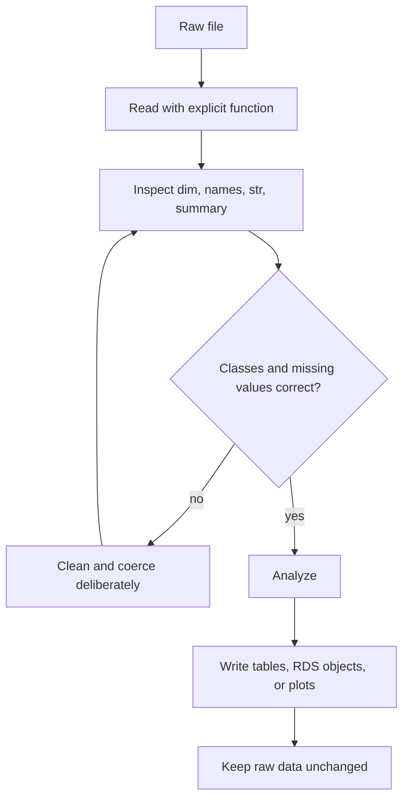

# Reading and Writing Data

Analysis begins when data enters R as an object with known columns, classes, and missing-value conventions. The details vary across text tables, spreadsheet workbooks, serialized R objects, web files, and graphics output, but the same discipline applies: know the path and format, inspect what was imported, and save results for their next use.

Keep raw input separate from derived output. Scripts should read unchanged source files, perform explicit cleaning steps, and write cleaned data, tables, plots, or serialized objects to predictable locations. That separation keeps the analysis reproducible and makes errors traceable.

## Choosing an interchange or storage format

A **CSV file** is comma-separated text, commonly read with `read.csv()` and written with `write.csv()`. More generally, a **delimited text file** stores rows as lines and separates columns with commas, tabs, semicolons, pipes, or another delimiter. `read.table()` is the flexible base R reader, while `read.delim()` is a tab-delimited convenience wrapper.

An **Excel workbook** is a spreadsheet file such as `.xlsx`. Base R does not read that format directly; packages such as `readxl` are commonly used.

R also has formats that preserve its own classes and attributes. An **RData** file stores one or more named objects: `save()` writes them and `load()` restores them into an environment. An **RDS** file stores a single object without fixing its name, so `saveRDS()` and `readRDS()` tend to be clearer in scripts.

| Format | Read function | Write function | Preserves R classes well? | Good use |
|---|---|---|---|---|
| CSV | `read.csv` | `write.csv` | Partly | Exchange with spreadsheets and other tools |
| Tab-delimited | `read.delim` | `write.table` | Partly | Plain-text data transfer |
| Excel `.xlsx` | `readxl::read_excel` | `writexl::write_xlsx` or another package | Partly | Spreadsheet collaboration |
| RData | `load` | `save` | Yes | Multiple R objects |
| RDS | `readRDS` | `saveRDS` | Yes | One object with explicit assignment |
| Image/PDF plot | Not usually read as data | `png`, `pdf`, `jpeg` | Not data | Reports and figures |

Choose according to the next consumer. CSV exchanges rectangular data with non-R tools but loses some R-specific classes and attributes. RDS preserves one object inside an R workflow. RData handles several objects but may populate the current environment with names that are not obvious from the call. Plot files are generated output and should be reproducible from code.

## Inspecting an import before analysis

Import arguments should document the file's conventions. CSV parsing can fail when a file uses a non-comma delimiter, decimal commas, embedded commas in quoted strings, unusual missing codes, or inconsistent headers. Set `sep`, `header`, `na.strings`, `stringsAsFactors`, or `colClasses` when the defaults do not match.

After reading a file, inspect both its shape and its column types:

```r
dim(dat)
names(dat)
str(dat)
summary(dat)
head(dat)
```

The checks fit into a short import loop:



| Checkpoint | Command | Failure it catches |
|---|---|---|
| File exists | `file.exists(path)` | Wrong working directory or path |
| Row/column shape | `dim(dat)` | Header parsed as data, delimiter wrong |
| Column names | `names(dat)` | Unexpected names or duplicates |
| Column classes | `str(dat)` | Numeric data imported as character |
| Missing values | `colSums(is.na(dat))` | Unrecognized missing-value codes |

### Declaring missing codes and factor levels

This small CSV records patient id, group, and response, with `.` used for a missing response. Declaring that code during import prevents it from becoming an ordinary string. The group levels are then set explicitly before calculating means.

```r
txt <- "id,group,response
1,control,5.1
2,treated,6.3
3,control,.
4,treated,6.9"

dat <- read.csv(textConnection(txt), na.strings = ".")
dat$group \lt - factor(dat$group, levels = c("control", "treated"))

str(dat)
# 'data.frame': 4 obs. of  3 variables:
#  $ id      : int  1 2 3 4
#  $ group   : Factor w/ 2 levels "control","treated": 1 2 1 2
#  $ response: num  5.1 6.3 NA 6.9

aggregate(response ~ group, data = dat, FUN = mean, na.rm = TRUE)
#     group response
# 1 control      5.1
# 2 treated      6.6
```

The treated mean is `(6.3 + 6.9) / 2 = 6.6`. The control group has one observed value, 5.1, because the other response is missing. This is a realistic import policy despite the small sample: missing codes are declared at the boundary, then class choices are made explicitly.

## Round-tripping an R object and writing a plot

A **graphics device** is an output target for plotting. The interactive plot pane is one device; `png()`, `pdf()`, and similar functions open file devices. Plot commands run while the device is open, and `dev.off()` closes and completes the file.

The following code creates a subset of `mtcars`, verifies an RDS round trip, and writes a PNG scatterplot:

```r
cars <- mtcars[, c("mpg", "wt", "hp", "cyl")]
cars$model <- rownames(mtcars)

tmp_rds <- tempfile(fileext = ".rds")
tmp_png <- tempfile(fileext = ".png")

saveRDS(cars, tmp_rds)
cars2 <- readRDS(tmp_rds)

identical(cars, cars2)
# [1] TRUE

png(tmp_png, width = 700, height = 500)
plot(cars2$wt, cars2$mpg, pch = 19, xlab = "Weight", ylab = "MPG")
dev.off()
```

`identical(cars, cars2)` returning `TRUE` confirms that the object survived serialization unchanged. A project script would replace the temporary filenames with stable paths such as `"data/clean/cars.rds"` and `"figures/mpg_vs_weight.png"`. If `dev.off()` is omitted, a file graphics device can remain incomplete or locked until the session ends.

`load("file.RData")` behaves differently: it creates objects in the current environment and invisibly returns their names. RDS makes the destination explicit:

```r
clean_data <- readRDS("clean_data.rds")
```

## A reusable import report

For repeated rectangular imports, a compact checker can return dimensions, names, class and missingness summaries, and a preview as structured data:

```r
check_import <- function(df) {
  stopifnot(is.data.frame(df))
  report <- data.frame(
    variable = names(df),
    class = vapply(df, function(x) paste(class(x), collapse = "/"), character(1)),
    missing = vapply(df, function(x) sum(is.na(x)), integer(1)),
    unique_values = vapply(df, function(x) length(unique(x)), integer(1)),
    row.names = NULL
  )
  list(
    dimensions = dim(df),
    names = names(df),
    report = report,
    preview = head(df)
  )
}

txt <- "site,count,status
A,10,ok
B,.,check
C,15,ok"

example <- read.csv(textConnection(txt), na.strings = ".")
print(check_import(example))
```

Returning a list keeps each result available for later work. `dimensions` can be compared with an expected shape, `report` can be written to a quality-control file, and `preview` can be shown interactively.

For a larger project, keep a small data dictionary beside the import code. Record each column's intended class, units, allowed missing codes, and factor levels. The import can then verify that numeric columns are numeric, categories have expected levels, and dates do not produce unexpected `NA` values.

## Paths and failure modes

A script that reads `"mydata.csv"` depends on the working directory. A path such as `"data/raw/mydata.csv"` inside an RStudio project states more of its context. A common layout separates `data/raw`, `data/clean`, `figures`, and `results`: source material remains read-only, while every other directory contains reproducible outputs.

Several details deserve an explicit check:

- Confirm paths with `getwd()` and `file.exists(path)` before diagnosing the parser.
- List every missing code, including variants such as `"."`, `"NA "`, and `"-99"`, rather than letting them become ordinary data.
- Inspect `str()`; printed numeric-looking values may still be character columns.
- Keep scripts and raw inputs rather than relying on a saved `.RData` workspace as the only record of an analysis.
- Use `row.names = FALSE` when writing CSV files for consumers that do not expect an extra row-name column.
- Record Excel package dependencies and specify the sheet name or number.
- Close each file graphics device with `dev.off()`.

Cleaning should write a new file or object instead of overwriting the raw input. When an assumption changes, the script can then be rerun from the original evidence.

<div className="see-also">

See also: [Getting started with R](/cs/programming/r/getting-started-rstudio-packages) · [Special values, classes, and coercion](/cs/programming/r/special-values-classes-coercion) · [Lists and data frames](/cs/programming/r/lists-and-data-frames) · [Base graphics](/cs/programming/r/base-graphics)

</div>
