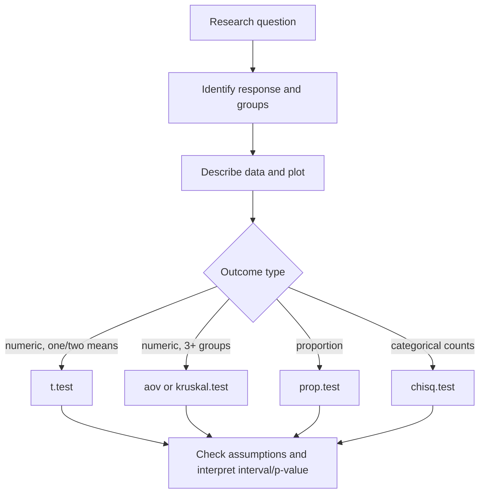

# Statistical Inference

Statistical inference uses sample data to make statements about a population or data-generating process. R supplies standard tests as functions, but the call comes after the study question, descriptive checks, assumptions, null and alternative hypotheses, and choice of statistic. Interpretation should return to the scale of the data rather than stop at "significant" or "not significant."

## Matching the question to a procedure

A **parameter** is a population quantity such as a mean $\mu$, proportion $p$, or regression slope $\beta_1$. An **estimator** is a sample-based rule for estimating it, such as the sample mean $\bar{x}$. The outcome type, number of groups, and study design narrow the choice of procedure:



| Question | Function | Typical formula or arguments |
|---|---|---|
| One mean | `t.test(x, mu = ...)` | Numeric vector |
| Two means | `t.test(y ~ group, data = ...)` | Numeric response, two groups |
| Paired mean difference | `t.test(before, after, paired = TRUE)` | Matched vectors |
| One or two proportions | `prop.test(x, n)` | Success counts and trial counts |
| Categorical goodness of fit | `chisq.test(table)` | One-way count table |
| Categorical association | `chisq.test(table(a, b))` | Two-way table |
| One-way ANOVA | `aov(y ~ group, data = ...)` | Numeric response, factor group |
| Nonparametric group comparison | `kruskal.test(y ~ group, data = ...)` | Rank-based alternative |

The same output terms recur across procedures:

| Output item | Meaning | Bad interpretation |
|---|---|---|
| Estimate | Sample-based effect size | Proof of population value |
| Confidence interval | Plausible parameter range | Probability parameter is inside after seeing data |
| p-value | Tail probability under null | Probability null is true |
| Test statistic | Standardized evidence measure | Effect size by itself |

A **confidence interval** comes from a procedure with a long-run coverage rate. Under its assumptions, a 95 percent procedure captures the true parameter in about 95 percent of repeated samples. A **p-value** is the probability, assuming the null hypothesis and model assumptions, of obtaining a test statistic at least as extreme as the observed one. It is not the probability that the null hypothesis is true.

## Estimating and testing one mean

For a one-sample t interval,

$$
\begin{aligned}
\bar{x} \pm t_{\alpha/2, n - 1}\frac{s}{\sqrt{n}}.
\end{aligned}
$$

The procedure assumes independent observations and, for a small sample, roughly normal data or at least no severe outliers. A two-sample t test also requires independent groups unless it is explicitly paired. R uses Welch's unequal-variance version by default.

Consider six reaction times in seconds: `0.48`, `0.52`, `0.51`, `0.49`, `0.55`, and `0.50`. The hypotheses are $H_0: \mu = 0.50$ and $H_A: \mu \ne 0.50$.

```r
rt <- c(0.48, 0.52, 0.51, 0.49, 0.55, 0.50)

mean(rt)
# [1] 0.5083333

sd(rt)
# [1] 0.02483277

t.test(rt, mu = 0.50)
# One Sample t-test
# t = 0.82158, df = 5, p-value = 0.4487
# 95 percent confidence interval:
#  0.4822657 0.5344009
# sample estimates:
# mean of x
# 0.5083333
```

The sample mean is $3.05 / 6 = 0.5083333$. The confidence interval includes 0.50 and the p-value is about 0.449, so this small sample supplies little evidence that the population mean differs from 0.50 seconds. The result does not establish that the mean equals 0.50; the observations are compatible with that value under the model and sample size.

## Testing association in a count table

A **null hypothesis** $H_0$ is the default claim under test, while an **alternative hypothesis** $H_A$ is the competing claim. For a chi-square association test, the null says that the two categorical variables are independent.

Suppose a survey records interface theme preference by user type:

```r
theme_counts <- matrix(
  c(35, 20,
    15, 30),
  nrow = 2,
  byrow = TRUE,
  dimnames = list(
    user = c("beginner", "advanced"),
    theme = c("light", "dark")
  )
)

theme_counts
#           theme
# user       light dark
# beginner      35   20
# advanced      15   30

test <- chisq.test(theme_counts)
test$expected
#           theme
# user       light dark
# beginner    27.5 27.5
# advanced    22.5 22.5

test$p.value
# [1] 0.002699796
```

Under independence, each row would be expected to split 27.5 and 27.5. Instead, beginners choose light more often than expected and advanced users choose dark more often than expected. The p-value of about 0.0027 is evidence of association, but the test does not explain its cause.

Expected counts and dependence in the study design matter. The chi-square approximation can be poor with small expected counts, and repeated observations from the same person are not independent. Warnings about approximation quality are part of the result.

## Comparing two groups without hiding the descriptives

The following helper returns group summaries alongside a Welch two-sample t test:

```r
compare_two_groups <- function(df, response, group) {
  y <- df[[response]]
  g <- factor(df[[group]])
  if (nlevels(g) != 2) stop("group must have exactly two levels")
  if (!is.numeric(y)) stop("response must be numeric")

  descriptive <- aggregate(y, list(group = g), function(x) {
    c(n = length(x), mean = mean(x), sd = sd(x))
  })
  names(descriptive)[2] <- response

  test <- t.test(y ~ g)
  list(
    descriptive = descriptive,
    estimate = test$estimate,
    conf_int = test$conf.int,
    p_value = test$p.value
  )
}

iris2 <- subset(iris, Species != "virginica")
print(compare_two_groups(iris2, "Sepal.Length", "Species"))
```

The group counts, means, and standard deviations describe the sample; the test adds an interval and p-value for the comparison. A severe sample-size imbalance or outlier in the descriptive output would call for closer scrutiny before interpreting the test.

In the formula `y ~ g`, the numeric response is on the left and a two-level group is on the right. Welch's default does not assume equal variances, but it still assumes independent observations and a response scale on which comparing means is meaningful. The helper also expects complete values; missing-data handling should be made explicit before calling it.

## Writing the claim the output supports

An inference statement should identify the population or process, estimate, interval, and p-value when relevant. For example: "In this sample, setosa had a lower mean sepal length than versicolor; the Welch interval for the difference excludes zero." That says more than reporting significance alone.

A useful reading order is parameter, estimate, uncertainty, assumptions, and conclusion. The parameter identifies the population quantity. The estimate records what the sample suggests. An interval or test statistic describes uncertainty. The assumptions set the conditions under which the procedure is trustworthy. The conclusion translates those pieces into the original question.

ANOVA follows the same discipline for more than two group means. It partitions variation into between-group and within-group components. A significant result indicates that at least one group mean differs; identifying particular pairs requires follow-up comparisons and attention to multiplicity.

## Error rates, power, and overclaiming

**Type I error** is rejection of a true null hypothesis. **Type II error** is failure to reject a false null hypothesis. **Power** is the probability of rejecting a false null. These concepts matter during study planning: a small study may miss an important effect, while a very large one may detect a negligible effect. Effect size and practical importance should therefore be reported separately from statistical significance.

Common overclaims have recognizable forms:

- A p-value is treated as the probability that the null hypothesis is true.
- A test is run before the data are plotted or summarized.
- Independence, paired structure, outliers, or expected cell counts are ignored.
- Only "significant" or "not significant" is reported, without an effect size or interval.
- Multiple tests are interpreted without considering multiplicity.
- A nonsignificant result, especially from a small sample, is presented as proof of no effect.
- A significant ANOVA is described as if it identified the differing groups.

<div className="see-also">

See also: [Descriptive statistics](/cs/programming/r/descriptive-statistics) · [Probability distributions](/cs/programming/r/probability-distributions) · [Base graphics](/cs/programming/r/base-graphics) · [Linear and generalized models](/cs/programming/r/linear-and-generalized-models)

</div>
