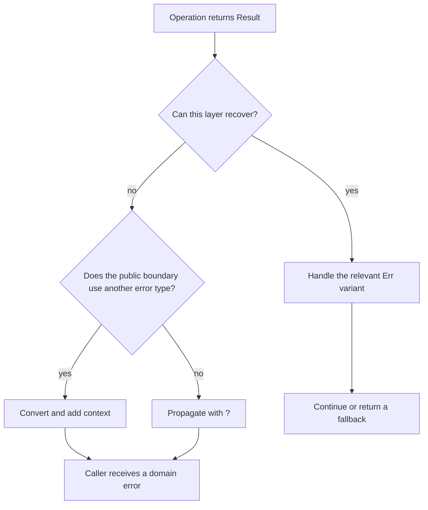

# Error Handling

Rust separates failures that callers can reasonably respond to from failures that mean the program's assumptions have already broken. Recoverable failures use `Result<T, E>`; violated invariants usually use `panic!`, assertions, or an explicit process exit at the application boundary. The distinction is about policy, not severity. A missing configuration file may be recoverable for an interactive program and fatal for a batch job, while an impossible internal state remains a bug in both.

## The error decision belongs high enough in the call stack

A file-reading helper cannot know whether a missing file should be created, reported, retried, or ignored. Returning `Result<String, io::Error>` leaves that decision to code with more context. Each layer should repair the failure it understands, add useful context and propagate it, or translate it into its own public error vocabulary.



The standard enum is ordinary Rust data:

```rust
enum Result<T, E> {
    Ok(T),
    Err(E),
}
```

Pattern matching therefore gives complete control over both outcomes. Combinators such as `map`, `and_then`, and `unwrap_or_else` are compact expressions of common matches; they are not a separate exception mechanism.

| Form | Success path | Failure path | Good fit |
|---|---|---|---|
| `match` | explicit branch | explicit branch | recovery depends on the error variant |
| `?` | unwraps `Ok` | returns early after conversion | a caller should decide |
| `map` | transforms the value | preserves the error | only the success value changes |
| `map_err` | preserves the value | transforms the error | crossing an API boundary |
| `unwrap_or` | uses the value | computes or supplies a fallback | every failure has the same harmless fallback |
| `expect` | unwraps the value | panics with a message | an established invariant or a test |

## What a panic promises

`panic!` says that normal execution cannot continue along the current path. Bounds checks, failed assertions, and `unreachable!` are common panic sites because reaching them indicates a programming error or a broken invariant. A panic is not the Rust equivalent of a checked exception and should not carry routine control flow.

The compilation profile chooses one of two broad panic strategies. With unwinding, Rust walks back through stack frames and drops local values. With aborting, the process ends immediately and no unwinding cleanup occurs. Neither strategy is a recovery interface for library callers. Code that must release an external resource reliably should use ownership and `Drop`, while code requiring process-wide recovery needs an explicit architectural boundary.

`unwrap` and `expect` are concise panic adapters. They are reasonable when a preceding check proves success, in tests where failure should fail the test, and during a short experiment. `expect` should explain the invariant rather than repeat the underlying operation:

```rust
let home = std::env::var("HOME")
    .expect("HOME must be set by the launcher");
```

For a reusable library, panicking because a user-supplied path is absent takes the policy decision away from the caller. Indexing a slice has the same distinction: use `values[index]` when an invalid index is a bug, and `values.get(index)` when absence is an expected possibility.

## Worked example: open a file, create only when absent

Suppose an application needs `settings.txt`. An absent file should be initialized, but a permissions error must remain an error. Treating every `File::open` failure as absence would hide the difference.

```rust
use std::fs::{File, OpenOptions};
use std::io::{self, ErrorKind, Write};

fn open_settings(path: &str) -> Result<File, io::Error> {
    match OpenOptions::new().read(true).write(true).open(path) {
        Ok(file) => Ok(file),
        Err(error) if error.kind() == ErrorKind::NotFound => {
            let mut file = OpenOptions::new()
                .read(true)
                .write(true)
                .create_new(true)
                .open(path)?;
            file.write_all(b"theme=light\n")?;
            Ok(file)
        }
        Err(error) => Err(error),
    }
}
```

Follow the two main executions step by step.

1. If the file exists and is readable, `open` returns `Ok(file)`. The first arm returns that handle without changing the file.
2. If the operating system reports `NotFound`, the guard selects the second arm. `create_new(true)` requests atomic creation and fails if another process creates the path first.
3. The first `?` returns a creation error immediately. It does not turn a permission failure into a panic.
4. After creation, `write_all` either writes the entire default document or propagates its I/O error.
5. Any original error other than `NotFound` reaches the final arm unchanged. The caller can still inspect its `ErrorKind`.

There is a race between the first failed open and creation. `create_new` handles it safely by refusing to overwrite a file that appeared in between. A caller may choose to retry the initial open after an `AlreadyExists` creation error. Whether that retry is desirable depends on the application, so the helper does not silently invent it.

## `?` is early return plus conversion

The `?` operator keeps the successful path linear. For a `Result`, it extracts the `Ok` value. On `Err`, it returns from the enclosing function after converting the error with `From` when necessary. Conceptually, though not as an exact macro expansion, `operation()?` behaves like:

```rust
match operation() {
    Ok(value) => value,
    Err(error) => return Err(From::from(error)),
}
```

The enclosing function must return a compatible type. A function returning `Result<_, AppError>` can use `?` on `Result<_, io::Error>` only when `AppError` implements `From<io::Error>`. The same operator works with `Option`: it extracts `Some` and returns `None` early. It does not automatically cross from `Option` to `Result`; `ok_or` or `ok_or_else` states which error absence should become.

```rust
fn first_number(text: &str) -> Result<i32, &'static str> {
    let token = text.split_whitespace().next().ok_or("input was empty")?;
    token.parse().map_err(|_| "first token was not an integer")
}
```

Here absence and invalid syntax are different failures. The conversions preserve that distinction even though the small example uses static strings.

## Worked example: a domain error with two sources

A configuration loader may fail while reading a file or while parsing a port. Exposing only `io::Error` cannot describe the second case, and returning a bare `String` loses structured causes. A small enum keeps the public states explicit.

```rust
use std::error::Error;
use std::fmt;
use std::fs;
use std::num::ParseIntError;

#[derive(Debug)]
enum ConfigError {
    Read(std::io::Error),
    InvalidPort(ParseIntError),
    MissingPort,
}

impl fmt::Display for ConfigError {
    fn fmt(&self, f: &mut fmt::Formatter<'_>) -> fmt::Result {
        match self {
            Self::Read(_) => write!(f, "could not read configuration"),
            Self::InvalidPort(_) => write!(f, "port was not an unsigned integer"),
            Self::MissingPort => write!(f, "configuration had no port entry"),
        }
    }
}

impl Error for ConfigError {
    fn source(&self) -> Option<&(dyn Error + 'static)> {
        match self {
            Self::Read(error) => Some(error),
            Self::InvalidPort(error) => Some(error),
            Self::MissingPort => None,
        }
    }
}

impl From<std::io::Error> for ConfigError {
    fn from(error: std::io::Error) -> Self { Self::Read(error) }
}

impl From<ParseIntError> for ConfigError {
    fn from(error: ParseIntError) -> Self { Self::InvalidPort(error) }
}

fn load_port(path: &str) -> Result<u16, ConfigError> {
    let text = fs::read_to_string(path)?;
    let value = text
        .lines()
        .find_map(|line| line.strip_prefix("port="))
        .ok_or(ConfigError::MissingPort)?;
    Ok(value.trim().parse()?)
}
```

For a file containing `name=demo` followed by `port=8080`, the read succeeds, `find_map` skips the first line, `strip_prefix` extracts `8080`, and `parse` produces `8080u16`. The function returns `Ok(8080)`.

For `port=eighty`, the read and lookup still succeed. `parse` returns `ParseIntError`; the final `?` invokes `ConfigError::from`, producing `InvalidPort`. A nonexistent path follows the other `From` implementation and becomes `Read`. `Display` supplies a stable outer message, while `source` retains the lower-level cause for diagnostics. Code can match the enum variants without parsing text.

The enum can grow when callers need another meaningful distinction. It should not mirror every internal operation. If two internal parsing failures have the same recovery policy, one public variant may be enough.

## Error types are part of an API

Applications and libraries often want different outer error types. A binary's `main` may return `Result<(), Box<dyn Error>>` when its only policy is to report any error and exit. Dynamic dispatch is acceptable there because no caller needs to exhaustively inspect variants. A library usually gains more from a concrete enum: callers can retry an I/O case, reject malformed input, or display their own message.

Converting errors to strings too early removes the source type and any structured fields. Logging and returning the same error at every layer also produces duplicated diagnostics. A useful division is:

- leaf code returns the specific failure it encounters;
- intermediate code converts it when crossing a domain boundary and adds information the lower layer could not know;
- the application boundary chooses presentation, logging, and exit status.

Standard output and standard error should remain separate in command-line programs. Results intended for a pipe go through `println!`; diagnostics go through `eprintln!`. A process that reports failure should also return a nonzero exit status, either by returning an error from `main` or by calling `std::process::exit` after printing a controlled message.

## Errors that compile but communicate poorly

- `unwrap` in a parsing library converts user input into a process-ending bug report. Return the parsing error or a domain variant instead.
- `unwrap_or(default)` treats every error alike. It is suitable only when all errors genuinely permit the same fallback; it can otherwise hide permissions failures and corrupted data.
- A catch-all `Err(_)` discards information. It is fine when the policy truly ignores every error, but suspicious around I/O or persistence.
- Error text should add context not already obvious from the source. “Could not load profile `alice`” helps; wrapping “No such file” in another “I/O error” contributes little.
- Assertions should check programmer-controlled invariants. Invalid network input and missing user files are normal environmental states, even when the program cannot proceed.
- A `Result` marked `must_use` should be handled, propagated, or deliberately assigned to `_`. Silently dropping a write error can lose data.

## Combinators without unreadable chains

`Result` and `Option` provide adapters for small transformations. `map` changes only a successful value, `map_err` changes only an error, and `and_then` sequences a second fallible operation. Their usefulness comes from keeping a short data flow in one expression. Once recovery has several branches or needs intermediate names, a `match` is usually clearer.

Consider parsing a positive timeout:

```rust
#[derive(Debug, PartialEq)]
enum TimeoutError {
    Missing,
    NotANumber,
    Zero,
}

fn parse_timeout(input: Option<&str>) -> Result<u64, TimeoutError> {
    input
        .ok_or(TimeoutError::Missing)
        .and_then(|text| text.parse().map_err(|_| TimeoutError::NotANumber))
        .and_then(|seconds| {
            if seconds == 0 {
                Err(TimeoutError::Zero)
            } else {
                Ok(seconds)
            }
        })
}
```

For `Some("30")`, `ok_or` produces `Ok("30")`; the first `and_then` parses it to `Ok(30)`; the second verifies that it is nonzero. For `None`, `ok_or` produces `Missing` and neither closure runs. For `Some("fast")`, parsing produces `NotANumber` and the range check is skipped. The chain works because each stage has one narrow responsibility and all stages share the same final error type.

Several similarly named methods differ in when they evaluate fallback work. `unwrap_or(value)` evaluates `value` before the call, while `unwrap_or_else(closure)` calls the closure only on failure. `ok_or(error)` eagerly constructs the error; `ok_or_else` delays construction. The lazy forms matter when computing a default allocates, logs, reads another file, or otherwise has observable cost. For a constant enum variant, the eager form is simpler.

## Reporting, testing, and preserving evidence

Tests should assert the error category that callers depend on, not the exact wording of an operating-system message. The latter may vary by platform. A unit test for the timeout parser can state the contract directly:

```rust
assert_eq!(parse_timeout(None), Err(TimeoutError::Missing));
assert_eq!(parse_timeout(Some("0")), Err(TimeoutError::Zero));
assert_eq!(parse_timeout(Some("15")), Ok(15));
```

For filesystem code, create an isolated temporary location through the test framework or a small fixture directory and assert the observable result. Tests that rely on a developer's current directory, home directory, or existing permissions tend to fail for reasons unrelated to the error policy.

Errors should normally be formatted only at the outer boundary. `Display` is for a concise user-facing description; `Debug` may include variant names and internal fields useful to a developer. The `Error::source` chain permits a reporter to print both levels without flattening them. A top-level diagnostic might therefore say that configuration loading failed, followed by an I/O cause from the operating system. The inner source retains details such as the error kind and raw OS code.

Retries deserve a separate decision. Only transient failures should be retried, and a retry loop needs a limit or cancellation path. Repeating a parse after invalid syntax cannot change the outcome. Repeating a network operation may duplicate a request unless the operation is idempotent. The presence of `Result` identifies failure in the type; it does not decide whether another attempt is safe.

Panic catching through `std::panic::catch_unwind` exists, but it is a narrow containment tool rather than general error handling. Not every value is unwind-safe, aborting profiles cannot be caught, and foreign-function boundaries have their own rules. Ordinary expected failures remain clearer as typed results.

Good error boundaries preserve the facts needed for the next decision.

<div className="see-also">

See also: [Pattern matching](/cs/programming/rust/pattern-matching) · [I/O project: minigrep](/cs/programming/rust/io-project-minigrep) · [Generics, traits, and lifetimes](/cs/programming/rust/generics-traits-lifetimes) · [Automated tests](/cs/programming/rust/automated-tests) · [Packages, crates, and modules](/cs/programming/rust/packages-crates-modules)

</div>
